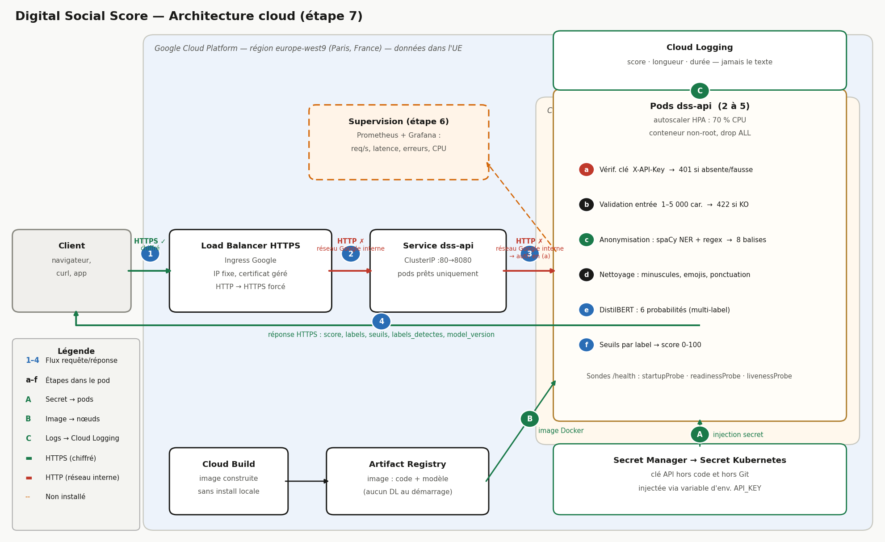
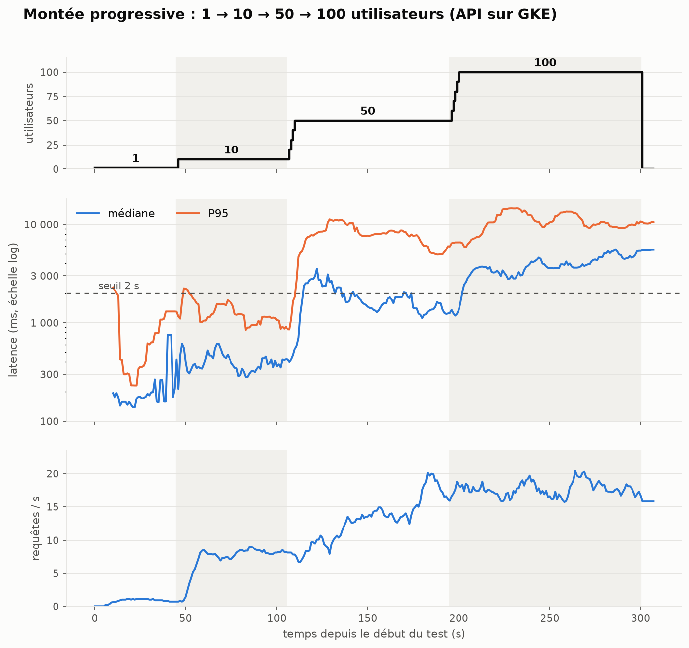
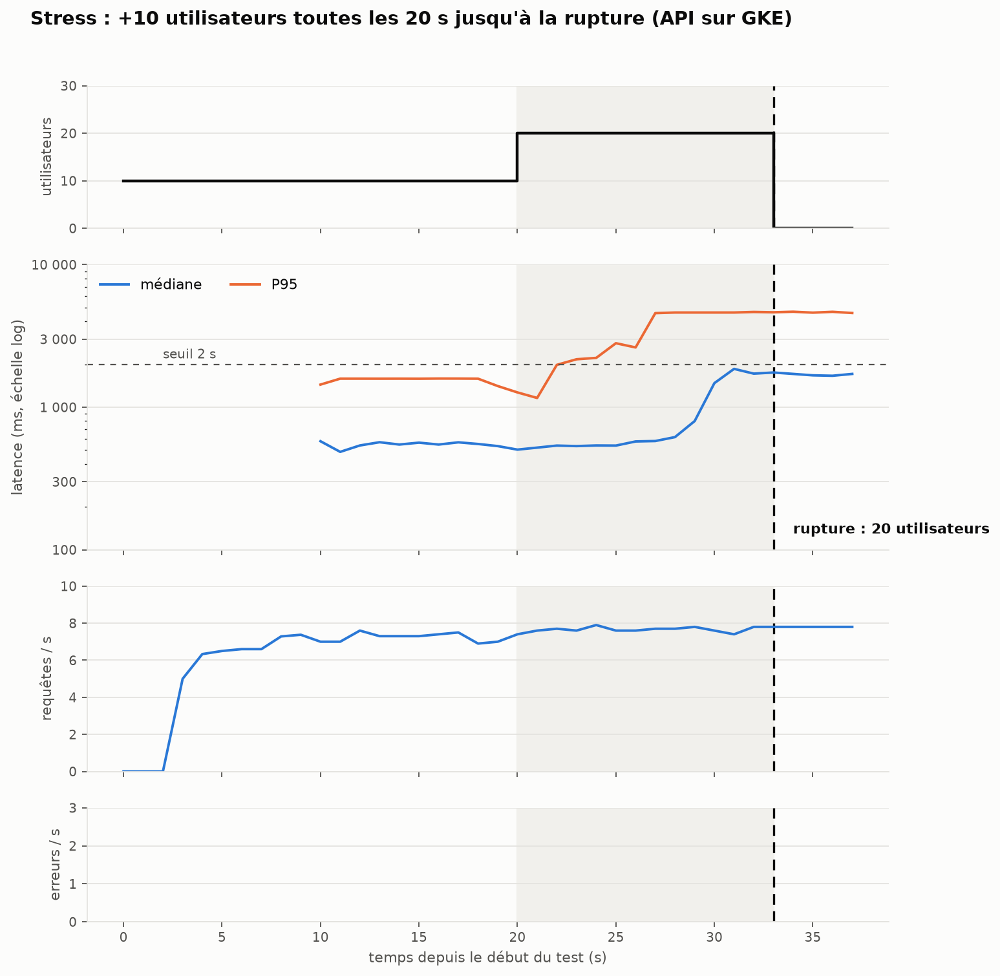
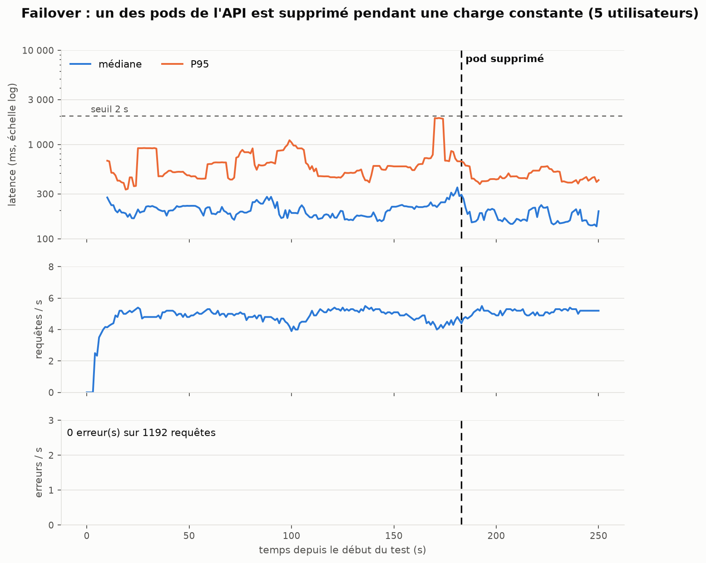

# Digital Social Score — choix et justifications

API qui note la toxicité d'un commentaire de 0 à 100, en protégeant les données personnelles (RGPD). Ce document explique **pourquoi** chaque choix a été fait, ce que les chiffres montrent, et ce qui reste faible.

Données : *Toxic Comment Classification Dataset* (commentaires de pages de discussion Wikipédia ; colonne `comment_text` + 6 labels : toxic, severe_toxic, obscene, threat, insult, identity_hate).

**Chaîne de traitement :** anonymisation → nettoyage → modèle → 6 probabilités → seuils par label → score 0-100.

| Étape                          | Notebook / code                               |
| ------------------------------- | --------------------------------------------- |
| 1. Anonymisation                | [anonyme_2.ipynb](notebooks/anonyme_2.ipynb)   |
| 2. Nettoyage                    | [clean_text.ipynb](notebooks/clean_text.ipynb) |
| 3. Entraînement et comparaison | [train.ipynb](notebooks/train.ipynb)           |
| 4. API et front                 | `api/`, `front/index.html`                |

---

## 1. Anonymisation

### 1.1 Méthode retenue

- **Regex** pour ce qui a un format fixe : email, téléphone, URL, IP, pseudo (`@x`, `User:x`), adresse précise.
- **NER spaCy** (`en_core_web_sm`) pour les noms de personnes (`PERSON`) et d'organisations (`ORG`).
- Chaque élément est remplacé par une balise typée (`personne_tag`, `email_tag`, `ip_tag`…). Le regex est prioritaire sur le NER.

### 1.2 Pourquoi ces choix

| Choix                                       | Justification                                                                                                                                 | Limite assumée                                                  |
| ------------------------------------------- | --------------------------------------------------------------------------------------------------------------------------------------------- | ---------------------------------------------------------------- |
| Regex pour les formats fixes                | Fiable, déterministe, rapide.                                                                                                                | Ne trouve que ce qui respecte un format.                         |
| NER pour les noms propres                   | Pas de format fixe : il faut le contexte.                                                                                                     | Faux positifs sur le jargon Wikipédia.                          |
| `en_core_web_sm` (petit modèle)          | ≈ 3 ms/commentaire : 310 000 lignes en ≈ 20 min sur un poste standard.                                                                      | Moins précis que `md`, `lg`, `trf`.                       |
| Seulement `PERSON` et `ORG`             | Ce sont elles qui identifient une personne ou son employeur.                                                                                  | Les `ORG` sont la source de faux positifs.                     |
| **Lieux non masqués** (villes, pays) | Non identifiants seuls ; un propos haineux peut viser un pays. Les masquer retirait du signal et créait des faux positifs (`US`, `POV`). | Risque faible de ré-identification par recoupement.             |
| **Mots toxiques non masqués**        | C'est le signal que le modèle doit apprendre. Ils sont retirés des entités NER avant masquage.                                             | Une insulte déformée (`m0ron`) peut être prise pour un nom. |
| Adresse précise masquée, ville conservée | Une adresse identifie un foyer, une ville non.                                                                                                | Formats FR/UK/US seulement.                                      |
| Balises typées plutôt que suppression     | Garde la structure de la phrase et le type d'information.                                                                                     | Révèle qu'une entité existait.                                |
| Un seul passage sur le texte original       | Évite les décalages de positions entre remplacements.                                                                                       | —                                                               |

### 1.3 Corrections après lecture des sorties

Le NER masquait trop : insultes prises pour des noms (`moron` ×202), jargon (`Wikipedia` ≈ 19 % des ORG, `UTC`, `POV`), personnalités publiques (`Hitler`), mots courants (`hi` ×189). Corrections : listes de filtrage, règle « un mot isolé en minuscules n'est pas un nom », motif IPv4 corrigé (≈ 1 100 IP non masquées), faux positifs d'adresse retirés (années, `Way`, `Place`). Résultat sur un échantillon de 20 000 lignes : 1,45 balise par commentaire (contre 1,93) ; aucune insulte masquée par le NER.

### 1.4 Ce que l'anonymisation ne garantit pas

- Aucun jeu annoté à la main : **pas de précision/rappel chiffrés** pour l'anonymisation. Décision du groupe.
- Cas non couverts constatés en test : adresse avec nom de rue en minuscules (« 13 rue pierre 75000 Paris »), numéro à 9 chiffres, pseudos sans préfixe `User:` ou `@`.
- Les listes de filtrage sont faites à la main, donc non exhaustives.

**Conclusion honnête : c'est de la pseudonymisation / minimisation, pas une anonymisation garantie.** Le texte original reste public sur Wikipédia, donc un auteur peut être ré-identifié par recoupement.

---

## 2. Nettoyage

Minuscules → suppression des emojis → suppression de la ponctuation (`[^\w\s]`) → espaces ramenés à un seul.

- **Pourquoi :** réduire le vocabulaire pour BiLSTM et DistilBERT (`distilbert-base-uncased` travaille déjà en minuscules).
- **Détail voulu :** `\w` conserve le `_`, donc les balises `*_tag` ne sont pas détruites. Le notebook vérifie que chaque balise apparaît le même nombre de fois avant et après.
- **Limite :** perdre les majuscules et la ponctuation (`!!!`) enlève un indice de colère. Accepté pour la simplicité.

---

## 3. Modèles : entraînement et comparaison

### 3.1 Protocole : mêmes données pour les trois 

| Jeu                  | Contenu                                                                                                        | Rôle                                        |
| -------------------- | -------------------------------------------------------------------------------------------------------------- | -------------------------------------------- |
| Entraînement commun | 30 000 lignes des 80 % de `train_clean.csv`, stratifiées sur la combinaison exacte des 6 labels (graine 42) | BiLSTM et DistilBERT (LAYA : non entraîné) |
| Validation           | les 20 % restants (31 915 lignes) ; 3 000 pour LAYA car prend trop de temps                                   | **choisir les seuils**, rien d'autre   |
| Test commun          | 10 000 lignes du test officiel Kaggle, graine 42, regardées **une seule fois** à la fin                | comparaison finale                           |

- **Pourquoi 30 000 lignes :** temps d'entraînement acceptable sur un Mac M3 16 Go (DistilBERT : 64 min).
- **Pourquoi stratifier sur les 6 labels :** les classes rares (`threat`) restent présentes dans l'échantillon.
- **Pourquoi retirer les lignes à -1 du test :** elles ne sont pas évaluées par Kaggle (89 186 sur 153 164). Retirées **avant** toute prédiction ; il reste 63 978 lignes.
- **Pourquoi un test séparé de la validation :** les seuils sont réglés sur la validation ; le test ne sert à aucun réglage, donc le résultat n'est pas optimiste.

### 3.2 Choix de modélisation

| Choix                                                                                | Justification                                                                                                                                                                                                                                                        |
| ------------------------------------------------------------------------------------ | -------------------------------------------------------------------------------------------------------------------------------------------------------------------------------------------------------------------------------------------------------------------- |
| 6 sorties sigmoïde (multi-label)                                                    | Un commentaire peut être à la fois `toxic`, `obscene` et `insult`.                                                                                                                                                                                           |
| `BCEWithLogitsLoss` avec `pos_weight = négatifs / positifs`                     | Sans lui, les classes rares (`threat`, `identity_hate`, `severe_toxic`) sont ignorées. Contrepartie : les probabilités sont gonflées, d'où le réglage des seuils.                                                                                         |
| **Seuil par label optimisé sur la validation** (0,02 à 0,98, maximise le F1) | À 0,5, le rappel est très élevé et la précision faible (BiLSTM : rappel 0,93, précision 0,29). Le seuil par label corrige l'effet de `pos_weight`. Limite : `threat` a peu de positifs, son seuil est moins stable.                                        |
| BiLSTM (embedding 128, 64 par sens, max-pooling, dropout 0,3, 3 époques, Adam 1e-3) | Référence légère, sans pré-entraînement. Hyperparamètres non imposés : choisis, non optimisés.                                                                                                                                                              |
| DistilBERT (`distilbert-base-uncased`, 2 époques, lr 2e-5, batch 16)              | Modèle pré-entraîné compact : bon compromis qualité / temps de calcul. Version « distillée » de BERT, plus rapide à entraîner et à servir.                                                                                                                |
| **LAYA en zéro-shot** (décision du groupe)                                   | Le fine-tuning complet (4-5 h sur 2 GPU T4) et `agent.fit` (mesuré à 7,6 s par ligne, ≈ 63 h pour 30 000 lignes) sont irréalistes sur notre machine. LAYA est donc un **plancher**, évalué sur le même test mais sans aucune donnée d'entraînement. |

### 3.3 Résultats (macro-moyenne sur les 6 labels, test = 10 000 lignes communes)

| Modèle              | ROC-AUC val     | ROC-AUC test    | F1 test (seuil 0,5) | Précision / rappel test (seuil optimisé) | F1 test (seuil optimisé) | Entraînement    | Inférence / commentaire |
| -------------------- | --------------- | --------------- | ------------------- | ------------------------------------------ | ------------------------- | ---------------- | ------------------------ |
| BiLSTM               | 0,948           | 0,916           | 0,231               | 0,301 / 0,481                              | 0,358                     | 157 s            | 0,13 ms                  |
| **DistilBERT** | **0,985** | **0,977** | 0,308               | 0,493 / 0,693                              | **0,558**           | 3 860 s (64 min) | 8,1 ms                   |
| LAYA (zéro-shot)    | 0,965           | 0,969           | 0,328               | 0,366 / 0,740                              | 0,476                     | 0                | 700 ms                   |

Détail par label : `models/resultats_par_label.csv`. Tableau complet : `models/resultats.csv`.

### 3.4 Pourquoi DistilBERT est le modèle par défaut

- Meilleur ROC-AUC (0,977) **et** meilleur F1 (0,558) sur le test commun.
- Inférence de 8 ms : compatible avec une API en ligne (LAYA : 700 ms, ≈ 90 fois plus lent).
- Le BiLSTM est le plus rapide mais le moins bon : trop faible pour être le modèle principal.
- LAYA, sans aucun entraînement, atteint 0,969 de ROC-AUC. Résultat intéressant, mais trop lent et trop lourd (800 Mo) pour le service par défaut.

La **ROC-AUC** est l'indicateur de référence pour comparer : elle ne dépend pas du seuil. Les F1 restent modestes (0,36 à 0,56) car les classes rares sont difficiles avec 30 000 lignes.

---

## 4. Score de 0 à 100

- Score d'un label = **probabilité × 100**.
- Un label est « true » si sa probabilité ≥ **son seuil**.
- Score global = **moyenne des scores des labels true** (un seul label : son score) ; si aucun n'est true, le **score de `toxic`**.

**Pourquoi cette règle :** la plus simple possible, explicable en une phrase, sans fabriquer de calibration. Elle utilise les seuils qui ont été choisis sur la validation.

**Limites :** ce n'est pas une probabilité calibrée (le `pos_weight` la gonfle) ; 50 n'est pas la frontière « toxique » (elle dépend du seuil de chaque label) ; la moyenne peut baisser le score quand un label faiblement détecté s'ajoute à un label très fort.

---

## 5. API et front

| Choix                                                                     | Justification                                                                                                                                                   |
| ------------------------------------------------------------------------- | --------------------------------------------------------------------------------------------------------------------------------------------------------------- |
| FastAPI                                                                   | Validation d'entrée intégrée, documentation `/docs` automatique.                                                                                           |
| Même anonymisation + nettoyage qu'à l'entraînement                     | Le modèle ne doit voir que des textes du même format que ceux appris.                                                                                         |
| Texte ni enregistré ni écrit dans les logs                              | Minimisation RGPD : le service n'a pas besoin de garder le texte.                                                                                               |
| Entrée validée (1 à 5 000 caractères, modèle dans une liste fermée) | Limite les abus et les erreurs.                                                                                                                                 |
| DistilBERT et BiLSTM préchargés, LAYA chargé à la demande             | Première requête rapide ; LAYA (800 Mo, ≈ 1 min de chargement) rarement utilisé.                                                                            |
| Front en un seul fichier HTML                                             | Aucune installation pour présenter le projet.                                                                                                                  |
| Historique du front : texte **anonymisé** seulement, dans l'onglet | Jamais le texte original ; effacé à la fermeture.                                                                                                             |
| Version « Pipeline » animée                                            | Pédagogique. **C'est une mise en scène des vraies données**, pas un suivi en direct : l'analyse est un seul appel à l'API, rejoué étape par étape. |
| Durées affichées (prétraitement, modèle, total)                       | Rendre visible le coût de chaque étape.                                                                                                                       |

**Deux API existent.** L'API locale de ce dépôt (`api/`, route `/predire`, sans clé) sert au développement et à la démonstration. L'API **déployée sur GKE** (route `/score`, clé API, HTTPS) est celle d'Enzo ; c'est elle qui est testée en charge (§ 6). **Pas encore fait :** limitation de débit, supervision (étape 6), schéma d'architecture (étape 7).

### 5.1 Déploiement sur GKE : choix techniques

Déployé par Enzo (scripts dans `api/deploy/`, manifestes dans `api/k8s/` de la branche `Enzo`). Les justifications ci-dessous reprennent les raisons écrites dans son code ; la colonne de droite dit ce que nos mesures en ont montré.

| Choix | Justification | Ce que les mesures montrent |
|---|---|---|
| **GKE Autopilot** | Google gère les machines ; moins d'administration. Il facture les ressources demandées par les pods : d'où le script de pause pour économiser le crédit. | Un pod neuf met 5 min 29 s à être prêt (Autopilot prépare une machine). |
| **Région `europe-west9` (Paris)** | Données hébergées dans l'UE (RGPD). | — |
| **Image construite avec Cloud Build** | Rien à installer en local. | — |
| **torch version CPU** | Image d'environ 200 Mo au lieu de 2 Go pour la version GPU. | Le CPU est le goulot : ≈ 4 requêtes/s par pod. |
| **Modèle embarqué dans l'image**, Hugging Face en mode hors ligne | Aucun téléchargement au démarrage d'un pod, aucun appel à un service externe en production. | — |
| **Conteneur non-root**, privilèges retirés (`drop ALL`, pas d'élévation) | Bonne pratique de sécurité : limite les dégâts si le conteneur est compromis. | — |
| **Clé API dans Secret Manager, puis Secret Kubernetes** ; comparaison à temps constant | La clé n'est jamais dans le code ni dans Git ; la comparaison à temps constant évite de la deviner par mesure du temps de réponse. | Sans clé ou avec une mauvaise clé : 401 (grille de tests, S1 et S2). |
| **HTTPS forcé** (Ingress Google, certificat géré, redirection) ; domaine `<ip>.sslip.io` | Chiffrement en transit ; le domaine gratuit permet d'obtenir le certificat sans acheter de nom. | HTTP redirigé vers HTTPS (S3). |
| **Logs d'accès désactivés** (`--no-access-log`) | Pas d'adresse IP des clients dans les journaux (RGPD). | — |
| **2 pods minimum** | Redondance : si l'un tombe, l'autre continue. | Failover : 0 erreur (testé avec 5 pods, § 6). |
| **Autoscaler 2 à 5 pods à 70 % de CPU** | Absorber les pics ; le plafond de 5 limite le coût (crédits étudiants). | Atteint 5 pods, mais trop lentement pour une montée de 5 minutes. |
| **Trois sondes sur `/health`** | `startupProbe` : laisse le temps de charger spaCy et le modèle ; `readinessProbe` : un pod pas prêt est retiré du load balancer ; `livenessProbe` : un pod bloqué est redémarré. | Pod de remplacement créé immédiatement après suppression. |
| **2 CPU et 4 Go par pod** | Dimensionné pour LAYA (421 M de paramètres) d'après le commentaire du code ; 1 CPU et 2 Go suffiraient pour BiLSTM et DistilBERT. | DistilBERT sature quand même 2 CPU (91-99 %) : le dimensionnement de départ est à réexaminer. |
| **Un seul worker uvicorn par pod** | Raison **non écrite dans le code**. | Un pod traite un commentaire à la fois : ≈ 4 requêtes/s par pod. |

**Faiblesses constatées** (non corrigées) : `/docs` est public, pas de limitation de débit, pas de `/metrics` pour la supervision.

### 5.2 Schéma d'architecture cloud (étape 7)



**Légende.** Les chiffres 1 à 4 suivent une requête ; les lettres a à f détaillent le traitement dans un pod ; A, B, C sont le secret, l'image et les journaux ; les pointillés sont ce qui n'existe pas encore. Le schéma est généré par [images/architecture_cloud.py](images/architecture_cloud.py), à partir des scripts et manifestes de la branche `Enzo`.

**Composants et justification**

| Composant | Rôle | Pourquoi ce choix |
|---|---|---|
| **API** : pods `dss-api` (FastAPI) | Reçoit le texte, vérifie la clé, valide, anonymise, nettoie, appelle le modèle, renvoie le score. | Voir § 5 et § 5.1. |
| **IA** : DistilBERT et spaCy dans l'image | Calcule les 6 probabilités ; spaCy sert à l'anonymisation. | Meilleur ROC-AUC et F1 du comparatif (§ 3.4), 8 ms par inférence en local. |
| **Réseau** : load balancer HTTPS + Service | Chiffre le trafic, redirige HTTP vers HTTPS, répartit entre les pods prêts. | Un point d'entrée unique ; le Service ne route que vers les pods qui ont passé la sonde de disponibilité. |
| **Stockage** | **Aucune base de données** : le texte n'est jamais stocké (RGPD). Seuls sont stockés l'image et le modèle (Artifact Registry), la clé (Secret Manager) et les journaux (Cloud Logging). | Minimisation : ce qui n'est pas stocké ne peut pas fuiter. |
| **Supervision** | **À faire** (étape 6) : Prometheus et Grafana. | Voir [supervision/PLAN.md](supervision/PLAN.md). |

**Flux, authentification et chiffrement**

| Flux | Chiffrement | Authentification |
|---|---|---|
| 1. Client vers load balancer | **HTTPS** (certificat géré par Google), HTTP redirigé | Aucune à ce niveau |
| 2. Load balancer vers Service puis pods | **Pas de TLS configuré** dans les manifestes : HTTP vers le port 8080, à l'intérieur du réseau Google | Aucune à ce niveau |
| 3 et a. Dans le pod | Mémoire du pod, rien n'est écrit sur disque | **Clé API** `X-API-Key` vérifiée sur chaque requête (401 sinon) |
| 4. Réponse au client | HTTPS | — |
| A. Secret vers pods | Secret Kubernetes, injecté en variable d'environnement | Droits Kubernetes |
| B. Image vers nœuds | Interne à Google Cloud | Le compte de service des nœuds n'a que le droit de **lecture** du dépôt d'images |
| C. Pods vers Cloud Logging | Interne à Google Cloud | — |

**Zero trust : ce qui est appliqué et ce qui manque**
- **Appliqué :** chaque requête est authentifiée (aucune confiance accordée parce qu'elle vient du bon réseau) ; moindre privilège (conteneur non-root, tous les privilèges retirés, droit de lecture seule sur les images) ; minimisation des données (ni texte ni IP dans les journaux).
- **Manque :** l'authentification se fait dans le pod, donc des requêtes non authentifiées atteignent les pods (pas de limitation de débit, `/docs` public) ; pas de chiffrement entre load balancer et pods ; aucun `NetworkPolicy` dans les manifestes ; une seule clé partagée, sans identité par appelant dans les journaux.

### 5.3 Utiliser l'API : exemples de requêtes et réponses

Exemples **réels**, relevés le 12 novembre 2026 sur le cluster (modèle `distilbert-2026-11-12`). `<domaine>` et `<CLE_API>` sont à remplacer : la clé n'est jamais écrite dans le dépôt, qui est public.

**Santé** (sans clé)

```bash
curl https://<domaine>.sslip.io/health
```
```json
{"status":"ok","model_version":"distilbert-2026-11-12","preprocessing_version":"1.0"}
```

**Commentaire neutre**

```bash
curl -X POST https://<domaine>.sslip.io/score \
  -H "Content-Type: application/json" -H "X-API-Key: <CLE_API>" \
  -d '{"text":"Thanks for fixing the references, great work."}'
```
```json
{"score":2,"labels":{"toxic":0.0157,"severe_toxic":0.0025,"obscene":0.0092,"threat":0.0057,"insult":0.0057,"identity_hate":0.0052},
 "toxique":false,"labels_detectes":[],
 "seuils":{"toxic":0.92,"severe_toxic":0.97,"obscene":0.94,"threat":0.97,"insult":0.94,"identity_hate":0.96},
 "model_version":"distilbert-2026-11-12"}
```

**Commentaire toxique**

```bash
curl -X POST https://<domaine>.sslip.io/score \
  -H "Content-Type: application/json" -H "X-API-Key: <CLE_API>" \
  -d '{"text":"You are a stupid idiot"}'
```
```json
{"score":99,"labels":{"toxic":0.9919,"severe_toxic":0.8882,"obscene":0.9896,"threat":0.6518,"insult":0.9849,"identity_hate":0.8672},
 "toxique":true,"labels_detectes":["toxic","obscene","insult"],
 "seuils":{"toxic":0.92,"severe_toxic":0.97,"obscene":0.94,"threat":0.97,"insult":0.94,"identity_hate":0.96},
 "model_version":"distilbert-2026-11-12"}
```

| Champ | Signification |
|---|---|
| `score` | Entier de 0 à 100 (§ 4) : moyenne des scores des labels détectés, sinon score de `toxic`. Ci-dessus : (99,19 + 98,96 + 98,49) / 3 ≈ 99 ; pour le texte neutre, aucun label détecté, donc le score de `toxic`, 1,57 arrondi à 2. |
| `labels` | Probabilité de chacun des 6 labels (entre 0 et 1). |
| `seuils` | Seuil de décision de chaque label (§ 3.2). |
| `labels_detectes` | Labels dont la probabilité atteint le seuil. |
| `toxique` | `true` si au moins un label est détecté. |
| `model_version` | Version du modèle (la route `/health` donne aussi `preprocessing_version`, la version du prétraitement). |

**Erreurs**

| Cas | Code | Corps de la réponse |
|---|---|---|
| Clé absente ou fausse | **401** | `{"detail":"Clé API absente ou invalide"}` |
| Texte vide | **422** | `{"detail":[{"type":"string_too_short","loc":["body","text"],"msg":"String should have at least 1 character","input":"","ctx":{"min_length":1}}]}` |
| Champ `text` absent | **422** | `{"detail":[{"type":"missing","loc":["body","text"],"msg":"Field required","input":{}}]}` |
| Texte de plus de 5 000 caractères, ou corps qui n'est pas du JSON | **422** | même format `detail` |

**Autres points.** Le texte reçu est anonymisé avant le modèle et n'est jamais stocké ni journalisé. L'API locale de ce dépôt est différente : route `/predire`, champ `texte`, choix du modèle, et la réponse contient en plus `etapes` (texte original, anonymisé, nettoyé) et les durées.

---

## 6. Test de charge (étape 5)

Méthode complète, captures et commandes : [loadtest/RAPPORT.md](loadtest/RAPPORT.md). Cible : l'API déployée sur GKE (2 à 5 pods, autoscaler à 70 % de CPU), modèle DistilBERT.

| Choix | Justification |
|---|---|
| Locust | Python comme le reste du projet, courbes en direct, export CSV. |
| Cible : l'API sur GKE, pas l'API locale | C'est le service réel : on teste aussi le load balancer, l'autoscaler et les pods. |
| 1 000 textes variés de `test_clean.csv`, un différent à chaque requête | Textes réalistes ; évite qu'un cache fausse les mesures. |
| Percentiles calculés requête par requête | Ceux du CSV de Locust sont cumulés depuis le début du test : inutilisables par palier. |
| Stress : +10 utilisateurs toutes les 20 s, arrêt automatique dès que le P95 dépasse 2 s pendant 10 s | Critère mesurable ; l'arrêt automatique limite le coût en crédit. |
| Seuil de 2 s pour le P95 | Choix de l'équipe, non imposé par le TP : au-delà, un appel d'API interactif est jugé trop lent. |
| Paliers 1 → 10 → 50 → 100 utilisateurs sur 5 min | Facteur 5 à 10 entre paliers pour voir où la latence décolle, sans durer assez longtemps pour coûter cher. |
| Failover avec 5 utilisateurs (≈ 5 requêtes/s) | Sous la capacité de 2 pods (≈ 8 requêtes/s) : le service est sain avant l'incident, donc l'effet de la perte d'un pod se voit. |
| 70 % d'utilisation cible, 5 pods au plus | Marge de 30 % pour les pics ; même valeur que l'autoscaler du cluster. |

**Montée progressive** (1 → 10 → 50 → 100 utilisateurs, 5 min) :



| Palier | Requêtes/s | Médiane | P95 | P99 | Erreurs |
|---|---|---|---|---|---|
| 1 utilisateur | 0,9 | 176 ms | 992 ms | 1,3 s | 0 |
| 10 | 8,0 | 384 ms | 1,2 s | 1,6 s | 0 |
| 50 | 14,2 | 1,6 s | 8,2 s | 11,2 s | 1 |
| 100 | 17,6 | 4,1 s | 11,8 s | 14,7 s | 2 |

**Ce que les mesures montrent**
- **L'API ne tombe pas, elle ralentit** : 4 erreurs 502 sur 3 616 requêtes (≈ 0,1 %), mais la latence passe de 176 ms à plus de 4 s.
- **Le goulot est le CPU** : pods à 91-99 % de CPU, environ 4 requêtes/s par pod (débit plafonné vers 8 requêtes/s avec 2 pods lors de la première exécution).
- **L'autoscaler est trop lent pour une montée de 5 minutes** : un pod neuf a mis 5 min 29 s à être prêt (5 min 10 s en `Pending`, le temps qu'Autopilot prépare une machine). À la 2e exécution il a atteint ses 5 pods, et le débit est monté à 17-20 requêtes/s.

**Stress** : rupture (P95 > 2 s) à **20 utilisateurs**, 33 s après le début, pour ≈ 8 requêtes/s de débit maximal (≈ 4 par pod : 2 pods au départ, vérifié sur capture). **0 erreur** : c'est une dégradation, pas une panne ; le test est trop court pour que l'autoscaler réagisse.



**Failover** : un pod est supprimé (`kubectl delete`) pendant une charge constante de 5 utilisateurs.



**0 erreur sur 1 192 requêtes**, latence inchangée (P95 628 ms avant, 465 ms après). Kubernetes a recréé un pod immédiatement. Limites : l'incident a eu lieu avec 5 pods prêts (pas le minimum de 2), l'arrêt est propre (pas une panne brutale), et le test s'arrête 59 s après.

**Conséquences pour les choix**
- DistilBERT limite la capacité à ≈ 4 requêtes/s par pod ; le BiLSTM (0,13 ms par commentaire) serait bien plus rapide mais son F1 est de 0,36 contre 0,56 (§ 3.3) : compromis assumé en faveur de la qualité.
- **Améliorations (cache, load balancer, redondance), ce qui est fait et ce qui ne l'est pas** : le **load balancer** (Ingress Google) et la **redondance** (2 pods minimum, autoscaler jusqu'à 5) sont **en place** et testés (failover : 0 erreur). Le reste est **proposé, non mis en œuvre** : minimum de 3 pods, pods prêts plus vite (un pod neuf met 5 min 29 s), CPU et threads de torch (goulot CPU), traitement par lots, limite de débit par clé, file d'attente, **cache** (non mesuré : nos tests envoient un texte différent à chaque requête). Détail et justification de chaque ligne : [loadtest/RAPPORT.md](loadtest/RAPPORT.md) § 7.

Grille de tests sécurité / stress / failover : [supervision/GRILLE_TESTS.md](supervision/GRILLE_TESTS.md).

**Limites** : Locust tourne sur un Mac et l'API sur Google Cloud (les latences incluent le réseau) ; une seule exécution du failover ; percentiles exacts seulement pour la 2e montée et le failover.

---

## 7. Registre de traitement (RGPD, article 30)

Registre fusionné : le traitement du jeu de données (notebooks) et celui de l'API en service. Les rubriques de l'API reprennent le registre établi par Eliana ([REGISTRE_RGPD.md](REGISTRE_RGPD.md)), corrigé sur le calcul du score et sur le journal réellement produit par l'API. Les champs **[À compléter]** ne sont pas inventés.

### 7.1 Responsable du traitement

| Champ         | Valeur                        |
| ------------- | ----------------------------- |
| Dénomination | Équipe Digital Social Score                    |
| Projet        | Digital Social Score API — analyse de toxicité |
| Contact       | contact@digitalsocialscore.fr                  |
| Localisation  | France                                         |

### 7.2 Traitement A : anonymisation du jeu de données (notebooks)

| Rubrique | Contenu |
|---|---|
| **Finalité** | Réduire la présence de données personnelles dans les commentaires avant l'entraînement (cadre pédagogique). |
| **Base légale** | Même base que le traitement B (§ 7.3) [à valider]. |
| **Données** | Texte libre pouvant contenir noms, pseudos, IP, emails, téléphones, URL, adresses. Les labels de toxicité peuvent révéler des attaques visant des groupes : **données potentiellement sensibles**. |
| **Source et volume** | *Toxic Comment Classification Dataset* : 159 571 commentaires (train), 153 164 (test) ; textes sous licence CC-BY-SA 3.0, labels CC0 (§ 7.4). |
| **Minimisation** | Identifiants directs remplacés par des balises avant l'entraînement ; fichiers d'origine inchangés. |
| **Conservation** | Fichiers `data/anonymise/` et `data/clean/` locaux, non commités ; durée : [À compléter]. |
| **Destinataires et transferts** | Traitement local, rien n'est envoyé à un tiers. Le dépôt GitHub (États-Unis) est public : ne jamais y publier de données brutes [à valider]. |
| **Risques résiduels** | Anonymisation incomplète (§ 1.4) ; ré-identification possible par recoupement avec Wikipédia. |

### 7.3 Traitement B : API de score en service

| Champ                              | Valeur                                                                                                                                                                                                                                                                                                                        |
| ---------------------------------- | ----------------------------------------------------------------------------------------------------------------------------------------------------------------------------------------------------------------------------------------------------------------------------------------------------------------------------- |
| Nom du traitement                  | Digital Social Score API — Analyse automatisée de toxicité                                                                                                                                                                                                                                                                 |
| Finalité principale               | Fournir une plateforme d'analyse automatisée de la toxicité de commentaires en ligne, restituant un score de 0 à 100 et une ventilation par catégorie de risque (toxic, severe_toxic, obscene, threat, insult, identity_hate)                                                                                             |
| Finalités secondaires             | Journalisation pseudonymisée des appels API à des fins de traçabilité et de conformité RGPD ; détection d'abus et d'utilisation anormale du service                                                                                                                                                                     |
| Base légale                       | **Art. 6.1.f RGPD — Intérêt légitime** à fournir une plateforme de détection et modération de commentaires toxiques. L'intérêt légitime a été mis en balance avec les droits des personnes concernées : l'anonymisation préalable des commentaires réduit l'impact sur la vie privée.                  |
| Traitement automatisé / Profilage | **Oui** — le score est calculé par un modèle ML (DistilBERT) sans intervention humaine. Aucune décision individuelle à effet juridique dans la version actuelle. Une AIPD (Art. 35) serait obligatoire si le score était intégré dans un processus décisionnel (modération automatique, accès, recrutement). |

### 7.4 Données traitées

#### Catégories de personnes concernées (Art. 30.1.c)

- **Utilisateurs de l'API** — développeurs et intégrateurs identifiés par leur clé API (la clé n'est pas journalisée)
- **Auteurs des commentaires analysés** — toute personne dont le commentaire est soumis à analyse 

#### Catégories de données traitées (Art. 30.1.c)

| Donnée                     | Nature                                                                                                 | Traitement appliqué                                       | Stockage                                 |
| --------------------------- | ------------------------------------------------------------------------------------------------------ | ---------------------------------------------------------- | ---------------------------------------- |
| Commentaire brut soumis     | Données à caractère personnel potentielles (contenu personnel, opinions, données sensibles Art. 9) | Anonymisé via spaCy NER + regex avant inférence          | Non — traitement en mémoire uniquement |
| Commentaire prétraité     | Pseudonymisé                                                                                         | Retourné en réponse à l'appelant                        | Non conservé côté serveur             |
| Score de toxicité          | Non DCP (résultat agrégé)                                                                           | Calcul : moyenne des scores des labels dont la probabilité atteint leur seuil, sinon score de `toxic` | Oui — journal applicatif (Cloud Logging)     |
| Longueur du commentaire     | Non DCP (métadonnée)                                                                                 | Nombre de caractères                                      | Oui — journal applicatif (Cloud Logging)     |
| Horodatage UTC              | Non DCP                                                                                                | ISO 8601                                                   | Oui — journal applicatif (Cloud Logging)     |
| Durée d'inférence (ms)    | Non DCP (performance)                                                                                  | Mesure temps réel                                         | Oui — journal applicatif (Cloud Logging)     |

#### Données sensibles (Art. 9 & 10 RGPD)

Les commentaires soumis peuvent contenir des données sensibles (opinions politiques, santé, orientation sexuelle, origine ethnique). L'anonymisation préalable réduit ce risque.

**Dataset d'entraînement** : Toxic Comment Classification Challenge (Jigsaw / Google, 2017).

| Caractéristique    | Détail                                                                                                                           |
| ------------------- | --------------------------------------------------------------------------------------------------------------------------------- |
| Source des données | Commentaires des pages de discussion Wikipedia (talk pages), en anglais                                                           |
| Taille              | 159 571 commentaires d'entraînement + 63 978 de test                                                                             |
| Annotation          | Annotation binaire par vote majoritaire d'évaluateurs humains                                                                    |
| Labels              | `toxic`, `severe_toxic`, `obscene`, `threat`, `insult`, `identity_hate` (multi-label)                                 |
| Licence labels      | CC0 (domaine public)                                                                                                              |
| Licence texte       | CC-BY-SA 3.0 (texte Wikipedia)                                                                                                    |
| Biais identifiés   | Corpus exclusivement anglophone, issu de Wikipedia — peut refléter des biais culturels dans la classification `identity_hate` |

### 7.5 Journal de traçabilité

**Où** : sortie standard de l'API, collectée par Cloud Logging (GKE). L'API ne tient ni fichier CSV ni hash de clé (d'après `api/main.py`).
**Principe** : aucun texte brut ni donnée directement identifiante n'est enregistré.

| Champ        | Type             | Description                                                                |
| ------------ | ---------------- | -------------------------------------------------------------------------- |
| horodatage   | datetime UTC     | ajouté par Cloud Logging                                                   |
| `score`      | entier [0–100]   | score de toxicité calculé — résultat agrégé, non ré-identifiable          |
| `longueur`   | entier           | nombre de caractères du texte soumis — aucune information sur le contenu |
| `duree_ms`   | décimal          | durée d'inférence en millisecondes                                         |

Ligne type : `score=87 longueur=142 duree_ms=14.2`

### 7.6 Destinataires et sous-traitants

#### Destinataires internes

- Équipe technique Digital Social Score (accès aux logs de traçabilité pour monitoring et support)

#### Sous-traitants (Art. 28 RGPD)

| Sous-traitant               | Rôle                                       | Localisation des données     | Garanties RGPD                                                            |
| --------------------------- | ------------------------------------------- | ----------------------------- | ------------------------------------------------------------------------- |
| Google Cloud Platform (GKE) | Hébergement Kubernetes, Artifact Registry | UE — europe-west9 (Paris) | Clauses contractuelles types (CCT) — DPA disponible sur cloud.google.com |
| Google Secret Manager       | Stockage sécurisé des clés API           | UE — europe-west9 (Paris) | Certifié ISO 27001, SOC 2 Type II                                        |

#### Transferts hors UE (Art. 30.1.e)

**Aucun transfert hors UE.** Le déploiement est restreint à la région `europe-west9` (Paris, France). Aucun traitement n'est réalisé dans des pays tiers sans décision d'adéquation de la Commission européenne.

### 7.7 Durées de conservation

| Données                                         | Durée de conservation                                              | Justification                                |
| ------------------------------------------------ | ------------------------------------------------------------------- | -------------------------------------------- |
| Texte brut                                       | **Aucune** — traitement en mémoire uniquement               | Principe de minimisation (Art. 5.1.c)        |
| Texte prétraité                                | **Aucune** côté serveur — retourné en réponse uniquement | Principe de minimisation                     |
| Journal applicatif (Cloud Logging) | **90 jours glissants** — purge automatique                   | Obligation de traçabilité vs. minimisation |
| Poids du modèle DistilBERT                      | Durée du service — révision à chaque nouvelle version           | Nécessité opérationnelle                  |

> **Action requise** : Purger les logs de plus de 90 jours.

### 7.8 Mesures de sécurité

| Mesure                               | Description technique                                                                                                       | Statut                  |
| ------------------------------------ | --------------------------------------------------------------------------------------------------------------------------- | ----------------------- |
| Authentification API                 | Clé API via header `X-API-Key`, comparaison à temps constant `secrets.compare_digest` — protection timing attack (`api/main.py`) | Implémentée |
| Chiffrement en transit               | HTTPS forcé via `FrontendConfig` GKE (`redirectToHttps: enabled`) + `ManagedCertificate` Google (`api/k8s/ingress.yaml`) | Implémentée |
| Anonymisation des commentaires       | spaCy NER + regex — 8 balises de remplacement : `personne_tag`, `organisation_tag`, `email_tag`, `url_tag`, `ip_tag`, `telephone_tag`, `pseudo_tag`, `adresse_tag` (`api/preprocess.py`) | Implémentée |
| Minimisation des logs                | `log.info` sans texte brut : longueur, score, durée uniquement — aucun stockage du contenu (`api/main.py`) | Implémentée |
| Gestion des secrets                  | `secretKeyRef: {name: dss-api-key, key: API_KEY}` dans `api/k8s/deployment.yaml` — clé absente du code source et de l'image Docker | Implémentée |
| Conteneur non-root                   | `useradd --uid 1000 appuser` + `USER 1000` dans `api/Dockerfile` ; `runAsNonRoot: true` + `runAsUser: 1000` dans `api/k8s/deployment.yaml` | Implémentée |
| Réduction des privilèges système     | `allowPrivilegeEscalation: false` + `capabilities: {drop: ["ALL"]}` dans `api/k8s/deployment.yaml` | Implémentée |
| Validation des entrées               | Pydantic `Field(min_length=1, max_length=5000)` — HTTP 422 si dépassement (`api/main.py`) | Implémentée |
| Haute disponibilité                  | `replicas: 2` minimum + `startupProbe` / `readinessProbe` / `livenessProbe` sur `/health` (`api/k8s/deployment.yaml`) | Implémentée |
| Journalisation des accès             | Logs Cloud Logging GKE (rétention 30 jours par défaut) | Par défaut GCP |
| AIPD (Art. 35 RGPD)                  | Analyse d'impact requise si le score est utilisé dans un processus décisionnel à effet juridique | À évaluer selon usage |

**Limitation de débit :** non faite (une limite par clé API est proposée au § 6). **Front de démonstration :** l'historique reste dans le `sessionStorage` de l'onglet et ne contient que le texte **anonymisé** ; la clé d'API saisie en mode « API distante » n'est jamais stockée ; la police DM Sans est chargée depuis Google Fonts (connexion du navigateur vers Google).

### 7.9 Droits des personnes concernées

| Droit                    | Article RGPD | Applicable  | Modalités d'exercice                                                                                     |
| ------------------------ | ------------ | ----------- | --------------------------------------------------------------------------------------------------------- |
| Droit d'accès           | Art. 15      | Oui         | Demande par email — les logs pseudonymisés correspondant à la clé sont communicables                  |
| Droit de rectification   | Art. 16      | Limité     | Données pseudonymisées — ré-identification impossible sans la clé d'origine                          |
| Droit à l'effacement    | Art. 17      | Oui         | Purge des logs sur demande — délai max 30 jours                                                         |
| Droit à la limitation   | Art. 18      | Oui         | Suspension de l'enregistrement des logs pour la clé concernée                                           |
| Droit à la portabilité | Art. 20      | Partiel     | Export CSV des logs liés à une clé — format structuré, sur demande                                   |
| Droit d'opposition       | Art. 21      | Oui         | Révocation de la clé API et purge des enregistrements associés                                         |
| Décision automatisée   | Art. 22      | À garantir | Le score DSS ne doit pas être la seule base d'une décision à effet juridique sans intervention humaine |

> **Note** : le journal ne contient pas de hash de clé : les droits d'accès, de portabilité et d'opposition « par clé » ne sont applicables que si ce hash est ajouté au journal.

**Contact pour exercer ses droits** : contact@digitalsocialscore.fr

**Droit de réclamation** (Art. 77 RGPD) :
CNIL — 3 place de Fontenoy, TSA 80715 — 75334 Paris Cedex 07 — www.cnil.fr

### 7.10 Risques résiduels

Anonymisation incomplète (§ 1.4) et ré-identification possible par recoupement avec Wikipédia ; données sensibles possibles dans les commentaires ; le score n'est pas calibré (§ 4) et ne doit pas fonder seul une décision à effet juridique.

---

## 8. Livrables du TP : où les trouver

| Livrable | Où | État |
|---|---|---|
| API fonctionnelle et documentée | API déployée sur GKE (§ 5.1), `/docs`, ce document | Fait |
| Exemples de requêtes et réponses | § 5.3 | Fait |
| Schéma d'architecture cloud + texte explicatif | § 5.2, [images/architecture_cloud.png](images/architecture_cloud.png) | Fait (supervision en pointillés : non installée) |
| Registre RGPD | § 7 | Fait, quelques champs **[À compléter]** |
| Tableau de bord / captures de supervision | — | **Pas fait** (étape 6, voir [supervision/PLAN.md](supervision/PLAN.md)) |
| Rapport de simulation de charge | § 6, [loadtest/RAPPORT.md](loadtest/RAPPORT.md) | Fait |
| Grille de tests sécurité / stress / failover | [supervision/GRILLE_TESTS.md](supervision/GRILLE_TESTS.md) | **Incomplète** (logs, attaque, panne brutale) |

---

## 9. Reproduire

```bash
python3.12 -m venv .venv && source .venv/bin/activate
pip install -r requirements.txt   # inclut le modèle spaCy en_core_web_sm
# 1. notebooks/anonyme_2.ipynb  (~20 min)  -> data/anonymise/
# 2. notebooks/clean_text.ipynb            -> data/clean/
# 3. notebooks/train.ipynb  (BiLSTM ~3 min, DistilBERT ~1 h, LAYA test ~2 h) -> models/
.venv/bin/uvicorn api.main:app --port 8000   # puis http://127.0.0.1:8000/
```
