# Digital Social Score — choix et justifications

**Membres** : NOUDEGBE Situ, OUEDRAOGO Eliana, CAKPOSSA Enzo

API qui note la toxicité d'un commentaire de 0 à 100, en protégeant les données personnelles (RGPD). Ce document explique **pourquoi** chaque choix a été fait, ce que les chiffres montrent, et ce qui reste faible.

Données : *Toxic Comment Classification Dataset* (commentaires de pages de discussion Wikipédia ; colonne `comment_text` + 6 labels : toxic, severe_toxic, obscene, threat, insult, identity_hate).

**Chaîne de traitement :** anonymisation → nettoyage → modèle → 6 probabilités → seuils par label → score 0-100.

| Étape                          | Notebook / code                               |
| ------------------------------- | --------------------------------------------- |
| 1. Anonymisation                | `notebooks/anonyme_2.ipynb`   |
| 2. Nettoyage                    | `notebooks/clean_text.ipynb` |
| 3. Entraînement et comparaison | `notebooks/train.ipynb`           |
| 4. API et front                 | `api/`, `front/index.html`                |

---

## Étape 1 : Exploration, analyse et anonymisation des données

### 1.1 Jeu de données retenu

**Toxic Comment Classification Dataset** (Jigsaw / Google, 2017) — commentaires des pages de discussion Wikipédia en anglais.

| Caractéristique  | Détail                                                                                           |
| ----------------- | ------------------------------------------------------------------------------------------------- |
| Volume            | 159 571 commentaires (train) + 153 164 (test, dont 63 978 labellisés)                            |
| Labels            | `toxic`, `severe_toxic`, `obscene`, `threat`, `insult`, `identity_hate` (multi-label) |
| Licence textes    | CC-BY-SA 3.0 (texte Wikipédia)                                                                   |
| Licence labels    | CC0 (domaine public)                                                                              |
| Déséquilibre    | ≈ 10 % de positifs sur `toxic` ; `threat` et `identity_hate` < 1 %                         |
| Biais identifiés | Corpus exclusivement anglophone ; biais culturels possibles sur `identity_hate`                 |

Pourquoi ce dataset : tâche multi-label réaliste, volume suffisant pour comparer trois architectures, labels publics vérifiés par vote majoritaire d'annotateurs humains.

### 1.2 Méthode d'anonymisation

Deux passes en un seul parcours du texte (priorité au regex, pas de chevauchement) :

- **Regex** pour ce qui a un format fixe : email, téléphone, URL, IP, pseudo (`@x`, `User:x`), adresse précise.
- **NER spaCy** (`en_core_web_sm`) pour les noms de personnes (`PERSON`) et d'organisations (`ORG`).
- Chaque élément est remplacé par une balise typée. Le regex est prioritaire sur le NER.

| Balise               | Ce qu'elle remplace                |
| -------------------- | ---------------------------------- |
| `personne_tag`     | Noms de personnes (NER)            |
| `organisation_tag` | Noms d'organisations (NER)         |
| `email_tag`        | Adresses email                     |
| `url_tag`          | URL                                |
| `ip_tag`           | Adresses IP                        |
| `telephone_tag`    | Numéros de téléphone            |
| `pseudo_tag`       | `@pseudo`, `User:Pseudo`       |
| `adresse_tag`      | Adresses précises (rue + numéro) |

### 1.3 Pourquoi ces choix

| Choix                                       | Justification                                                                                                                                 | Limite assumée                                                  |
| ------------------------------------------- | --------------------------------------------------------------------------------------------------------------------------------------------- | ---------------------------------------------------------------- |
| Regex pour les formats fixes                | Fiable, déterministe, rapide.                                                                                                                | Ne trouve que ce qui respecte un format.                         |
| NER pour les noms propres                   | Pas de format fixe : il faut le contexte.                                                                                                     | Faux positifs sur le jargon Wikipédia.                          |
| `en_core_web_sm` (petit modèle)          | ≈ 3 ms/commentaire : 310 000 lignes en ≈ 20 min.                                                                                            | Moins précis que `md`, `lg`, `trf`.                       |
| Seulement `PERSON` et `ORG`             | Ce sont elles qui identifient une personne ou son employeur.                                                                                  | `ORG` = source de faux positifs.                               |
| Lieux non masqués (villes, pays)           | Non identifiants seuls ; un propos haineux peut viser un pays. Les masquer retirait du signal et créait des faux positifs (`US`, `POV`). | Risque faible de ré-identification par recoupement.             |
| Mots toxiques non masqués                  | C'est le signal que le modèle doit apprendre. Ils sont retirés des entités NER avant masquage.                                             | Une insulte déformée (`m0ron`) peut être prise pour un nom. |
| Adresse précise masquée, ville conservée | Une adresse identifie un foyer, une ville non.                                                                                                | Formats FR/UK/US seulement.                                      |
| Balises typées plutôt que suppression     | Garde la structure de la phrase et le type d'information.                                                                                     | Révèle qu'une entité existait.                                |
| Un seul passage sur le texte original       | Évite les décalages de positions entre remplacements.                                                                                       | —                                                               |

### 1.4 Corrections après lecture des sorties

Le NER masquait trop : insultes prises pour des noms (`moron` ×202), jargon (`Wikipedia` ≈ 19 % des ORG, `UTC`, `POV`), personnalités publiques (`Hitler`), mots courants (`hi` ×189). Corrections : listes de filtrage, règle « un mot isolé en minuscules n'est pas un nom », motif IPv4 corrigé (≈ 1 100 IP non masquées), faux positifs d'adresse retirés (années, `Way`, `Place`). Résultat sur un échantillon de 20 000 lignes : 1,45 balise par commentaire (contre 1,93) ; aucune insulte masquée par le NER.

### 1.5 Ce que l'anonymisation ne garantit pas

- Aucun jeu annoté à la main : **pas de précision/rappel chiffrés** pour l'anonymisation.
- Les listes de filtrage sont faites à la main, donc non exhaustives.
- Cas non couverts constatés en test : adresse avec nom de rue en minuscules (« 13 rue pierre 75000 Paris »), numéro à 9 chiffres, pseudos sans préfixe `User:` ou `@`.

**Conclusion  : c'est de la pseudonymisation / minimisation, pas une anonymisation garantie.** Le texte original reste public sur Wikipédia, donc un auteur peut être ré-identifié par recoupement.

### 1.6 Nettoyage du texte

Minuscules → suppression des emojis → suppression de la ponctuation (`[^\w\s]`) → espaces ramenés à un seul.

- **Pourquoi :** réduire le vocabulaire pour BiLSTM et DistilBERT (`distilbert-base-uncased` travaille déjà en minuscules).
- **Détail voulu :** `\w` conserve le `_`, donc les balises `*_tag` ne sont pas détruites. Le notebook vérifie que chaque balise apparaît le même nombre de fois avant et après.
- **Limite :** perdre les majuscules et la ponctuation (`!!!`) enlève un indice de colère. Accepté pour la simplicité.

---

## Étape 2 : Préparation et entraînement d'un modèle IA

### 2.1 Protocole commun aux trois modèles

| Jeu                  | Contenu                                                                                                         | Rôle                                       |
| -------------------- | --------------------------------------------------------------------------------------------------------------- | ------------------------------------------- |
| Entraînement commun | 30 000 lignes des 80 % de `train_clean.csv`, stratifiées sur la combinaison exacte des 6 labels (graine 42) | BiLSTM et DistilBERT (LAYA : non entrainé) |
| Validation           | 20 % restants (31 915 lignes) ; 3 000 pour LAYA car trop lent                                                   | Choisir les seuils                          |
| Test commun          | 10 000 lignes du test Kaggle, graine 42, regardées **une seule fois** à la fin                          | Comparaison finale                          |

- **Pourquoi 30 000 lignes :** temps d'entraînement acceptable sur Mac M3 16 Go (DistilBERT : 64 min).
- **Pourquoi stratifier :** les classes rares (`threat`) restent présentes dans l'échantillon.
- **Pourquoi retirer les -1 du test :** 8elles ne sont pas évaluées par Kaggle (89 186 sur 153 164). Retirées **avant** toute prédiction ; il reste 63 978 lignes.
- **Pourquoi un test séparé :** les seuils sont réglés sur la validation ; le test ne sert à aucun réglage, donc le résultat n'est pas optimiste.

### 2.2 Choix de modélisation

| Choix                                                                                | Justification                                                                                                                                                                                                      |
| ------------------------------------------------------------------------------------ | ------------------------------------------------------------------------------------------------------------------------------------------------------------------------------------------------------------------ |
| 6 sorties sigmoïde (multi-label)                                                    | Un commentaire peut être à la fois `toxic`, `obscene` et `insult`.                                                                                                                                         |
| `BCEWithLogitsLoss` avec `pos_weight = négatifs / positifs`                     | Sans lui, les classes rares (`threat`, `identity_hate`, `severe_toxic`) sont ignorées.<br />Contrepartie : les probabilités sont gonflées, d'où le réglage des seuils.                                  |
| Seuil par label optimisé sur la validation (maximise le F1)                         | À 0,5, le rappel est très élevé et la précision très faible. Le seuil par label corrige l'effet du `pos_weight`.Limite : `threat` a peu de positifs, son seuil est moins stable.                         |
| BiLSTM (embedding 128, 64 par sens, max-pooling, dropout 0,3, 3 époques, Adam 1e-3) | Référence légère, sans pré-entraînement. Hyperparamètres non imposés : choisis, non optimisés.                                                                                                            |
| DistilBERT (`distilbert-base-uncased`, 2 époques, lr 2e-5, batch 16)              | Modèle pré-entraîné compact : bon compromis qualité / temps de calcul. Version « distillée » de BERT, plus rapide à entraîner et à servir.ou                                                            |
| **LAYA en zéro-shot**                                                         | Fine-tuning complet (4-5 h sur 2 GPU T4) et `agent.fit` (≈ 7,6 s/ligne → 63 h pour 30 000 lignes) irréalistes sur notre machine. LAYA est un **plancher** évalué sans aucune donnée d'entraînement. |

### 2.3 Résultats (macro-moyenne sur 6 labels, test = 10 000 lignes communes)

| Modèle              | ROC-AUC val     | ROC-AUC test    | AUC-PR test     | F1 test (seuil 0,5) | Précision / rappel test (seuil optimisé) | F1 test (seuil optimisé) | Entraînement    | Inférence/commentaire |
| -------------------- | --------------- | --------------- | --------------- | ------------------- | ------------------------------------------ | ------------------------- | ---------------- | ---------------------- |
| BiLSTM               | 0,948           | 0,916           | 0,362           | 0,231               | 0,301 / 0,481                              | 0,358                     | 157 s            | 0,13 ms                |
| **DistilBERT** | **0,985** | **0,977** | **0,590** | 0,308               | 0,493 / 0,693                              | **0,558**           | 3 860 s (64 min) | 8,1 ms                 |
| LAYA (zéro-shot)    | 0,965           | 0,969           | —              | 0,328               | 0,366 / 0,740                              | 0,476                     | 0                | 700 ms                 |

Détail par label : `models/resultats_par_label.csv`. Tableau complet : `models/resultats.csv`.

### 2.4 Pourquoi DistilBERT est le modèle déployé

- Meilleur ROC-AUC (0,977) **et** meilleur F1 (0,558) sur le test commun.
- Inférence de 8 ms : compatible avec une API en ligne (LAYA : 700 ms, ≈ 90 fois plus lent).
- BiLSTM le plus rapide mais AUC-PR 36 % contre 59 % : trop faible pour le service principal.
- LAYA sans entraînement atteint 0,969 de ROC-AUC : intéressant, mais inutilisable en production.

L'**AUC-PR** est l'indicateur principal : elle ne dépend pas du seuil et pénalise les faux positifs, contrairement au ROC-AUC qui se laisse gonfler par les vrais négatifs sur un dataset déséquilibré (≈ 10 % de positifs).

### 2.5 Score de 0 à 100

- Score d'un label = **probabilité × 100**.
- Un label est « détecté » si sa probabilité ≥ **son seuil** (optimisé sur la validation).
- Score global = **moyenne des scores des labels détectés** ; si aucun n'est détecté, score de `toxic`.

**Pourquoi la moyenne sur les labels détectés seulement :** inclure tous les labels effacerait le signal. Un commentaire très `toxic` (probabilité 0,95) avec cinq autres labels à 0,02 donnerait un score de ~19 au lieu de 95 si on moyennait tout. En ne retenant que les labels dont la probabilité franchit leur seuil, le score reflète l'intensité de ce qui a été détecté, pas le bruit des labels non déclenchés.

**Limites :** ce n'est pas une probabilité calibrée (le `pos_weight` la gonfle) ; 50 n'est pas la frontière « toxique » ; la moyenne peut baisser le score quand un label faiblement détecté s'ajoute à un label très fort.

---

## Étape 3 : Déploiement du modèle en API Cloud

### 3.1 Choix de l'API et du front

| Choix                                                                     | Justification                                                                                                                                                   |
| ------------------------------------------------------------------------- | --------------------------------------------------------------------------------------------------------------------------------------------------------------- |
| FastAPI                                                                   | Validation d'entrée intégrée, documentation `/docs` automatique.                                                                                           |
| Même anonymisation + nettoyage qu'à l'entraînement                     | Le modèle ne doit voir que des textes du même format que ceux appris.                                                                                         |
| Texte ni enregistré ni écrit dans les logs                              | Minimisation RGPD : le service n'a pas besoin de garder le texte.                                                                                               |
| Entrée validée (1 à 5 000 caractères, modèle dans une liste fermée) | Limite les abus et les erreurs.                                                                                                                                 |
| DistilBERT et BiLSTM préchargés, LAYA chargé à la demande             | Première requête rapide ; LAYA (800 Mo, ≈ 1 min de chargement) rarement utilisé.                                                                            |
| Front en un seul fichier HTML                                             | Aucune installation pour présenter le projet.                                                                                                                  |
| Historique du front : texte **anonymisé** seulement, dans l'onglet | Jamais le texte original ; effacé à la fermeture.                                                                                                             |
| Version « Pipeline » animée                                            | Pédagogique. **C'est une mise en scène des vraies données**, pas un suivi en direct : l'analyse est un seul appel à l'API, rejoué étape par étape. |
| Durées affichées (prétraitement, modèle, total)                       | Rendre visible le coût de chaque étape.                                                                                                                       |

**Deux API existent.** L'API locale de ce dépôt (`api/`, route `/predire`, sans clé) sert au développement et à la démonstration. L'API **déployée sur GKE** (route `/score`, clé API, HTTPS) est celle d'Enzo ; c'est elle qui est testée en charge (§ 5).

### 3.2 Déploiement sur GKE : choix techniques

Déployé par Enzo (scripts dans `api/deploy/`, manifestes dans `api/k8s/` de la branche `Enzo`). Les justifications ci-dessous reprennent les raisons écrites dans son code ; la colonne de droite dit ce que nos mesures en ont montré.

| Choix | Justification | Ce que les mesures montrent |
|---|---|---|
| **GKE Autopilot** | Google gère les machines ; moins d'administration. Il facture les ressources demandées par les pods : d'où le script de pause pour économiser le crédit. | Un pod neuf met 5 min 29 s à être prêt (Autopilot prépare une machine). |
| **Région `europe-west9` (Paris)** | Données hébergées dans l'UE (RGPD). | — |
| **Image construite avec Cloud Build** | Rien à installer en local. | — |
| **torch version CPU** | Image d'environ 200 Mo au lieu de 2 Go pour la version GPU. | Le CPU est le goulot : ≈ 4 requêtes/s par pod. |
| **Modèle embarqué dans l'image**, Hugging Face en mode hors ligne | Aucun téléchargement au démarrage d'un pod, aucun appel à un service externe en production. | — |
| **Conteneur non-root**, privilèges retirés (`drop ALL`, pas d'élévation) | Bonne pratique de sécurité : limite les dégâts si le conteneur est compromis. | — |
| **Clé API dans Secret Manager, puis Secret Kubernetes** ; comparaison à temps constant | La clé n'est jamais dans le code ni dans Git ; la comparaison à temps constant évite de la deviner par mesure du temps de réponse. | Sans clé ou avec une mauvaise clé : 401 (grille de tests, S1 et S2). |
| **HTTPS forcé** (Ingress Google, certificat géré, redirection) ; domaine `<ip>.sslip.io` | Chiffrement en transit ; le domaine gratuit permet d'obtenir le certificat sans acheter de nom. | HTTP redirigé vers HTTPS (S3). |
| **Logs d'accès désactivés** (`--no-access-log`) | Pas d'adresse IP des clients dans les journaux (RGPD). | — |
| **2 pods minimum** | Redondance : si l'un tombe, l'autre continue. | Failover : 0 erreur (testé avec 5 pods, étape 5). |
| **Autoscaler 2 à 5 pods à 70 % de CPU** | Absorber les pics ; le plafond de 5 limite le coût (crédits étudiants). | Atteint 5 pods, mais trop lentement pour une montée de 5 minutes. |
| **Trois sondes sur `/health`** | `startupProbe` : laisse le temps de charger spaCy et le modèle ; `readinessProbe` : un pod pas prêt est retiré du load balancer ; `livenessProbe` : un pod bloqué est redémarré. | Pod de remplacement créé immédiatement après suppression. |
| **Ressources par pod** : 2 CPU et 4 Go au départ (dimensionné pour LAYA, 421 M de paramètres), ramenées à **1 CPU et 2 Go** par Enzo le 12 novembre (dimensionné pour DistilBERT, 66 M de paramètres) | Autopilot facture les ressources demandées : on ne paie pas pour LAYA si on déploie DistilBERT. | Pods à 91-99 % de leur CPU pendant la montée : le CPU est saturé. Le déploiement demande **1 CPU et 2 Go** (vérifié le 12 novembre). C'est le ReplicaSet `69798c4847`, actif pendant tous nos tests : **les mesures de l'étape 5 ont été faites à 1 CPU et 2 Go par pod**, soit ≈ 4 requêtes/s par CPU. |
| **Un seul worker uvicorn par pod** | Raison **non écrite dans le code**. | Un pod traite un commentaire à la fois : ≈ 4 requêtes/s par pod. |

**Faiblesses constatées** (non corrigées) : `/docs` est public, pas de limitation de débit, bogue de la clé d'API non ASCII (500 au lieu de 401, voir étape 6).

### 3.3 Utiliser l'API : exemples de requêtes et réponses

Exemples **réels**, relevés le 12 novembre 2026 sur le cluster (modèle `distilbert-2026-11-12`). `<domaine>` et `<CLE_API>` sont à remplacer : la clé n'est jamais écrite dans le dépôt, qui est public.

**Santé** (sans clé)

```bash
curl https://<domaine>.sslip.io/health
```

```json
{"status":"ok","model_version":"distilbert-2026-11-12","preprocessing_version":"1.0"}
```

**Commentaire neutre**

```bash
curl -X POST https://<domaine>.sslip.io/score \
  -H "Content-Type: application/json" -H "X-API-Key: <CLE_API>" \
  -d '{"text":"Thanks for fixing the references, great work."}'
```

```json
{"score":2,"labels":{"toxic":0.0157,"severe_toxic":0.0025,"obscene":0.0092,"threat":0.0057,"insult":0.0057,"identity_hate":0.0052},
 "toxique":false,"labels_detectes":[],
 "seuils":{"toxic":0.92,"severe_toxic":0.97,"obscene":0.94,"threat":0.97,"insult":0.94,"identity_hate":0.96},
 "model_version":"distilbert-2026-11-12"}
```

**Commentaire toxique**

```bash
curl -X POST https://<domaine>.sslip.io/score \
  -H "Content-Type: application/json" -H "X-API-Key: <CLE_API>" \
  -d '{"text":"You are a stupid idiot"}'
```

```json
{"score":99,"labels":{"toxic":0.9919,"severe_toxic":0.8882,"obscene":0.9896,"threat":0.6518,"insult":0.9849,"identity_hate":0.8672},
 "toxique":true,"labels_detectes":["toxic","obscene","insult"],
 "seuils":{"toxic":0.92,"severe_toxic":0.97,"obscene":0.94,"threat":0.97,"insult":0.94,"identity_hate":0.96},
 "model_version":"distilbert-2026-11-12"}
```

| Champ               | Signification                                                                                                                                                                                                                        |
| ------------------- | ------------------------------------------------------------------------------------------------------------------------------------------------------------------------------------------------------------------------------------ |
| `score`           | Entier de 0 à 100 : moyenne des scores des labels détectés, sinon score de `toxic`. Ci-dessus : (99,19 + 98,96 + 98,49) / 3 ≈ 99 ; pour le texte neutre, aucun label détecté, donc le score de `toxic`, 1,57 arrondi à 2. |
| `labels`          | Probabilité de chacun des 6 labels (entre 0 et 1).                                                                                                                                                                                  |
| `seuils`          | Seuil de décision de chaque label (§ 2.2).                                                                                                                                                                                         |
| `labels_detectes` | Labels dont la probabilité atteint le seuil.                                                                                                                                                                                        |
| `toxique`         | `true` si au moins un label est détecté.                                                                                                                                                                                         |
| `model_version`   | Version du modèle (la route `/health` donne aussi `preprocessing_version`, la version du prétraitement).                                                                                                                       |

**Erreurs**

| Cas                                                                | Code          | Corps de la réponse                                                                                                                                 |
| ------------------------------------------------------------------ | ------------- | ---------------------------------------------------------------------------------------------------------------------------------------------------- |
| Clé absente ou fausse                                             | **401** | `{"detail":"Clé API absente ou invalide"}`                                                                                                        |
| Texte vide                                                         | **422** | `{"detail":[{"type":"string_too_short","loc":["body","text"],"msg":"String should have at least 1 character","input":"","ctx":{"min_length":1}}]}` |
| Champ `text` absent                                              | **422** | `{"detail":[{"type":"missing","loc":["body","text"],"msg":"Field required","input":{}}]}`                                                          |
| Texte de plus de 5 000 caractères, ou corps qui n'est pas du JSON | **422** | même format `detail`                                                                                                                              |

**Autres points.** Le texte reçu est anonymisé avant le modèle et n'est jamais stocké ni journalisé. L'API locale de ce dépôt est différente : route `/predire`, champ `texte`, choix du modèle, et la réponse contient en plus `etapes` (texte original, anonymisé, nettoyé) et les durées.

---

## Étape 4 : Sécurisation et conformité RGPD

### 4.1 Registre de traitement (RGPD, article 30)

#### 4.1.1 Responsable du traitement

| Champ         | Valeur                                           |
| ------------- | ------------------------------------------------ |
| Dénomination | Équipe Digital Social Score                     |
| Projet        | Digital Social Score API — analyse de toxicité |
| Contact       | contact@digitalsocialscore.fr                    |
| Localisation  | France                                           |

#### 4.1.2 Traitement A : anonymisation du jeu de données (notebooks)

| Rubrique                              | Contenu                                                                                                                                                                                                        |
| ------------------------------------- | -------------------------------------------------------------------------------------------------------------------------------------------------------------------------------------------------------------- |
| **Finalité**                   | Réduire la présence de données personnelles dans les commentaires avant l'entraînement (cadre pédagogique).                                                                                               |
| **Base légale**                | Art. 6.1.f RGPD (intérêt légitime) : on analyse des commentaires publics pour un exercice pédagogique de détection de toxicité. Les données sont anonymisées avant tout usage. |
| **Données**                    | Texte libre pouvant contenir noms, pseudos, IP, emails, téléphones, URL, adresses. Les labels de toxicité peuvent révéler des attaques visant des groupes : **données potentiellement sensibles**. |
| **Source et volume**            | *Toxic Comment Classification Dataset* : 159 571 commentaires (train), 153 164 (test) ; textes CC-BY-SA 3.0, labels CC0 (§ 1.1).                                                                            |
| **Minimisation**                | Identifiants directs remplacés par des balises avant l'entraînement ; fichiers d'origine inchangés.                                                                                                         |
| **Conservation**                | `data/anonymise/` et `data/clean/` : gardés en local jusqu'à la remise du projet, puis supprimés. Ils ne servent qu'au TP. |
| **Destinataires et transferts** | Traitement local : rien n'est envoyé à un tiers. Le dépôt GitHub (États-Unis) ne contient aucune donnée brute : seuls le code, la documentation et les résultats y sont publiés. |
| **Risques résiduels**          | Anonymisation incomplète (§ 1.5) ; ré-identification possible par recoupement avec Wikipédia.                                                                                                              |

#### 4.1.3 Traitement B : API de score en service

| Champ                                        | Valeur                                                                                                                                                                                                                                                                                                                        |
| -------------------------------------------- | ----------------------------------------------------------------------------------------------------------------------------------------------------------------------------------------------------------------------------------------------------------------------------------------------------------------------------- |
| **Nom du traitement**                  | Digital Social Score API — Analyse automatisée de toxicité                                                                                                                                                                                                                                                                 |
| **Finalité principale**               | Fournir une plateforme d'analyse automatisée de la toxicité de commentaires en ligne, restituant un score de 0 à 100 et une ventilation par catégorie de risque (toxic, severe_toxic, obscene, threat, insult, identity_hate)                                                                                             |
| **Finalités secondaires**             | Journalisation pseudonymisée des appels API à des fins de traçabilité et de conformité RGPD ; détection d'abus et d'utilisation anormale du service                                                                                                                                                                     |
| **Base légale**                       | **Art. 6.1.f RGPD — Intérêt légitime** à fournir une plateforme de détection et modération de commentaires toxiques. L'intérêt légitime a été mis en balance avec les droits des personnes concernées : l'anonymisation préalable des commentaires réduit l'impact sur la vie privée.                  |
| **Traitement automatisé / Profilage** | **Oui** — le score est calculé par un modèle ML (DistilBERT) sans intervention humaine. Aucune décision individuelle à effet juridique dans la version actuelle. Une AIPD (Art. 35) serait obligatoire si le score était intégré dans un processus décisionnel (modération automatique, accès, recrutement). |

#### 4.1.4 Catégorie de personnes concernées (Art. 30.1.c)

- **Utilisateurs de l'API** — développeurs et intégrateurs identifiés par leur clé API (clé non journalisée)
- **Auteurs des commentaires analysés** — toute personne dont le commentaire est soumis à analyse

#### 4.1.5 Données traitées (Art. 30.1.c)

| Donnée                  | Nature                                                                                                 | Traitement appliqué                                                                                     | Stockage                                  |
| ------------------------ | ------------------------------------------------------------------------------------------------------ | -------------------------------------------------------------------------------------------------------- | ----------------------------------------- |
| Commentaire brut soumis  | Données à caractère personnel potentielles (contenu personnel, opinions, données sensibles Art. 9) | Anonymisé via spaCy NER + regex avant inférence                                                        | Non — traitement en mémoire uniquement  |
| Commentaire prétraité  | Pseudonymisé                                                                                          | Retourné en réponse à l'appelant (API locale `/predire` uniquement — l'API GKE `/score` ne le retourne pas) | Non conservé côté serveur              |
| Score de toxicité       | Non DCP (résultat agrégé)                                                                           | Calcul : moyenne des scores des labels dont la probabilité atteint leur seuil, sinon score de `toxic` | Oui — journal applicatif (Cloud Logging) |
| Longueur du commentaire  | Non DCP (métadonnée)                                                                                 | Nombre de caractères                                                                                    | Oui — journal applicatif (Cloud Logging) |
| Horodatage UTC           | Non DCP                                                                                                | ISO 8601                                                                                                 | Oui — journal applicatif (Cloud Logging) |
| Durée d'inférence (ms) | Non DCP (performance)                                                                                  | Mesure temps réel                                                                                       | Oui — journal applicatif (Cloud Logging) |

**Données sensibles (Art. 9 & 10 RGPD)**

Les commentaires soumis peuvent contenir des données sensibles (opinions politiques, santé, orientation sexuelle, origine ethnique). L'anonymisation préalable réduit ce risque.

**Dataset d'entraînement** : Toxic Comment Classification Challenge (Jigsaw / Google, 2017).

| Caractéristique    | Détail                                                                                                                           |
| ------------------- | --------------------------------------------------------------------------------------------------------------------------------- |
| Source des données | Commentaires des pages de discussion Wikipedia (talk pages), en anglais                                                           |
| Taille              | 159 571 commentaires d'entraînement + 63 978 de test                                                                             |
| Annotation          | Annotation binaire par vote majoritaire d'évaluateurs humains                                                                    |
| Labels              | `toxic`, `severe_toxic`, `obscene`, `threat`, `insult`, `identity_hate` (multi-label)                                 |
| Licence labels      | CC0 (domaine public)                                                                                                              |
| Licence texte       | CC-BY-SA 3.0 (texte Wikipedia)                                                                                                    |
| Biais identifiés   | Corpus exclusivement anglophone, issu de Wikipedia — peut refléter des biais culturels dans la classification `identity_hate` |

#### 4.1.6 Journal de traçabilité

**Où** : sortie standard de l'API, collectée par Cloud Logging (GKE). Ni fichier CSV, ni hash de clé.
**Principe** : aucun texte brut ni donnée directement identifiante n'est enregistré.

| Champ        | Type            | Description                                                                |
| ------------ | --------------- | -------------------------------------------------------------------------- |
| horodatage   | datetime UTC    | ajouté par Cloud Logging                                                  |
| `score`    | entier [0–100] | score de toxicité — résultat agrégé, non ré-identifiable             |
| `longueur` | entier          | nombre de caractères du texte soumis — aucune information sur le contenu |
| `duree_ms` | décimal        | durée d'inférence en millisecondes                                       |

Ligne type : `score=87 longueur=142 duree_ms=14.2`

#### 4.1.7 Destinataires et sous-traitants (Art. 28 RGPD)

#### Destinataires internes

- Équipe technique Digital Social Score (accès aux logs de traçabilité pour monitoring et support)

#### Sous-traitants (Art. 28 RGPD)

| Sous-traitant               | Rôle                                      | Localisation des données  | Garanties RGPD                                                            |
| --------------------------- | ------------------------------------------ | -------------------------- | ------------------------------------------------------------------------- |
| Google Cloud Platform (GKE) | Hébergement Kubernetes, Artifact Registry | UE — europe-west9 (Paris) | Clauses contractuelles types (CCT) — DPA disponible sur cloud.google.com |
| Google Secret Manager       | Stockage sécurisé des clés API          | UE — europe-west9 (Paris) | Certifié ISO 27001, SOC 2 Type II                                        |

#### Transferts hors UE (Art. 30.1.e)

**Aucun transfert hors UE.** Le déploiement est restreint à la région `europe-west9` (Paris, France). Aucun traitement n'est réalisé dans des pays tiers sans décision d'adéquation de la Commission européenne.

#### 4.1.8 Durées de conservation

| Données                           | Durée                                            | Justification                  |
| ---------------------------------- | ------------------------------------------------- | ------------------------------ |
| Texte brut                         | **Aucune** — mémoire uniquement           | Minimisation (Art. 5.1.c)      |
| Texte prétraité                  | **Aucune** côté serveur                   | Minimisation                   |
| Journal applicatif (Cloud Logging) | **30 jours** — rétention par défaut GKE (non configurée manuellement) | Traçabilité vs. minimisation |
| Poids du modèle DistilBERT        | Durée du service                                 | Nécessité opérationnelle    |

> **Note** : la rétention par défaut GKE est de 30 jours ; aucune rétention personnalisée n'est configurée dans les manifestes.

#### 4.1.9 Mesures de sécurité

| Mesure                              | Description technique                                                                                                                                                                                       | Statut                  |
| ----------------------------------- | ----------------------------------------------------------------------------------------------------------------------------------------------------------------------------------------------------------- | ----------------------- |
| Authentification API                | Clé API via header `X-API-Key`, comparaison à temps constant `secrets.compare_digest` — protection timing attack (`api/main.py`) ; **défaut constaté (test S2b) : une clé avec un caractère non ASCII provoque une erreur 500 au lieu de 401**                                                                   | Implémentée           |
| Chiffrement en transit              | HTTPS forcé via `FrontendConfig` GKE (`redirectToHttps: enabled`) + `ManagedCertificate` Google (`api/k8s/ingress.yaml`)                                                                           | Implémentée           |
| Anonymisation des commentaires      | spaCy NER + regex — 8 balises de remplacement : `personne_tag`, `organisation_tag`, `email_tag`, `url_tag`, `ip_tag`, `telephone_tag`, `pseudo_tag`, `adresse_tag` (`api/preprocess.py`) | Implémentée           |
| Minimisation des logs               | `log.info` sans texte brut : longueur, score, durée uniquement — aucun stockage du contenu (`api/main.py`)                                                                                            | Implémentée           |
| Gestion des secrets                 | `secretKeyRef: {name: dss-api-key, key: API_KEY}` dans `api/k8s/deployment.yaml` — clé absente du code source et de l'image Docker                                                                    | Implémentée           |
| Conteneur non-root                  | `useradd --uid 1000 appuser` + `USER 1000` dans `api/Dockerfile` ; `runAsNonRoot: true` + `runAsUser: 1000` dans `api/k8s/deployment.yaml`                                                      | Implémentée           |
| Réduction des privilèges système | `allowPrivilegeEscalation: false` + `capabilities: {drop: ["ALL"]}` dans `api/k8s/deployment.yaml`                                                                                                    | Implémentée           |
| Validation des entrées             | Pydantic `Field(min_length=1, max_length=5000)` — HTTP 422 si dépassement (`api/main.py`)                                                                                                             | Implémentée           |
| Haute disponibilité                | `replicas: 2` minimum + `startupProbe` / `readinessProbe` / `livenessProbe` sur `/health` (`api/k8s/deployment.yaml`)                                                                           | Implémentée           |
| Journalisation des accès           | Logs Cloud Logging GKE (rétention 30 jours par défaut)                                                                                                                                                    | Par défaut GCP          |
| Désactivation des logs d'accès uvicorn | `--no-access-log` dans le CMD du `api/Dockerfile` — les logs uvicorn n'enregistrent aucune IP cliente                                                                                               | Implémentée            |
| AIPD (Art. 35 RGPD)                 | Analyse d'impact requise si le score est utilisé dans un processus décisionnel à effet juridique                                                                                                         | À évaluer selon usage |

**Limitation de débit :** non faite (une limite par clé API est proposée à l'étape 5). **Front de démonstration :** l'historique reste dans le `sessionStorage` de l'onglet et ne contient que le texte **anonymisé** ; la clé d'API saisie en mode « API distante » n'est jamais stockée ; la police DM Sans est chargée depuis Google Fonts (connexion du navigateur vers Google).

#### 4.1.10 Droits des personnes concernées

| Droit                    | Article RGPD | Applicable  | Modalités d'exercice                                                                                     |
| ------------------------ | ------------ | ----------- | --------------------------------------------------------------------------------------------------------- |
| Droit d'accès           | Art. 15      | Oui         | Demande par email — logs pseudonymisés correspondant à la clé communicables                           |
| Droit de rectification   | Art. 16      | Limité     | Données pseudonymisées — ré-identification impossible sans la clé d'origine                          |
| Droit à l'effacement    | Art. 17      | Oui         | Les journaux se suppriment d'eux-mêmes après 30 jours (rétention par défaut de Google Cloud). Aucune donnée personnelle n'est stockée ailleurs. |
| Droit à la limitation   | Art. 18      | Sans objet | Le journal ne contient aucun identifiant ni le texte : il n'y a rien à suspendre pour une personne précise. Arrêter d'utiliser la clé suffit. |
| Droit à la portabilité | Art. 20      | Sans objet | Aucune donnée personnelle n'est conservée côté serveur : il n'y a rien à exporter. |
| Droit d'opposition       | Art. 21      | Oui         | Le journal ne conserve ni le texte ni l'identité de l'utilisateur : rien à rattacher à une personne. Une opposition se traduit par l'arrêt de l'envoi de textes et la révocation de la clé d'API de l'intéressé. |
| Décision automatisée   | Art. 22      | À garantir | Le score DSS ne doit pas être la seule base d'une décision à effet juridique sans intervention humaine |

**Droit de réclamation** (Art. 77 RGPD) : CNIL — 3 place de Fontenoy, TSA 80715 — 75334 Paris Cedex 07 — www.cnil.fr

**Contact pour exercer ses droits** : contact@digitalsocialscore.fr

> **Note** : le journal ne contient pas de hash de clé : les droits d'accès, de portabilité et d'opposition « par clé » ne sont applicables que si ce hash est ajouté au journal.

#### 4.1.11 Risques résiduels

Anonymisation incomplète (§ 1.5) et ré-identification possible par recoupement avec Wikipédia ; données sensibles possibles dans les commentaires ; le score n'est pas calibré (§ 2.5) et ne doit pas fonder seul une décision à effet juridique.

### 4.2 Droits d'accès (IAM)

Relevé du 12 novembre 2026 (`gcloud projects get-iam-policy`). Les adresses ne sont pas reproduites (dépôt public) : les comptes sont désignés par le prénom de leur titulaire.

| Qui | Rôles | Ce que ça permet | Jugement |
|---|---|---|---|
| **Enzo** | **Owner**, plus des rôles précis : `artifactregistry.writer`, `cloudbuild.builds.editor`, `container.developer`, `secretmanager.admin`, `compute.networkViewer`, `logging.viewer`, `monitoring.viewer`, `serviceUsageConsumer` | Tout, en particulier déployer l'API et gérer le secret de la clé | Les rôles précis sont inutiles : `Owner` les contient tous |
| **Situ** | **Owner**, plus `container.developer`, `logging.viewer`, `monitoring.viewer`, un rôle d'éditeur de ressources | Tout, en particulier piloter le cluster (`kubectl`) et lire les journaux | Les trois rôles utiles aux tests suffiraient sans `Owner` |
| **Eliana** | **Owner** uniquement | Tout | Trop large pour un rôle de documentation |
| **Compte de service de calcul et de Cloud Build** | `cloudbuild.builds.builder` ; lecture du dépôt d'images accordée sur le dépôt seul, par le script `gke_setup.sh` | Construire et publier l'image ; les machines du cluster ne peuvent que **lire** les images | **Moindre privilège respecté** pour la chaîne de livraison |
| **Comptes de service gérés par Google** (agents de service de GKE, Cloud Build, Artifact Registry, etc.) | rôles `...serviceAgent` | Fonctionnement interne de Google Cloud | Normal, non modifiable |

**Ce qui est bien fait**
- Les **pods de l'API n'ont aucun droit Google Cloud** : aucun rôle ne leur est accordé. L'API n'en a pas besoin, donc une faille dans le conteneur ne donne pas accès au projet.
- Les machines du cluster n'ont qu'un droit de **lecture** sur le dépôt d'images, accordé sur ce dépôt et non sur tout le projet.
- La clé d'API est dans **Secret Manager** (`dss-api-key`), pas dans le code ; seul Enzo a le rôle d'administrateur du secret.

**Ce qui n'est pas bien fait (et pourquoi on l'a gardé)**
- **Les trois membres sont `Owner`** : chacun peut supprimer le cluster, lire la clé d'API et modifier les droits des autres. Choix de commodité pour un projet étudiant à trois ; en production, un seul `Owner`, les autres avec `container.developer` et les rôles de lecture. Conséquence concrète : le rôle d'administrateur du secret réservé à Enzo ne protège rien, puisque `Owner` lit aussi le secret.
- **Comptes personnels sans organisation** : pas de groupes, pas de politique d'organisation (par exemple imposer la double authentification). Cette vérification n'a pas été faite.
- **Un seul compte de service** pour les machines : un compte dédié à l'API, sans autre droit, serait plus propre.

---

## Étape 5 : Simulation de montée en charge

Méthode complète, captures et commandes : Annexe B. Cible : l'API déployée sur GKE (2 à 5 pods, autoscaler à 70 % de CPU), modèle DistilBERT.

| Choix | Justification |
|---|---|
| Locust | Python comme le reste du projet, courbes en direct, export CSV. |
| Cible : l'API sur GKE, pas l'API locale | C'est le service réel : on teste aussi le load balancer, l'autoscaler et les pods. |
| 1 000 textes variés de `test_clean.csv`, un différent à chaque requête | Textes réalistes ; évite qu'un cache fausse les mesures. |
| Percentiles calculés requête par requête | Ceux du CSV de Locust sont cumulés depuis le début du test : inutilisables par palier. |
| Stress : +10 utilisateurs toutes les 20 s, arrêt automatique dès que le P95 dépasse 2 s pendant 10 s | Critère mesurable ; l'arrêt automatique limite le coût en crédit. |
| Seuil de 2 s pour le P95 | Choix de l'équipe, non imposé par le TP : au-delà, un appel d'API interactif est jugé trop lent. |
| Paliers 1 → 10 → 50 → 100 utilisateurs sur 5 min | Facteur 5 à 10 entre paliers pour voir où la latence décolle, sans durer assez longtemps pour coûter cher. |
| Failover avec 5 utilisateurs (≈ 5 requêtes/s) | Sous la capacité de 2 pods (≈ 8 requêtes/s) : le service est sain avant l'incident, donc l'effet de la perte d'un pod se voit. |
| 70 % d'utilisation cible, 5 pods au plus | Marge de 30 % pour les pics ; même valeur que l'autoscaler du cluster. |

**Montée progressive** (1 → 10 → 50 → 100 utilisateurs, 5 min) :


| Palier | Requêtes/s | Médiane | P95 | P99 | Erreurs |
|---|---|---|---|---|---|
| 1 utilisateur | 0,9 | 176 ms | 992 ms | 1,3 s | 0 |
| 10 | 8,0 | 384 ms | 1,2 s | 1,6 s | 0 |
| 50 | 14,2 | 1,6 s | 8,2 s | 11,2 s | 1 |
| 100 | 17,6 | 4,1 s | 11,8 s | 14,7 s | 2 |

**Ce que les mesures montrent**
- **L'API ne tombe pas, elle ralentit** : 4 erreurs 502 sur 3 616 requêtes (≈ 0,1 %), mais la latence passe de 176 ms à plus de 4 s.
- **Le goulot est le CPU** : pods à 91-99 % de CPU, environ 4 requêtes/s par pod (débit plafonné vers 8 requêtes/s avec 2 pods lors de la première exécution).
- **L'autoscaler est trop lent pour une montée de 5 minutes** : un pod neuf a mis 5 min 29 s à être prêt (5 min 10 s en `Pending`, le temps qu'Autopilot prépare une machine). À la 2e exécution il a atteint ses 5 pods, et le débit est monté à 17-20 requêtes/s.

**Stress** : rupture (P95 > 2 s) à **20 utilisateurs**, 33 s après le début, pour ≈ 8 requêtes/s de débit maximal (≈ 4 par pod : 2 pods au départ, vérifié sur capture). **0 erreur** : c'est une dégradation, pas une panne ; le test est trop court pour que l'autoscaler réagisse.


**Failover** : un pod est supprimé (`kubectl delete`) pendant une charge constante de 5 utilisateurs.


**0 erreur sur 1 192 requêtes**, latence inchangée (P95 628 ms avant, 465 ms après). Kubernetes a recréé un pod immédiatement. Limites : l'incident a eu lieu avec 5 pods prêts (pas le minimum de 2), l'arrêt est propre (pas une panne brutale), et le test s'arrête 59 s après.

**Conséquences pour les choix**
- DistilBERT limite la capacité à ≈ 4 requêtes/s par pod ; le BiLSTM (0,13 ms par commentaire) serait bien plus rapide mais son F1 est de 0,36 contre 0,56 (§ 2.3) : compromis assumé en faveur de la qualité.
- **Améliorations (cache, load balancer, redondance), ce qui est fait et ce qui ne l'est pas** : le **load balancer** (Ingress Google) et la **redondance** (2 pods minimum, autoscaler jusqu'à 5) sont **en place** et testés (failover : 0 erreur). Le reste est **proposé, non mis en œuvre** : minimum de 3 pods, pods prêts plus vite (un pod neuf met 5 min 29 s), CPU et threads de torch (goulot CPU), traitement par lots, limite de débit par clé, file d'attente, **cache** (non mesuré : nos tests envoient un texte différent à chaque requête). Détail et justification de chaque ligne : Annexe B, § B.7.

**Limites** : Locust tourne sur un Mac et l'API sur Google Cloud (les latences incluent le réseau) ; une seule exécution du failover ; percentiles exacts seulement pour la 2e montée et le failover.

---

## Étape 6 : Supervision et sécurité

### 6.1 Tests de sécurité

Grille complète : Annexe A.

| Test | Résultat |
|---|---|
| S1 — requête sans clé | 401 |
| S2 — requête avec une clé fausse | 401 |
| S2b — clé contenant un caractère non ASCII | **500 au lieu de 401** : bogue de la comparaison de clé (`TypeError` dans le journal) ; un client peut produire des erreurs 500 sans connaître la clé |
| S3 — appel en HTTP | 301 vers HTTPS |
| S4 — texte vide, trop long (> 5 000 caractères) ou corps non JSON | 422 |
| S5 — le texte reçu n'apparaît pas dans les journaux | **Vérifié** : un texte avec un nom, une adresse IP et un mot unique a été envoyé ; la recherche de ces trois éléments dans Cloud Logging ne renvoie rien (voir 6.4) |
| S6 — `/docs` accessible sans clé | 200 : documentation publique (constat) |
| S7 — rafale de requêtes invalides | Service légitime maintenu (voir 6.5) |
| S8 — limitation de débit | Aucune : aucun refus 429 (constat, voir 6.5) |

### 6.2 Supervision Prometheus et Grafana

**Choix et justification.** Prometheus et Grafana sont imposés par le TP ; on les installe **dans le cluster** (Helm, `kube-prometheus-stack`) plutôt qu'en service géré, pour rester sur les outils demandés sans dépendre d'une offre payante en plus. L'API expose ses métriques sur un **port séparé (9090)**, non relié au Service ni à l'Ingress : elles ne sont donc **pas accessibles depuis Internet**, contrairement à ce qui se serait passé avec un `/metrics` sur le port public. Grafana n'a **aucune adresse publique** : on l'ouvre par `port-forward` (même raisonnement que pour `/docs`, déjà public, qu'on ne veut pas aggraver).

| Ce qu'on observe | Résultat de l'essai (montée progressive, 14:50 à 14:57, heure de Paris) |
|---|---|
| Collecte | 2 pods sur 2 collectés |
| CPU par pod | **1,0 cœur** (le maximum alloué) sur les 2 pods d'origine pendant toute la charge : confirme que l'API est limitée par le calcul |
| Autoscaler | 2 → 3 pods vers 14:55 → 5 vers 14:56:30, retour à 2 vers 15:01:30 : les pods ajoutés sont prêts **quand la charge se termine** |
| Débit | pic d'environ 12,5 requêtes/s |
| Mémoire par pod | 0,5 à 0,65 Go au repos, 1,43 Go au pic, sur 2 Gi |
| Erreurs 5xx | aucune |
| Latence P95 | **non exploitable** : la courbe reste à 1 s, plafond des intervalles de mesure par défaut ; Locust mesurait 8 à 12 s |

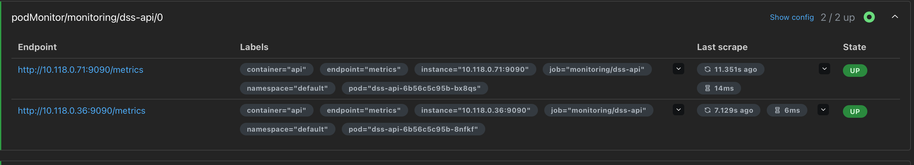

*Figure 6.1 : cibles Prometheus, 2 pods sur 2 collectés.*

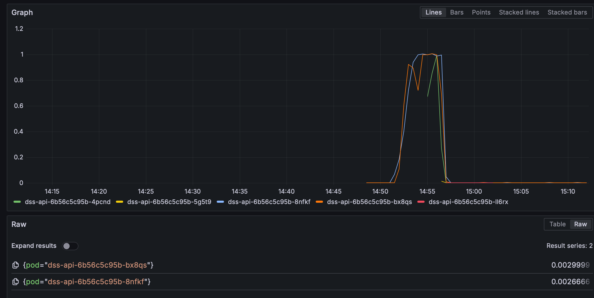

*Figure 6.2 : CPU par pod. Les deux pods d'origine atteignent 1 cœur (le maximum alloué) ; les pods ajoutés par l'autoscaler servent trop tard.*

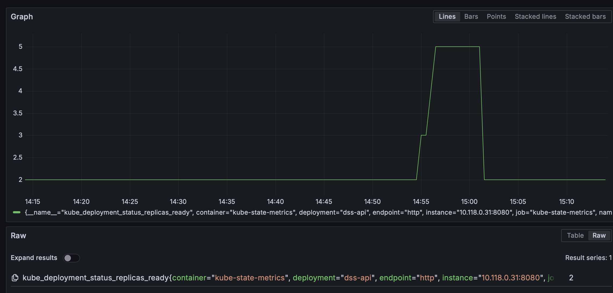

*Figure 6.3 : pods prêts. 2, puis 3, puis 5, puis retour à 2 environ 5 minutes après la fin de la charge.*

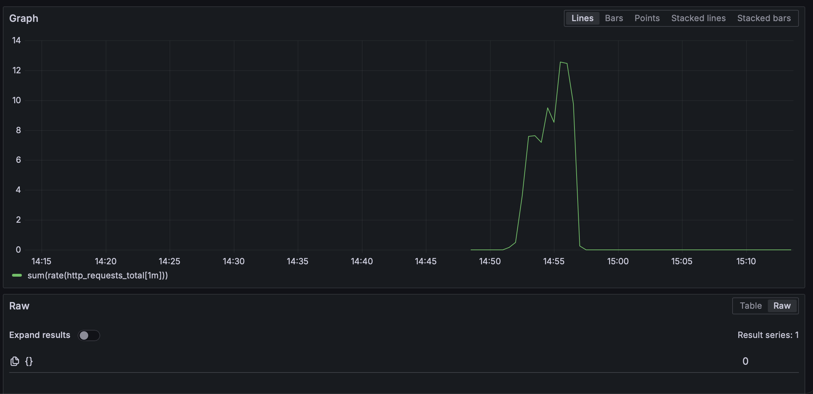

*Figure 6.4 : requêtes par seconde (pic ≈ 12,5).*

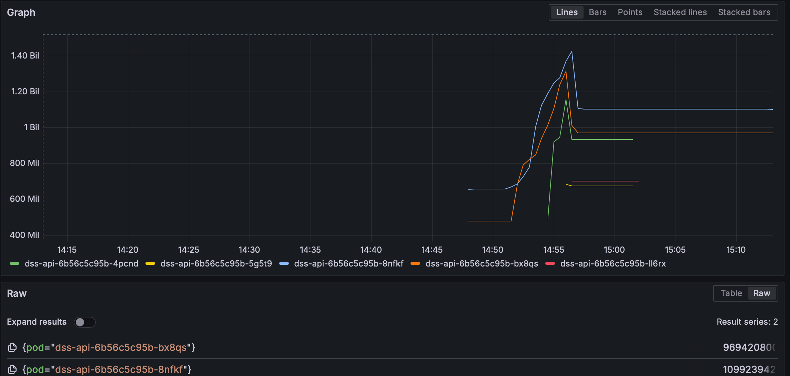

*Figure 6.5 : mémoire par pod (de 0,5 à 1,43 Go, limite 2 Gi).*

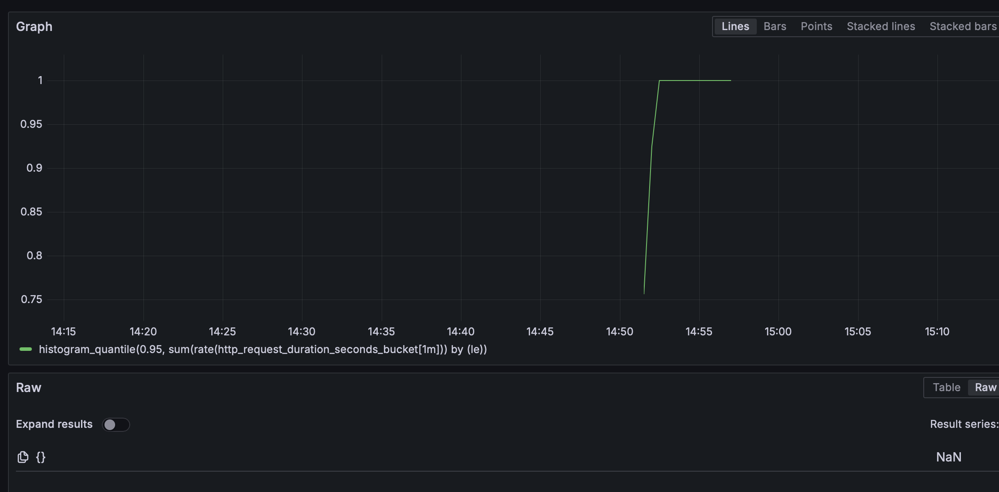

*Figure 6.6 : latence P95 telle que mesurée par Prometheus. La courbe reste bloquée à 1 s (plafond des intervalles de mesure), alors que Locust mesurait 8 à 12 s : cette mesure n'est pas exploitable au-dessus de 1 s.*

**Tableau de bord Grafana.** Un tableau de bord à nous (fichier `grafana_dashboard.json`, fourni avec le rendu, à importer dans Grafana) regroupe 4 indicateurs et 5 graphiques construits sur les métriques qui fonctionnent (débit, erreurs 5xx, CPU et mémoire par pod, pods prêts contre réplicas voulus). Capture pendant une charge de 5 utilisateurs : 2 pods prêts, ≈ 4,7 requêtes/s, 0 erreur, ≈ 0,5 cœur par pod (sous le seuil de l'autoscaler, donc pas de pod ajouté). La latence P95 n'y figure pas (voir limites ci-dessous).

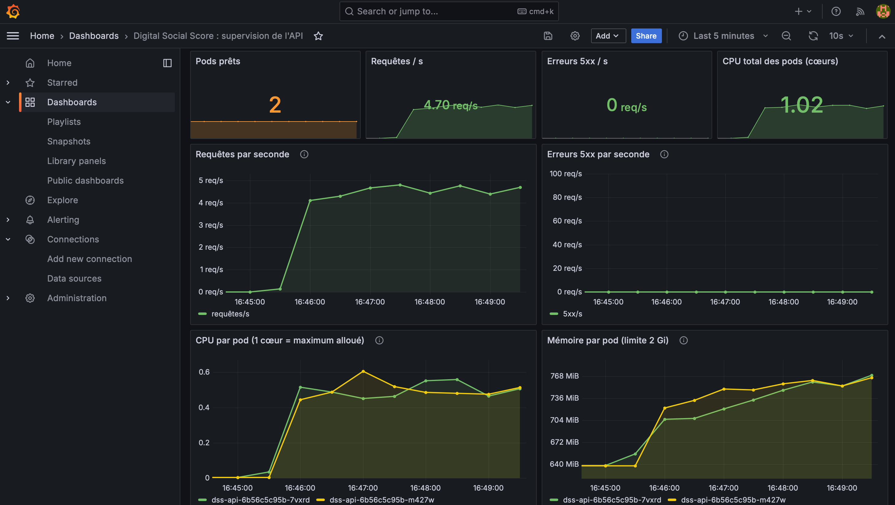

*Figure 6.7 : tableau de bord Grafana (haut de page).*

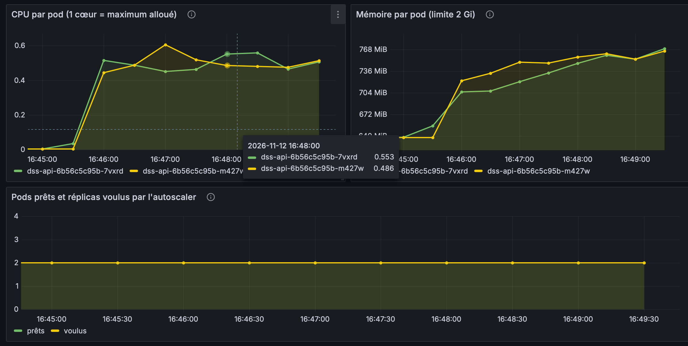

*Figure 6.8 : tableau de bord Grafana (CPU, mémoire par pod, pods prêts et réplicas voulus).*

**Limites constatées, et ce qu'on en tire**
- **Grafana n'affiche pas l'usage CPU/mémoire de ses tableaux prêts à l'emploi** (« No data », figure 6.9) : GKE Autopilot ne donne pas accès aux métriques kubelet. On s'appuie donc sur les métriques du processus exposées par l'API elle-même, ce qui suffit pour le CPU et la mémoire par pod.
- **L'autoscaler réagit trop tard pour une montée brutale** (déjà mesuré à l'étape 5, visible ici) : justifie un minimum de pods plus élevé avant un pic annoncé.
- **La supervision consomme de la place sur un cluster partagé** : au moment de l'essai, Google n'avait plus de machine disponible dans la zone (« GCE out of resources ») et Grafana est resté bloqué en attente. On a retiré **Alertmanager** (aucun canal de notification n'est configuré) pour libérer de la mémoire. Les règles d'alerte peuvent se lire dans Prometheus, mais aucune notification n'est envoyée.
- Grafana a dû être ramené en version 10.4.2 : en version 13, l'interface ne se chargeait pas à travers l'aperçu web de Cloud Shell (fichier JavaScript non transmis par le relais).
- Pas de limitation de débit et `/docs` public : points faibles non corrigés (voir grille S6, S8).

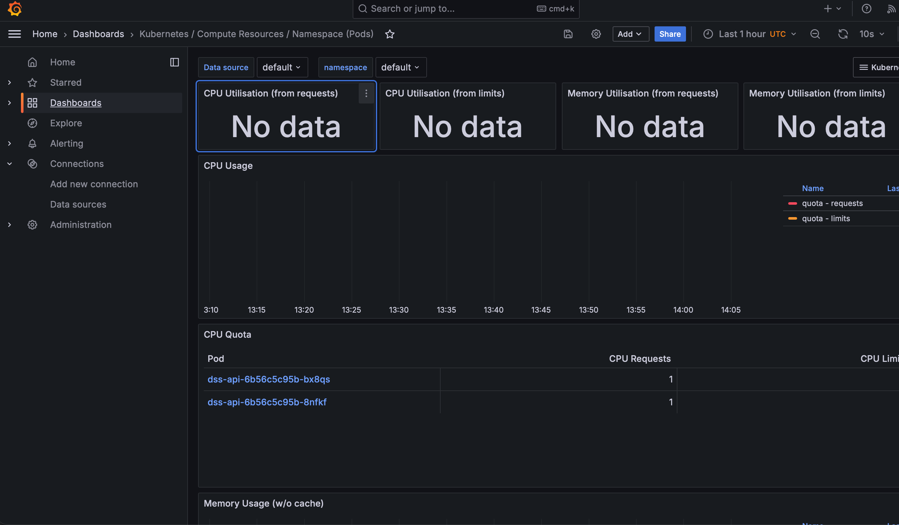

*Figure 6.9 : tableau de bord Kubernetes livré avec Grafana. « CPU Requests » s'affiche, les panneaux d'usage restent vides (« No data »).*

Grille complète (tests SU1 à SU9) : Annexe A.

### 6.3 Panne brutale d'un pod (F2, F3)

**Panne brutale (étape 6, F2).** Même charge (5 utilisateurs), mais le pod est supprimé **sans délai** (`--grace-period=0 --force`) : **1 erreur sur 771 requêtes** (un 502 du load balancer, 2 s après), latence inchangée (P95 715 ms avant, 572 ms après), débit en baisse d'environ 10 s (≈ 4,3 req/s) avant retour à la normale 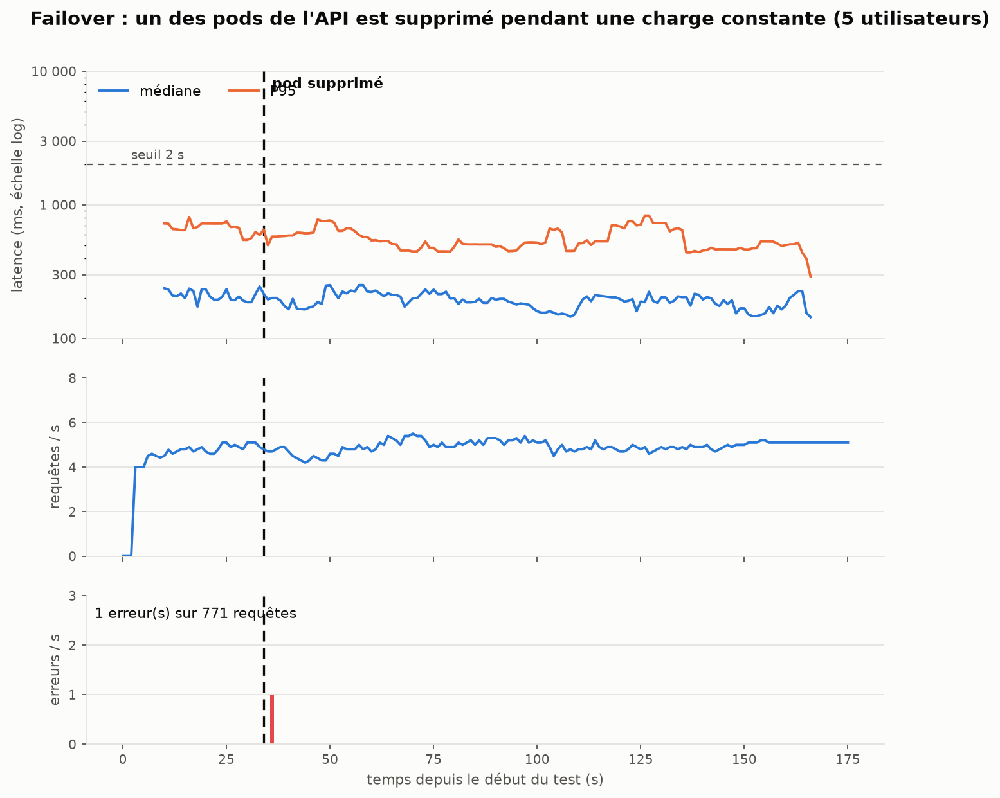 Limite de F2 : 5 pods étaient prêts, ce n'est pas le pire cas, d'où F3 ci-dessous. Un pod de remplacement a été prêt en 15 à 20 s quand les machines avaient de la place, contre 5 min 29 s quand Autopilot doit en préparer une nouvelle : le délai de reprise dépend donc de la capacité disponible.

**Pire cas (F3).** Même test avec seulement 2 pods : **0 erreur sur 892 requêtes**, mais un seul pod porte tout le trafic pendant **7 min 27 s** : le pod de remplacement reste `Pending` parce que Google refuse d'ajouter une machine (`GCE quota exceeded`, l'autoscaler de machines passe en attente). Latence dégradée : médiane 240 → 394 ms, P95 779 → 1 092 ms, maximum 4,7 s ; le service reste sous notre seuil de 2 s pour la charge testée (≈ 5 req/s). 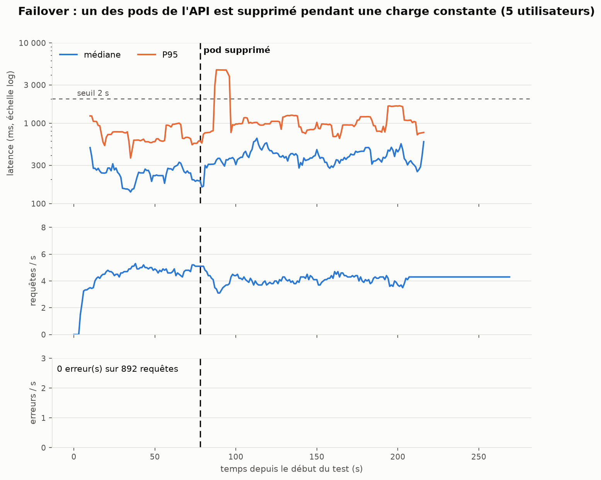 Pendant ce temps, le pod survivant a lui aussi été arrêté (probablement évincé quand une machine a été retirée), et il n'existe **aucun PodDisruptionBudget** pour l'en empêcher : amélioration proposée (`minAvailable: 1`), non appliquée. **Le risque réel n'est donc pas Kubernetes mais la capacité que Google accepte de fournir** (message `GCE quota exceeded`). Les quotas relevés ensuite, hors charge, ne sont pas pleins ; le plus serré est la **limite globale du projet à 12 CPU** (`CPUS_ALL_REGIONS`, 4/12 hors charge), probablement atteinte quand l'API, Prometheus et Grafana occupaient le plus de machines (hypothèse, non vérifiable après coup) : tant que Google refuse une machine, la redondance promise n'est pas rétablie. Une charge plus forte (≥ 10 utilisateurs) aurait dépassé la capacité d'un seul pod (≈ 4 req/s) : justifie un minimum de 3 pods pour un trafic réel.

### 6.4 Journaux (Cloud Logging)

Cloud Logging GKE collecte automatiquement la sortie standard des pods. Ligne type : `score=60 longueur=67 duree_ms=80.2` : aucun texte, aucun identifiant. **Preuve (S5)** : envoi du texte « Bonjour je suis Jean Dupont, ip 192.168.45.67, mot-test ZEBRAXYZ123 » (réponse 200), puis recherche du mot unique, du nom et de l'adresse IP dans les journaux des 30 dernières minutes : **aucun résultat**. Le journal a aussi permis de repérer l'erreur du test S2b (trace `TypeError: comparing strings with non-ASCII characters is not supported`).

### 6.5 Attaque simulée (S7, S8)

2 minutes, 8 attaquants (sans clé, mauvaise clé, texte trop long, JSON invalide) et 2 utilisateurs légitimes. **5 812 requêtes d'attaque (≈ 49/s) toutes refusées avec le bon code (401 ou 422), médiane 25 ms** : un refus est environ 4 fois moins coûteux qu'un vrai calcul (90 ms). Les légitimes n'ont subi **aucune erreur** (276 requêtes, P95 170 ms). Limites : charge faible, et la comparaison avec des légitimes seuls n'a pas été faite avec les mêmes textes. **Aucune limitation de débit** : l'API répond à ≈ 49 requêtes/s d'un même client sans jamais envoyer de 429, donc une attaque plus forte consommerait le CPU sans être freinée (amélioration proposée : limite par clé ou par IP). Et le bogue de clé à accent (S2b) permet de produire des erreurs 500, que cette rafale n'a pas utilisées.

---

## Étape 7 : Modélisation de l'infrastructure Cloud — Synthèse

### 7.1 Schéma d'architecture


**Légende**

| Symbole | Signification |
|---|---|
| 1 → 4 | Trajet d'une requête client jusqu'à la réponse |
| a → f | Étapes de traitement à l'intérieur d'un pod : (a) vérification de la clé, (b) validation de l'entrée, (c) anonymisation, (d) nettoyage, (e) inférence DistilBERT, (f) calcul du score |
| A | Secret Manager → Secret Kubernetes : injection de la clé API |
| B | Artifact Registry → nœuds GKE : téléchargement de l'image Docker |
| C | Pods → Cloud Logging : journaux d'accès pseudonymisés |
| Orange | Supervision Prometheus / Grafana, installée dans le cluster (voir § 6.2) ; les métriques de l'API passent par le port 9090, non public |

**Texte explicatif**

L'infrastructure repose sur **GKE Autopilot** (région `europe-west9`, Paris), ce qui garantit que les données ne quittent pas l'Union européenne (Art. 44 RGPD). Un seul point d'entrée public — le **load balancer HTTPS** (Ingress Google avec certificat géré) — reçoit toutes les requêtes et redirige le trafic HTTP vers HTTPS. Il répartit ensuite la charge entre les pods prêts via un **Service Kubernetes** (ClusterIP), de sorte qu'un pod encore en démarrage ne reçoit jamais de trafic.

Chaque **pod `dss-api`** exécute FastAPI + DistilBERT + spaCy. La chaîne de traitement dans le pod suit les étapes a → f : la clé API est vérifiée en premier (401 si absente ou fausse) ; l'entrée est validée (422 si texte vide ou > 5 000 caractères) ; le texte est anonymisé par spaCy NER + regex avant toute inférence (principe de minimisation RGPD) ; DistilBERT prédit les 6 probabilités de toxicité ; le score 0-100 est calculé et renvoyé. Le texte n'est jamais écrit sur disque ni dans les journaux.

L'**autoscaler horizontal** (HPA) maintient entre 2 et 5 pods en ciblant 70 % d'utilisation CPU. Les tests de charge (étape 5) ont montré que l'ajout d'un pod prend 5 min 29 s sur Autopilot : l'autoscaler est trop lent pour absorber une montée de 5 minutes, mais efficace sur une durée plus longue.

La **clé API** est stockée dans Secret Manager et injectée en variable d'environnement via un Secret Kubernetes : elle n'entre jamais dans le code ni dans Git (dépôt public). Le conteneur tourne en non-root (uid 1000) avec tous les privilèges retirés (`drop ALL`).

### 7.2 Composants et justifications

| Composant                                             | Rôle                                                                                                                                                                                              | Pourquoi ce choix                                                                                                              |
| ----------------------------------------------------- | -------------------------------------------------------------------------------------------------------------------------------------------------------------------------------------------------- | ------------------------------------------------------------------------------------------------------------------------------ |
| **Load balancer HTTPS** (Ingress Google)        | Point d'entrée unique ; chiffre en transit ; redirige HTTP → HTTPS ; route vers les pods prêts                                                                                                  | Un seul IP public fixe ; certificat géré par Google ; failover transparent (0 erreur testé)                                 |
| **Service dss-api** (ClusterIP)                 | Répartit entre les pods qui ont passé la sonde de disponibilité                                                                                                                                 | Sans lui, un pod en cours de démarrage reçoit du trafic                                                                      |
| **Pods dss-api** (FastAPI + DistilBERT + spaCy) | Vérifie la clé, valide, anonymise, nettoie, prédit, renvoie le score                                                                                                                            | FastAPI : validation intégrée ; DistilBERT : meilleur AUC-PR (59 %) et F1 (0,56) ; spaCy : anonymisation à 3 ms/commentaire |
| **Autoscaler** (2 à 5 pods, cible 70 % CPU)    | Absorbe les pics de charge                                                                                                                                                                         | Limite le coût (essaie gratuit) ; rupture testée à 20 utilisateurs → 8 req/s                                               |
| **Secret Manager → Secret Kubernetes**         | Stocke la clé API hors du code et de l'image                                                                                                                                                      | La clé n'entre jamais dans Git (dépôt public)                                                                               |
| **Artifact Registry**                           | Stocke l'image Docker (code + modèle)                                                                                                                                                             | Modèle embarqué = aucun téléchargement au démarrage du pod                                                                |
| **Cloud Build**                                 | Construit l'image sans rien installer en local                                                                                                                                                     | Reproductibilité                                                                                                              |
| **Cloud Logging**                               | Collecte les logs des pods                                                                                                                                                                         | Gratuit sur GKE ; rétention 90 j                                                                                              |
| **Stockage**                                    | **Aucune base de données** : le texte n'est jamais stocké (RGPD). Seuls sont stockés l'image et le modèle (Artifact Registry), la clé (Secret Manager) et les journaux (Cloud Logging). | Minimisation (Art. 5.1.c RGPD) : ce qui n'est pas stocké ne peut pas fuiter.                                                  |
| **Supervision** | Prometheus + Grafana dans le cluster : requêtes/s, erreurs, CPU, mémoire, pods prêts (métriques de l'API sur le port 9090, non public) | Voir § 6.2                                                                                                                    |

### 7.3 Flux, authentification et chiffrement

| Flux                       | Chiffrement                                                      | Authentification                                                          |
| -------------------------- | ---------------------------------------------------------------- | ------------------------------------------------------------------------- |
| 1. Client → load balancer | **HTTPS** (certificat Google géré), HTTP redirigé       | Aucune à ce niveau                                                       |
| 2. Load balancer → pods   | HTTP (réseau interne Google) — **pas de TLS configuré** | Aucune à ce niveau                                                       |
| 3. Dans le pod             | Mémoire — rien écrit sur disque                               | **Clé API `X-API-Key`** vérifiée à temps constant (401 sinon) |
| 4. Réponse → client      | HTTPS                                                            | —                                                                        |
| A. Secret → pods          | Secret Kubernetes, injecté en variable d'environnement          | Droits Kubernetes                                                         |
| B. Image → nœuds         | Réseau interne Google                                           | Compte de service en lecture seule sur Artifact Registry                  |
| C. Pods → Cloud Logging   | Réseau interne Google                                           | —                                                                        |

### 7.4 Approche zero trust

**Appliqué :**

- Chaque requête est authentifiée — aucune confiance accordée parce que la requête vient du bon réseau.
- Moindre privilège — conteneur non-root (uid 1000), `capabilities: {drop: ["ALL"]}`, `allowPrivilegeEscalation: false`.
- Droit de lecture seule sur Artifact Registry pour les nœuds.
- Minimisation des données — ni texte ni IP dans les journaux.

**Manque :**

- Des requêtes non authentifiées atteignent les pods (pas de WAF ni de limitation au niveau du load balancer).
- Pas de chiffrement interne (load balancer → pods).
- Pas de `NetworkPolicy` dans les manifestes.
- Une seule clé partagée — impossible d'identifier un appelant ou de révoquer un accès individuellement.
- `/docs` public.

### 7.5 Tableau de synthèse des choix techniques

| Étape | Problème                  | Choix retenu                                    | Alternative écartée            | Raison                                                                 |
| ------ | -------------------------- | ----------------------------------------------- | -------------------------------- | ---------------------------------------------------------------------- |
| 1      | Anonymisation noms propres | spaCy `en_core_web_sm` + regex                | Modèle NER plus grand (`trf`) | 3 ms/commentaire suffisant ; `trf` trop lent pour 310 000 lignes     |
| 1      | Dataset                    | Jigsaw Toxic Comments                           | GameTox                          | Volume (159 k), labels multi-label vérifiés, licence CC0             |
| 2      | Modèle principal          | DistilBERT                                      | BERT base, RoBERTa               | Meilleur compromis qualité (AUC-PR 59 %) / vitesse (8 ms)             |
| 2      | Modèle de référence     | BiLSTM                                          | GRU, CNN                         | Architecture classique, sans pré-entraînement, entraînable en 3 min |
| 2      | 3e modèle                 | LAYA zéro-shot                                 | LAYA fine-tuné                  | Fine-tuning irréaliste sur Mac M3 (≈ 63 h estimées)                 |
| 3      | Framework API              | FastAPI                                         | Flask                            | Validation Pydantic, `/docs` automatique                             |
| 3      | Cloud                      | GKE Autopilot                                   | Vertex AI, Scaleway              | Moins d'administration, Kubernetes standard, région Paris             |
| 4      | Authentification           | Clé API (`X-API-Key`)                        | JWT                              | Simplicité ; JWT inutile sans sessions ni rafraîchissement de token  |
| 4      | Chiffrement                | HTTPS géré Google                             | TLS manuel                       | Certificat automatique, renouvellement géré                          |
| 4      | Secrets                    | Secret Manager + Secret K8s                     | Variable d'env dans le code      | La clé ne doit jamais entrer dans Git (dépôt public)                |
| 5      | Test de charge             | Locust                                          | Apache Bench, k6                 | Python, courbes temps réel, export CSV                                |
| 6      | Supervision                | Cloud Logging + Prometheus/Grafana (en place)  | Cloud Monitoring seul            | Le TP cite Prometheus/Grafana explicitement                            |

---

## Livrables du TP

| Livrable | Où | État |
|---|---|---|
| API fonctionnelle et documentée | API déployée sur GKE (étape 3), `/docs`, ce document | Fait |
| Exemples de requêtes et réponses | § 3.3 | Fait |
| Schéma d'architecture cloud + texte explicatif | Étape 7 (§ 7.1 à 7.4) | Fait |
| Registre RGPD | § 4.1 | Fait |
| Droits d'accès (IAM) | § 4.2 | Fait (relevé du 12 novembre) |
| Tableau de bord / captures de supervision | § 6.2, figures 6.1 à 6.9 ; fichier `grafana_dashboard.json` | Fait |
| Rapport de simulation de charge | Étape 5 et Annexe B | Fait |
| Grille de tests sécurité / stress / failover | Annexe A | Fait (F4, perte d'une machine entière, non réalisé) |

---

## Reproduire

```bash
python3.12 -m venv .venv && source .venv/bin/activate
pip install -r requirements.txt        # inclut spaCy en_core_web_sm
# 1. notebooks/anonyme_2.ipynb  (~20 min)   → data/anonymise/
# 2. notebooks/clean_text.ipynb             → data/clean/
# 3. notebooks/train.ipynb  (BiLSTM ~3 min, DistilBERT ~64 min, LAYA test ~2 h) → models/
.venv/bin/uvicorn api.main:app --port 8000   # API locale → http://127.0.0.1:8000/
```

---

## Annexe A : grille de tests (sécurité, stress, failover, supervision)

Livrable du TP (« Grille tests sécurité/stress/failover »). Cible : l'API déployée sur GKE. Date des essais : 12 novembre 2026.

Légende : **OK** = vérifié sur le cluster ; **code** = prévu dans le code (tests `pytest` de la branche Enzo), pas vérifié sur le cluster ; **à faire**.

### Sécurité

| ID | Test | Attendu | Résultat | État |
|---|---|---|---|---|
| S1 | `POST /score` sans clé | 401 | 401 | **OK** |
| S2 | `POST /score` avec une mauvaise clé | 401 | 401 | **OK** |
| S2b | `POST /score` avec une clé contenant un caractère non ASCII (ex. `clé`) | 401 | **500 Internal Server Error** ; le journal montre `TypeError: comparing strings with non-ASCII characters is not supported` (comparaison de clé). | **Bogue confirmé** (reproduit avec `X-API-Key: clé`, HTTP/2 500) : à corriger (comparer des octets, pas des chaînes) ; un client peut provoquer des erreurs 500 à volonté |
| S3 | Appel en HTTP (sans TLS) | redirection vers HTTPS | 301 vers `https://…:443/health` | **OK** |
| S4a | Texte vide | 422 | 422 | **OK** |
| S4b | Texte de 6 000 caractères (> 5 000) | 422 | 422 | **OK** |
| S4c | Corps qui n'est pas du JSON | 422 | 422 | **OK** |
| S5 | Les logs ne contiennent pas le texte reçu | aucun texte ni IP dans Cloud Logging | Texte envoyé : un nom, une IP et un mot unique (`ZEBRAXYZ123`). Recherche dans Cloud Logging (30 min) : **aucun résultat**. Les lignes du journal ont toutes la forme `score=60 longueur=67 duree_ms=80.2` (jamais le texte). | **OK** |
| S6 | `/docs` (Swagger) accessible sans clé | à décider | **200 : publique** | constat |
| S7 | Rafale de requêtes invalides (sans clé, mauvaise clé, texte trop long, JSON invalide) pendant que des utilisateurs légitimes travaillent | le service légitime continue | 2 min, 2 légitimes + 8 attaquants (`loadtest/attaque.py`). **5 812 requêtes d'attaque (≈ 49/s), toutes refusées avec le bon code** (401 ou 422), médiane 25 ms. **Utilisateurs légitimes : 276 requêtes, 0 erreur, médiane 90 ms, P95 170 ms, maximum 391 ms.** | **OK** (limite : pas de mesure « légitimes seuls » avec les mêmes textes, donc la comparaison n'est qu'indicative) |
| S8 | Limitation de débit | requêtes refusées (429) au-delà d'un seuil | Aucun 429 : les ≈ 49 requêtes/s d'un même client ont toutes été traitées jusqu'au refus (401/422). Une attaque plus forte consommerait du CPU sans être freinée. | constat : non implémentée (amélioration proposée : limite par clé ou par IP au niveau du load balancer) |

### Supervision (Prometheus et Grafana)

Charge de l'essai : montée progressive Locust lancée depuis un Mac, de 14:50 à 14:57 (heure de Paris, affichage Grafana). Captures : figures 6.1 à 6.9 de l'étape 6.

| ID | Test | Attendu | Résultat | État |
|---|---|---|---|---|
| SU1 | Prometheus collecte les 2 pods de l'API (port 9090, séparé du port public) | 2 cibles `UP` | 2/2 `UP`, collecte en 6 à 14 ms | **OK** |
| SU2 | Nombre de pods et autoscaler visibles | 2 pods, puis plus sous charge | 2 → 3 (≈ 14:55) → 5 (≈ 14:56:30) → 2 (≈ 15:01:30) | **OK** |
| SU3 | CPU par pod | saturation visible sous charge | 1,0 cœur (le maximum alloué) sur les 2 pods d'origine de 14:52 à 14:57 ; les pods ajoutés servent trop tard | **OK** |
| SU4 | Mémoire par pod | marge suffisante | 0,5 à 0,65 Go au repos, 1,43 Go au pic (limite 2 Gi), non rendue après la charge | **OK** |
| SU5 | Débit de l'API | courbe proportionnelle à la charge | pic ≈ 12,5 requêtes/s, 0 après la fin | **OK** |
| SU6 | Taux d'erreurs 5xx | visible s'il y en a | aucune série : **aucune erreur 5xx** renvoyée par les pods | **OK** |
| SU7 | Latence P95 | monte avec la charge, alerte à 2 s | **courbe bloquée à 1 s** : les intervalles de mesure par défaut s'arrêtent à 1 s, alors que Locust mesurait 8 à 12 s à 50-100 utilisateurs. **Non exploitable au-dessus de 1 s.** | limite : à corriger (intervalles à élargir côté API) |
| SU8 | Tableau de bord Grafana (Kubernetes / Compute Resources / Namespace) | CPU et mémoire par pod | « CPU Requests » affiché ; panneaux d'usage vides : GKE Autopilot ne laisse pas Prometheus lire les métriques kubelet/cAdvisor. Remplacé par les métriques du processus exposées par l'API (SU3, SU4). | contourné |
| SU9 | Tableau de bord Grafana construit pour l'API (`grafana_dashboard.json`, importable) | indicateurs et courbes alimentés par Prometheus pendant une charge de 5 utilisateurs | 9 panneaux affichés : 2 pods prêts, ≈ 4,7 req/s, 0 erreur 5xx, CPU total ≈ 1,02 cœur (≈ 0,5 par pod), mémoire de 640 à 770 MiB par pod. L'autoscaler ne monte pas : 0,5 cœur par pod reste sous son seuil (70 % de 1 cœur). | **OK** |

### Stress

| ID | Test | Attendu | Résultat | État |
|---|---|---|---|---|
| ST1 | Montée 1 → 10 → 50 → 100 utilisateurs | l'API répond, la latence monte | 4 erreurs sur 3 616 (≈ 0,1 %) ; P95 de 1,2 s à 11,8 s ; débit jusqu'à 17-20 requêtes/s (5 pods) | **OK** |
| ST2 | +10 utilisateurs/20 s jusqu'à P95 > 2 s | point de rupture | 20 utilisateurs (≈ 8 requêtes/s, 2 pods), 0 erreur | **OK** |
| ST3 | Autoscaler | ajoute des pods quand le CPU dépasse 70 % | 5 pods atteints ; un pod neuf prêt en 5 min 29 s | **OK**, jugé trop lent |
| ST4 | Point de rupture « dur » (erreurs) | première vague d'erreurs | non atteint jusqu'à 100 utilisateurs | à faire si besoin (monter plus haut, coût) |

### Failover

| ID | Test | Attendu | Résultat | État |
|---|---|---|---|---|
| F1 | Suppression propre d'un pod (`kubectl delete`) sous charge de 5 utilisateurs | pas d'erreur, latence stable | 0 erreur sur 1 192 requêtes ; P95 628 ms avant, ≈ 465 ms après ; 5 pods avant l'incident | **OK** (limites : arrêt propre, 59 s observées) |
| F2 | Arrêt brutal d'un pod (`--grace-period=0 --force`) sous charge de 5 utilisateurs | quelques erreurs possibles, retour rapide | Pod supprimé à 14:41:25 UTC (t = 34 s). **1 erreur sur 771 requêtes** (502 Bad Gateway du load balancer, 2 s après le kill). Médiane 207 → 199 ms, P95 715 → 572 ms. Débit descendu à ≈ 4,3 req/s pendant ≈ 10 s, puis revenu à ≈ 5. 5 pods prêts avant l'incident. | **OK** (limite : 5 pods, pas le pire cas) |
| F3 | Perte d'un pod quand il n'en reste que 2 (charge de 5 utilisateurs) | service maintenu, capacité divisée par 2 | Pod supprimé de force à 14:51:09 UTC (t = 78 s) : **0 erreur sur 892 requêtes**. **Le pod de remplacement a mis 7 min 27 s à être prêt** (créé à 14:51:10, prêt vers 14:58:37) : il est resté `Pending`, l'autoscaler de machines a échoué (`FailedScaleUp : GCE quota exceeded`, puis « in backoff »). Un seul pod prêt pendant tout ce temps. Latence : médiane 240 → 394 ms, **P95 779 → 1 092 ms**, maximum 4,7 s ; débit ≈ 4,7 → ≈ 4 req/s. | **OK** : service maintenu mais dégradé ; **constat : la reprise dépend de la capacité que Google accepte de fournir (message `GCE quota exceeded`), pas seulement de Kubernetes. Quotas relevés ensuite (hors charge) : régionaux non pleins (CPUS 8/32, INSTANCES 1/8, adresses IP 1/4) ; **le plus serré est la limite globale du projet, `CPUS_ALL_REGIONS` = 12** (4/12 hors charge). Hypothèse la plus plausible : cette limite de 12 CPU a été atteinte quand l'API, Prometheus et Grafana occupaient le plus de machines ; non vérifiable après coup** |
| F3b | Protection contre les évictions volontaires (PodDisruptionBudget) | une règle empêche de retirer le dernier pod prêt | `kubectl get pdb` : **aucune règle**. Pendant F3, le pod survivant a été arrêté (`Terminating`) alors que son remplaçant n'était pas encore prêt : fenêtre probable d'environ 20 s sans pod prêt (déduite des âges des pods, non mesurée). | constat : amélioration proposée (PDB `minAvailable: 1`), non appliquée |
| F4 | Perte de tous les pods d'un nœud | — | — | à voir avec Enzo |

Détails, courbes et captures : étapes 5 et 6 et Annexe B.

---

## Annexe B : rapport de simulation de charge

Cible : l'API déployée sur GKE (Kubernetes Autopilot, Paris), 2 pods au minimum, autoscaler de 2 à 5 pods à 70 % de CPU, **1 CPU et 2 Go par pod** (vérifié : le même ReplicaSet a servi pendant tous les tests). Modèle : DistilBERT. Route testée : `POST /score` avec clé API.

### B.1 Méthode et justification des choix

| Choix | Justification |
|---|---|
| **Locust** | Python comme le reste du projet, courbes en direct, export CSV pour le rapport. |
| **Cible : l'API sur GKE**, pas l'API locale | C'est ce qui sera réellement utilisé : on teste le load balancer, l'autoscaler et les pods, pas seulement le code. |
| **1 000 textes de `test_clean.csv`**, tirés au hasard (graine fixe), longueur médiane 147 caractères, maximum 4 728 | Textes variés et réalistes ; un texte différent à chaque requête évite qu'un cache fausse les mesures. |
| **Pause de 0,5 à 1 s** entre deux requêtes d'un utilisateur | Environ 1 requête par seconde et par utilisateur : 100 utilisateurs ≈ 100 requêtes/s demandées. |
| **Seuil de 2 s** pour le P95 | Choix de l'équipe, non imposé par le TP : au-delà, un appel d'API interactif est jugé trop lent. |
| **Paliers 1 → 10 → 50 → 100 utilisateurs** sur 5 min | Facteur 5 à 10 entre paliers pour voir où la latence décolle, sans durer assez longtemps pour coûter cher. |
| **Failover avec 5 utilisateurs** (≈ 5 requêtes/s) | Sous la capacité de 2 pods (≈ 8 requêtes/s) : le service est sain avant l'incident, donc l'effet de la perte d'un pod se voit. |
| **Mesures** : latence moyenne, médiane, P95, P99, taux d'erreur, requêtes/s | Demandées par le TP. Le P95 et le P99 disent ce que vivent presque tous les utilisateurs, ce que la moyenne cache. |
| **Percentiles calculés requête par requête** (journal `*_requetes.csv`) | Les percentiles du CSV de Locust sont cumulés depuis le début du test : inutilisables par palier. |

**Précaution :** Locust tourne sur un Mac et l'API sur Google Cloud. Les latences incluent donc le réseau et le chiffrement HTTPS. La clé d'API n'est jamais écrite dans un fichier (variable d'environnement), et le journal ne contient aucun texte.

### B.2 Mesure de référence : 1 utilisateur

120 requêtes en 80 s, **0 erreur** : médiane 220 ms, moyenne 287 ms, P95 620 ms, P99 1 000 ms. C'est la latence de base à laquelle tout le reste est comparé.

Ce temps est bien supérieur aux ~12 ms mesurées en local (prétraitement 4 ms + modèle 8 ms) : on en déduit qu'un commentaire coûte environ 200 ms de calcul sur un pod, hypothèse cohérente avec le CPU à 99 % observé plus bas, mais non vérifiée (voir § B.5).

### B.3 Scénario 1 : montée progressive (1 → 10 → 50 → 100 utilisateurs, 5 min)

Deux exécutions. **Exécution 2** (percentiles exacts) :

*(Courbe : voir l'étape 5.)*

| Palier | Requêtes/s | Moyenne | Médiane | P95 | P99 | Erreurs |
|---|---|---|---|---|---|---|
| 1 utilisateur | 0,9 | 317 ms | 176 ms | 992 ms | 1,3 s | 0 |
| 10 | 8,0 | 482 ms | 384 ms | 1,2 s | 1,6 s | 0 |
| 50 | 14,2 | 2,8 s | 1,6 s | 8,2 s | 11,2 s | 1 |
| 100 | 17,6 | 4,9 s | 4,1 s | 11,8 s | 14,7 s | 2 |

3 616 requêtes en tout, 4 erreurs « 502 Bad Gateway » (≈ 0,1 %).

**Exécution 1** (moyennes seulement : le journal par requête n'existait pas encore) :

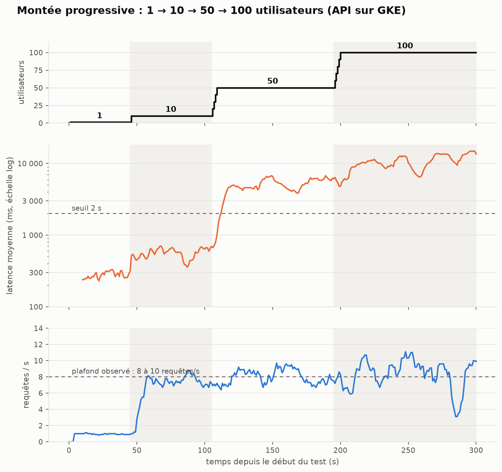

| Palier | Requêtes/s | Latence moyenne | Erreurs |
|---|---|---|---|
| 1 utilisateur | 1,0 | 280 ms | 0 |
| 10 | 7,5 | 569 ms | 0 |
| 50 | 8,1 | 5,1 s | 1 |
| 100 | 8,4 | 10,8 s | 1 |

**Lecture.**
- L'API ne s'effondre pas : moins de 0,2 % d'erreurs dans les deux exécutions. Elle **ralentit** : les requêtes attendent dans une file.
- **Point de rupture (latence)** : la latence moyenne dépasse 2 s entre 10 et 50 utilisateurs ; le stress test (§ B.4) le situe à 20 utilisateurs (P95 > 2 s). Jusqu'à 10 utilisateurs, le P95 reste vers 1,2 s.
- **Exécution 1 : le débit plafonne vers 8 requêtes/s** dès 10 utilisateurs, avec 2 pods. **Exécution 2 : il monte à 17-20 requêtes/s** après le palier à 10. La capacité a plus que doublé d'une exécution à l'autre : les captures du § B.5 montrent que l'autoscaler a cette fois atteint ses 5 pods.

### B.4 Scénario 2 : stress

Profil `stress.py` : **+10 utilisateurs toutes les 20 s**. Arrêt automatique dès que le P95 (fenêtre de 10 s) reste au-dessus de **2 s pendant 10 s**, ou que 5 erreurs arrivent en 10 s, ou à 200 utilisateurs. Le point de rupture est enregistré dans `results/stress_rupture.json`.

*(Courbe : voir l'étape 5.)*

| Palier | Requêtes/s | Moyenne | Médiane | P95 | P99 | Erreurs |
|---|---|---|---|---|---|---|
| 10 utilisateurs | 7,7 | 574 ms | 504 ms | 1,3 s | 1,6 s | 0 |
| 20 utilisateurs (interrompu après 13 s) | 8,0 | 1,8 s | 1,6 s | 4,4 s | 4,7 s | 0 |

**Résultat : rupture au sens du critère à 20 utilisateurs**, 33 s après le début, avec un P95 de 4,8 s. Le débit est déjà de ≈ 8 requêtes/s à 10 utilisateurs et n'augmente plus : la capacité est atteinte, les requêtes font la queue. La capture ci-dessous montre **2 pods** au départ (l'autoscaler à 2 réplicas, CPU à 49 % pendant le test) : cela fait ≈ 4 requêtes/s par pod.

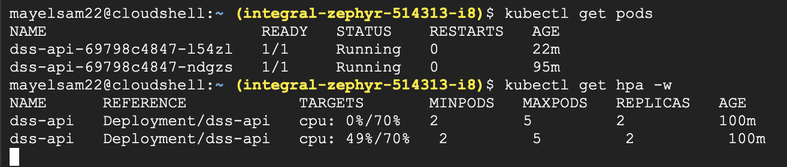

**Limites.**
- Le critère (P95 > 2 s) est strict : c'est une **dégradation**, pas une panne (0 erreur). La montée à 100 utilisateurs (§ B.3) a tenu avec 0,1 % d'erreurs : on n'a donc pas trouvé de rupture « dure ».
- Le test dure 37 s : l'autoscaler n'a pas eu le temps de réagir (un pod neuf met plus de 5 min à être prêt, § B.5). Le point de rupture mesuré est celui de la configuration de départ.
- Le palier à 20 utilisateurs est très court : ses valeurs sont indicatives.

### B.5 Autoscaling

**Exécution 1** :

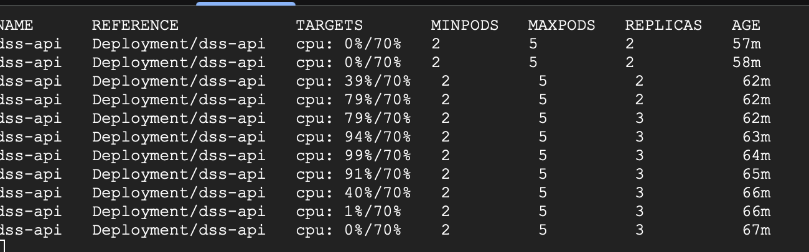

Le CPU passe de 0 % à 79 %, l'autoscaler ajoute **un seul pod** (2 → 3), puis le CPU reste à 91-99 % avec 3 pods, sans que l'autoscaler monte plus haut pendant le test. Le goulot est donc le **CPU**, pas le réseau.

**Exécution 2** : liste des pods relevée avec `kubectl get pods -w` pendant et après le test.

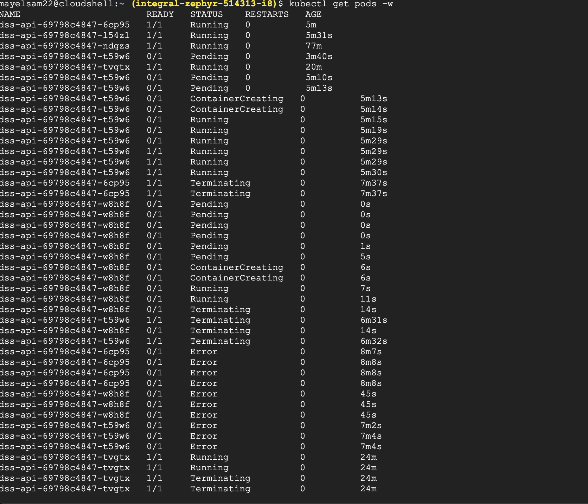

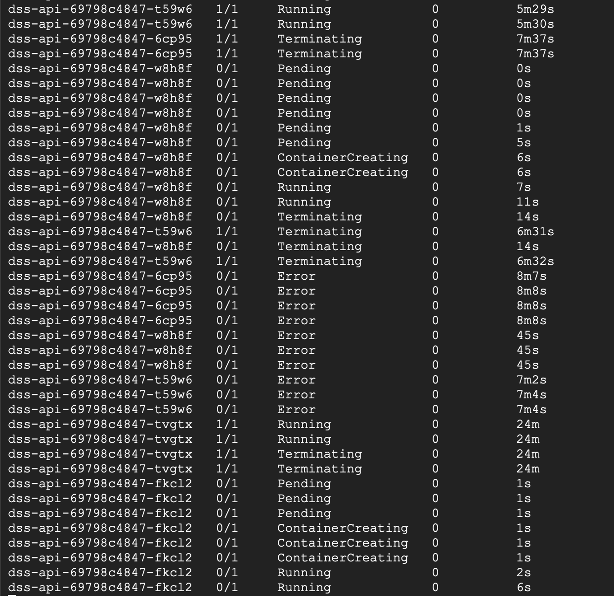

- On compte **5 pods distincts** : l'autoscaler a atteint son **maximum**. Trois d'entre eux (âgés de 3 à 5 min au début de la capture) ont été créés pendant la montée. Cela explique le débit de 17 à 20 requêtes/s : environ 4 à 5 requêtes/s par pod si 4 à 5 pods servaient, cohérent avec les ≈ 4 requêtes/s par pod de l'exécution 1.
- **Un pod neuf met plusieurs minutes à servir.** Le pod `t59w6` reste **5 min 10 s en `Pending`** (Autopilot doit d'abord préparer une machine), démarre en ≈ 15 s, et n'est prêt (`1/1`) qu'à **5 min 29 s**. Un pod ajouté pendant une montée de 5 minutes arrive donc quand elle est déjà finie.
- Les pods arrêtés passent par le statut `Error` : non diagnostiqué ici, à faire examiner (code de sortie du conteneur).

### B.6 Scénario 3 : failover

Charge constante de 5 utilisateurs (≈ 5 requêtes/s, sous la capacité), 4 minutes. À **t = 183 s** (11:34:43 UTC), un pod est supprimé avec `kubectl delete` :

*(Courbe : voir l'étape 5.)*

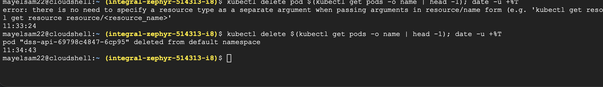

Interface de Locust pendant les deux tests (montée progressive, puis failover à 5 utilisateurs) et tableau final du failover :

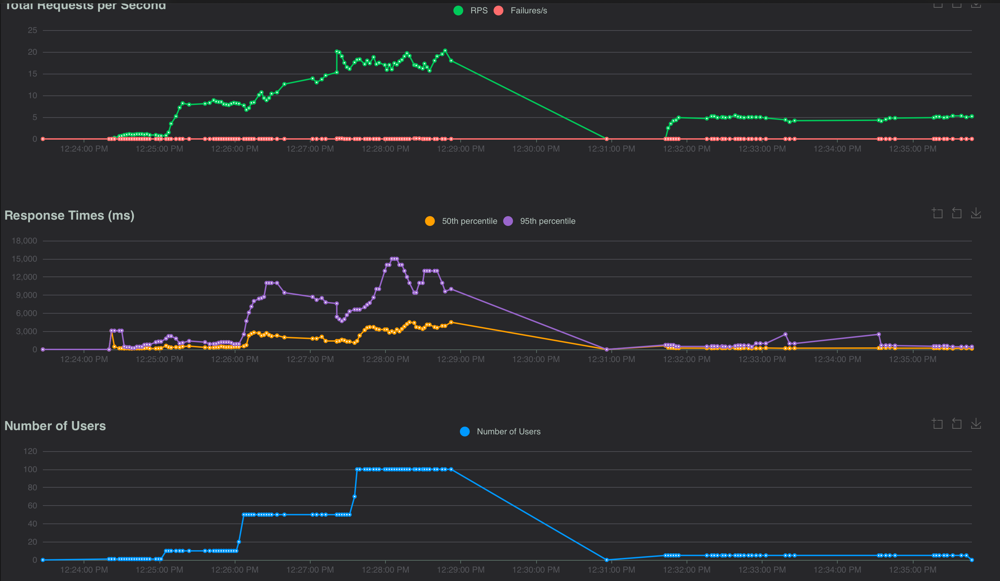

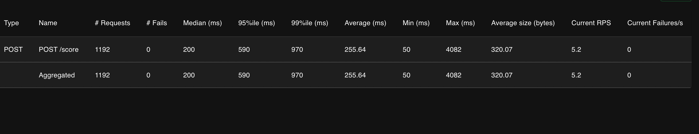

| Période | Requêtes/s | Médiane | P95 | Erreurs |
|---|---|---|---|---|
| Avant l'incident | 4,9 | 209 ms | 628 ms | 0 |
| 0 à 20 s après | 5,2 | 161 ms | 413 ms | 0 |
| 20 à 60 s après | 5,1 | 170 ms | 465 ms | 0 |

**Résultat : 0 erreur sur 1 192 requêtes** ; la latence ne se dégrade pas.

**Pods autour de l'incident** (captures du § B.5) : avant l'incident, **5 pods étaient prêts** (`t59w6` l'est devenu environ 50 s avant). Le pod supprimé `6cp95` passe en `Terminating` ; Kubernetes crée **immédiatement** un remplacement (`w8h8f` : `Pending` 0 s, `Running` à 7 s). Ce remplacement est lui-même arrêté 14 s plus tard, avec d'autres pods : probablement la réduction de l'autoscaler, le CPU étant redevenu bas (non confirmé).

**Limites, à ne pas passer sous silence :**
- Le test s'arrête **59 s après** l'incident : on n'observe ni le retour à un état stable, ni le temps de démarrage d'un pod de remplacement (celui créé a été arrêté après 14 s).
- `kubectl delete pod` est un arrêt **propre** (le pod est retiré du load balancer avant de s'arrêter). Une panne brutale (nœud perdu, processus tué) n'a pas été testée.
- La charge de 5 requêtes/s est inférieure à la capacité des pods restants : le résultat ne dit rien sur une panne pendant un pic.
- L'incident a eu lieu avec **5 pods prêts** (4 après la suppression), pas avec le minimum de 2 : le résultat montre la redondance d'un cluster déjà monté en charge, pas celle de la configuration minimale.

### B.7 Améliorations (cache, load balancer, redondance)

Le TP demande de **proposer** des améliorations. Voici ce qui existe déjà, ce qui a été testé, et ce qui reste une proposition, **sans l'avoir mis en œuvre ni mesuré** :

| Amélioration | État | Justification (liée aux mesures) |
|---|---|---|
| **Load balancer** | **En place** (Ingress Google, déployé par Enzo) ; testé indirectement par tous les tests | Répartit les requêtes entre les pods ; sans lui, le failover (§ B.6) n'aurait pas été transparent. |
| **Redondance** : 2 pods minimum + autoscaler jusqu'à 5 | **En place et testée** (failover : 0 erreur ; autoscaler : 5 pods atteints à la 2e montée) | Le service continue quand un pod disparaît. |
| **Au moins 3 pods en permanence** | Proposée | Avec 2 pods, la perte d'un pod divise la capacité par 2 (≈ 4 requêtes/s restantes) ; le failover a été testé avec 5 pods, pas avec 2. |
| **Pods prêts plus vite** (minimum relevé avant un pic prévu, cible de CPU plus basse) | Proposée | Un pod neuf a mis **5 min 29 s** à être prêt (5 min 10 s de `Pending`) : trop lent pour une montée de 5 minutes. |
| **Plus de CPU par pod, ou réglage des threads de torch** | Proposée | Pods à 91-99 % de leur **1 CPU** pour ≈ 4 requêtes/s chacun : le calcul du modèle est le goulot. Doubler le CPU par pod est l'essai le plus direct. |
| **Traitement par lots** (plusieurs commentaires par appel du modèle) | Proposée | Le modèle est plus efficace par lots ; à 100 requêtes/s, un appel par commentaire pèse. |
| **Limite de débit par clé API** | Proposée, non faite | Au-delà de ≈ 8 requêtes/s l'API fait la queue : mieux vaut refuser tôt (429) que laisser la latence monter à 10 s. |
| **File d'attente pour les pics** | Proposée | Absorbe un pic sans faire attendre l'appelant en direct. |
| **Cache des textes déjà vus** | Proposée, **non mesurée** | Utile seulement si des textes se répètent : nos tests envoient un texte différent à chaque requête, donc rien n'a été mesuré. |
| **Modèle plus léger** (BiLSTM : 0,13 ms par commentaire) | Proposée | Capacité bien plus grande, mais F1 de 0,36 contre 0,56 pour DistilBERT : un compromis à assumer. |

### B.8 Limites de l'étude

- Locust et l'API ne sont pas sur le même réseau : les latences incluent le trajet.
- Une seule exécution par scénario sauf la montée (deux exécutions, aux résultats différents) : pas d'intervalle de confiance.
- Percentiles exacts uniquement pour l'exécution 2 de la montée et pour le failover.
- Compte gratuit : le quota n'a pas empêché l'autoscaler d'atteindre 5 pods (exécution 2).
- Les textes envoyés sont ceux de `test_clean.csv`, déjà nettoyés (l'API les anonymise quand même).

### B.9 Relancer les tests

```bash
# Depuis la racine du projet ; la clé reste dans la variable d'environnement, jamais dans un fichier
export API_KEY=<clé>
# Montée progressive (interface sur http://localhost:8089, cliquer sur Start)
LOG_REQUETES=loadtest/results/montee_requetes.csv .venv/bin/locust -f loadtest/locustfile.py,loadtest/montee.py \
    --host https://<domaine>.sslip.io --web-host 127.0.0.1 --csv loadtest/results/montee
.venv/bin/python loadtest/report.py montee
# Failover : lancer failover.py à la place de montee.py, puis supprimer un pod et noter l'heure UTC
#   kubectl delete $(kubectl get pods -o name | head -1); date -u +%T
.venv/bin/python loadtest/report.py failover <HH:MM:SS>
```
