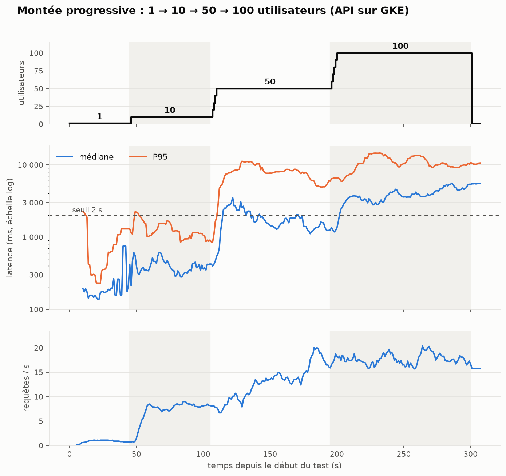
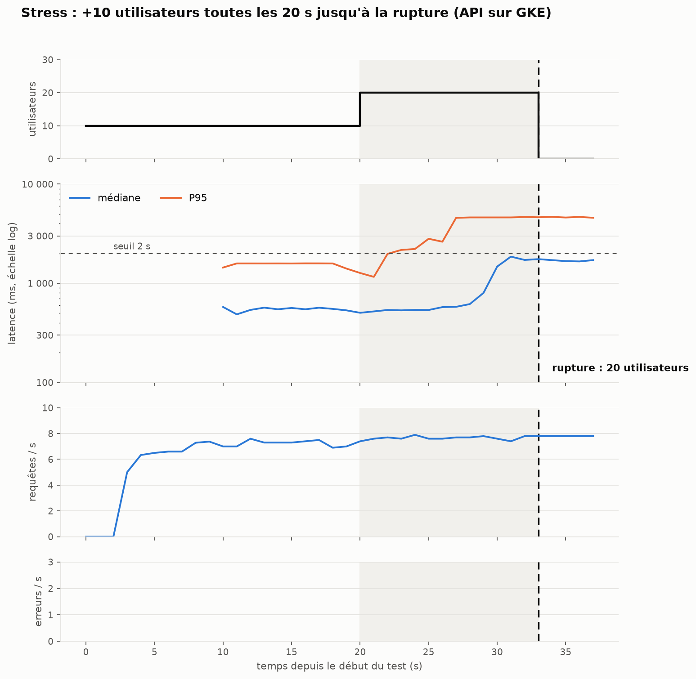
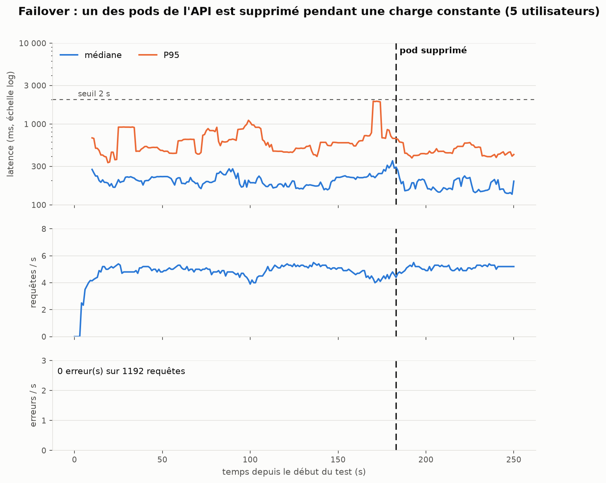
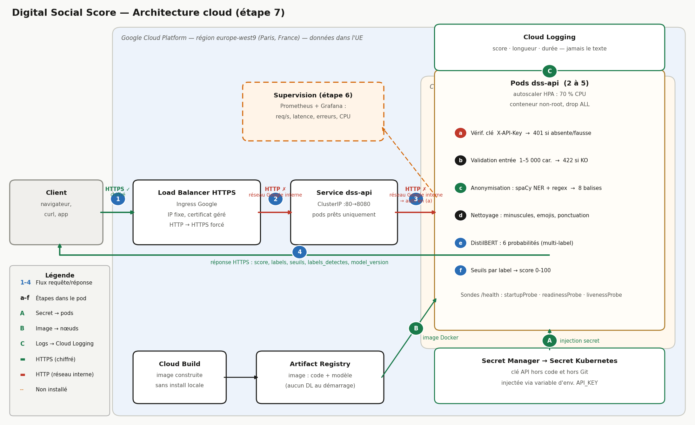

# Digital Social Score — choix et justifications

API qui note la toxicité d'un commentaire de 0 à 100, en protégeant les données personnelles (RGPD). Ce document explique **pourquoi** chaque choix a été fait, ce que les chiffres montrent, et ce qui reste faible.

Données : *Toxic Comment Classification Dataset* (commentaires de pages de discussion Wikipédia ; colonne `comment_text` + 6 labels : toxic, severe_toxic, obscene, threat, insult, identity_hate).

**Chaîne de traitement :** anonymisation → nettoyage → modèle → 6 probabilités → seuils par label → score 0-100.

| Étape                          | Notebook / code                               |
| ------------------------------- | --------------------------------------------- |
| 1. Anonymisation                | [anonyme_2.ipynb](notebooks/anonyme_2.ipynb)   |
| 2. Nettoyage                    | [clean_text.ipynb](notebooks/clean_text.ipynb) |
| 3. Entraînement et comparaison | [train.ipynb](notebooks/train.ipynb)           |
| 4. API et front                 | `api/`, `front/index.html`                |

---

## Étape 1 : Exploration, analyse et anonymisation des données

### 1.1 Jeu de données retenu

**Toxic Comment Classification Dataset** (Jigsaw / Google, 2017) — commentaires des pages de discussion Wikipédia en anglais.

| Caractéristique  | Détail                                                                                           |
| ----------------- | ------------------------------------------------------------------------------------------------- |
| Volume            | 159 571 commentaires (train) + 153 164 (test, dont 63 978 labellisés)                            |
| Labels            | `toxic`, `severe_toxic`, `obscene`, `threat`, `insult`, `identity_hate` (multi-label) |
| Licence textes    | CC-BY-SA 3.0 (texte Wikipédia)                                                                   |
| Licence labels    | CC0 (domaine public)                                                                              |
| Déséquilibre    | ≈ 10 % de positifs sur `toxic` ; `threat` et `identity_hate` < 1 %                         |
| Biais identifiés | Corpus exclusivement anglophone ; biais culturels possibles sur `identity_hate`                 |

Pourquoi ce dataset : tâche multi-label réaliste, volume suffisant pour comparer trois architectures, labels publics vérifiés par vote majoritaire d'annotateurs humains.

### 1.2 Méthode d'anonymisation

Deux passes en un seul parcours du texte (priorité au regex, pas de chevauchement) :

- **Regex** pour ce qui a un format fixe : email, téléphone, URL, IP, pseudo (`@x`, `User:x`), adresse précise.
- **NER spaCy** (`en_core_web_sm`) pour les noms de personnes (`PERSON`) et d'organisations (`ORG`).
- Chaque élément est remplacé par une balise typée. Le regex est prioritaire sur le NER.

| Balise               | Ce qu'elle remplace                |
| -------------------- | ---------------------------------- |
| `personne_tag`     | Noms de personnes (NER)            |
| `organisation_tag` | Noms d'organisations (NER)         |
| `email_tag`        | Adresses email                     |
| `url_tag`          | URL                                |
| `ip_tag`           | Adresses IP                        |
| `telephone_tag`    | Numéros de téléphone            |
| `pseudo_tag`       | `@pseudo`, `User:Pseudo`       |
| `adresse_tag`      | Adresses précises (rue + numéro) |

### 1.3 Pourquoi ces choix

| Choix                                       | Justification                                                                                                                                 | Limite assumée                                                  |
| ------------------------------------------- | --------------------------------------------------------------------------------------------------------------------------------------------- | ---------------------------------------------------------------- |
| Regex pour les formats fixes                | Fiable, déterministe, rapide.                                                                                                                | Ne trouve que ce qui respecte un format.                         |
| NER pour les noms propres                   | Pas de format fixe : il faut le contexte.                                                                                                     | Faux positifs sur le jargon Wikipédia.                          |
| `en_core_web_sm` (petit modèle)          | ≈ 3 ms/commentaire : 310 000 lignes en ≈ 20 min.                                                                                            | Moins précis que `md`, `lg`, `trf`.                       |
| Seulement `PERSON` et `ORG`             | Ce sont elles qui identifient une personne ou son employeur.                                                                                  | `ORG` = source de faux positifs.                               |
| Lieux non masqués (villes, pays)           | Non identifiants seuls ; un propos haineux peut viser un pays. Les masquer retirait du signal et créait des faux positifs (`US`, `POV`). | Risque faible de ré-identification par recoupement.             |
| Mots toxiques non masqués                  | C'est le signal que le modèle doit apprendre. Ils sont retirés des entités NER avant masquage.                                             | Une insulte déformée (`m0ron`) peut être prise pour un nom. |
| Adresse précise masquée, ville conservée | Une adresse identifie un foyer, une ville non.                                                                                                | Formats FR/UK/US seulement.                                      |
| Balises typées plutôt que suppression     | Garde la structure de la phrase et le type d'information.                                                                                     | Révèle qu'une entité existait.                                |
| Un seul passage sur le texte original       | Évite les décalages de positions entre remplacements.                                                                                       | —                                                               |

### 1.4 Corrections après lecture des sorties

Le NER masquait trop : insultes prises pour des noms (`moron` ×202), jargon (`Wikipedia` ≈ 19 % des ORG, `UTC`, `POV`), personnalités publiques (`Hitler`), mots courants (`hi` ×189). Corrections : listes de filtrage, règle « un mot isolé en minuscules n'est pas un nom », motif IPv4 corrigé (≈ 1 100 IP non masquées), faux positifs d'adresse retirés (années, `Way`, `Place`). Résultat sur un échantillon de 20 000 lignes : 1,45 balise par commentaire (contre 1,93) ; aucune insulte masquée par le NER.

### 1.5 Ce que l'anonymisation ne garantit pas

- Aucun jeu annoté à la main : **pas de précision/rappel chiffrés** pour l'anonymisation.
- Les listes de filtrage sont faites à la main, donc non exhaustives.
- Cas non couverts constatés en test : adresse avec nom de rue en minuscules (« 13 rue pierre 75000 Paris »), numéro à 9 chiffres, pseudos sans préfixe `User:` ou `@`.

**Conclusion  : c'est de la pseudonymisation / minimisation, pas une anonymisation garantie.** Le texte original reste public sur Wikipédia, donc un auteur peut être ré-identifié par recoupement.

### 1.6 Nettoyage du texte

Minuscules → suppression des emojis → suppression de la ponctuation (`[^\w\s]`) → espaces ramenés à un seul.

- **Pourquoi :** réduire le vocabulaire pour BiLSTM et DistilBERT (`distilbert-base-uncased` travaille déjà en minuscules).
- **Détail voulu :** `\w` conserve le `_`, donc les balises `*_tag` ne sont pas détruites. Le notebook vérifie que chaque balise apparaît le même nombre de fois avant et après.
- **Limite :** perdre les majuscules et la ponctuation (`!!!`) enlève un indice de colère. Accepté pour la simplicité.

---

## Étape 2 : Préparation et entraînement d'un modèle IA

### 2.1 Protocole commun aux trois modèles

| Jeu                  | Contenu                                                                                                         | Rôle                                       |
| -------------------- | --------------------------------------------------------------------------------------------------------------- | ------------------------------------------- |
| Entraînement commun | 30 000 lignes des 80 % de `train_clean.csv`, stratifiées sur la combinaison exacte des 6 labels (graine 42) | BiLSTM et DistilBERT (LAYA : non entrainé) |
| Validation           | 20 % restants (31 915 lignes) ; 3 000 pour LAYA car trop lent                                                   | Choisir les seuils                          |
| Test commun          | 10 000 lignes du test Kaggle, graine 42, regardées **une seule fois** à la fin                          | Comparaison finale                          |

- **Pourquoi 30 000 lignes :** temps d'entraînement acceptable sur Mac M3 16 Go (DistilBERT : 64 min).
- **Pourquoi stratifier :** les classes rares (`threat`) restent présentes dans l'échantillon.
- **Pourquoi retirer les -1 du test :** 8elles ne sont pas évaluées par Kaggle (89 186 sur 153 164). Retirées **avant** toute prédiction ; il reste 63 978 lignes.
- **Pourquoi un test séparé :** les seuils sont réglés sur la validation ; le test ne sert à aucun réglage, donc le résultat n'est pas optimiste.

### 2.2 Choix de modélisation

| Choix                                                                                | Justification                                                                                                                                                                                                      |
| ------------------------------------------------------------------------------------ | ------------------------------------------------------------------------------------------------------------------------------------------------------------------------------------------------------------------ |
| 6 sorties sigmoïde (multi-label)                                                    | Un commentaire peut être à la fois `toxic`, `obscene` et `insult`.                                                                                                                                         |
| `BCEWithLogitsLoss` avec `pos_weight = négatifs / positifs`                     | Sans lui, les classes rares (`threat`, `identity_hate`, `severe_toxic`) sont ignorées.<br />Contrepartie : les probabilités sont gonflées, d'où le réglage des seuils.                                  |
| Seuil par label optimisé sur la validation (maximise le F1)                         | À 0,5, le rappel est très élevé et la précision très faible. Le seuil par label corrige l'effet du `pos_weight`.Limite : `threat` a peu de positifs, son seuil est moins stable.                         |
| BiLSTM (embedding 128, 64 par sens, max-pooling, dropout 0,3, 3 époques, Adam 1e-3) | Référence légère, sans pré-entraînement. Hyperparamètres non imposés : choisis, non optimisés.                                                                                                            |
| DistilBERT (`distilbert-base-uncased`, 2 époques, lr 2e-5, batch 16)              | Modèle pré-entraîné compact : bon compromis qualité / temps de calcul. Version « distillée » de BERT, plus rapide à entraîner et à servir.ou                                                            |
| **LAYA en zéro-shot**                                                         | Fine-tuning complet (4-5 h sur 2 GPU T4) et `agent.fit` (≈ 7,6 s/ligne → 63 h pour 30 000 lignes) irréalistes sur notre machine. LAYA est un **plancher** évalué sans aucune donnée d'entraînement. |

### 2.3 Résultats (macro-moyenne sur 6 labels, test = 10 000 lignes communes)

| Modèle              | ROC-AUC val     | ROC-AUC test    | AUC-PR test     | F1 test (seuil 0,5) | Précision / rappel test (seuil optimisé) | F1 test (seuil optimisé) | Entraînement    | Inférence/commentaire |
| -------------------- | --------------- | --------------- | --------------- | ------------------- | ------------------------------------------ | ------------------------- | ---------------- | ---------------------- |
| BiLSTM               | 0,948           | 0,916           | 0,362           | 0,231               | 0,301 / 0,481                              | 0,358                     | 157 s            | 0,13 ms                |
| **DistilBERT** | **0,985** | **0,977** | **0,590** | 0,308               | 0,493 / 0,693                              | **0,558**           | 3 860 s (64 min) | 8,1 ms                 |
| LAYA (zéro-shot)    | 0,965           | 0,969           | —              | 0,328               | 0,366 / 0,740                              | 0,476                     | 0                | 700 ms                 |

Détail par label : `models/resultats_par_label.csv`. Tableau complet : `models/resultats.csv`.

### 2.4 Pourquoi DistilBERT est le modèle déployé

- Meilleur ROC-AUC (0,977) **et** meilleur F1 (0,558) sur le test commun.
- Inférence de 8 ms : compatible avec une API en ligne (LAYA : 700 ms, ≈ 90 fois plus lent).
- BiLSTM le plus rapide mais AUC-PR 36 % contre 59 % : trop faible pour le service principal.
- LAYA sans entraînement atteint 0,969 de ROC-AUC : intéressant, mais inutilisable en production.

L'**AUC-PR** est l'indicateur principal : elle ne dépend pas du seuil et pénalise les faux positifs, contrairement au ROC-AUC qui se laisse gonfler par les vrais négatifs sur un dataset déséquilibré (≈ 10 % de positifs).

### 2.5 Score de 0 à 100

- Score d'un label = **probabilité × 100**.
- Un label est « détecté » si sa probabilité ≥ **son seuil** (optimisé sur la validation).
- Score global = **moyenne des scores des labels détectés** ; si aucun n'est détecté, score de `toxic`.

**Pourquoi la moyenne sur les labels détectés seulement :** inclure tous les labels effacerait le signal. Un commentaire très `toxic` (probabilité 0,95) avec cinq autres labels à 0,02 donnerait un score de ~19 au lieu de 95 si on moyennait tout. En ne retenant que les labels dont la probabilité franchit leur seuil, le score reflète l'intensité de ce qui a été détecté, pas le bruit des labels non déclenchés.

**Limites :** ce n'est pas une probabilité calibrée (le `pos_weight` la gonfle) ; 50 n'est pas la frontière « toxique » ; la moyenne peut baisser le score quand un label faiblement détecté s'ajoute à un label très fort.

---

## Étape 3 : Déploiement du modèle en API Cloud

### 3.1 Choix de l'API et du front

| Choix                                                                     | Justification                                                                                                                                                   |
| ------------------------------------------------------------------------- | --------------------------------------------------------------------------------------------------------------------------------------------------------------- |
| FastAPI                                                                   | Validation d'entrée intégrée, documentation `/docs` automatique.                                                                                           |
| Même anonymisation + nettoyage qu'à l'entraînement                     | Le modèle ne doit voir que des textes du même format que ceux appris.                                                                                         |
| Texte ni enregistré ni écrit dans les logs                              | Minimisation RGPD : le service n'a pas besoin de garder le texte.                                                                                               |
| Entrée validée (1 à 5 000 caractères, modèle dans une liste fermée) | Limite les abus et les erreurs.                                                                                                                                 |
| DistilBERT et BiLSTM préchargés, LAYA chargé à la demande             | Première requête rapide ; LAYA (800 Mo, ≈ 1 min de chargement) rarement utilisé.                                                                            |
| Front en un seul fichier HTML                                             | Aucune installation pour présenter le projet.                                                                                                                  |
| Historique du front : texte **anonymisé** seulement, dans l'onglet | Jamais le texte original ; effacé à la fermeture.                                                                                                             |
| Version « Pipeline » animée                                            | Pédagogique. **C'est une mise en scène des vraies données**, pas un suivi en direct : l'analyse est un seul appel à l'API, rejoué étape par étape. |
| Durées affichées (prétraitement, modèle, total)                       | Rendre visible le coût de chaque étape.                                                                                                                       |

**Deux API existent.** L'API locale de ce dépôt (`api/`, route `/predire`, sans clé) sert au développement et à la démonstration. L'API **déployée sur GKE** (route `/score`, clé API, HTTPS) est celle d'Enzo ; c'est elle qui est testée en charge (§ 5).

### 3.2 Déploiement sur GKE : choix techniques

Déployé par Enzo (scripts dans `api/deploy/`, manifestes dans `api/k8s/` de la branche `Enzo`). Les justifications reprennent les raisons écrites dans son code ; la colonne de droite dit ce que nos mesures en ont montré.

| Choix                                                                                               | Justification                                                                                                                                                                                | Ce que les mesures montrent                                                                       |
| --------------------------------------------------------------------------------------------------- | -------------------------------------------------------------------------------------------------------------------------------------------------------------------------------------------- | ------------------------------------------------------------------------------------------------- |
| **GKE Autopilot**                                                                             | Google gère les machines ; moins d'administration. Il facture les ressources demandées par les pods : d'où le script de pause pour économiser le crédit.                                | Un pod neuf met 5 min 29 s à être prêt (Autopilot prépare une machine).                       |
| **Région `europe-west9` (Paris)**                                                          | Données hébergées dans l'UE (RGPD).                                                                                                                                                       | —                                                                                                |
| **Image construite avec Cloud Build**                                                         | Rien à installer en local.                                                                                                                                                                  | —                                                                                                |
| **torch version CPU**                                                                         | Image d'environ 200 Mo au lieu de 2 Go pour la version GPU.                                                                                                                                  | Le CPU est le goulot : ≈ 4 requêtes/s par pod.                                                  |
| **Modèle embarqué dans l'image**, Hugging Face en mode hors ligne                           | Aucun téléchargement au démarrage d'un pod, aucun appel à un service externe en production.                                                                                              | —                                                                                                |
| **Conteneur non-root**, privilèges retirés (`drop ALL`, pas d'élévation)                | Bonne pratique de sécurité : limite les dégâts si le conteneur est compromis.                                                                                                            | —                                                                                                |
| **Clé API dans Secret Manager, puis Secret Kubernetes** ; comparaison à temps constant      | La clé n'est jamais dans le code ni dans Git ; la comparaison à temps constant évite de la deviner par mesure du temps de réponse.                                                       | Sans clé ou avec une mauvaise clé : 401 (grille de tests, S1 et S2).                            |
| **HTTPS forcé** (Ingress Google, certificat géré, redirection) ; domaine `<ip>.sslip.io` | Chiffrement en transit ; le domaine gratuit permet d'obtenir le certificat sans acheter de nom.                                                                                              | HTTP redirigé vers HTTPS (S3).                                                                   |
| **Logs d'accès désactivés** (`--no-access-log`)                                          | Pas d'adresse IP des clients dans les journaux (RGPD).                                                                                                                                       | —                                                                                                |
| **2 pods minimum**                                                                            | Redondance : si l'un tombe, l'autre continue.                                                                                                                                                | Failover : 0 erreur (testé avec 5 pods, § 5).                                                   |
| **Autoscaler 2 à 5 pods à 70 % de CPU**                                                     | Absorber les pics ; le plafond de 5 limite le coût (crédits étudiants).                                                                                                                   | Atteint 5 pods, mais trop lentement pour une montée de 5 minutes.                                |
| **Trois sondes sur `/health`**                                                              | `startupProbe` : laisse le temps de charger spaCy et le modèle ; `readinessProbe` : un pod pas prêt est retiré du load balancer ; `livenessProbe` : un pod bloqué est redémarré. | Pod de remplacement créé immédiatement après suppression.                                     |
| **2 CPU et 4 Go par pod**                                                                     | Dimensionné pour LAYA (421 M de paramètres) d'après le commentaire du code ; 1 CPU et 2 Go suffiraient pour BiLSTM et DistilBERT.                                                         | DistilBERT sature quand même 2 CPU (91-99 %) : le dimensionnement de départ est à réexaminer. |
| **Un seul worker uvicorn par pod**                                                            | Raison **non écrite dans le code**.                                                                                                                                                   | Un pod traite un commentaire à la fois : ≈ 4 requêtes/s par pod.                               |

**Faiblesses constatées** (non corrigées) : `/docs` est public, pas de limitation de débit, pas de `/metrics` pour la supervision.

### 3.3 Utiliser l'API : exemples de requêtes et réponses

Exemples **réels**, relevés le 12 novembre 2026 sur le cluster (modèle `distilbert-2026-11-12`). `<domaine>` et `<CLE_API>` sont à remplacer : la clé n'est jamais écrite dans le dépôt, qui est public.

**Santé** (sans clé)

```bash
curl https://<domaine>.sslip.io/health
```

```json
{"status":"ok","model_version":"distilbert-2026-11-12","preprocessing_version":"1.0"}
```

**Commentaire neutre**

```bash
curl -X POST https://<domaine>.sslip.io/score \
  -H "Content-Type: application/json" -H "X-API-Key: <CLE_API>" \
  -d '{"text":"Thanks for fixing the references, great work."}'
```

```json
{"score":2,"labels":{"toxic":0.0157,"severe_toxic":0.0025,"obscene":0.0092,"threat":0.0057,"insult":0.0057,"identity_hate":0.0052},
 "toxique":false,"labels_detectes":[],
 "seuils":{"toxic":0.92,"severe_toxic":0.97,"obscene":0.94,"threat":0.97,"insult":0.94,"identity_hate":0.96},
 "model_version":"distilbert-2026-11-12"}
```

**Commentaire toxique**

```bash
curl -X POST https://<domaine>.sslip.io/score \
  -H "Content-Type: application/json" -H "X-API-Key: <CLE_API>" \
  -d '{"text":"You are a stupid idiot"}'
```

```json
{"score":99,"labels":{"toxic":0.9919,"severe_toxic":0.8882,"obscene":0.9896,"threat":0.6518,"insult":0.9849,"identity_hate":0.8672},
 "toxique":true,"labels_detectes":["toxic","obscene","insult"],
 "seuils":{"toxic":0.92,"severe_toxic":0.97,"obscene":0.94,"threat":0.97,"insult":0.94,"identity_hate":0.96},
 "model_version":"distilbert-2026-11-12"}
```

| Champ               | Signification                                                                                                                                                                                                                        |
| ------------------- | ------------------------------------------------------------------------------------------------------------------------------------------------------------------------------------------------------------------------------------ |
| `score`           | Entier de 0 à 100 : moyenne des scores des labels détectés, sinon score de `toxic`. Ci-dessus : (99,19 + 98,96 + 98,49) / 3 ≈ 99 ; pour le texte neutre, aucun label détecté, donc le score de `toxic`, 1,57 arrondi à 2. |
| `labels`          | Probabilité de chacun des 6 labels (entre 0 et 1).                                                                                                                                                                                  |
| `seuils`          | Seuil de décision de chaque label (§ 2.2).                                                                                                                                                                                         |
| `labels_detectes` | Labels dont la probabilité atteint le seuil.                                                                                                                                                                                        |
| `toxique`         | `true` si au moins un label est détecté.                                                                                                                                                                                         |
| `model_version`   | Version du modèle (la route `/health` donne aussi `preprocessing_version`, la version du prétraitement).                                                                                                                       |

**Erreurs**

| Cas                                                                | Code          | Corps de la réponse                                                                                                                                 |
| ------------------------------------------------------------------ | ------------- | ---------------------------------------------------------------------------------------------------------------------------------------------------- |
| Clé absente ou fausse                                             | **401** | `{"detail":"Clé API absente ou invalide"}`                                                                                                        |
| Texte vide                                                         | **422** | `{"detail":[{"type":"string_too_short","loc":["body","text"],"msg":"String should have at least 1 character","input":"","ctx":{"min_length":1}}]}` |
| Champ `text` absent                                              | **422** | `{"detail":[{"type":"missing","loc":["body","text"],"msg":"Field required","input":{}}]}`                                                          |
| Texte de plus de 5 000 caractères, ou corps qui n'est pas du JSON | **422** | même format `detail`                                                                                                                              |

**Autres points.** Le texte reçu est anonymisé avant le modèle et n'est jamais stocké ni journalisé. L'API locale de ce dépôt est différente : route `/predire`, champ `texte`, choix du modèle, et la réponse contient en plus `etapes` (texte original, anonymisé, nettoyé) et les durées.

---

## Étape 4 : Sécurisation et conformité RGPD

### 4.1 Registre de traitement (RGPD, article 30)

#### 4.1.1 Responsable du traitement

| Champ         | Valeur                                           |
| ------------- | ------------------------------------------------ |
| Dénomination | Équipe Digital Social Score                     |
| Projet        | Digital Social Score API — analyse de toxicité |
| Contact       | contact@digitalsocialscore.fr                    |
| Localisation  | France                                           |

#### 4.1.2 Traitement A : anonymisation du jeu de données (notebooks)

| Rubrique                              | Contenu                                                                                                                                                                                                        |
| ------------------------------------- | -------------------------------------------------------------------------------------------------------------------------------------------------------------------------------------------------------------- |
| **Finalité**                   | Réduire la présence de données personnelles dans les commentaires avant l'entraînement (cadre pédagogique).                                                                                               |
| **Base légale**                | Art. 6.1.f RGPD — intérêt légitime [à valider].                                                                                                                                                           |
| **Données**                    | Texte libre pouvant contenir noms, pseudos, IP, emails, téléphones, URL, adresses. Les labels de toxicité peuvent révéler des attaques visant des groupes : **données potentiellement sensibles**. |
| **Source et volume**            | *Toxic Comment Classification Dataset* : 159 571 commentaires (train), 153 164 (test) ; textes CC-BY-SA 3.0, labels CC0 (§ 1.1).                                                                            |
| **Minimisation**                | Identifiants directs remplacés par des balises avant l'entraînement ; fichiers d'origine inchangés.                                                                                                         |
| **Conservation**                | `data/anonymise/` et `data/clean/` locaux, non commités ; durée : [À compléter].                                                                                                                       |
| **Destinataires et transferts** | Traitement local, rien n'est envoyé à un tiers. Le dépôt GitHub (États-Unis) est public : ne jamais y publier de données brutes [à valider].                                                            |
| **Risques résiduels**          | Anonymisation incomplète (§ 1.5) ; ré-identification possible par recoupement avec Wikipédia.                                                                                                              |

#### 4.1.3 Traitement B : API de score en service

| Champ                                        | Valeur                                                                                                                                                                                                                                                                                                                        |
| -------------------------------------------- | ----------------------------------------------------------------------------------------------------------------------------------------------------------------------------------------------------------------------------------------------------------------------------------------------------------------------------- |
| **Nom du traitement**                  | Digital Social Score API — Analyse automatisée de toxicité                                                                                                                                                                                                                                                                 |
| **Finalité principale**               | Fournir une plateforme d'analyse automatisée de la toxicité de commentaires en ligne, restituant un score de 0 à 100 et une ventilation par catégorie de risque (toxic, severe_toxic, obscene, threat, insult, identity_hate)                                                                                             |
| **Finalités secondaires**             | Journalisation pseudonymisée des appels API à des fins de traçabilité et de conformité RGPD ; détection d'abus et d'utilisation anormale du service                                                                                                                                                                     |
| **Base légale**                       | **Art. 6.1.f RGPD — Intérêt légitime** à fournir une plateforme de détection et modération de commentaires toxiques. L'intérêt légitime a été mis en balance avec les droits des personnes concernées : l'anonymisation préalable des commentaires réduit l'impact sur la vie privée.                  |
| **Traitement automatisé / Profilage** | **Oui** — le score est calculé par un modèle ML (DistilBERT) sans intervention humaine. Aucune décision individuelle à effet juridique dans la version actuelle. Une AIPD (Art. 35) serait obligatoire si le score était intégré dans un processus décisionnel (modération automatique, accès, recrutement). |

#### 4.1.4 Catégorie de personnes concernées (Art. 30.1.c)

- **Utilisateurs de l'API** — développeurs et intégrateurs identifiés par leur clé API (clé non journalisée)
- **Auteurs des commentaires analysés** — toute personne dont le commentaire est soumis à analyse

#### 4.1.5 Données traitées (Art. 30.1.c)

| Donnée                  | Nature                                                                                                 | Traitement appliqué                                                                                     | Stockage                                  |
| ------------------------ | ------------------------------------------------------------------------------------------------------ | -------------------------------------------------------------------------------------------------------- | ----------------------------------------- |
| Commentaire brut soumis  | Données à caractère personnel potentielles (contenu personnel, opinions, données sensibles Art. 9) | Anonymisé via spaCy NER + regex avant inférence                                                        | Non — traitement en mémoire uniquement  |
| Commentaire prétraité  | Pseudonymisé                                                                                          | Retourné en réponse à l'appelant (API locale `/predire` uniquement — l'API GKE `/score` ne le retourne pas) | Non conservé côté serveur              |
| Score de toxicité       | Non DCP (résultat agrégé)                                                                           | Calcul : moyenne des scores des labels dont la probabilité atteint leur seuil, sinon score de `toxic` | Oui — journal applicatif (Cloud Logging) |
| Longueur du commentaire  | Non DCP (métadonnée)                                                                                 | Nombre de caractères                                                                                    | Oui — journal applicatif (Cloud Logging) |
| Horodatage UTC           | Non DCP                                                                                                | ISO 8601                                                                                                 | Oui — journal applicatif (Cloud Logging) |
| Durée d'inférence (ms) | Non DCP (performance)                                                                                  | Mesure temps réel                                                                                       | Oui — journal applicatif (Cloud Logging) |

**Données sensibles (Art. 9 & 10 RGPD)**

Les commentaires soumis peuvent contenir des données sensibles (opinions politiques, santé, orientation sexuelle, origine ethnique). L'anonymisation préalable réduit ce risque.

**Dataset d'entraînement** : Toxic Comment Classification Challenge (Jigsaw / Google, 2017).

| Caractéristique    | Détail                                                                                                                           |
| ------------------- | --------------------------------------------------------------------------------------------------------------------------------- |
| Source des données | Commentaires des pages de discussion Wikipedia (talk pages), en anglais                                                           |
| Taille              | 159 571 commentaires d'entraînement + 63 978 de test                                                                             |
| Annotation          | Annotation binaire par vote majoritaire d'évaluateurs humains                                                                    |
| Labels              | `toxic`, `severe_toxic`, `obscene`, `threat`, `insult`, `identity_hate` (multi-label)                                 |
| Licence labels      | CC0 (domaine public)                                                                                                              |
| Licence texte       | CC-BY-SA 3.0 (texte Wikipedia)                                                                                                    |
| Biais identifiés   | Corpus exclusivement anglophone, issu de Wikipedia — peut refléter des biais culturels dans la classification `identity_hate` |

#### 4.1.6 Journal de traçabilité

**Où** : sortie standard de l'API, collectée par Cloud Logging (GKE). Ni fichier CSV, ni hash de clé.
**Principe** : aucun texte brut ni donnée directement identifiante n'est enregistré.

| Champ        | Type            | Description                                                                |
| ------------ | --------------- | -------------------------------------------------------------------------- |
| horodatage   | datetime UTC    | ajouté par Cloud Logging                                                  |
| `score`    | entier [0–100] | score de toxicité — résultat agrégé, non ré-identifiable             |
| `longueur` | entier          | nombre de caractères du texte soumis — aucune information sur le contenu |
| `duree_ms` | décimal        | durée d'inférence en millisecondes                                       |

Ligne type : `score=87 longueur=142 duree_ms=14.2`

#### 4.1.7 Destinataires et sous-traitants (Art. 28 RGPD)

#### Destinataires internes

- Équipe technique Digital Social Score (accès aux logs de traçabilité pour monitoring et support)

#### Sous-traitants (Art. 28 RGPD)

| Sous-traitant               | Rôle                                      | Localisation des données  | Garanties RGPD                                                            |
| --------------------------- | ------------------------------------------ | -------------------------- | ------------------------------------------------------------------------- |
| Google Cloud Platform (GKE) | Hébergement Kubernetes, Artifact Registry | UE — europe-west9 (Paris) | Clauses contractuelles types (CCT) — DPA disponible sur cloud.google.com |
| Google Secret Manager       | Stockage sécurisé des clés API          | UE — europe-west9 (Paris) | Certifié ISO 27001, SOC 2 Type II                                        |

#### Transferts hors UE (Art. 30.1.e)

**Aucun transfert hors UE.** Le déploiement est restreint à la région `europe-west9` (Paris, France). Aucun traitement n'est réalisé dans des pays tiers sans décision d'adéquation de la Commission européenne.

#### 4.1.8 Durées de conservation

| Données                           | Durée                                            | Justification                  |
| ---------------------------------- | ------------------------------------------------- | ------------------------------ |
| Texte brut                         | **Aucune** — mémoire uniquement           | Minimisation (Art. 5.1.c)      |
| Texte prétraité                  | **Aucune** côté serveur                   | Minimisation                   |
| Journal applicatif (Cloud Logging) | **30 jours** — rétention par défaut GKE (non configurée manuellement) | Traçabilité vs. minimisation |
| Poids du modèle DistilBERT        | Durée du service                                 | Nécessité opérationnelle    |

> **Note** : la rétention par défaut GKE est de 30 jours ; aucune rétention personnalisée n'est configurée dans les manifestes.

#### 4.1.9 Mesures de sécurité

| Mesure                              | Description technique                                                                                                                                                                                       | Statut                  |
| ----------------------------------- | ----------------------------------------------------------------------------------------------------------------------------------------------------------------------------------------------------------- | ----------------------- |
| Authentification API                | Clé API via header `X-API-Key`, comparaison à temps constant `secrets.compare_digest` — protection timing attack (`api/main.py`)                                                                   | Implémentée           |
| Chiffrement en transit              | HTTPS forcé via `FrontendConfig` GKE (`redirectToHttps: enabled`) + `ManagedCertificate` Google (`api/k8s/ingress.yaml`)                                                                           | Implémentée           |
| Anonymisation des commentaires      | spaCy NER + regex — 8 balises de remplacement : `personne_tag`, `organisation_tag`, `email_tag`, `url_tag`, `ip_tag`, `telephone_tag`, `pseudo_tag`, `adresse_tag` (`api/preprocess.py`) | Implémentée           |
| Minimisation des logs               | `log.info` sans texte brut : longueur, score, durée uniquement — aucun stockage du contenu (`api/main.py`)                                                                                            | Implémentée           |
| Gestion des secrets                 | `secretKeyRef: {name: dss-api-key, key: API_KEY}` dans `api/k8s/deployment.yaml` — clé absente du code source et de l'image Docker                                                                    | Implémentée           |
| Conteneur non-root                  | `useradd --uid 1000 appuser` + `USER 1000` dans `api/Dockerfile` ; `runAsNonRoot: true` + `runAsUser: 1000` dans `api/k8s/deployment.yaml`                                                      | Implémentée           |
| Réduction des privilèges système | `allowPrivilegeEscalation: false` + `capabilities: {drop: ["ALL"]}` dans `api/k8s/deployment.yaml`                                                                                                    | Implémentée           |
| Validation des entrées             | Pydantic `Field(min_length=1, max_length=5000)` — HTTP 422 si dépassement (`api/main.py`)                                                                                                             | Implémentée           |
| Haute disponibilité                | `replicas: 2` minimum + `startupProbe` / `readinessProbe` / `livenessProbe` sur `/health` (`api/k8s/deployment.yaml`)                                                                           | Implémentée           |
| Journalisation des accès           | Logs Cloud Logging GKE (rétention 30 jours par défaut)                                                                                                                                                    | Par défaut GCP          |
| Désactivation des logs d'accès uvicorn | `--no-access-log` dans le CMD du `api/Dockerfile` — les logs uvicorn n'enregistrent aucune IP cliente                                                                                               | Implémentée            |
| AIPD (Art. 35 RGPD)                 | Analyse d'impact requise si le score est utilisé dans un processus décisionnel à effet juridique                                                                                                         | À évaluer selon usage |

**Limitation de débit :** non faite (une limite par clé API est proposée au § 5). **Front de démonstration :** l'historique reste dans le `sessionStorage` de l'onglet et ne contient que le texte **anonymisé** ; la clé d'API saisie en mode « API distante » n'est jamais stockée ; la police DM Sans est chargée depuis Google Fonts (connexion du navigateur vers Google).

#### 4.1.10 Droits des personnes concernées

| Droit                    | Article RGPD | Applicable  | Modalités d'exercice                                                                                     |
| ------------------------ | ------------ | ----------- | --------------------------------------------------------------------------------------------------------- |
| Droit d'accès           | Art. 15      | Oui         | Demande par email — logs pseudonymisés correspondant à la clé communicables                           |
| Droit de rectification   | Art. 16      | Limité     | Données pseudonymisées — ré-identification impossible sans la clé d'origine                          |
| Droit à l'effacement    | Art. 17      | Oui         | Purge des logs sur demande — délai max 30 jours                                                         |
| Droit à la limitation   | Art. 18      | Oui         | Suspension de l'enregistrement des logs pour la clé concernée                                           |
| Droit à la portabilité | Art. 20      | Partiel     | Export CSV des logs liés à une clé — format structuré, sur demande                                   |
| Droit d'opposition       | Art. 21      | Oui         | Révocation de la clé API et purge des enregistrements associés                                         |
| Décision automatisée   | Art. 22      | À garantir | Le score DSS ne doit pas être la seule base d'une décision à effet juridique sans intervention humaine |

**Droit de réclamation** (Art. 77 RGPD) : CNIL — 3 place de Fontenoy, TSA 80715 — 75334 Paris Cedex 07 — www.cnil.fr

**Contact pour exercer ses droits** : contact@digitalsocialscore.fr

> **Note** : le journal ne contient pas de hash de clé : les droits d'accès, de portabilité et d'opposition « par clé » ne sont applicables que si ce hash est ajouté au journal.

#### 4.1.11 Risques résiduels

Anonymisation incomplète (§ 1.5) et ré-identification possible par recoupement avec Wikipédia ; données sensibles possibles dans les commentaires ; le score n'est pas calibré (§ 2.5) et ne doit pas fonder seul une décision à effet juridique.

---

## Étape 5 : Simulation de montée en charge

Méthode complète, captures et commandes : [loadtest/RAPPORT.md](loadtest/RAPPORT.md). Cible : l'API déployée sur GKE (2 à 5 pods, autoscaler à 70 % de CPU), modèle DistilBERT.

### 5.1 Méthode et choix

| Choix                                                                                                   | Justification                                                                                                                     |
| ------------------------------------------------------------------------------------------------------- | --------------------------------------------------------------------------------------------------------------------------------- |
| Locust                                                                                                  | Python comme le reste du projet, courbes en direct, export CSV.                                                                   |
| Cible : l'API sur GKE, pas l'API locale                                                                 | C'est le service réel : on teste aussi le load balancer, l'autoscaler et les pods.                                               |
| 1 000 textes variés de `test_clean.csv`, un différent à chaque requête                            | Textes réalistes ; évite qu'un cache fausse les mesures.                                                                        |
| Percentiles calculés requête par requête                                                             | Ceux du CSV de Locust sont cumulés depuis le début du test : inutilisables par palier.                                          |
| Stress : +10 utilisateurs toutes les 20 s, arrêt automatique dès que le P95 dépasse 2 s pendant 10 s | Critère mesurable ; l'arrêt automatique limite le coût en crédit.                                                             |
| Seuil de 2 s pour le P95                                                                                | Choix de l'équipe, non imposé par le TP : au-delà, un appel d'API interactif est jugé trop lent.                              |
| Paliers 1 → 10 → 50 → 100 utilisateurs sur 5 min                                                     | Facteur 5 à 10 entre paliers pour voir où la latence décolle, sans durer assez longtemps pour coûter cher.                    |
| Failover avec 5 utilisateurs (≈ 5 requêtes/s)                                                         | Sous la capacité de 2 pods (≈ 8 requêtes/s) : le service est sain avant l'incident, donc l'effet de la perte d'un pod se voit. |
| 70 % d'utilisation cible, 5 pods au plus                                                                | Marge de 30 % pour les pics ; même valeur que l'autoscaler du cluster.                                                           |

### 5.2 Montée progressive (1 → 10 → 50 → 100 utilisateurs, 5 min)



| Palier        | Req/s | Médiane | P95    | P99    | Erreurs |
| ------------- | ----- | -------- | ------ | ------ | ------- |
| 1 utilisateur | 0,9   | 176 ms   | 992 ms | 1,3 s  | 0       |
| 10            | 8,0   | 384 ms   | 1,2 s  | 1,6 s  | 0       |
| 50            | 14,2  | 1,6 s    | 8,2 s  | 11,2 s | 1       |
| 100           | 17,6  | 4,1 s    | 11,8 s | 14,7 s | 2       |

**Ce que les mesures montrent**

- **L'API ne tombe pas, elle ralentit** : 4 erreurs 502 sur 3 616 requêtes (≈ 0,1 %), mais la latence passe de 176 ms à plus de 4 s.
- **Le goulot est le CPU** : pods à 91-99 % de CPU, environ 4 requêtes/s par pod (débit plafonné vers 8 requêtes/s avec 2 pods lors de la première exécution).
- **L'autoscaler est trop lent pour une montée de 5 minutes** : un pod neuf a mis 5 min 29 s à être prêt (5 min 10 s en `Pending`, le temps qu'Autopilot prépare une machine). À la 2e exécution il a atteint ses 5 pods, et le débit est monté à 17-20 requêtes/s.

### 5.3 Stress



**Stress** : rupture (P95 > 2 s) à **20 utilisateurs**, 33 s après le début, pour ≈ 8 requêtes/s de débit maximal (≈ 4 par pod : 2 pods au départ, vérifié sur capture). **0 erreur** : c'est une dégradation, pas une panne ; le test est trop court pour que l'autoscaler réagisse.

### 5.4 Failover

**Failover** : un pod est supprimé (`kubectl delete`) pendant une charge constante de 5 utilisateurs.



**0 erreur sur 1 192 requêtes**, latence inchangée (P95 628 ms avant, 465 ms après). Kubernetes a recréé un pod immédiatement. Limites : l'incident a eu lieu avec 5 pods prêts (pas le minimum de 2), l'arrêt est propre (pas une panne brutale), et le test s'arrête 59 s après.

**Conséquences pour les choix**

- DistilBERT limite la capacité à ≈ 4 requêtes/s par pod ; le BiLSTM (0,13 ms par commentaire) serait bien plus rapide mais son F1 est de 0,36 contre 0,56 (§ 3.3) : compromis assumé en faveur de la qualité.

### 5.5 Améliorations proposées

- **Améliorations (cache, load balancer, redondance), ce qui est fait et ce qui ne l'est pas** : le **load balancer** (Ingress Google) et la **redondance** (2 pods minimum, autoscaler jusqu'à 5) sont **en place** et testés (failover : 0 erreur). Le reste est **proposé, non mis en œuvre** : minimum de 3 pods, pods prêts plus vite (un pod neuf met 5 min 29 s), CPU et threads de torch (goulot CPU), traitement par lots, limite de débit par clé, file d'attente, **cache** (non mesuré : nos tests envoient un texte différent à chaque requête). Détail et justification de chaque ligne : [loadtest/RAPPORT.md](loadtest/RAPPORT.md) § 7.

Grille de tests sécurité / stress / failover : [supervision/GRILLE_TESTS.md](supervision/GRILLE_TESTS.md).

| Amélioration                                 | État                                                              |
| --------------------------------------------- | ------------------------------------------------------------------ |
| Load balancer (Ingress Google)                | **En place** — testé (failover 0 erreur)                   |
| Redondance 2 pods min + autoscaler jusqu'à 5 | **En place** — testée                                      |
| ≥ 3 pods en permanence                       | Proposée — avec 2 pods, perte d'un pod divise la capacité par 2 |
| Pods prêts plus vite                         | Proposée — 5 min 29 s est trop lent pour une montée de 5 min    |
| Plus de CPU ou réglage threads torch         | Proposée — CPU = goulot (91-99 %)                                |
| Limite de débit par clé (429)               | Proposée, non faite                                               |
| Traitement par lots                           | Proposée                                                          |
| Cache des textes déjà vus                   | Proposée, non mesurée (textes différents dans nos tests)        |

**Limites** : Locust tourne sur un Mac et l'API sur Google Cloud (les latences incluent le réseau) ; une seule exécution du failover ; percentiles exacts seulement pour la 2e montée et le failover.

---

## Étape 6 : Supervision et sécurité

### 6.1 Tests de sécurité

Grille complète : [supervision/GRILLE_TESTS.md](supervision/GRILLE_TESTS.md)

| Test                            | Résultat                   |
| ------------------------------- | --------------------------- |
| S1 — Requête sans clé        | 401                         |
| S2 — Requête avec clé fausse | 401                         |
| S3 — HTTP redirigé vers HTTPS | 301 → HTTPS                |
| S4 — Texte vide / trop long    | 422                         |
| S5 — Texte absent des logs     | Vérifié sur Cloud Logging |

### 6.2 Supervision

**Ce qui est en place :** Cloud Logging GKE collecte automatiquement la sortie standard des pods. Ligne type : `score=87 longueur=142 duree_ms=14.2` — aucun texte, aucun identifiant.

**Ce qui manque (en cours) :** Prometheus et Grafana — métriques req/s, taux d'erreur, latence P50/P95/P99, CPU par pod, état de l'autoscaler. Plan : [supervision/PLAN.md](supervision/PLAN.md).

---

## Étape 7 : Modélisation de l'infrastructure Cloud — Synthèse

### 7.1 Schéma d'architecture



**Légende**

| Symbole | Signification |
|---|---|
| 1 → 4 | Trajet d'une requête client jusqu'à la réponse |
| a → f | Étapes de traitement à l'intérieur d'un pod : (a) vérification de la clé, (b) validation de l'entrée, (c) anonymisation, (d) nettoyage, (e) inférence DistilBERT, (f) calcul du score |
| A | Secret Manager → Secret Kubernetes : injection de la clé API |
| B | Artifact Registry → nœuds GKE : téléchargement de l'image Docker |
| C | Pods → Cloud Logging : journaux d'accès pseudonymisés |
| Pointillés | Supervision Prometheus / Grafana — non installée (voir § 6.2) |

**Texte explicatif**

L'infrastructure repose sur **GKE Autopilot** (région `europe-west9`, Paris), ce qui garantit que les données ne quittent pas l'Union européenne (Art. 44 RGPD). Un seul point d'entrée public — le **load balancer HTTPS** (Ingress Google avec certificat géré) — reçoit toutes les requêtes et redirige le trafic HTTP vers HTTPS. Il répartit ensuite la charge entre les pods prêts via un **Service Kubernetes** (ClusterIP), de sorte qu'un pod encore en démarrage ne reçoit jamais de trafic.

Chaque **pod `dss-api`** exécute FastAPI + DistilBERT + spaCy. La chaîne de traitement dans le pod suit les étapes a → f : la clé API est vérifiée en premier (401 si absente ou fausse) ; l'entrée est validée (422 si texte vide ou > 5 000 caractères) ; le texte est anonymisé par spaCy NER + regex avant toute inférence (principe de minimisation RGPD) ; DistilBERT prédit les 6 probabilités de toxicité ; le score 0-100 est calculé et renvoyé. Le texte n'est jamais écrit sur disque ni dans les journaux.

L'**autoscaler horizontal** (HPA) maintient entre 2 et 5 pods en ciblant 70 % d'utilisation CPU. Les tests de charge (étape 5) ont montré que l'ajout d'un pod prend 5 min 29 s sur Autopilot : l'autoscaler est trop lent pour absorber une montée de 5 minutes, mais efficace sur une durée plus longue.

La **clé API** est stockée dans Secret Manager et injectée en variable d'environnement via un Secret Kubernetes : elle n'entre jamais dans le code ni dans Git (dépôt public). Le conteneur tourne en non-root (uid 1000) avec tous les privilèges retirés (`drop ALL`).

### 7.2 Composants et justifications

| Composant                                             | Rôle                                                                                                                                                                                              | Pourquoi ce choix                                                                                                              |
| ----------------------------------------------------- | -------------------------------------------------------------------------------------------------------------------------------------------------------------------------------------------------- | ------------------------------------------------------------------------------------------------------------------------------ |
| **Load balancer HTTPS** (Ingress Google)        | Point d'entrée unique ; chiffre en transit ; redirige HTTP → HTTPS ; route vers les pods prêts                                                                                                  | Un seul IP public fixe ; certificat géré par Google ; failover transparent (0 erreur testé)                                 |
| **Service dss-api** (ClusterIP)                 | Répartit entre les pods qui ont passé la sonde de disponibilité                                                                                                                                 | Sans lui, un pod en cours de démarrage reçoit du trafic                                                                      |
| **Pods dss-api** (FastAPI + DistilBERT + spaCy) | Vérifie la clé, valide, anonymise, nettoie, prédit, renvoie le score                                                                                                                            | FastAPI : validation intégrée ; DistilBERT : meilleur AUC-PR (59 %) et F1 (0,56) ; spaCy : anonymisation à 3 ms/commentaire |
| **Autoscaler** (2 à 5 pods, cible 70 % CPU)    | Absorbe les pics de charge                                                                                                                                                                         | Limite le coût (essaie gratuit) ; rupture testée à 20 utilisateurs → 8 req/s                                               |
| **Secret Manager → Secret Kubernetes**         | Stocke la clé API hors du code et de l'image                                                                                                                                                      | La clé n'entre jamais dans Git (dépôt public)                                                                               |
| **Artifact Registry**                           | Stocke l'image Docker (code + modèle)                                                                                                                                                             | Modèle embarqué = aucun téléchargement au démarrage du pod                                                                |
| **Cloud Build**                                 | Construit l'image sans rien installer en local                                                                                                                                                     | Reproductibilité                                                                                                              |
| **Cloud Logging**                               | Collecte les logs des pods                                                                                                                                                                         | Gratuit sur GKE ; rétention 90 j                                                                                              |
| **Stockage**                                    | **Aucune base de données** : le texte n'est jamais stocké (RGPD). Seuls sont stockés l'image et le modèle (Artifact Registry), la clé (Secret Manager) et les journaux (Cloud Logging). | Minimisation (Art. 5.1.c RGPD) : ce qui n'est pas stocké ne peut pas fuiter.                                                  |
| **Supervision** *(à faire)*                  | Prometheus + Grafana : req/s, latence, erreurs, CPU                                                                                                                                                | Voir § 6.2                                                                                                                    |

### 7.3 Flux, authentification et chiffrement

| Flux                       | Chiffrement                                                      | Authentification                                                          |
| -------------------------- | ---------------------------------------------------------------- | ------------------------------------------------------------------------- |
| 1. Client → load balancer | **HTTPS** (certificat Google géré), HTTP redirigé       | Aucune à ce niveau                                                       |
| 2. Load balancer → pods   | HTTP (réseau interne Google) — **pas de TLS configuré** | Aucune à ce niveau                                                       |
| 3. Dans le pod             | Mémoire — rien écrit sur disque                               | **Clé API `X-API-Key`** vérifiée à temps constant (401 sinon) |
| 4. Réponse → client      | HTTPS                                                            | —                                                                        |
| A. Secret → pods          | Secret Kubernetes, injecté en variable d'environnement          | Droits Kubernetes                                                         |
| B. Image → nœuds         | Réseau interne Google                                           | Compte de service en lecture seule sur Artifact Registry                  |
| C. Pods → Cloud Logging   | Réseau interne Google                                           | —                                                                        |

### 7.4 Approche zero trust

**Appliqué :**

- Chaque requête est authentifiée — aucune confiance accordée parce que la requête vient du bon réseau.
- Moindre privilège — conteneur non-root (uid 1000), `capabilities: {drop: ["ALL"]}`, `allowPrivilegeEscalation: false`.
- Droit de lecture seule sur Artifact Registry pour les nœuds.
- Minimisation des données — ni texte ni IP dans les journaux.

**Manque :**

- Des requêtes non authentifiées atteignent les pods (pas de WAF ni de limitation au niveau du load balancer).
- Pas de chiffrement interne (load balancer → pods).
- Pas de `NetworkPolicy` dans les manifestes.
- Une seule clé partagée — impossible d'identifier un appelant ou de révoquer un accès individuellement.
- `/docs` public.

### 7.5 Tableau de synthèse des choix techniques

| Étape | Problème                  | Choix retenu                                    | Alternative écartée            | Raison                                                                 |
| ------ | -------------------------- | ----------------------------------------------- | -------------------------------- | ---------------------------------------------------------------------- |
| 1      | Anonymisation noms propres | spaCy `en_core_web_sm` + regex                | Modèle NER plus grand (`trf`) | 3 ms/commentaire suffisant ; `trf` trop lent pour 310 000 lignes     |
| 1      | Dataset                    | Jigsaw Toxic Comments                           | GameTox                          | Volume (159 k), labels multi-label vérifiés, licence CC0             |
| 2      | Modèle principal          | DistilBERT                                      | BERT base, RoBERTa               | Meilleur compromis qualité (AUC-PR 59 %) / vitesse (8 ms)             |
| 2      | Modèle de référence     | BiLSTM                                          | GRU, CNN                         | Architecture classique, sans pré-entraînement, entraînable en 3 min |
| 2      | 3e modèle                 | LAYA zéro-shot                                 | LAYA fine-tuné                  | Fine-tuning irréaliste sur Mac M3 (≈ 63 h estimées)                 |
| 3      | Framework API              | FastAPI                                         | Flask                            | Validation Pydantic, `/docs` automatique                             |
| 3      | Cloud                      | GKE Autopilot                                   | Vertex AI, Scaleway              | Moins d'administration, Kubernetes standard, région Paris             |
| 4      | Authentification           | Clé API (`X-API-Key`)                        | JWT                              | Simplicité ; JWT inutile sans sessions ni rafraîchissement de token  |
| 4      | Chiffrement                | HTTPS géré Google                             | TLS manuel                       | Certificat automatique, renouvellement géré                          |
| 4      | Secrets                    | Secret Manager + Secret K8s                     | Variable d'env dans le code      | La clé ne doit jamais entrer dans Git (dépôt public)                |
| 5      | Test de charge             | Locust                                          | Apache Bench, k6                 | Python, courbes temps réel, export CSV                                |
| 6      | Supervision                | Cloud Logging (en place) + Prometheus/Grafana  | Cloud Monitoring seul            | Le TP cite Prometheus/Grafana explicitement                            |

---

## Livrables du TP

| Livrable                                        | Où                                                                 | État                                |
| ----------------------------------------------- | ------------------------------------------------------------------- | ------------------------------------ |
| API fonctionnelle et documentée                | API déployée sur GKE, `/docs`, § 3                             | ✅ Fait                              |
| Exemples de requêtes et réponses              | § 3.3                                                              | ✅ Fait                              |
| Schéma d'architecture cloud + texte explicatif | § 7, [images/architecture_cloud.png](images/architecture_cloud.png) | ✅ Fait (supervision en pointillés) |
| Registre RGPD                                   | § 4.1                                                              | ✅ Fait                              |
| Tableau de bord / captures supervision          | § 6.2                                                              | ⏳ En cours                          |
| Rapport simulation de charge                    | § 5, [loadtest/RAPPORT.md](loadtest/RAPPORT.md)                     | ✅ Fait                              |
| Grille tests sécurité / stress / failover     | [supervision/GRILLE_TESTS.md](supervision/GRILLE_TESTS.md)           | ⏳ À compléter                     |

---

## Reproduire

```bash
python3.12 -m venv .venv && source .venv/bin/activate
pip install -r requirements.txt        # inclut spaCy en_core_web_sm
# 1. notebooks/anonyme_2.ipynb  (~20 min)   → data/anonymise/
# 2. notebooks/clean_text.ipynb             → data/clean/
# 3. notebooks/train.ipynb  (BiLSTM ~3 min, DistilBERT ~64 min, LAYA test ~2 h) → models/
.venv/bin/uvicorn api.main:app --port 8000   # API locale → http://127.0.0.1:8000/
```
