# Livrable TP1 : API « Digital Social Score »

**Membres** : CAKPOSSA Jean-Philippe, OUEDRAOGO Eliana, NOUDEGBE Situ ; TP1, Déploiement de solutions IA et cybersécurité, ESIGELEC, novembre 2026

API de détection de toxicité, de l'analyse de texte à une infrastructure cloud sécurisée. Le document suit les 7 étapes de l'énoncé (§ 2 à 8). La grille de tests, le rapport de charge et le registre RGPD complets sont en annexes. Dépôt : `github.com/elSam22/depl_ai_cyber`.

## Résumé

Nous avons conçu, entraîné, déployé et sécurisé une API qui reçoit un commentaire et renvoie un score de toxicité de 0 à 100. Le texte est anonymisé avant le modèle et n'est jamais stocké ni journalisé. DistilBERT est déployé sur GKE Autopilot à Paris, derrière HTTPS et une clé d'API, sur 2 à 5 pods. L'API ralentit sous charge sans tomber, et n'a aucune limitation de débit : une attaque plus forte consommerait son CPU sans être freinée.

| Étape                | Résultat clé                                                                                                                                                                                                                                                                                           | Preuve                  |
| --------------------- | -------------------------------------------------------------------------------------------------------------------------------------------------------------------------------------------------------------------------------------------------------------------------------------------------------- | ----------------------- |
| 1. Anonymisation      | Regex (e-mails, téléphones, IP, URL, pseudos, adresses) + NER spaCy, 8 balises ; limites mesurées et dites (le NER laisse passer certains noms)                                                                                                                                                       | § 2.2 à 2.5           |
| 2. Modèles           | 3 modèles sur les mêmes 30 000 lignes et le même test de 10 000 lignes : AUC-PR (indicateur principal) / F1 : DistilBERT 0,571 / 0,56, BiLSTM 0,332 / 0,36, LAYA (zéro-shot, entraînement mesuré irréaliste) 0,467 / 0,48 ; ROC-AUC 0,977 / 0,916 / 0,969 | § 3.3                  |
| 3. API Cloud          | FastAPI sur GKE Autopilot (Paris), HTTPS, `POST /score` → score, 6 probabilités, seuils, verdict ; requêtes et réponses réelles                                                                                                                                                                   | § 4.2, 4.4             |
| 4. Sécurité et RGPD | Clé d'API (Secret Manager, comparaison à temps constant), HTTPS forcé, IAM au moindre privilège, texte jamais stocké ni journalisé, registre article 30 complet                                                                                                                                    | § 5.1 à 5.5, Annexe C |
| 5. Charge             | ≈ 8 requêtes/s avec 2 pods (le calcul limite : pods à 91-99 % de CPU) ; rupture (P95 > 2 s) à 20 utilisateurs ; failover : 0 erreur sur 1 192 requêtes ; un pod neuf met 5 min 29 s                                                                                   | Annexe B                |
| 6. Supervision        | Prometheus + Grafana (tableau de bord à nous) ; panne brutale : 1 erreur sur 771 ; attaque simulée de 5 812 requêtes invalides toutes refusées, utilisateurs légitimes sans erreur                                                                                                                  | § 7                    |
| 7. Architecture       | Schéma des composants, flux, authentification, chiffrement, approche zero trust                                                                                                                                                                                                                         | § 8                    |

## 1. Introduction

**Objectif.** Le sujet demande une API qui détecte la toxicité d'un texte (injure, racisme, harcèlement, propos haineux), lui attribue un score de 0 à 100, respecte le RGPD, tient la charge, est observable et documentée par un schéma d'architecture justifié.

**Démarche.** Nous avons suivi les 7 étapes du sujet dans l'ordre, en mesurant chaque choix. Chaque section donne le choix retenu, l'alternative écartée, la raison et ce que nos mesures en ont montré.

**Chaîne de traitement.** anonymisation → nettoyage → modèle → 6 probabilités → seuils par label → score 0-100.

### Nos principes de choix

Cinq principes ont guidé nos choix. Les sections suivantes y renvoient (P1 à P5) au lieu de répéter le raisonnement.

| Principe                                               | Ce qu'il veut dire concrètement                                                                                                                                                                |
| ---------------------------------------------------------------- | --------------------------------------------------------------------------------------------------------------------------------------------------------------------------------------------------------- |
| P1 : Un outil spécialisé par tâche                 | Pour chaque problème, l'outil le plus simple qui le résout bien. Une regex pour un format fixe, un modèle statistique pour ce qui demande du contexte. Pas d'outil universel qui fait tout moyennement |
| P2 : Mesurer, puis vérifier en charge                | Un choix est fait sur une mesure (temps, qualité, mémoire), puis confirmé ou corrigé par les tests de l'étape 5. Un réglage sans mesure est signalé comme tel                                      |
| P3 : Minimiser les données (RGPD dès la conception) | Ce qui n'est pas collecté ou pas stocké ne peut pas fuiter. Le texte est anonymisé avant le modèle et n'est jamais écrit                                                                             |
| P4 : Refuser tôt et à bas coût                     | Les contrôles les moins chers (clé, format) passent avant les traitements coûteux (NER, modèle) : un attaquant doit coûter plus cher à l'API qu'il ne lui coûte                                    |
| P5 : Tenir dans un budget étudiant                   | Un Mac M3 16 Go pour l'entraînement, des crédits Google Cloud limités et un quota de 12 CPU pour le projet. Chaque ressource demandée est facturée                                                   |

| Étape de l'énoncé             | Section | Fichiers                                                                      |
| ------------------------------------------ | ----------------- | --------------------------------------------------------------------------------------- |
| 1. Anonymisation (et nettoyage)            | § 2              | `notebooks/anonyme_2.ipynb`, `notebooks/clean_text.ipynb`, `api/preprocessing.py` |
| 2. Modèles (entraînement et comparaison) | § 3              | `notebooks/train.ipynb`, `outils/calculer_auc_pr.py`                                |
| 3. API Cloud                               | § 4              | `api/main.py`, `api/scorer.py`, `api/k8s/`, `api/deploy/`                       |
| 4. Sécurité et RGPD                      | § 5              | `api/main.py`, `api/k8s/deployment.yaml`, annexe C                                  |
| 5. Montée en charge                       | § 6, annexe B    | `loadtest/`                                                                           |
| 6. Supervision et sécurité               | § 7, annexe A    | `supervision/`                                                                        |
| 7. Architecture cloud                      | § 8              | `images/architecture_cloud.png`                                                       |

## 2. Données et anonymisation (étape 1)

Cette étape prépare le jeu de données : téléchargement, anonymisation par regex et NER spaCy, comparaison avant/après (§ 2.3 à 2.5) et registre de traitement (§ 5.5 et annexe C).

### 2.1 Jeu de données

**Toxic Comment Classification Dataset** (Jigsaw / Google, 2017) : commentaires des pages de discussion de Wikipédia en anglais.

| Caractéristique | Détail                                                               |
| -------------------------- | ------------------------------------------------------------------------------- |
| Volume                     | 159 571 commentaires d'entraînement ; 153 164 de test, dont 63 978 labellisés |
| Labels (multi-label)       | toxic, severe_toxic, obscene, threat, insult, identity_hate                     |
| Licences                   | Texte : CC-BY-SA 3.0 (Wikipédia) ; labels : CC0                                |
| Déséquilibre             | ≈ 10 % de positifs sur toxic ; threat et identity_hate < 1 %                   |
| Biais                      | Corpus uniquement anglophone ; biais culturels possibles sur identity_hate      |

**Pourquoi ce jeu plutôt que GameTox.** Une tâche multi-label réaliste, un volume suffisant pour comparer trois architectures, des labels issus d'un vote majoritaire d'annotateurs humains.

### 2.2 Méthode : regex puis NER, en un seul passage

Les données personnelles d'un commentaire sont de deux natures. Certaines ont une forme fixe (une adresse e-mail a toujours un `@` et un domaine, une IPv4 a quatre nombres séparés par des points). D'autres n'en ont aucune : « Paris » peut être une personne, une ville ou un nom d'hôtel, et seul le contexte de la phrase le dit. Le sujet impose un NER et l'absence de donnée personnelle conservée en clair.

**Pourquoi deux outils plutôt qu'un (P1).**

- **La regex** est exacte et explicable sur les formats fixes : elle trouve chaque e-mail bien formé, en quelques microsecondes, et l'on sait toujours pourquoi elle a masqué un mot. En revanche, elle est incapable de reconnaître un nom propre.
- **Le NER de spaCy** lit le contexte et reconnaît « John Smith » comme une personne. Mais `en_core_web_sm` n'a pas d'étiquette pour les e-mails, les IP ou les téléphones : seul, il laisserait passer précisément les identifiants les plus directs.
- **Ensemble**, chacun couvre l'angle mort de l'autre. La regex est prioritaire en cas de chevauchement, parce qu'elle est déterministe : on préfère sa réponse sûre à une probabilité du NER.

**Pourquoi un traitement local (P3).** spaCy tourne dans le conteneur. Un service d'anonymisation en ligne (API de détection de données personnelles d'un fournisseur cloud, ou un LLM) obligerait à envoyer le texte brut à un tiers pour le protéger, ce qui contredit la finalité même de l'étape. Un LLM serait en plus bien plus lent (non mesuré), contre 3 ms ici.

**Comment ça marche.**

- **Regex** pour ce qui a un format fixe : e-mail, téléphone, URL, adresse IP, pseudo (`@x`, `User:x`), adresse postale précise.
- **spaCy** `en_core_web_sm` pour ce qui n'a pas de format : noms de personnes (`PERSON`) et d'organisations (`ORG`).
- La regex est prioritaire : on fusionne les deux listes de positions, puis on remplace en un seul passage sur le texte d'origine. Remplacer en plusieurs passes décalerait les positions.
- Chaque élément devient une balise typée : `personne_tag`, `organisation_tag`, `email_tag`, `url_tag`, `ip_tag`, `telephone_tag`, `pseudo_tag`, `adresse_tag`.

| Besoin                                                                                        | Choix                                                                              | Raison technique                                                                                                                                                                      | Alternative écartée                                                                               | Limite                             |
| ------------------------------------------------------------------------------------------------------- | -------------------------------------------------------------------------------------------- | ----------------------------------------------------------------------------------------------------------------------------------------------------------------------------------------------- | ------------------------------------------------------------------------------------------------------------- | ----------------------------------------------------- |
| Traiter 310 000 lignes en un temps raisonnable, puis chaque requête de l'API sans ralentir la réponse | `en_core_web_sm` (P2, P5)                                                                  | Mesuré à ≈ 3 ms par commentaire sur Mac M3 : 20 min pour tout le jeu. En production, la requête complète (anonymisation + modèle) coûte ≈ 100 ms médiane sur 1 CPU (journaux de l'API) | `trf` (transformer) : plus précis d'après la documentation de spaCy, mais plus lent et plus gourmand en mémoire ; non testé | Moins précis sur les noms rares                      |
| Masquer ce qui identifie une personne, sans détruire le sens                                           | PERSON et ORG seulement                                                                      | Un nom identifie une personne, une organisation peut identifier son employeur                                                                                                                   | Masquer aussi les lieux (GPE, LOC)                                                                            | ORG produit des faux positifs (jargon Wikipédia)     |
| Garder le signal de identity_hate                                                                       | Villes et pays conservés (P1 appliqué à la finalité)                                     | Seuls, ils n'identifient personne ; or « les gens de [pays] » est exactement ce que le modèle doit apprendre. Les masquer créait en plus des faux positifs (`US`, `POV`)                | Tout masquer                                                                                                  | Ré-identification possible par recoupement           |
| Ne pas effacer ce que le modèle doit apprendre                                                         | Mots toxiques retirés des entités NER avant masquage                                       | Une insulte prise pour un nom (« moron ») et masquée rendrait le commentaire neutre pour le modèle                                                                                          | Faire confiance au NER                                                                                        | Une insulte déformée peut encore passer pour un nom |
| Que le modèle comprenne la phrase après masquage                                                      | Balise typée (`personne_tag`)                                                             | La phrase garde sa structure, et « insulte + personne_tag » reste distinct de « insulte + organisation_tag »                                                                                | Supprimer l'entité, ou une balise unique `[MASK]`                                                          | Révèle qu'une entité existait                      |
| Exactitude des positions                                                                                | Un seul passage, regex prioritaire                                                           | Remplacer en plusieurs passes décale les positions trouvées ensuite                                                                                                                           | Enchaîner `re.sub` puis NER                                                                                | —                                                    |
| Même traitement à l'entraînement et en production                                                    | Code partagé (`api/preprocessing.py`, version de prétraitement exposée par `/health`) | Un modèle qui voit en production des textes formatés autrement qu'à l'entraînement se trompe sans prévenir                                                                                 | Réécrire le prétraitement dans l'API                                                                       | Le notebook et l'API doivent rester synchronisés     |

### 2.3 Avant / après : exemples exécutés

Exécutés avec le code en service (`api/preprocessing.py`, fonctions `anonymize` puis `preprocess`). Phrases de test inventées, pour ne reproduire aucune donnée réelle.

| Texte d'origine                                                                               | Après anonymisation                                                            | Lecture                                               |
| ------------------------------------------------------------------------------------------------------- | ----------------------------------------------------------------------------------------- | --------------------------------------------------------------- |
| Hi John Smith, please stop reverting my edits or I will report you to Microsoft.                        | Hi personne_tag, please stop reverting my edits or I will report you to organisation_tag. | NER : personne et organisation                                  |
| Contact me at jane.doe@example.com or call +33 6 12 34 56 78.                                           | Contact me at email_tag or call telephone_tag.                                            | Regex : e-mail et téléphone                                   |
| User:WikiFan42 your edit from 192.168.45.67 was vandalism, see https://en.wikipedia.org/wiki/Talk:Paris | User:pseudo_tag your edit from ip_tag was vandalism, see url_tag                          | Regex : pseudo, IP, URL (l'URL entière, y compris « Paris ») |
| @darkknight you are a moron, I live at 221 Baker Street, London.                                        | @pseudo_tag you are a moron, I live at adresse_tag, London.                               | « moron » conservé ; adresse masquée, ville conservée      |
| I hate people from France, they are all idiots.                                                         | (inchangé)                                                                               | Choix voulu : le pays visé est le signal de identity_hate      |
| 13 rue pierre 75000 Paris                                                                               | (inchangé)                                                                               | Échec connu : nom de rue en minuscules               |
| Y0u 4re a st0pid 1diot                                                                                  | personne_tag a st0pid 1diot                                                               | Faux positif : le leetspeak est pris pour un nom      |

Après nettoyage, la dernière ligne devient `personne_tag a stopid 1diot` : la balise survit au nettoyage (le `_` est conservé), mais une partie de l'insulte est perdue. C'est une limite réelle de l'ordre des traitements.

### 2.4 Corrections après lecture des sorties

La première version masquait trop. Nous avons lu les sorties et compté :

- insultes prises pour des noms (`moron` ×202), jargon Wikipédia (`Wikipedia` ≈ 19 % des ORG, `UTC`, `POV`), personnalités publiques, mots courants (`hi` ×189) ;
- un motif IPv4 incorrect laissait passer ≈ 1 100 adresses IP ;
- de fausses adresses détectées (années, `Way`, `Place`).

Corrections : listes de filtrage, règle « un mot isolé en minuscules n'est pas un nom », motif IPv4 corrigé, faux positifs d'adresse retirés. Résultat sur 20 000 lignes : 1,45 balise par commentaire au lieu de 1,93, et plus aucune insulte masquée par le NER.

### 2.5 Ce que l'anonymisation ne garantit pas

- **Aucun jeu annoté à la main** : nous n'avons ni précision ni rappel chiffrés pour l'anonymisation.
- Les listes de filtrage sont faites à la main, donc incomplètes.
- Cas non couverts constatés : rue en minuscules, numéro à 9 chiffres, pseudo sans préfixe, leetspeak pris pour un nom.

**Conclusion : c'est de la pseudonymisation et de la minimisation, pas une anonymisation au sens du RGPD.** Le texte d'origine reste public sur Wikipédia : un auteur peut être ré-identifié par recoupement.

### 2.6 Nettoyage

Minuscules → suppression des emojis → suppression de la ponctuation (`[^\w\s]`) → espaces réduits à un seul. Le `\w` conserve le `_` : les balises `xxx_tag` survivent. Le notebook vérifie que chaque balise apparaît le même nombre de fois avant et après. Limite acceptée : les majuscules et les `!!!` sont des indices de colère que l'on perd.

## 3. Modèles (étape 2)

Cette étape nettoie les textes (§ 2.6), entraîne BiLSTM, DistilBERT et LAYA (§ 3.1 et 3.2) et compare précision, rappel et temps de traitement (§ 3.3 et 3.4).

### 3.1 Un protocole commun

| Jeu | Contenu                                                                                              | Rôle                                  |
| ------------- | -------------------------------------------------------------------------------------------------------------- | ------------------------------------------------ |
| Entraînement | 30 000 lignes des 80 % de `train_clean.csv`, stratifiées sur la combinaison exacte des 6 labels (graine 42) | BiLSTM et DistilBERT (LAYA n'est pas entraîné) |
| Validation    | Les 20 % restants (31 915 lignes) ; 3 000 pour LAYA, trop lent                                                 | Choisir les seuils                               |
| Test          | 10 000 lignes du test Kaggle, graine 42, regardées une seule fois à la fin                         | Comparaison finale                               |

- **30 000 lignes** : temps d'entraînement acceptable sur un Mac M3 16 Go (DistilBERT : 64 min).
- **Stratification** : les classes rares (threat) restent présentes dans l'échantillon.
- **Lignes à -1 retirées du test avant toute prédiction** : elles ne sont pas évaluées par Kaggle (89 186 sur 153 164).
- **Test séparé de la validation** : les seuils sont réglés sur la validation, donc le résultat du test n'est pas optimiste.

### 3.2 Choix de modélisation

Un commentaire peut cumuler plusieurs formes de toxicité, et les plus graves (menace, haine identitaire) sont les plus rares, à moins de 1 %. Un modèle qui les ignore serait inutile pour la modération. Le modèle est appelé en ligne, sur CPU : pour garder un P95 inférieur à 2 s avec plusieurs requêtes en file, une inférence doit coûter de l'ordre de la dizaine de millisecondes.

| Choix                                                                                        | Justification                                                                                                                                                         |
| ------------------------------------------------------------------------------------------------------ | ------------------------------------------------------------------------------------------------------------------------------------------------------------------------------- |
| 6 sorties sigmoïde (multi-label)                                                                      | Un commentaire peut être à la fois toxic, obscene et insult                                                                                                                   |
| `BCEWithLogitsLoss` avec `pos_weight` = négatifs / positifs                                       | Sans lui, les classes rares sont ignorées. Contrepartie : les probabilités sont gonflées                                                                                     |
| Seuil par label, réglé sur la validation (maximise le F1)                                            | Au seuil 0,5, le rappel est très haut et la précision très basse ; le seuil corrige l'effet du `pos_weight`. Limite : threat a peu de positifs, son seuil est moins stable |
| BiLSTM (embedding 128, 64 par sens, max-pooling, dropout 0,3, 3 époques, Adam 1e-3)         | Référence légère, sans pré-entraînement. Hyperparamètres choisis, non optimisés                                                                                         |
| **DistilBERT** (`distilbert-base-uncased`, 66 M de paramètres, 2 époques, lr 2e-5, batch 16) | Version distillée de BERT : bon compromis entre qualité et temps de calcul, à l'entraînement comme en service                                                               |
| LAYA en zéro-shot (`convaiinnovations/laya`)                                              | Voir ci-dessous                                                                                                                                                                 |

**LAYA, le « modèle de décision » du sujet.** LAYA (Convai Innovations, licence Apache 2.0) repose sur un encodeur ModernBERT-large de 421 M de paramètres, six fois plus gros que DistilBERT. Il ne génère pas de texte : on lui pose une question oui/non par label, et la probabilité de « oui » sert de score. Nous ne l'avons pas entraîné, par décision de groupe, car les deux voies possibles étaient irréalistes sur notre machine :

- le fine-tuning complet demande 4 à 5 h sur 2 GPU T4, avec un script prévu pour un autre format de données ;
- `agent.fit` a été mesuré à 7,6 s par ligne, soit ≈ 63 h pour 30 000 lignes.

LAYA est donc un plancher : un modèle évalué sur le même test sans avoir vu une seule donnée d'entraînement.

### 3.3 Résultats (macro-moyenne sur les 6 labels, test commun de 10 000 lignes)

| Modèle    | ROC-AUC test | AUC-PR test | F1 (seuil 0,5) | Précision / rappel (seuil optimisé) | F1 (seuil optimisé) | Entraînement | Inférence |
| -------------------- | ---------------------- | --------------------- | ------------------------ | ----------------------------------------------- | ------------------------------ | ----------------------- | -------------------- |
| BiLSTM               | 0,916                  | 0,332                 | 0,231                    | 0,301 / 0,481                                   | 0,358                          | 157 s                   | 0,13 ms              |
| **DistilBERT** | **0,977**        | **0,571**       | 0,308                    | 0,493 / 0,693                                   | **0,558**                | 64 min                  | 8,1 ms               |
| LAYA (zéro-shot)    | 0,969                  | 0,467                 | 0,328                    | 0,366 / 0,740                                   | 0,476                          | 0                       | 700 ms               |

ROC-AUC sur la validation : 0,948 / 0,985 / 0,965. Détail par label : `models/resultats_par_label.csv`. L'AUC-PR ne figure pas dans `models/resultats.csv` (ROC-AUC, précision, rappel, F1) : c'est la moyenne sur les 6 labels de la précision moyenne (`average_precision_score`), recalculable avec `outils/calculer_auc_pr.py` à partir des probabilités enregistrées (le script retrouve aussi les ROC-AUC du tableau, preuve que c'est le même échantillon).


**Seuils de décision de DistilBERT** (`models/seuils.json`, choisis sur la validation pour maximiser le F1 de chaque label) : `toxic` 0,92 ; `obscene` et `insult` 0,94 ; `identity_hate` 0,96 ; `severe_toxic` et `threat` 0,97. Ils sont élevés parce que le `pos_weight` gonfle les probabilités. BiLSTM : 0,84 à 0,96. LAYA : 0,50 à 0,90.

### 3.4 Pourquoi DistilBERT est déployé

- **Meilleure qualité** sur le test commun : AUC-PR 0,571 et F1 0,558.
- **8 ms d'inférence** sur Mac M3 (≈ 100 ms par requête complète dans un pod à 1 CPU, d'après les journaux de production) : compatible avec une API en ligne. LAYA est ≈ 90 fois plus lent (700 ms sur Mac M3).
- **L'AUC-PR est notre indicateur principal.** Avec ≈ 10 % de positifs, la ROC-AUC est gonflée par les vrais négatifs : BiLSTM a 0,916 de ROC-AUC mais seulement 0,332 d'AUC-PR.
- **Pourquoi pas BERT base ou RoBERTa.** Ils ont plus de paramètres (110 M pour BERT base, contre 66 M) et sont plus lents. Sur notre CPU, cela réduirait la capacité par pod, déjà le goulot (§ 6), pour un gain de qualité que nous n'avons pas mesuré dans notre budget d'entraînement (P5).
- **Ce que la comparaison montre.** DistilBERT et LAYA reposent tous deux sur un encodeur de type BERT. Le petit modèle spécialisé par fine-tuning (66 M) bat le gros modèle généraliste (421 M), à la fois en qualité et en vitesse.

### 3.5 Le score de 0 à 100

- Score d'un label = probabilité × 100.
- Un label est « détecté » si sa probabilité atteint son seuil.
- **Score global = moyenne des scores des labels détectés** ; si aucun n'est détecté, score de toxic.

**Pourquoi ne pas faire la moyenne des 6 labels.** Un commentaire très toxique (toxic à 0,95) avec cinq autres labels à 0,02 obtiendrait ≈ 19 au lieu de 95 : le bruit des labels non déclenchés effacerait le signal.

**Limites.** Ce n'est pas une probabilité calibrée (le `pos_weight` la gonfle) ; 50 n'est pas la frontière du « toxique » ; un label faiblement détecté peut faire baisser la moyenne.

**En service** : l'API renvoie le score, les 6 probabilités, les seuils, les labels détectés, le verdict `toxique` et la version du modèle (§ 4.4).

## 4. Déploiement et API (étape 3)

Cette étape exporte le modèle, le déploie dans le cloud (§ 4.1 et 4.2) et expose l'API qui reçoit un texte et renvoie un score (§ 3.5 et 4.4, avec des requêtes et réponses réelles).

### 4.1 Chaîne de livraison

**Poids du modèle copiés dans `api/model/` sur le poste qui déploie** → Cloud Build construit l'image → Artifact Registry → GKE Autopilot (europe-west9, Paris).

- **Les poids ne sont jamais dans Git**, qui est public (`api/model/` est ignoré).
- **Le modèle est intégré dans l'image** et Hugging Face tourne en mode hors ligne : aucun téléchargement au démarrage d'un pod, aucun appel externe en production.
- **Leçon du 13 novembre.** Un déploiement lancé depuis un clone Git (Cloud Shell) a produit une image sans modèle. L'API est retombée silencieusement sur un modèle factice (`dummy-0`) tout en répondant 200. On contrôle donc `model_version` après chaque déploiement. Un second déploiement a échoué parce que le fichier de poids n'était lisible que par son propriétaire (`-rw-------`) alors que le conteneur est non-root : `CrashLoopBackOff`, mais le déploiement progressif a gardé les deux anciens pods en service.
- **Limite.** Le procédé dépend d'une copie locale non versionnée : il n'est pas reproductible depuis le seul dépôt. Amélioration proposée : stocker les poids dans un bucket privé, les lire pendant la construction, et refuser de déployer si `model_version` commence par `dummy`.

### 4.2 Choix techniques du déploiement

| Besoin                                                                                           | Choix                                                 | Raison technique                                                                                                                                                                     | Alternative écartée                                                                                                                                                                   | Validé par                                                                                 |
| ---------------------------------------------------------------------------------------------------------- | --------------------------------------------------------------- | ---------------------------------------------------------------------------------------------------------------------------------------------------------------------------------------------- | ------------------------------------------------------------------------------------------------------------------------------------------------------------------------------------------------- | ----------------------------------------------------------------------------------------------------- |
| Une API qui encaisse la charge, survit à la perte d'une instance et se teste en failover (étapes 5 et 6) | Kubernetes (GKE)                                      | Réplicas, sondes de santé, autoscaler et load balancer sont fournis et réglables ; on peut tuer un pod pour tester la reprise                                                               | Vertex AI : déploiement plus simple, mais, d'après sa documentation, moins de contrôle sur la redondance et pas de moyen de provoquer une panne d'instance (non testé) ; une VM : tout serait à construire à la main | Failover F1 à F3 (§ 6.4)                                                                            |
| Ne pas passer le projet à administrer des machines (P5)                                                   | Autopilot plutôt que GKE Standard                    | Google gère les nœuds ; facturation à la ressource demandée par les pods, pas à la machine                                                                                                | GKE Standard : nœuds à dimensionner et à mettre à jour nous-mêmes                                                                                                                            | Contrepartie mesurée : un pod qui exige une nouvelle machine met 5 min 29 s à servir                |
| Données dans l'UE, utilisateurs en France                                                                 | Région europe-west9 (Paris)                          | Hébergement UE (RGPD, P3) et latence réseau minimale depuis la France                                                                                                                        | Régions US, moins chères                                                                                                                                                                        | —                                                                                                    |
| Construire l'image sans Docker sur nos postes                                                              | Cloud Build                                           | Construction dans le projet, à côté du dépôt d'images, reproductible                                                                                                                      | Docker local : dépend du poste, pousse 1 Go d'image depuis une connexion domestique                                                                                                              | —                                                                                                    |
| Un pod qui démarre vite et sans dépendance externe                                                       | Modèle intégré à l'image, Hugging Face hors ligne | Aucun téléchargement au démarrage, aucun service externe en production                                                                                                                      | Télécharger le modèle au démarrage : plus lent, et la production dépendrait de Hugging Face                                                                                                  | Pod prêt en 15 à 20 s quand une machine est disponible (F2)                                         |
| Un calcul sur CPU, sans GPU                                                                                | torch CPU                                             | Notre inférence (≈ 100 ms par requête dans le pod, 8 ms sur Mac M3) n'a pas besoin de GPU ; la version CPU évite ≈ 2 Go de bibliothèques CUDA inutiles                                   | Nœuds GPU : coût sans rapport avec le besoin (P5)                                                                                                                                               | Le CPU est le goulot (≈ 4 req/s par pod), mais un GPU coûterait bien plus qu'un pod supplémentaire |
| Retirer du trafic un pod qui n'est pas prêt, redémarrer un pod bloqué                                   | Trois sondes sur `/health`                          | startup : laisse jusqu'à 5 min pour charger spaCy et le modèle ; readiness : pas de trafic avant d'être prêt ; liveness : redémarrage d'un pod figé                                      | Une seule sonde : un pod lent à démarrer serait tué en boucle                                                                                                                                  | Remplacement immédiat en F1                                                                          |
| Ne pas gaspiller la mémoire du pod                                                                        | Un seul worker uvicorn   | Chaque worker charge sa propre copie de spaCy et du modèle. Avec 1,43 Go au pic, deux workers dépasseraient les 2 Go ; et sur 1 CPU, un second worker n'apporte aucun calcul supplémentaire | 2 workers ou plus                                                                                                                                                                                 | Mémoire mesurée (§ 7.1)                                                                            |

**Extrait commenté de** `api/k8s/deployment.yaml` (sécurité du conteneur) :

```
securityContext:
  runAsNonRoot: true            # Kubernetes refuse de lancer le conteneur en root
  runAsUser: 1000               # utilisateur appuser créé dans l'image
containers:
  - env:
      - name: API_KEY           # lue dans un Secret, jamais dans le code
        valueFrom:
          secretKeyRef: {name: dss-api-key, key: API_KEY}
    securityContext:
      allowPrivilegeEscalation: false
      capabilities: {drop: ["ALL"]}
```
**Extrait commenté du** `Dockerfile` :

```
FROM python:3.12-slim
RUN pip install --extra-index-url https://download.pytorch.org/whl/cpu -r requirements.txt
ENV HF_HUB_OFFLINE=1 TRANSFORMERS_OFFLINE=1     # aucun téléchargement en production
RUN useradd --create-home --uid 1000 appuser
USER 1000                                       # non-root
CMD uvicorn main:app --workers 1 --no-access-log
#   --no-access-log : aucune adresse IP de client dans les journaux de l'API
```
### 4.3 Dimensionnement : pourquoi 1 CPU par pod, et de 2 à 5 pods

Ces chiffres ont été posés avant les tests, sur des raisons de coût et de redondance, puis confrontés aux mesures de l'étape 5 (P2). Les mesures les confirment pour l'usage prévu et fixent leur limite.

**Ce que vaut un pod.** Un pod à 1 CPU sert ≈ 4 requêtes/s quand son CPU est saturé (91 à 99 %). Un utilisateur de nos tests envoie ≈ 1 requête/s (10 utilisateurs → 8 requêtes/s mesurées).

| Configuration         | Capacité                       | Utilisateurs servis avec P95 < 2 s                                           | Source      |
| ------------------------------- | ----------------------------------------- | -------------------------------------------------------------------------------------- | --------------------- |
| 1 pod (après une panne, F3)    | ≈ 4 req/s                                | 5 utilisateurs tenus de justesse (P95 1,09 s, maximum 4,7 s)                           | F3                    |
| 2 pods (minimum)      | ≈ 8 req/s                                | 10 utilisateurs (P95 1,2 s) ; rupture à 20                                  | Montée, stress       |
| 5 pods (maximum)      | 17 à 20 req/s mesurées                  | ≈ 20 utilisateurs, par calcul (5 × 4 req/s) ; P95 non mesuré à ce palier | Montée, exécution 2 |
| 5 pods face à 100 utilisateurs | 17,6 req/s servies pour ≈ 100 demandées | ✗ P95 11,8 s                                                                          | Montée               |

| Réglage              | Raison posée au départ                                                                                                                   | Ce que les mesures en disent                                                                                                                                                                                                |
| ------------------------------- | ---------------------------------------------------------------------------------------------------------------------------------------------------- | ------------------------------------------------------------------------------------------------------------------------------------------------------------------------------------------------------------------------------------- |
| 1 CPU et 2 Go par pod | Autopilot facture les ressources demandées : 2 CPU et 4 Go étaient dimensionnés pour LAYA (421 M de paramètres), inutiles pour DistilBERT (66 M) | Mémoire au pic : 1,43 Go, soit ≈ 30 % de marge sur 2 Go. Le CPU est saturé : c'est lui l'unité de capacité, ce qui justifie de raisonner en nombre de pods                                                                       |
| 2 pods minimum        | Redondance : un pod peut tomber sans couper le service                                                                                               | L'usage normal reste sous 2 req/s : 2 pods en servent 8, marge × 4. La perte d'un pod sur 2 a été tenue sans erreur (F3)                                                                                                 |
| 5 pods maximum        | Plafond de coût (crédits étudiants, P5)                                                                                                           | 5 pods à 1 CPU, plus Prometheus et Grafana, approchent le quota de 12 CPU du projet : c'est très probablement ce quota qui a bloqué un pod pendant F3 (§ 6.4). Monter plus haut demanderait d'abord une hausse de quota |
| Cible de 70 % de CPU  | Garder de la marge pour les pics                                                                                                                     | Un pod neuf met 5 min 29 s à servir. Pendant ce temps, les 30 % restants des pods en place absorbent la hausse (≈ 1,2 req/s par pod)                                                                                                |

**Conclusion.** 2 à 5 pods couvrent l'usage visé : l'usage normal avec une marge de 4, et un pic d'environ 20 utilisateurs actifs. Ils ne couvrent pas 100 utilisateurs simultanés : il faudrait au moins 25 pods à 1 CPU (100 req/s ÷ 4), donc une hausse de quota, ou bien plus de CPU par pod et un traitement par lots (§ 6.5). C'est un choix de coût.

### 4.4 Utiliser l'API

Exemples réels, relevés le 12 novembre 2026 sur le cluster (modèle `distilbert-2026-11-12`). `<domaine>` et `<CLE_API>` remplacent les vraies valeurs : le dépôt est public.

```
curl https://<domaine>.sslip.io/health
{"status":"ok","model_version":"distilbert-2026-11-12","preprocessing_version":"1.0"}

curl -X POST https://<domaine>.sslip.io/score \
  -H "Content-Type: application/json" -H "X-API-Key: <CLE_API>" \
  -d '{"text":"Thanks for fixing the references, great work."}'
{"score":2,"labels":{"toxic":0.0157,"severe_toxic":0.0025,"obscene":0.0092,"threat":0.0057,"insult":0.0057,"identity_hate":0.0052},
 "toxique":false,"labels_detectes":[],
 "seuils":{"toxic":0.92,"severe_toxic":0.97,"obscene":0.94,"threat":0.97,"insult":0.94,"identity_hate":0.96},
 "model_version":"distilbert-2026-11-12"}

curl -X POST https://<domaine>.sslip.io/score ... -d '{"text":"You are a stupid idiot"}'
{"score":99,"labels":{"toxic":0.9919,"severe_toxic":0.8882,"obscene":0.9896,"threat":0.6518,"insult":0.9849,"identity_hate":0.8672},
 "toxique":true,"labels_detectes":["toxic","obscene","insult"],
 "seuils":{"toxic":0.92,"severe_toxic":0.97,"obscene":0.94,"threat":0.97,"insult":0.94,"identity_hate":0.96},
 "model_version":"distilbert-2026-11-12"}
```
| Champ     | Signification                                                                                                                                                                                                              |
| ------------------- | ------------------------------------------------------------------------------------------------------------------------------------------------------------------------------------------------------------------------------------ |
| `score`           | Entier de 0 à 100 : moyenne des scores des labels détectés, sinon score de `toxic`. Ci-dessus : (99,19 + 98,96 + 98,49) / 3 ≈ 99 ; pour le texte neutre, aucun label détecté, donc le score de `toxic` (1,57 arrondi à 2) |
| `labels`          | Probabilité de chacun des 6 labels (entre 0 et 1)                                                                                                                                                                                   |
| `seuils`          | Seuil de décision de chaque label (§ 3.2)                                                                                                                                                                                          |
| `labels_detectes` | Labels dont la probabilité atteint le seuil                                                                                                                                                                                         |
| `toxique`         | `true` si au moins un label est détecté                                                                                                                                                                                          |
| `model_version`   | Version du modèle (`/health` donne aussi `preprocessing_version`)                                                                                                                                                               |

Le champ `text` accepte 1 à 5 000 caractères. Il est anonymisé avant le modèle et n'est jamais stocké ni journalisé. La réponse contient aussi le texte anonymisé et le texte nettoyé, pour l'affichage du front.

| Cas                                                       | Code | Origine                                                        |
| ------------------------------------------------------------------- | -------------- | ------------------------------------------------------------------------ |
| Clé absente ou fausse                                              | 401            | Vérification de la clé : `{"detail":"Clé API absente ou invalide"}` |
| Texte vide, champ absent, plus de 5 000 caractères, corps non JSON | 422            | Validation Pydantic (format `detail`)                                  |

**API locale.** Une seconde API (`api_locale/main_local.py`, route `/predire`, sans clé) sert au développement : elle permet de choisir le modèle (BiLSTM, DistilBERT ou LAYA) et renvoie le détail des étapes. Le front `front/index.html` s'appuie dessus (§ 9).

### 4.5 Structure du code et tests

| Dossier               | Contenu                                                                                                                                          |
| ------------------------------- | ---------------------------------------------------------------------------------------------------------------------------------------------------------- |
| `api/`                        | `main.py` (routes), `preprocessing.py` (anonymisation et nettoyage, même code qu'à l'entraînement), `scorer.py` (chargement du modèle et seuils) |
| `api/k8s/`                    | `deployment.yaml`, `service.yaml`, `ingress.yaml`, `hpa.yaml`, `podmonitor.yaml`                                                                 |
| `api/deploy/`                 | `gke_setup.sh` (mise en place, une fois), `deploy_gke.sh`, `gke_pause.sh` (pause pour économiser le crédit)                                        |
| `api/tests/`                  | 12 tests pytest : clé, validation d'entrée, format de réponse, anonymisation                                                                            |
| `loadtest/`, `supervision/` | Scripts Locust, résultats, tableau de bord Grafana                                                                                                        |

Code commenté en français. Les tests unitaires et d'intégration couvrent l'API, le prétraitement et la conformité des entrées.

## 5. Sécurité et conformité RGPD (étape 4)

Cette étape couvre l'authentification par clé d'API (§ 5.2, avec la raison de ne pas utiliser JWT), HTTPS et IAM (§ 5.2 et 5.3), la validation des entrées, les journaux (§ 5.4) et le registre RGPD (§ 5.5 et annexe C).

### 5.1 Analyse des risques (STRIDE)

Actifs à protéger : les textes soumis (données personnelles potentielles), la clé d'API, le modèle (propriété intellectuelle), la disponibilité du service.

| Menace (STRIDE)        | Scénario concret                                           | Mesure en place                                                                                                                    | Statut                                                                                                                  |
| -------------------------------- | --------------------------------------------------------------------- | -------------------------------------------------------------------------------------------------------------------------------------------- | --------------------------------------------------------------------------------------------------------------------------------- |
| Spoofing               | Appeler l'API sans y avoir droit ; deviner la clé                    | Clé de 64 caractères hexadécimaux (`openssl rand -hex 32`), comparaison à temps constant                                               | Partiel : clé unique partagée ; pas de blocage des essais répétés ; clé non ASCII → 500 (S2b)                                   |
| Tampering              | Déposer un exécutable dans le conteneur compromis ; image modifiée | non-root, `drop ALL`, pas d'élévation de privilèges ; image construite par Cloud Build, nœuds en lecture seule sur le dépôt d'images | Couvert |
| Repudiation            | Impossible de reconstituer une attaque                                | Journaux du load balancer (adresse, chemin, code) ; journaux de l'API sans texte                                                             | Partiel : une seule clé : on ne sait pas quel client l'utilise                                                                        |
| Information disclosure | Fuite des textes ; interception ; schéma de l'API exposé            | Texte jamais journalisé (prouvé, S5) ; HTTPS forcé ; poids hors de Git                                                                    | Partiel : `/docs` public (S6) ; HTTP non chiffré entre le load balancer et les pods ; la réponse détaille probabilités et seuils |
| Denial of service      | Inonder `/score`, qui coûte 100 à 250 ms de CPU                   | Validation de la taille du texte (422), autoscaler                                                                                           | Non couvert : aucune limitation de débit (S8) : une attaque plus forte consomme le CPU sans être freinée                                  |
| Elevation of privilege | Sortir du conteneur ; utiliser les droits du pod sur le projet        | `allowPrivilegeEscalation: false`, aucun rôle Google Cloud pour les pods                                                                  | Couvert pour les pods ; comptes humains `Owner` : non couvert (§ 5.3)                                                                        |

**Rattachement aux référentiels.**

- **OWASP API Security Top 10, édition 2023** : API2:2023 Broken Authentication → clé à temps constant (mais aucun blocage des essais répétés) ; API4:2023 Unrestricted Resource Consumption → non couvert, aucune limitation de débit ; API8:2023 Security Misconfiguration → conteneur durci, mais `/docs` public ; API9:2023 Improper Inventory Management → peu de routes (`/health`, `/score`, `/docs`).
- **CIS Google Kubernetes Engine (GKE) Benchmark** : conteneur non-root, pas d'élévation de privilèges, capacités retirées, secrets hors de l'image.
- **ANSSI, guide d'hygiène informatique** : moindre privilège, cloisonnement (métriques sur un port non exposé), journalisation.

### 5.2 Authentification, chiffrement, validation

| Besoin                                                                                                           | Choix                                                                                    | Raison technique                                                                                                                                                           | Alternative écartée                                                                                                                                                    | Preuve                             |
| -------------------------------------------------------------------------------------------------------------------------- | -------------------------------------------------------------------------------------------------- | ------------------------------------------------------------------------------------------------------------------------------------------------------------------------------------ | ---------------------------------------------------------------------------------------------------------------------------------------------------------------------------------- | -------------------------------------------- |
| Réserver l'API à des clients connus. Ce sont des programmes (outils de modération), pas des personnes qui se connectent | Clé d'API dans l'en-tête `X-API-Key`, comparée à temps constant                    | Un appel = une vérification, sans état ni serveur d'identité. Le temps constant empêche de deviner la clé caractère par caractère en mesurant le temps de réponse            | JWT : utile pour des sessions d'utilisateurs avec expiration et droits variables ; ici, il ajouterait un émetteur de jetons et une rotation sans rien protéger de plus | S1, S2 : 401                                 |
| Chiffrer le trafic sans gérer de certificat                                                                               | Certificat géré par Google sur l'Ingress, HTTP redirigé ; domaine `<ip>.sslip.io`   | Émission et renouvellement automatiques ; sslip.io donne un nom de domaine gratuit pointant vers notre IP, condition pour obtenir le certificat                                     | Certificat manuel (Let's Encrypt) : renouvellement à surveiller ; acheter un domaine (P5)                                                                                         | S3 : 301 vers HTTPS                          |
| Clé hors du code, du dépôt public et de l'image                                                                         | Secret Manager → Secret Kubernetes → variable d'environnement                          | Accès contrôlé par IAM et journalisé ; la clé change sans reconstruire l'image                                                                                                  | Variable écrite dans le manifeste ou le code : elle finirait dans Git (c'est arrivé une fois dans une branche, clé révoquée depuis)                                           | `gke_setup.sh`, étape 3/6                 |
| Rejeter les entrées invalides avant tout calcul (P4)                                                                      | Pydantic : 1 à 5 000 caractères, sinon 422                                             | Validation déclarative, intégrée à FastAPI, avant le NER et le modèle                                                                                                           | Contrôles écrits à la main dans la route                                                                                                                                        | S4 : 422                                     |
| Laisser le front de démonstration appeler l'API depuis un navigateur                                                      | CORS ouvert à toutes les origines, sans cookies, GET et POST, deux en-têtes autorisés | La clé est dans un en-tête, jamais dans un cookie : une page tierce ne peut pas l'utiliser à l'insu de l'utilisateur, donc ouvrir les origines n'affaiblit pas l'authentification | Liste blanche d'origines : impossible, le front est ouvert depuis un fichier (origine `null`)                                                                                    | Front en mode « API distante » fonctionnel |

**Ce qui n'existe pas.** Aucune limitation de débit, aucun plafond de taille du corps de la requête, aucun blocage des clés fausses répétées : l'API traite tout ce qui est correctement formé. C'est un constat de nos tests (S7, S8), traité comme amélioration proposée (§ 6.5 et § 10).

**Défaut trouvé par nos tests (S2b), non corrigé.** Une clé contenant un caractère non ASCII provoque une erreur 500 au lieu de 401 : `compare_digest` refuse de comparer des chaînes non ASCII (`TypeError`, visible dans le journal). Un client peut donc produire des erreurs 500 sans connaître la clé. Correction à faire : comparer des octets, `compare_digest(cle.encode(), API_KEY.encode())`.

### 5.3 Moindre privilège et droits d'accès (IAM)

Relevé du 12 novembre 2026 (`gcloud projects get-iam-policy`). Les adresses e-mail ne sont pas reproduites.

**Ce qui applique le moindre privilège, avec sa preuve :**

| Compte ou composant         | Droits                                                                              | Pourquoi c'est le minimum                                                                 | Preuve                                             |
| ------------------------------------- | --------------------------------------------------------------------------------------------- | --------------------------------------------------------------------------------------------------- | ------------------------------------------------------------ |
| Pods de l'API               | Aucun rôle Google Cloud                                                            | L'API n'appelle aucun service Google : une faille dans le conteneur ne donne aucun accès au projet | Aucun compte de service dédié ni liaison IAM pour les pods |
| Nœuds du cluster           | `artifactregistry.reader` sur le seul dépôt d'images `dss`, pas sur le projet | Ils n'ont besoin que de télécharger l'image                                                       | `gke_setup.sh`, étape 5/6 (extrait ci-dessous)            |
| Processus dans le conteneur | uid 1000, aucune capacité Linux, pas d'élévation                                           | Le moindre privilège s'applique aussi à l'intérieur du pod                                       | `deployment.yaml` (§ 4.2)                                 |
| Secret de la clé           | Un seul administrateur du secret                                                              | Limite qui peut changer la clé                                                                     | Relevé IAM                                                  |
| Poids du modèle            | Hors Git (dossier ignoré), copiés sur le poste qui déploie puis intégrés à l'image      | Le dépôt est public : les poids n'y sont jamais                                                   | `.gitignore`                                               |
| Métriques                  | Port 9090, ni dans le Service ni dans l'Ingress                                               | Lisibles par Prometheus dans le cluster, pas depuis Internet                                        | `deployment.yaml`, `service.yaml`                        |

```
# api/deploy/gke_setup.sh, étape 5/6 : lecture des images, sur ce dépôt seulement
gcloud artifacts repositories add-iam-policy-binding "$REPO" --location="$REGION" \
  --member="serviceAccount:$NUM-compute@developer.gserviceaccount.com" \
  --role="roles/artifactregistry.reader"
```
**Ce qui ne l'applique pas pleinement, et l'état cible :**

| Qui    | Rôles actuels                                                                                                        | État cible                                                                                            |
| ------ | --------------------------------------------------------------------------------------------------------------------- | ------------------------------------------------------------------------------------------------------ |
| Jean-Philippe | `Owner` + 8 rôles précis (artifactregistry.writer, cloudbuild.editor, container.developer, secretmanager.admin…) | Retirer `Owner` ; garder les 8 rôles précis qui couvrent exactement ses besoins                    |
| Situ   | `Owner` + container.developer, logging.viewer, monitoring.viewer                                                    | Retirer `Owner` ; garder container.developer, logging.viewer, monitoring.viewer                      |
| Eliana | `Owner`                                                                                                             | Conserve `Owner` : crée le projet, gère le budget et la facturation (accès billing indispensable) |


**Bilan : le moindre privilège est respecté pour tous les comptes machines et à l'intérieur du conteneur.** 

### 5.4 Journaux et RGPD

- **Journaux de l'API** : une ligne par analyse, `score=60 longueur=67 duree_ms=80.2`. Jamais le texte, jamais l'adresse (`--no-access-log`).
- **Journaux du load balancer** : adresse IP, chemin, code, outil. Ils sont produits par Google et sont les seuls à permettre de reconstituer une attaque. Ils contiennent des adresses IP, donc des données personnelles : déclarés dans le registre, conservés 30 jours.
- **Preuve (test S5)** : envoi de « Bonjour je suis Jean Dupont, ip 192.168.45.67, mot-test ZEBRAXYZ123 », puis recherche de ces trois éléments dans Cloud Logging sur 30 minutes : aucun résultat.

### 5.5 Registre de traitement (article 30) : synthèse

Le registre complet est en Annexe C. Il distingue deux traitements.

| Rubrique | A. Préparation du jeu d'entraînement                                                      | B. API de score en service                                                                   |
| ------------------ | ----------------------------------------------------------------------------------------------------- | ------------------------------------------------------------------------------------------------------ |
| Finalité          | Réduire les données personnelles avant l'entraînement (cadre pédagogique)                         | Fournir un score de toxicité de 0 à 100                                                              |
| Base légale       | Intérêt légitime (art. 6.1.f) ; commentaires publics, sous licence                                 | Intérêt légitime (art. 6.1.f), mis en balance par la minimisation                                   |
| Données           | Texte libre (noms, pseudos, IP, e-mails…) ; labels pouvant révéler des attaques contre des groupes | Texte soumis (en mémoire seulement) ; score, longueur, durée ; IP dans les journaux du load balancer |
| Conservation       | Fichiers anonymisés supprimés après la notation                                                    | Texte : aucune ; journaux : 30 jours                                                                   |
| Hors UE            | Le dépôt GitHub (États-Unis) contient le jeu brut public                                 | Calcul et journaux en UE ; la police du front de démonstration vient de Google Fonts                  |

Le registre a été relu contre le code en service (version 1.1, historique en annexe C § 9). Cette relecture a fait déclarer le jeu brut présent dans le dépôt public, les adresses IP des journaux du load balancer, la réplication automatique du secret et la police Google Fonts du front.

**Décision automatisée (art. 22).** Le score ne doit jamais être la seule base d'une décision à effet juridique. S'il servait à modérer ou à refuser un accès, une analyse d'impact (AIPD, art. 35) serait obligatoire.

## 6. Montée en charge (étape 5)

Cette étape simule une croissance progressive, un stress test et des pannes (§ 6.2 à 6.4, détail en annexe B), mesure latence moyenne, percentiles et taux d'erreur, et propose des améliorations (§ 6.5).

### 6.1 Méthode

| Choix                                                                                                   | Justification                                                                                                                                                                                                                                                                                               |
| ----------------------------------------------------------------------------------------------------------------- | --------------------------------------------------------------------------------------------------------------------------------------------------------------------------------------------------------------------------------------------------------------------------------------------------------------------- |
| Locust                                                                                                            | Les scénarios sont du code Python, comme le reste du projet : c'est ce qui a permis l'arrêt automatique du stress test et l'attaque mêlée à du trafic légitime. Apache Bench ne sait envoyer qu'une même requête en boucle ; k6 s'écrit en JavaScript, une langue de plus dans le projet |
| Cible : l'API sur GKE, pas l'API locale                                                                           | On teste aussi le load balancer, l'autoscaler et les pods                                                                                                                                                                                                                                                             |
| 1 000 textes réels de `test_clean.csv`, un différent à chaque requête                                       | Textes réalistes ; aucun cache ne fausse la mesure                                                                                                                                                                                                                                                                   |
| Percentiles recalculés requête par requête (`*_requetes.csv`)                                                | Ceux de Locust sont cumulés depuis le début du test : inutilisables par palier                                                                                                                                                                                                                                      |
| Seuil de rupture : P95 > 2 s                                                                                      | Choix de l'équipe : au-delà, un appel interactif est jugé trop lent                                                                                                                                                                                                                                                |
| Stress : +10 utilisateurs toutes les 20 s, arrêt automatique dès que le P95 dépasse 2 s pendant 10 s | Critère mesurable, et le test s'arrête seul pour économiser le crédit                                                                                                                                                                                                                                             |

**Conditions.** Mesures du 12 novembre, à 1 CPU et 2 Go par pod (ReplicaSet `69798c4847`, vérifié actif pendant tous les tests). Locust tournait sur un Mac : les latences incluent le réseau.

### 6.2 Montée progressive (1 → 10 → 50 → 100 utilisateurs en 5 min)

| Palier | Requêtes/s | Moyenne | Médiane | P95 | P99 | Erreurs |
| ---------------- | --------------------- | ----------------- | ------------------ | ------------- | ------------- | ----------------- |
| 1                | 0,9                   | 317 ms            | 176 ms             | 992 ms        | 1,3 s         | 0                 |
| 10               | 8,0                   | 482 ms            | 384 ms             | 1,2 s         | 1,6 s         | 0                 |
| 50               | 14,2                  | 2,8 s             | 1,6 s              | 8,2 s         | 11,2 s        | 1                 |
| 100              | 17,6                  | 4,9 s             | 4,1 s              | 11,8 s        | 14,7 s        | 2                 |

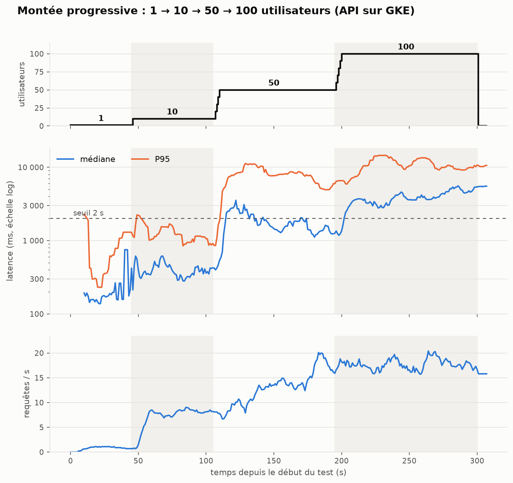

- **L'API ne tombe pas, elle ralentit** : 4 erreurs 502 sur 3 616 requêtes (≈ 0,1 %), mais une latence médiane qui passe de 176 ms à plus de 4 s. Les requêtes font la queue.
- **Le goulot est le CPU** : pods à 91-99 % de leur CPU, ≈ 4 requêtes/s par pod.
- **L'autoscaler est trop lent pour un pic de 5 minutes** : un pod neuf a mis 5 min 29 s à être prêt, dont 5 min 10 s en attente d'une machine. Une première exécution est restée à 8 requêtes/s ; la seconde a atteint 5 pods et 17 à 20 requêtes/s.

### 6.3 Stress test

Rupture (P95 > 2 s) à 20 utilisateurs, 33 s après le début, pour un débit maximal de ≈ 8 requêtes/s avec 2 pods, soit ≈ 4 par pod. 0 erreur : c'est une dégradation, pas une panne. Le test est trop court pour que l'autoscaler réagisse : c'est la capacité de la configuration de départ.

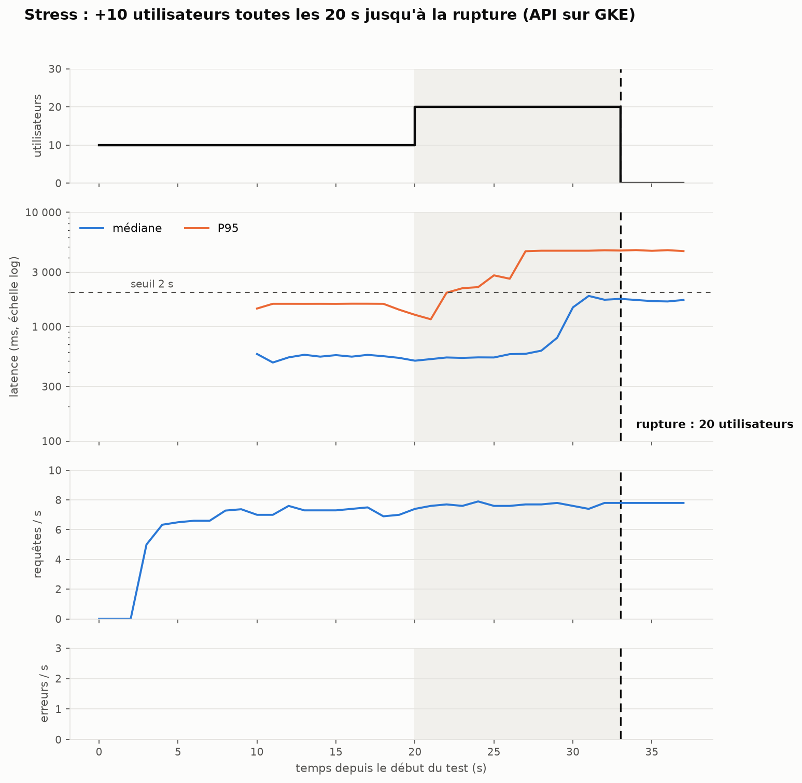

### 6.4 Failover

| Test | Scénario                                                             | Résultat                                                                       |
| -------------- | ------------------------------------------------------------------------------- | ----------------------------------------------------------------------------------------- |
| F1             | Suppression propre d'un pod (`kubectl delete`), 5 utilisateurs, 5 pods prêts | 0 erreur sur 1 192 requêtes ; P95 628 ms avant, 465 ms après                            |
| F2             | Arrêt brutal (`--grace-period=0 --force`), mêmes conditions                 | 1 erreur sur 771 (un 502 du load balancer, 2 s après) ; débit en baisse pendant ≈ 10 s |
| F3             | Pire cas : arrêt brutal avec seulement 2 pods              | 0 erreur sur 892 ; un seul pod pendant 7 min 27 s ; P95 779 → 1 092 ms         |

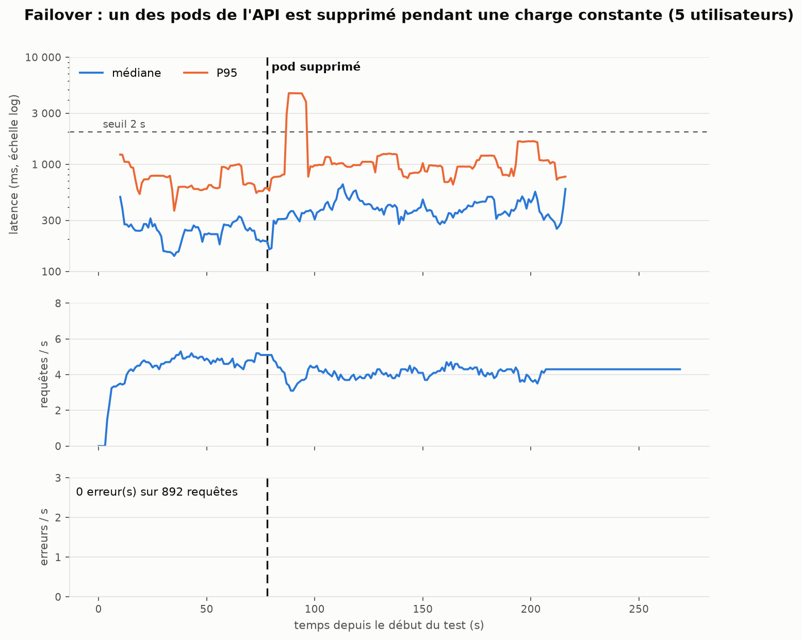

**Ce que F3 a révélé.** Le pod de remplacement est resté en attente : Google a refusé d'ajouter une machine (`GCE quota exceeded`). Le plus serré des quotas relevés ensuite est la limite globale du projet, 12 CPU toutes régions confondues (4/12 hors charge). Hypothèse la plus plausible, non vérifiable après coup : elle a été atteinte quand l'API, Prometheus et Grafana occupaient le plus de machines. Le risque vient donc de la capacité que Google accepte de fournir, plus que de Kubernetes. Par ailleurs, le pod survivant a lui-même été arrêté pendant l'incident : aucun `PodDisruptionBudget` ne l'empêchait.

### 6.5 Améliorations proposées, reliées aux mesures

| Priorité | Amélioration                                                                                                                          | État                   | Mesure qui la justifie                                                                                                                             |
| ------------------- | ------------------------------------------------------------------------------------------------------------------------------------------------ | --------------------------------- | ------------------------------------------------------------------------------------------------------------------------------------------------------------ |
| 1                   | 3 pods minimum et un `PodDisruptionBudget` (`minAvailable: 1`)                                                                               | Proposée                         | F3 : 7 min 27 s sur un seul pod, et le survivant évincé                                                                                                    |
| 2                   | Refuser tôt plutôt que faire attendre : limite de débit par clé ou par adresse (429), au bord du réseau (Cloud Armor) si le quota le permet | Proposée                         | Au-delà de ≈ 8 requêtes/s l'API fait la queue (latence jusqu'à 10 s à 100 utilisateurs) ; les ≈ 49 req/s d'un même client en S7 n'ont reçu aucun 429 |
| 3                   | Plus de CPU par pod, ou réglage des threads de torch                                                                                            | Proposée                         | Pods saturés à 91-99 % pour ≈ 4 requêtes/s                                                                                                               |
| 4                   | Traitement par lots                                                                                                                              | Proposée                         | Le modèle est plus efficace par lots ; un appel par commentaire pèse à 100 requêtes/s                                                                    |
| 5                   | Monter le minimum de pods avant un pic annoncé                                                                                                  | Proposée                         | 5 min 29 s pour qu'un pod neuf serve                                                                                                                         |
| 6                   | File d'attente pour les pics                                                                                                                     | Proposée                         | Absorbe un pic sans bloquer l'appelant                                                                                                                       |
| 7                   | Cache des textes déjà vus                                                                                                                      | Proposée, non mesurée | Nos tests envoient un texte différent à chaque requête                                                                                                    |
| —                  | Load balancer et redondance (2 pods minimum)                                                                                                     | En place et testés     | F1 : 0 erreur                                                                                                                                                |
| —                  | Modèle plus léger (BiLSTM, 0,13 ms)                                                                                                            | Écartée                         | F1 de 0,36 contre 0,56 : nous préférons la qualité                                                                                                        |

## 7. Supervision et sécurité (étape 6)

Cette étape teste Prometheus et Grafana (§ 7.1 et 7.2), analyse les journaux (§ 5.4) et simule des pannes et une attaque (§ 6.4 et § 7.3).

### 7.1 Prometheus et Grafana

- **Installation dans le cluster** (Helm, `kube-prometheus-stack`) plutôt qu'en service géré : ce sont les outils demandés par le sujet, sans offre payante en plus.
- **Métriques sur un port séparé (9090)**, non relié au Service ni à l'Ingress : contrairement à un `/metrics` sur le port public, elles ne sont pas lisibles depuis Internet. Prometheus les lit sur le pod (`PodMonitor`).
- **Grafana sans adresse publique** : on l'ouvre par `port-forward`.
- **Tableau de bord conçu par nous** (`grafana_dashboard.json`, importable). Les tableaux de bord Kubernetes livrés avec Grafana restent vides (« No data ») : GKE Autopilot ne laisse pas Prometheus lire les métriques kubelet. Nous nous appuyons donc sur les métriques exposées par l'API elle-même.

**Métriques exposées et pourquoi :**

| Métrique               | Question à laquelle elle répond                                                                                                                                                              |
| --------------------------------- | -------------------------------------------------------------------------------------------------------------------------------------------------------------------------------------------------------- |
| Requêtes/s par route et par code | Le trafic est-il normal ? Sur quelle route arrive une attaque ?                                                                                                                                          |
| Part de 4xx et de 5xx             | Les clients se trompent-ils ? Le service casse-t-il ?                                                                                                                                                    |
| Latence P95 de `/score`         | Que vivent presque tous les utilisateurs ? Limite : la courbe est plafonnée à 1 s (intervalles de mesure par défaut) alors que Locust mesurait 8 à 12 s ; non exploitable au-dessus de 1 s |
| CPU et mémoire par pod           | Où est le goulot ? (le CPU, pas la mémoire)                                                                                                                                                            |
| Pods prêts / réplicas voulus    | La redondance promise est-elle là ?                                                                                                                                                                     |

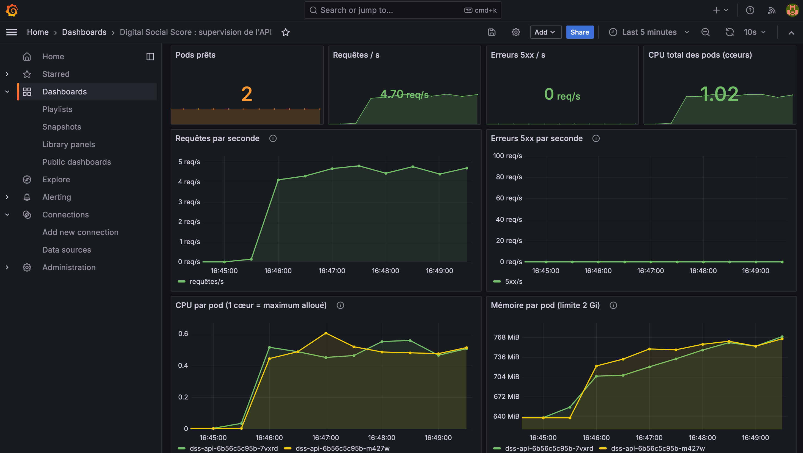

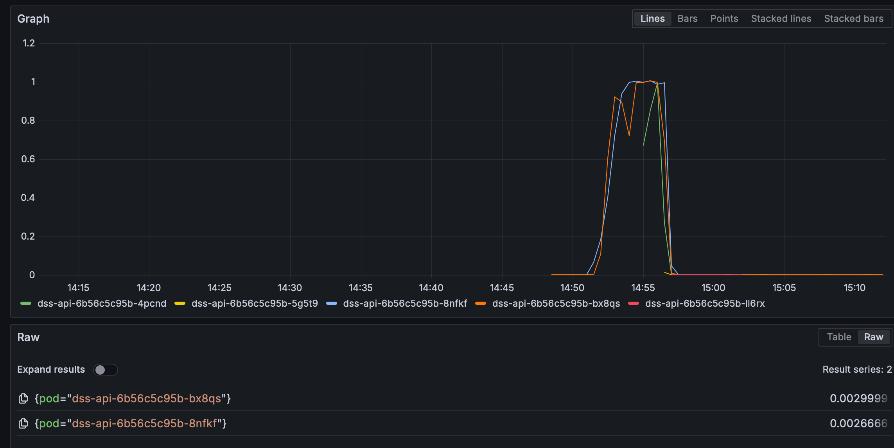

### 7.2 Alertes

**Aucune règle d'alerte n'est déployée** : Alertmanager n'est pas installé (retiré pour libérer de la mémoire, et aucun canal de notification n'était configuré). Les métriques se lisent dans Prometheus et Grafana ; rien ne prévient l'équipe. Voici les alertes que nous proposons, avec leur seuil tiré de nos mesures :

| Alerte proposée | Condition                                 | Pourquoi ce seuil                                                                              | Sévérité |
| -------------------------- | --------------------------------------------------- | -------------------------------------------------------------------------------------------------------- | --------------------- |
| Débit anormal             | Plus de 30 requêtes/s pendant 1 min                | 15 fois l'usage normal (< 2/s) et près de 4 fois la capacité de calcul (≈ 8/s) : impossible sans abus | critique              |
| Erreurs 5xx                | Plus de 5 % de réponses 5xx                        | Le service casse vraiment, au-delà d'erreurs ponctuelles (0,1 % mesuré sous forte charge)              | critique              |
| Latence P95                | P95 de `/score` au-dessus de 2 s                  | Notre critère de rupture de l'étape 5 (exige d'élargir d'abord les intervalles de mesure, § 7.1)     | critique              |
| Pods insuffisants          | Moins de 2 pods prêts                              | La redondance minimale n'est plus là (cas F3)                                                           | critique              |
| Redémarrages              | Un pod a redémarré dans les 10 dernières minutes | Un redémarrage révèle une panne (mémoire, blocage) que la sonde a dû corriger                       | avertissement         |

### 7.3 Tests de sécurité

| ID | Test                                                                             | Attendu | Résultat                                                                                                    |
| ------------ | ------------------------------------------------------------------------------------------ | ----------------- | ---------------------------------------------------------------------------------------------------------------------- |
| S1           | `/score` sans clé                                                                       | 401               | 401 OK                                                                                                                 |
| S2           | Mauvaise clé                                                                              | 401               | 401 OK                                                                                                                 |
| S2b          | Clé avec un caractère non ASCII                                                          | 401               | 500 : bogue confirmé, non corrigé (§ 5.2) échec                                                              |
| S3           | Appel en HTTP                                                                              | redirection       | 301 vers HTTPS OK                                                                                                      |
| S4           | Texte vide, > 5 000 caractères, corps non JSON                                            | 422               | 422 OK                                                                                                                 |
| S5           | Le texte reçu n'apparaît pas dans les journaux                                           | aucun résultat   | aucun résultat OK (canari ZEBRAXYZ123)                                                                                |
| S6           | `/docs` sans clé                                                                        | à décider       | 200 : documentation publique (constat)                                                                       |
| S7           | Rafale invalide (8 attaquants) pendant que 2 utilisateurs légitimes travaillent | service maintenu  | 5 812 requêtes d'attaque toutes refusées (401/422, médiane 25 ms) ; légitimes : 0 erreur, P95 170 ms OK            |
| S8           | Limitation de débit                                                                       | 429               | aucun 429 : les ≈ 49 requêtes/s d'un même client ont toutes été traitées (constat : non implémentée) |

## 8. Architecture cloud (étape 7)

Cette étape liste les composants, dessine les flux, l'authentification et le chiffrement (§ 8.1 à 8.3) et décrit l'approche zero trust (§ 8.4).

### 8.1 Schéma

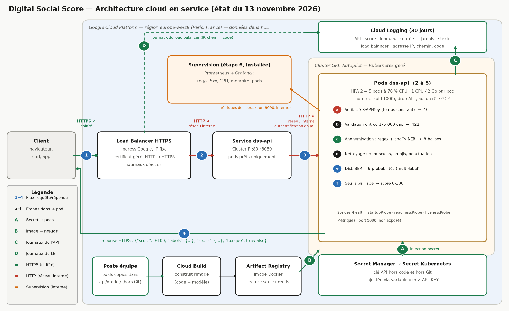

| Repère | Signification                                                               |
| ----------------- | ------------------------------------------------------------------------------------- |
| 1 → 4            | Trajet d'une requête : client → load balancer HTTPS → Service → pod → réponse   |
| a → f            | Dans le pod : clé, validation, anonymisation, nettoyage, DistilBERT, seuils et score |
| A                 | Secret Manager → Secret Kubernetes → variable d'environnement `API_KEY`           |
| B                 | Artifact Registry → nœuds (lecture seule, sur ce dépôt d'images seulement)        |
| C                 | Journaux de l'API → Cloud Logging (jamais le texte)                                  |
| D                 | Journaux du load balancer → Cloud Logging (adresse IP, 30 jours)                     |
| Orange            | Supervision dans le cluster ; métriques par le port 9090, non public                 |

### 8.2 Texte explicatif

L'infrastructure repose sur GKE Autopilot en région europe-west9 (Paris) : le calcul et les journaux restent dans l'Union européenne. Il n'y a qu'un seul point d'entrée public, le load balancer HTTPS de Google. Il porte un certificat géré, redirige le HTTP vers le HTTPS et journalise chaque appel. Il répartit le trafic entre les seuls pods prêts, via un Service interne.

Chaque pod suit les étapes a → f. Les refus bon marché (401, 422) arrivent avant les traitements coûteux. Le texte est anonymisé avant le modèle, et n'est jamais écrit sur disque ni dans les journaux. Le pod ne possède aucun droit sur le projet Google Cloud et tourne sans privilèges.

L'autoscaler maintient 2 à 5 pods à 70 % de CPU. Il absorbe une charge durable, mais pas un pic de quelques minutes (§ 6).

### 8.3 Flux, authentification et chiffrement

| Flux                        | Chiffrement                              | Authentification           |
| ------------------------------------- | -------------------------------------------------- | ------------------------------------ |
| 1. Client → load balancer            | HTTPS (certificat Google), HTTP redirigé          | Aucune à ce niveau                  |
| 2-3. Load balancer → Service → pods | HTTP, réseau interne Google, pas de TLS | Aucune à ce niveau                  |
| Dans le pod                           | Mémoire seulement                                 | Clé `X-API-Key` à temps constant |
| 4. Réponse                           | HTTPS                                              | —                                   |
| A. Secret → pods                     | Secret Kubernetes                                  | Droits Kubernetes                    |
| B. Image → nœuds                    | Réseau interne Google                             | Lecture seule sur ce dépôt         |
| C, D. Journaux                        | Réseau interne Google                             | Service géré                       |

### 8.4 Approche zero trust

| Principe                      | Appliqué                                                       | Manque                                                                            |
| --------------------------------------- | ------------------------------------------------------------------------- | ------------------------------------------------------------------------------------------- |
| Ne jamais faire confiance au réseau    | Chaque appel à `/score` est authentifié, même venant de l'intérieur | Pas de TLS entre le load balancer et les pods ; pas de `NetworkPolicy`                    |
| Moindre privilège                      | Pods sans rôle, nœuds en lecture seule, conteneur durci (§ 5.3)        | Trois comptes humains `Owner`                                                             |
| Vérifier explicitement chaque appelant | Clé obligatoire sur `/score`                                           | Une seule clé partagée : impossible d'identifier ou de révoquer un client seul |
| Réduire la surface                     | Peu de routes exposées (`/health`, `/score`)                         | `/docs` public                                                                  |
| Supposer la compromission               | Conteneur non-root sans privilèges, journaux du load balancer            | Pas de WAF, aucune limitation de débit, aucune alerte déployée                           |

## 9. Particularités techniques

**1. Des scénarios de charge pensés pour mesurer juste.**

- Un stress test qui s'arrête seul au premier critère de rupture (P95 > 2 s pendant 10 s, ou 5 erreurs en 10 s), pour économiser le crédit.
- Des percentiles recalculés requête par requête, parce que ceux de Locust sont cumulés et faux par palier.
- Une attaque mêlée à du trafic légitime (S7), pour mesurer ce que vit l'utilisateur légitime pendant une attaque, et pas seulement si l'attaque échoue.
- Le pire cas de failover (F3, 2 pods), qui a fait apparaître une limite que personne n'attendait : le quota de machines de Google.

**2. Des vérifications dans les journaux et après déploiement.**

- **Canari dans les journaux** : un mot unique (ZEBRAXYZ123) envoyé puis recherché, pour prouver que le texte n'est jamais journalisé.
- **Contrôle de la version du modèle** après déploiement, né d'un incident réel (le modèle factice du 13 novembre).

**3. Une supervision qui ne s'expose pas.** Métriques sur un port interne, Grafana sans adresse publique, tableau de bord conçu par nous quand ceux livrés par défaut restaient vides sur Autopilot.

**4. Un front de démonstration pédagogique.** `front/index.html` est une page unique, sans installation. Elle permet de choisir le modèle (BiLSTM, DistilBERT, LAYA) et montre le texte original, puis anonymisé, puis nettoyé, avec la durée de chaque étape. Une version « Pipeline » animée rejoue la vraie réponse étape par étape. L'historique ne garde que le texte anonymisé, et il est effacé à la fermeture de l'onglet.

**5. Un mode de calcul du score pensé pour ne pas tromper.** Le score de 0 à 100 n'est pas la moyenne des 6 probabilités : il est la moyenne des seuls labels déclenchés (ceux qui dépassent leur seuil). Un commentaire très toxique sur un seul label obtient 95, pas 16 (95 ÷ 6). Si aucun label n'est déclenché, on retombe sur la probabilité brute de `toxic`, pour ne jamais renvoyer 0 sur un texte ambigu. Ce choix est motivé par le déséquilibre des classes : les 5 labels minoritaires tireraient systématiquement le score vers le bas sans rien apporter à la décision.

**6. Un audit de nos propres choix.** L'audit IAM juge chaque compte, y compris les nôtres. Le registre RGPD a été relu contre le code et corrigé. Le bogue S2b a été trouvé par nos propres tests.

## 10. Limites, risques résiduels et améliorations priorisées

| Priorité | Risque résiduel                                                                     | Amélioration                                                                              | Effort |
| ------------------- | ---------------------------------------------------------------------------------------------- | ---------------------------------------------------------------------------------------------------- | ---------------- |
| 1                   | Deux comptes `Owner` superflus (Jean-Philippe et Situ) : peuvent lire la clé ou supprimer le cluster | Retirer `Owner` à deux membres, garder les rôles utiles en fin de TP                             | Faible           |
| 2                   | Clé non ASCII → 500 (S2b) : un client peut provoquer des erreurs à volonté                 | Comparer des octets, ajouter un test                                                                 | Faible           |
| 3                   | Une seule clé partagée                                                                       | Une clé par client, stockée sous forme de hash ; changer la clé après la notation                | Moyen            |
| 4                   | Jeu brut public dans Git                                                                       | Retirer `data/*.csv` de l'historique, documenter le téléchargement depuis Kaggle                 | Faible           |
| 5                   | Reprise lente et dépendante du quota (F3)                                                     | 3 pods minimum, `PodDisruptionBudget`, demande de quota                                            | Faible           |
| 6                   | Aucune limitation de débit (S8) ; `/docs` public (S6)                                       | Limite par clé ou adresse (Cloud Armor si quota, sinon dans l'API) ; fermer `/docs` en production | Moyen            |
| 7                   | Pas de TLS ni de `NetworkPolicy` dans le cluster                                             | `NetworkPolicy` « seul le load balancer parle aux pods » ; mTLS                                  | Moyen            |
| 8                   | Aucune alerte déployée                                                                       | Règles Prometheus (§ 7.2) et Alertmanager vers un canal de l'équipe                               | Faible           |
| 9                   | Anonymisation non mesurée                                                                     | Annoter 500 commentaires à la main pour mesurer précision et rappel                                | Moyen            |

## 11. Conclusion

L'API détecte la toxicité avec un modèle choisi sur mesures (DistilBERT, F1 0,558), renvoie un score de 0 à 100, anonymise le texte avant le modèle et ne le garde jamais. Elle tourne en HTTPS dans l'UE, derrière une clé, dans un conteneur durci, sur 2 à 5 pods supervisés.

Nos tests en ont fixé les limites : environ 4 requêtes/s par pod, un autoscaler trop lent pour un pic, une reprise qui dépend du quota de Google. Nos tests de sécurité ont aussi relevé ce qui manque : aucune limitation de débit, `/docs` public, un bogue sur les clés non ASCII. Ces points sont classés au § 10.

**Passage à l'échelle.** Aujourd'hui, l'API sert 10 à 20 utilisateurs actifs avec moins de 2 s de latence (§ 4.3) : passer de quelques utilisateurs à des milliers n'est pas atteint en volume. Le passage aux milliers est pourtant prévu par la conception. Les pods sont identiques et sans état, derrière un load balancer : on augmente la capacité en ajoutant des pods, sans rien réécrire. Pour 1 000 utilisateurs qui envoient un commentaire toutes les 10 s (100 requêtes/s), il faudrait ≈ 25 pods à la capacité actuelle, ou moins après deux optimisations à mesurer : le traitement par lots et 2 CPU par pod. Dans tous les cas, il faudrait aussi relever le minimum de pods avant un pic connu et augmenter le quota du projet. Ce qui nous limite est le budget et le quota de 12 CPU, non l'architecture.

Les faiblesses qui restent sont classées au § 10. Les plus importantes (comptes `Owner` superflus, clé unique) se corrigent facilement ; le bogue S2b, trouvé par nos tests, reste à corriger.

## 12. Reproduire

```
# Environnement
python3.12 -m venv .venv && source .venv/bin/activate
pip install -r requirements.txt                # inclut spaCy en_core_web_sm

# Données et modèles (le jeu Kaggle va dans data/)
# 1. notebooks/anonyme_2.ipynb   (~20 min)      -> data/anonymise/
# 2. notebooks/clean_text.ipynb                  -> data/clean/
# 3. notebooks/train.ipynb  (BiLSTM ~3 min, DistilBERT ~64 min, LAYA ~2,5 h : 3 000 lignes de validation + 10 000 de test à ≈ 0,7 s) -> models/

# API locale et front
.venv/bin/uvicorn api_locale.main_local:app --port 8000   # API locale + front, http://127.0.0.1:8000/

# Mise en place GCP (une fois), puis déploiement
PROJECT_ID=<projet> bash api/deploy/gke_setup.sh
python api/export_model.py --type distilbert   # copie les poids dans api/model/
PROJECT_ID=<projet> bash api/deploy/deploy_gke.sh
curl https://<domaine>.sslip.io/health   # model_version : jamais dummy-…

# Tests
cd api && pytest -v
export API_KEY=<clé>   # jamais dans un fichier
LOG_REQUETES=loadtest/results/montee_requetes.csv .venv/bin/locust \
  -f loadtest/locustfile.py,loadtest/montee.py --host https://<domaine>.sslip.io
.venv/bin/python loadtest/report.py montee
```
---

## Annexe A : grille de tests (sécurité, stress, failover, supervision)

Livrable du TP (« Grille tests sécurité/stress/failover »). Cible : l'API déployée sur GKE. Date des essais : 12 novembre 2026.

Légende : OK = vérifié sur le cluster ; code = prévu dans le code (tests `pytest` de `api/tests/`), pas vérifié sur le cluster ; à faire.

### Sécurité

| ID  | Test                                                                                                                                         | Attendu                                       | Résultat                                                                                                                                                                                                                                                                             | État                                                                                                                                                                                   |
| --- | -------------------------------------------------------------------------------------------------------------------------------------------- | --------------------------------------------- | ------------------------------------------------------------------------------------------------------------------------------------------------------------------------------------------------------------------------------------------------------------------------------------- | --------------------------------------------------------------------------------------------------------------------------------------------------------------------------------------- |
| S1  | `POST /score` sans clé                                                                                                                    | 401                                           | 401                                                                                                                                                                                                                                                                                   | OK                                                                                                                                                                            |
| S2  | `POST /score` avec une mauvaise clé                                                                                                       | 401                                           | 401                                                                                                                                                                                                                                                                                   | OK                                                                                                                                                                            |
| S2b | `POST /score` avec une clé contenant un caractère non ASCII (ex. `clé`)                                                               | 401                                           | 500 Internal Server Error ; le journal montre `TypeError: comparing strings with non-ASCII characters is not supported` (comparaison de clé).                                                                                                                            | Bogue confirmé (reproduit avec `X-API-Key: clé`, HTTP/2 500) : à corriger (comparer des octets, pas des chaînes) ; un client peut provoquer des erreurs 500 à volonté |
| S3  | Appel en HTTP (sans TLS)                                                                                                                     | redirection vers HTTPS                        | 301 vers `https://…:443/health`                                                                                                                                                                                                                                                    | OK                                                                                                                                                                            |
| S4a | Texte vide                                                                                                                                   | 422                                           | 422                                                                                                                                                                                                                                                                                   | OK                                                                                                                                                                            |
| S4b | Texte de 6 000 caractères (> 5 000)                                                                                                         | 422                                           | 422                                                                                                                                                                                                                                                                                   | OK                                                                                                                                                                            |
| S4c | Corps qui n'est pas du JSON                                                                                                                  | 422                                           | 422                                                                                                                                                                                                                                                                                   | OK                                                                                                                                                                            |
| S5  | Les logs ne contiennent pas le texte reçu                                                                                                   | aucun texte ni IP dans Cloud Logging          | Texte envoyé : un nom, une IP et un mot unique (`ZEBRAXYZ123`). Recherche dans Cloud Logging (30 min) : aucun résultat. Les lignes du journal ont toutes la forme `score=60 longueur=67 duree_ms=80.2` (jamais le texte).                                             | OK                                                                                                                                                                            |
| S6  | `/docs` (Swagger) accessible sans clé                                                                                                     | à décider                                   | 200 : publique                                                                                                                                                                                                                                                              | constat                                                                                                                                                                                 |
| S7  | Rafale de requêtes invalides (sans clé, mauvaise clé, texte trop long, JSON invalide) pendant que des utilisateurs légitimes travaillent | le service légitime continue                 | 2 min, 2 légitimes + 8 attaquants (`loadtest/attaque.py`). 5 812 requêtes d'attaque (≈ 49/s), toutes refusées avec le bon code (401 ou 422), médiane 25 ms. Utilisateurs légitimes : 276 requêtes, 0 erreur, médiane 90 ms, P95 170 ms, maximum 391 ms. | OK (limite : pas de mesure « légitimes seuls » avec les mêmes textes, donc la comparaison n'est qu'indicative)                                                            |
| S8  | Limitation de débit                                                                                                                         | requêtes refusées (429) au-delà d'un seuil | Aucun 429 : les ≈ 49 requêtes/s d'un même client ont toutes été traitées jusqu'au refus (401/422). Une attaque plus forte consommerait du CPU sans être freinée.                                                                                                              | constat : non implémentée (amélioration proposée : limite par clé ou par adresse)                                                                                                  |

### Supervision (Prometheus et Grafana)

Charge de l'essai : montée progressive Locust lancée depuis un Mac, de 14:50 à 14:57 (heure de Paris, affichage Grafana). Captures : § 7.1.

| ID  | Test                                                                                  | Attendu                                                                               | Résultat                                                                                                                                                                                                                             | État                                                     |
| --- | ------------------------------------------------------------------------------------- | ------------------------------------------------------------------------------------- | ------------------------------------------------------------------------------------------------------------------------------------------------------------------------------------------------------------------------------------- | --------------------------------------------------------- |
| SU1 | Prometheus collecte les 2 pods de l'API (port 9090, séparé du port public)          | 2 cibles `UP`                                                                       | 2/2 `UP`, collecte en 6 à 14 ms                                                                                                                                                                                                    | OK                                              |
| SU2 | Nombre de pods et autoscaler visibles                                                 | 2 pods, puis plus sous charge                                                         | 2 → 3 (≈ 14:55) → 5 (≈ 14:56:30) → 2 (≈ 15:01:30)                                                                                                                                                                               | OK                                              |
| SU3 | CPU par pod                                                                           | saturation visible sous charge                                                        | 1,0 cœur (le maximum alloué) sur les 2 pods d'origine de 14:52 à 14:57 ; les pods ajoutés servent trop tard                                                                                                                       | OK                                              |
| SU4 | Mémoire par pod                                                                      | marge suffisante                                                                      | 0,5 à 0,65 Go au repos, 1,43 Go au pic (limite 2 Gi), non rendue après la charge                                                                                                                                                    | OK                                              |
| SU5 | Débit de l'API                                                                       | courbe proportionnelle à la charge                                                   | pic ≈ 12,5 requêtes/s, 0 après la fin                                                                                                                                                                                              | OK                                              |
| SU6 | Taux d'erreurs 5xx                                                                    | visible s'il y en a                                                                   | aucune série : aucune erreur 5xx renvoyée par les pods                                                                                                                                                                    | OK                                              |
| SU7 | Latence P95                                                                           | monte avec la charge, alerte à 2 s                                                   | courbe bloquée à 1 s : les intervalles de mesure par défaut s'arrêtent à 1 s, alors que Locust mesurait 8 à 12 s à 50-100 utilisateurs. Non exploitable au-dessus de 1 s.                                  | limite : à corriger (intervalles à élargir côté API) |
| SU8 | Tableau de bord Grafana (Kubernetes / Compute Resources / Namespace)                  | CPU et mémoire par pod                                                               | « CPU Requests » affiché ; panneaux d'usage vides : GKE Autopilot ne laisse pas Prometheus lire les métriques kubelet/cAdvisor. Remplacé par les métriques du processus exposées par l'API (SU3, SU4).                         | contourné                                                |
| SU9 | Tableau de bord Grafana construit pour l'API (`grafana_dashboard.json`, importable) | indicateurs et courbes alimentés par Prometheus pendant une charge de 5 utilisateurs | 9 panneaux affichés : 2 pods prêts, ≈ 4,7 req/s, 0 erreur 5xx, CPU total ≈ 1,02 cœur (≈ 0,5 par pod), mémoire de 640 à 770 MiB par pod. L'autoscaler ne monte pas : 0,5 cœur par pod reste sous son seuil (70 % de 1 cœur). | OK                                              |

### Stress

| ID  | Test                                      | Attendu                                    | Résultat                                                                                            | État                                        |
| --- | ----------------------------------------- | ------------------------------------------ | ---------------------------------------------------------------------------------------------------- | -------------------------------------------- |
| ST1 | Montée 1 → 10 → 50 → 100 utilisateurs | l'API répond, la latence monte            | 4 erreurs sur 3 616 (≈ 0,1 %) ; P95 de 1,2 s à 11,8 s ; débit jusqu'à 17-20 requêtes/s (5 pods) | OK                                 |
| ST2 | +10 utilisateurs/20 s jusqu'à P95 > 2 s  | point de rupture                           | 20 utilisateurs (≈ 8 requêtes/s, 2 pods), 0 erreur                                                 | OK                                 |
| ST3 | Autoscaler                                | ajoute des pods quand le CPU dépasse 70 % | 5 pods atteints ; un pod neuf prêt en 5 min 29 s                                                    | OK, jugé trop lent                |
| ST4 | Point de rupture « dur » (erreurs)      | première vague d'erreurs                  | non atteint jusqu'à 100 utilisateurs                                                                | à faire si besoin (monter plus haut, coût) |

### Failover

| ID  | Test                                                                                | Attendu                                             | Résultat                                                                                                                                                                                                                                                                                                                                                                                                                                                                                     | État                                                                                                                                                                                                                                                                                                                                                                                                                                                                                                                                                                                           |
| --- | ----------------------------------------------------------------------------------- | --------------------------------------------------- | --------------------------------------------------------------------------------------------------------------------------------------------------------------------------------------------------------------------------------------------------------------------------------------------------------------------------------------------------------------------------------------------------------------------------------------------------------------------------------------------- | ----------------------------------------------------------------------------------------------------------------------------------------------------------------------------------------------------------------------------------------------------------------------------------------------------------------------------------------------------------------------------------------------------------------------------------------------------------------------------------------------------------------------------------------------------------------------------------------------- |
| F1  | Suppression propre d'un pod (`kubectl delete`) sous charge de 5 utilisateurs      | pas d'erreur, latence stable                        | 0 erreur sur 1 192 requêtes ; P95 628 ms avant, ≈ 465 ms après ; 5 pods avant l'incident                                                                                                                                                                                                                                                                                                                                                                                                   | OK (limites : arrêt propre, 59 s observées)                                                                                                                                                                                                                                                                                                                                                                                                                                                                                                                                         |
| F2  | Arrêt brutal d'un pod (`--grace-period=0 --force`) sous charge de 5 utilisateurs | quelques erreurs possibles, retour rapide           | Pod supprimé à 14:41:25 UTC (t = 34 s). 1 erreur sur 771 requêtes (502 Bad Gateway du load balancer, 2 s après le kill). Médiane 207 → 199 ms, P95 715 → 572 ms. Débit descendu à ≈ 4,3 req/s pendant ≈ 10 s, puis revenu à ≈ 5. 5 pods prêts avant l'incident.                                                                                                                                                                                                       | OK (limite : 5 pods, pas le pire cas)                                                                                                                                                                                                                                                                                                                                                                                                                                                                                                                                                 |
| F3  | Perte d'un pod quand il n'en reste que 2 (charge de 5 utilisateurs)                 | service maintenu, capacité divisée par 2          | Pod supprimé de force à 14:51:09 UTC (t = 78 s) : 0 erreur sur 892 requêtes. Le pod de remplacement a mis 7 min 27 s à être prêt (créé à 14:51:10, prêt vers 14:58:37) : il est resté `Pending`, l'autoscaler de machines a échoué (`FailedScaleUp : GCE quota exceeded`, puis « in backoff »). Un seul pod prêt pendant tout ce temps. Latence : médiane 240 → 394 ms, P95 779 → 1 092 ms, maximum 4,7 s ; débit ≈ 4,7 → ≈ 4 req/s. | OK : service maintenu mais dégradé ; constat : la reprise dépend de la capacité que Google accepte de fournir (message `GCE quota exceeded`), pas seulement de Kubernetes. Quotas relevés ensuite (hors charge) : régionaux non pleins (CPUS 8/32, INSTANCES 1/8, adresses IP 1/4) ; le plus serré est la limite globale du projet, `CPUS_ALL_REGIONS` = 12 (4/12 hors charge). Hypothèse la plus plausible : cette limite de 12 CPU a été atteinte quand l'API, Prometheus et Grafana occupaient le plus de machines ; non vérifiable après coup |
| F3b | Protection contre les évictions volontaires (PodDisruptionBudget)                  | une règle empêche de retirer le dernier pod prêt | `kubectl get pdb` : aucune règle. Pendant F3, le pod survivant a été arrêté (`Terminating`) alors que son remplaçant n'était pas encore prêt : fenêtre probable d'environ 20 s sans pod prêt (déduite des âges des pods, non mesurée).                                                                                                                                                                                                                             | constat : amélioration proposée (PDB `minAvailable: 1`), non appliquée                                                                                                                                                                                                                                                                                                                                                                                                                                                                                                                     |

### Tests non réalisés

| Test non réalisé               | Pourquoi                                                          |
| ------------------------------------------ | --------------------------------------------------------------------------- |
| ST4 : rupture « dure » (vague d'erreurs) | Non atteinte jusqu'à 100 utilisateurs ; monter plus haut coûte du crédit |
| F4 : perte d'un nœud entier               | Non réalisé : sur Autopilot, les nœuds sont gérés par Google           |

Détails, courbes et captures : § 6, § 7 et annexe B.

---

## Annexe B : rapport de simulation de charge

Cible : l'API déployée sur GKE (Kubernetes Autopilot, Paris), 2 pods au minimum, autoscaler de 2 à 5 pods à 70 % de CPU, 1 CPU et 2 Go par pod (vérifié : le même ReplicaSet a servi pendant tous les tests). Modèle : DistilBERT. Route testée : `POST /score` avec clé API.

### B.1 Méthode et justification des choix

Le choix de Locust, de la cible, du seuil de 2 s et des percentiles par requête est justifié au § 6.1. Compléments propres à cette annexe :

| Choix                                                                                                                          | Justification                                                                                                                     |
| ------------------------------------------------------------------------------------------------------------------------------ | --------------------------------------------------------------------------------------------------------------------------------- |
| 1 000 textes de `test_clean.csv`, tirés au hasard (graine fixe), longueur médiane 147 caractères, maximum 4 728 | Textes variés et réalistes ; un texte différent à chaque requête évite qu'un cache fausse les mesures.                      |
| Pause de 0,5 à 1 s entre deux requêtes d'un utilisateur                                                            | Environ 1 requête par seconde et par utilisateur : 100 utilisateurs ≈ 100 requêtes/s demandées.                               |
| Paliers 1 → 10 → 50 → 100 utilisateurs sur 5 min                                                                  | Facteur 5 à 10 entre paliers pour voir où la latence décolle, sans durer assez longtemps pour coûter cher.                    |
| Failover avec 5 utilisateurs (≈ 5 requêtes/s)                                                                      | Sous la capacité de 2 pods (≈ 8 requêtes/s) : le service est sain avant l'incident, donc l'effet de la perte d'un pod se voit. |
| Mesures : latence moyenne, médiane, P95, P99, taux d'erreur, requêtes/s                                            | Demandées par le TP. Le P95 et le P99 disent ce que vivent presque tous les utilisateurs, ce que la moyenne cache.               |

**Précaution :** Locust tourne sur un Mac et l'API sur Google Cloud. Les latences incluent donc le réseau et le chiffrement HTTPS. La clé d'API n'est jamais écrite dans un fichier (variable d'environnement), et le journal ne contient aucun texte.

### B.2 Mesure de référence : 1 utilisateur

120 requêtes en 80 s, 0 erreur : médiane 220 ms, moyenne 287 ms, P95 620 ms, P99 1 000 ms. C'est la latence de base à laquelle tout le reste est comparé.

Ce temps est bien supérieur aux ~12 ms mesurées en local (prétraitement 4 ms + modèle 8 ms), mais il est vu du client : il comprend le réseau et le chiffrement HTTPS. Le calcul dans le pod, lui, est mesuré : les journaux de l'API (`duree_ms`) donnent ≈ 100 ms médiane à faible charge. Quand le CPU est saturé (≈ 4 requêtes/s pour 1 CPU), cela fait au plus ≈ 250 ms de CPU par requête, d'où la fourchette « 100 à 250 ms » du § 5.1. Le reste des 220 ms est du réseau.

### B.3 Scénario 1 : montée progressive (1 → 10 → 50 → 100 utilisateurs, 5 min)

Deux exécutions. Exécution 2 (percentiles exacts, 3 616 requêtes, 4 erreurs « 502 Bad Gateway » ≈ 0,1 %) : tableau et courbe au § 6.2.

**Exécution 1** (moyennes seulement : le journal par requête n'existait pas encore) :

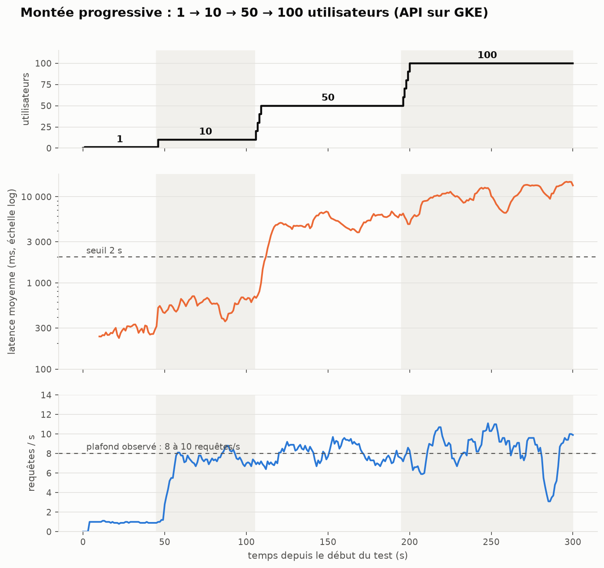

| Palier        | Requêtes/s | Latence moyenne | Erreurs |
| ------------- | ----------- | --------------- | ------- |
| 1 utilisateur | 1,0         | 280 ms          | 0       |
| 10            | 7,5         | 569 ms          | 0       |
| 50            | 8,1         | 5,1 s           | 1       |
| 100           | 8,4         | 10,8 s          | 1       |

**Lecture.**

- L'API ne s'effondre pas : moins de 0,2 % d'erreurs dans les deux exécutions. Elle ralentit : les requêtes attendent dans une file.
- **Point de rupture (latence)** : la latence moyenne dépasse 2 s entre 10 et 50 utilisateurs ; le stress test (§ B.4) le situe à 20 utilisateurs (P95 > 2 s). Jusqu'à 10 utilisateurs, le P95 reste vers 1,2 s.
- **Exécution 1 : le débit plafonne vers 8 requêtes/s** dès 10 utilisateurs, avec 2 pods. Exécution 2 : il monte à 17-20 requêtes/s après le palier à 10. La capacité a plus que doublé d'une exécution à l'autre : les captures du § B.5 montrent que l'autoscaler a cette fois atteint ses 5 pods.

### B.4 Scénario 2 : stress

Profil `stress.py` : +10 utilisateurs toutes les 20 s. Arrêt automatique dès que le P95 (fenêtre de 10 s) reste au-dessus de 2 s pendant 10 s, ou que 5 erreurs arrivent en 10 s, ou à 200 utilisateurs. Le point de rupture est enregistré dans `results/stress_rupture.json`.

*(Courbe : voir § 6.3.)*

| Palier                                   | Requêtes/s | Moyenne | Médiane | P95   | P99   | Erreurs |
| ---------------------------------------- | ----------- | ------- | -------- | ----- | ----- | ------- |
| 10 utilisateurs                          | 7,7         | 574 ms  | 504 ms   | 1,3 s | 1,6 s | 0       |
| 20 utilisateurs (interrompu après 13 s) | 8,0         | 1,8 s   | 1,6 s    | 4,4 s | 4,7 s | 0       |

**Résultat : rupture au sens du critère à 20 utilisateurs**, 33 s après le début, avec un P95 de 4,8 s. Le débit est déjà de ≈ 8 requêtes/s à 10 utilisateurs et n'augmente plus : la capacité est atteinte, les requêtes font la queue. La capture ci-dessous montre 2 pods au départ (l'autoscaler à 2 réplicas, CPU à 49 % pendant le test) : cela fait ≈ 4 requêtes/s par pod.

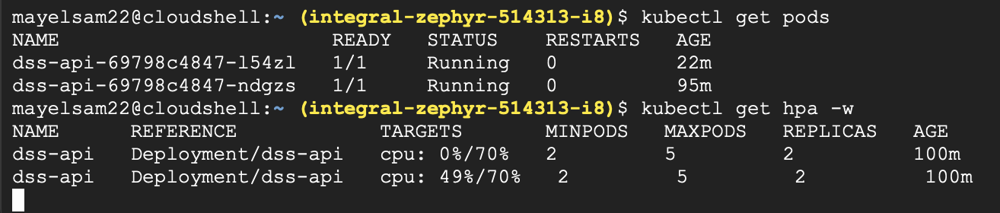

**Limites.**

- Le critère (P95 > 2 s) est strict : c'est une dégradation, pas une panne (0 erreur). La montée à 100 utilisateurs (§ B.3) a tenu avec 0,1 % d'erreurs : on n'a donc pas trouvé de rupture « dure ».
- Le test dure 37 s : l'autoscaler n'a pas eu le temps de réagir (un pod neuf met plus de 5 min à être prêt, § B.5). Le point de rupture mesuré est celui de la configuration de départ.
- Le palier à 20 utilisateurs est très court : ses valeurs sont indicatives.

### B.5 Autoscaling

**Exécution 1** :

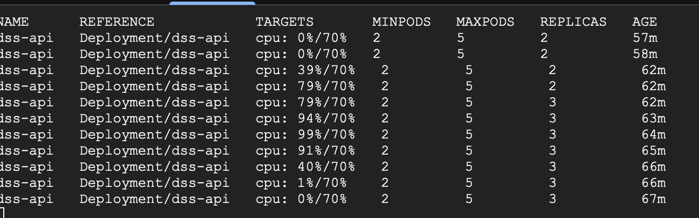

Le CPU passe de 0 % à 79 %, l'autoscaler ajoute un seul pod (2 → 3), puis le CPU reste à 91-99 % avec 3 pods, sans que l'autoscaler monte plus haut pendant le test. Le goulot est donc le CPU, pas le réseau.

**Exécution 2** : liste des pods relevée avec `kubectl get pods -w` pendant et après le test.

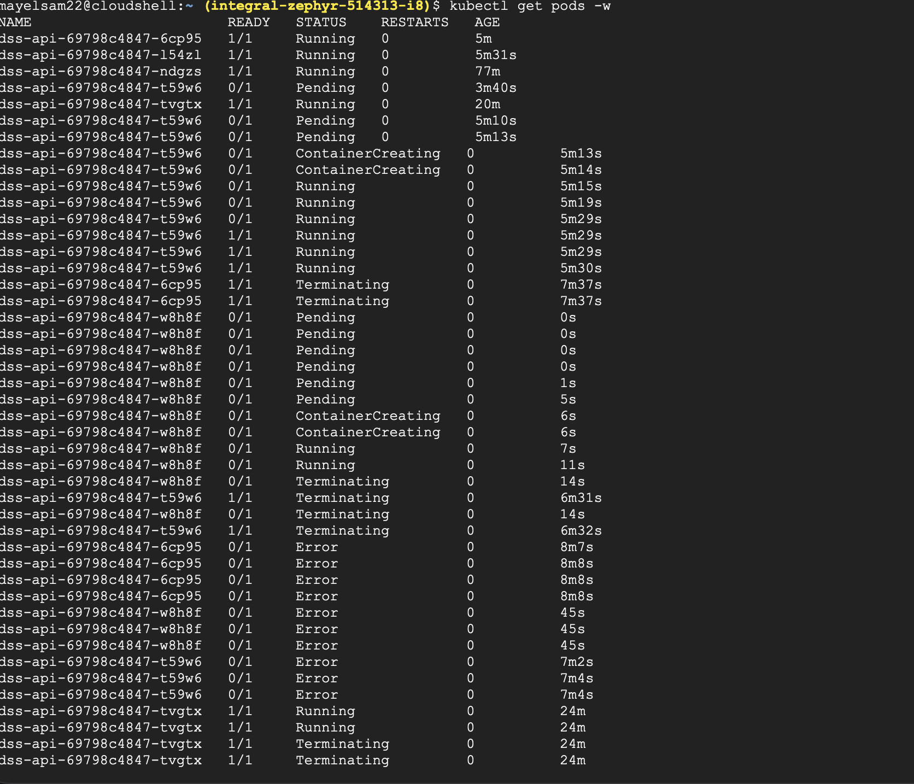

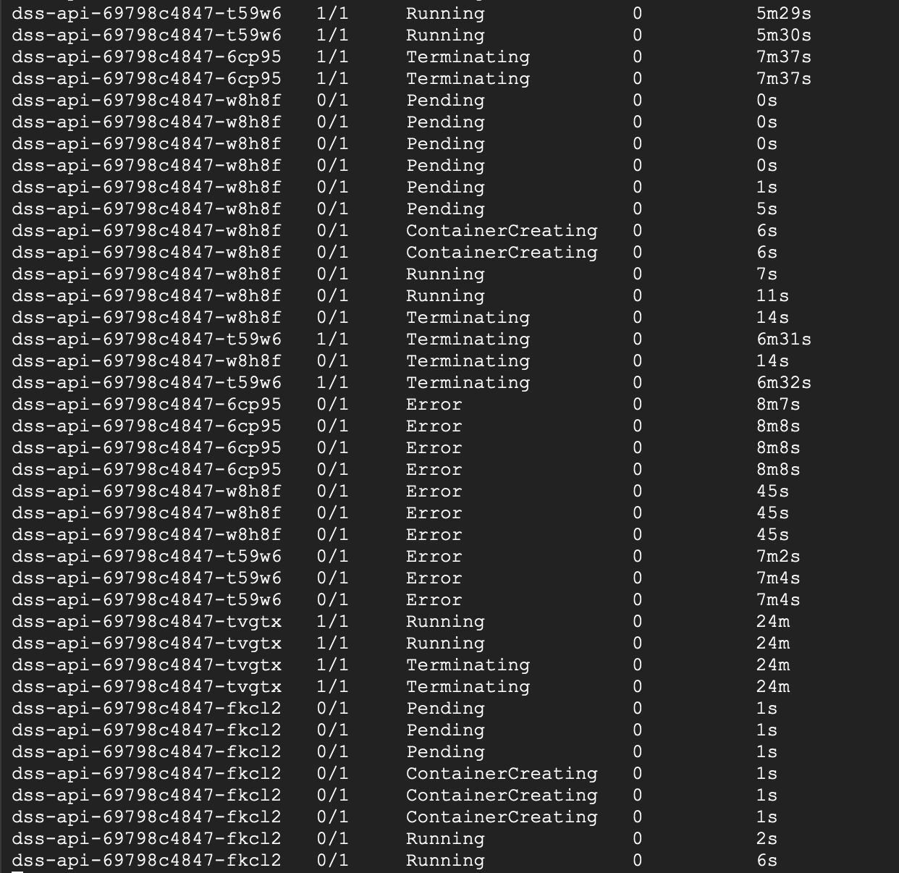

- On compte 5 pods distincts : l'autoscaler a atteint son maximum. Trois d'entre eux (âgés de 3 à 5 min au début de la capture) ont été créés pendant la montée. Cela explique le débit de 17 à 20 requêtes/s : environ 4 à 5 requêtes/s par pod si 4 à 5 pods servaient, cohérent avec les ≈ 4 requêtes/s par pod de l'exécution 1.
- **Un pod neuf met plusieurs minutes à servir.** Le pod `t59w6` reste 5 min 10 s en `Pending` (Autopilot doit d'abord préparer une machine), démarre en ≈ 15 s, et n'est prêt (`1/1`) qu'à 5 min 29 s. Un pod ajouté pendant une montée de 5 minutes arrive donc quand elle est déjà finie.
- Les pods arrêtés passent par le statut `Error` : non diagnostiqué ici ; piste : lire le code de sortie du conteneur (`kubectl describe pod`).

### B.6 Scénario 3 : failover

Charge constante de 5 utilisateurs (≈ 5 requêtes/s, sous la capacité), 4 minutes. À t = 183 s (11:34:43 UTC), un pod est supprimé avec `kubectl delete` :

*(Courbe : voir § 6.4.)*

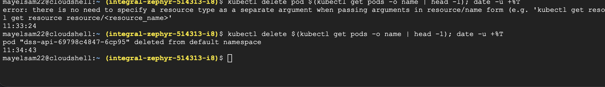

Interface de Locust pendant les deux tests (montée progressive, puis failover à 5 utilisateurs) et tableau final du failover :

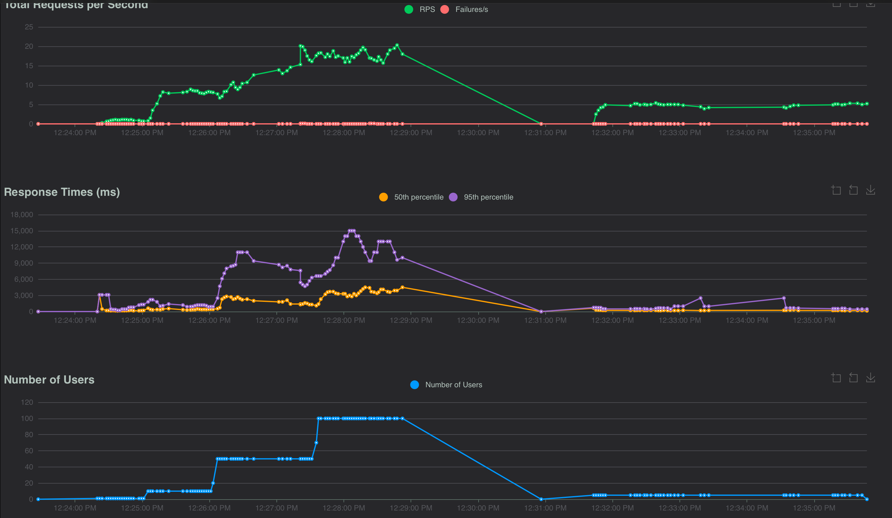

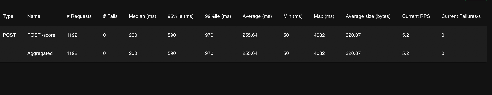

| Période          | Requêtes/s | Médiane | P95    | Erreurs |
| ----------------- | ----------- | -------- | ------ | ------- |
| Avant l'incident  | 4,9         | 209 ms   | 628 ms | 0       |
| 0 à 20 s après  | 5,2         | 161 ms   | 413 ms | 0       |
| 20 à 60 s après | 5,1         | 170 ms   | 465 ms | 0       |

**Résultat : 0 erreur sur 1 192 requêtes** ; la latence ne se dégrade pas.

**Pods autour de l'incident** (captures du § B.5) : avant l'incident, 5 pods étaient prêts (`t59w6` l'est devenu environ 50 s avant). Le pod supprimé `6cp95` passe en `Terminating` ; Kubernetes crée immédiatement un remplacement (`w8h8f` : `Pending` 0 s, `Running` à 7 s). Ce remplacement est lui-même arrêté 14 s plus tard, avec d'autres pods : probablement la réduction de l'autoscaler, le CPU étant redevenu bas (non confirmé).

**Limites :**

- Le test s'arrête 59 s après l'incident : on n'observe ni le retour à un état stable, ni le temps de démarrage d'un pod de remplacement (celui créé a été arrêté après 14 s).
- `kubectl delete pod` est un arrêt propre (le pod est retiré du load balancer avant de s'arrêter). Une panne brutale (nœud perdu, processus tué) n'a pas été testée.
- La charge de 5 requêtes/s est inférieure à la capacité des pods restants : le résultat ne dit rien sur une panne pendant un pic.
- L'incident a eu lieu avec 5 pods prêts (4 après la suppression), pas avec le minimum de 2 : le résultat montre la redondance d'un cluster déjà monté en charge, pas celle de la configuration minimale.

### B.7 Limites de l'étude

- Locust et l'API ne sont pas sur le même réseau : les latences incluent le trajet.
- Une seule exécution par scénario sauf la montée (deux exécutions, aux résultats différents) : pas d'intervalle de confiance.
- Percentiles exacts uniquement pour l'exécution 2 de la montée et pour le failover.
- Compte gratuit : le quota n'a pas empêché l'autoscaler d'atteindre 5 pods (exécution 2).
- Les textes envoyés sont ceux de `test_clean.csv`, déjà nettoyés (l'API les anonymise quand même).

### B.8 Relancer les tests

```bash
# Depuis la racine du projet ; la clé reste dans la variable d'environnement, jamais dans un fichier
export API_KEY=<clé>
# Montée progressive (interface sur http://localhost:8089, cliquer sur Start)
LOG_REQUETES=loadtest/results/montee_requetes.csv .venv/bin/locust -f loadtest/locustfile.py,loadtest/montee.py \
    --host https://<domaine>.sslip.io --web-host 127.0.0.1 --csv loadtest/results/montee
.venv/bin/python loadtest/report.py montee
# Failover : lancer failover.py à la place de montee.py, puis supprimer un pod et noter l'heure UTC
#   kubectl delete $(kubectl get pods -o name | head -1); date -u +%T
.venv/bin/python loadtest/report.py failover <HH:MM:SS>
```
---

## Annexe C : registre des activités de traitement (article 30 RGPD)

**Référence** : DSS-RGPD-2026-001
**Version** : 1.1 (relue contre le code en service, branche `ci`)
**Date** : 19 novembre 2026 (ajouts du 19/11 : annotation et biais du jeu, ligne type du journal, fichiers sources des mesures, repris du registre d'Eliana)
**Statut** : En vigueur

---

#### 1. Responsable du traitement

| Champ | Valeur |
|---|---|
| Dénomination | Équipe Digital Social Score (CAKPOSSA Jean-Philippe, OUEDRAOGO Eliana, NOUDEGBE Situ) |
| Projet | Digital Social Score API — analyse de toxicité (TP ESIGELEC) |
| Contact | Les membres de l'équipe, joignables par l'ESIGELEC (adresses non publiées : dépôt public). Projet pédagogique : aucune adresse dédiée n'existe |
| Localisation | France |

---

#### 2. Traitement A — Préparation du jeu d'entraînement (notebooks)

| Rubrique | Contenu |
|---|---|
| Finalité | Réduire la présence de données personnelles dans les commentaires avant l'entraînement des modèles (cadre pédagogique) |
| Base légale | Art. 6.1.f — intérêt légitime : commentaires publics publiés sous licence libre, utilisés pour un exercice de détection de toxicité ; données pseudonymisées avant tout usage |
| Source | Toxic Comment Classification Dataset (Jigsaw / Google, 2017) : 159 571 commentaires d'entraînement, 153 164 de test ; texte CC-BY-SA 3.0 (Wikipédia), labels CC0 ; annotation binaire par vote majoritaire d'évaluateurs humains ; **biais** : corpus uniquement anglophone, issu de Wikipédia, biais culturels possibles sur `identity_hate` |
| Données | Texte libre pouvant contenir noms, pseudos, adresses IP, e-mails, téléphones, URL, adresses postales. Les labels (notamment `identity_hate`) peuvent révéler des attaques visant des groupes : données potentiellement sensibles (art. 9) |
| Personnes concernées | Auteurs et personnes citées dans les commentaires Wikipédia |
| Minimisation | Identifiants directs remplacés par 8 balises typées (regex + spaCy NER) avant l'entraînement. **Pseudonymisation, pas anonymisation** : le texte d'origine reste public sur Wikipédia |
| Stockage | Fichiers anonymisés et nettoyés (`data/anonymise/`, `data/clean/`) : en local seulement, exclus de Git |
| **Jeu brut** | **`data/train.csv` et `data/test.csv` (≈ 130 Mo) sont publiés dans le dépôt GitHub public** `elSam22/depl_ai_cyber`. Texte déjà public et sous licence, mais republié sans pseudonymisation, sur un hébergement situé aux États-Unis. **Action : retirer ces fichiers de l'historique Git et documenter le téléchargement depuis Kaggle** |
| Conservation | Fichiers anonymisés et nettoyés : supprimés après la notation du projet |
| Destinataires | Équipe projet |
| Transferts hors UE | GitHub (États-Unis) : code, documentation, résultats agrégés **et jeu brut public** (voir ci-dessus) |
| Risques résiduels | Anonymisation incomplète (aucun jeu annoté pour la mesurer) ; ré-identification par recoupement avec Wikipédia |

---

#### 3. Traitement B — API de score en service

| Rubrique | Contenu |
|---|---|
| Nom | Digital Social Score API — analyse automatisée de toxicité |
| Finalité principale | Restituer, pour un texte soumis, un score de toxicité de 0 à 100 (arrondi à la dizaine) et un verdict (`toxique`) |
| Finalité secondaire | Sécurité du service : détection et analyse d'abus (journaux du load balancer, refus pseudonymisés) |
| Base légale | Art. 6.1.f — intérêt légitime à fournir un outil d'aide à la modération ; mis en balance par la minimisation (texte jamais conservé, anonymisé avant le modèle) |
| Décision automatisée / profilage | Le score est calculé sans intervention humaine. Aucune décision à effet juridique dans la version actuelle. **Une AIPD (art. 35) serait obligatoire** si le score était intégré à un processus décisionnel (modération automatique, accès, recrutement) |

##### 3.1 Personnes concernées

- **Utilisateurs de l'API** (développeurs, intégrateurs) : identifiés par une clé d'API **unique et partagée** ; la clé n'est jamais journalisée.
- **Auteurs des commentaires soumis**, et personnes citées dans ces commentaires.

##### 3.2 Données traitées

| Donnée | Nature | Traitement | Stockage |
|---|---|---|---|
| Commentaire soumis | Données personnelles potentielles, y compris sensibles (art. 9 : opinions, santé, origine…) | Anonymisé (regex + spaCy NER) puis nettoyé, en mémoire, avant le modèle | **Aucun** — ni disque, ni journal, ni réponse |
| Réponse | Score arrondi à la dizaine + verdict | Renvoyée à l'appelant | Non conservée côté serveur |
| Journal de l'API | Score, longueur du texte, durée de calcul, horodatage : non personnel | Une ligne par analyse, par exemple `score=87 longueur=142 duree_ms=14.2` | Cloud Logging, 30 jours |
| Journal des refus (401, 429, 503, 413) | Motif, route, **empreinte HMAC de 10 caractères de l'adresse IP** (clé secrète du serveur) : donnée pseudonymisée | Au plus une ligne par minute et par client | Cloud Logging, 30 jours |
| **Journaux du load balancer** | **Adresse IP du client, chemin, code de réponse, user-agent, horodatage : données personnelles** | Activés volontairement (`sampleRate: 1.0`) pour pouvoir reconstituer une attaque | Cloud Logging, 30 jours |
| Métriques Prometheus | Compteurs par route, code, motif de refus ; CPU, mémoire : non personnel | Dans le cluster, port non exposé | Durée de rétention de Prometheus |

---

#### 4. Destinataires et sous-traitants (art. 28)

**Destinataires internes** : les trois membres de l'équipe (journaux et supervision). Note : les trois membres ont le rôle `Owner` du projet Google Cloud (voir § 5.3).

| Sous-traitant | Rôle | Localisation | Garanties |
|---|---|---|---|
| Google Cloud (GKE, Artifact Registry, Cloud Build, Cloud Logging, Cloud Storage) | Hébergement, construction de l'image, journaux, stockage des poids du modèle | europe-west9 (Paris) pour le cluster et le dépôt d'images | Avenant de traitement des données Google Cloud (CCT) |
| Google Secret Manager | Stockage de la clé d'API | **Réplication automatique (multi-régions choisies par Google)** : créé avec `--replication-policy=automatic` | ISO 27001, SOC 2 ; **action : restreindre la réplication à europe-west9** |
| GitHub (Microsoft) | Code source, pipeline | États-Unis | Pas de donnée de production ; jeu brut public (traitement A) |
| Google Fonts | Police du front de démonstration | Hors UE possible | Connexion directe du navigateur vers Google (adresse IP) ; **action : héberger la police localement** |

##### Transferts hors UE (art. 30.1.e)

Le calcul du score et les journaux de production restent dans l'UE. Il existe trois flux hors UE ou non localisés : le dépôt GitHub (jeu brut public), la réplication du secret, et la police Google Fonts chargée par le front de démonstration.

---

#### 5. Durées de conservation

| Données | Durée | Justification |
|---|---|---|
| Texte soumis | Aucune — mémoire uniquement | Minimisation (art. 5.1.c) |
| Journaux de l'API, des refus et du load balancer | **30 jours** — rétention par défaut de Cloud Logging, non modifiée | Sécurité et traçabilité, mises en balance avec la minimisation |
| Poids du modèle | Durée du service | Nécessité opérationnelle |
| Fichiers du traitement A | Jusqu'à la notation | Projet pédagogique |

---

#### 6. Mesures de sécurité (art. 32)

| Mesure | Mise en œuvre | Statut |
|---|---|---|
| Authentification | Clé `X-API-Key`, comparaison à temps constant (`secrets.compare_digest`, `api/main.py`) ; 429 après 10 clés fausses par minute et par adresse | En service — défaut : une clé non ASCII donne 500 au lieu de 401 |
| Chiffrement en transit | HTTPS forcé (certificat géré, redirection : `api/k8s/ingress.yaml`, `backendconfig.yaml`) ; pas de TLS entre le load balancer et les pods | En service |
| Minimisation | Anonymisation avant le modèle (`api/preprocessing.py`) ; texte jamais journalisé (`api/main.py`, `--no-access-log` dans `api/Dockerfile`) (prouvé par un canari) ; réponse réduite | En service |
| Secrets | Secret Manager → Secret Kubernetes (`secretKeyRef` dans `api/k8s/deployment.yaml`) ; jamais dans le code, l'image ou Git ; poids du modèle dans un bucket privé | En service |
| Durcissement | Non-root, `drop ALL`, pas d'élévation (`api/Dockerfile`, `api/k8s/deployment.yaml`), système de fichiers en lecture seule, aucun rôle Google Cloud pour les pods | En service |
| Protection en entrée | Texte de 1 à 5 000 caractères (422, `api/main.py`) ; limites par adresse (429, `api/limiteur_debit.py`), corps ≤ 40 Ko (413), au plus 3 calculs par pod (503), `/docs` fermé | En service depuis le 16 novembre |
| Disponibilité | 2 à 5 pods, sondes de santé (`api/k8s/deployment.yaml`, `hpa.yaml`) | En service |
| Supervision | Prometheus, Grafana, 7 règles d'alerte (sans notification) | En service |
| Droits d'accès | 3 comptes `Owner` | **À réduire** |

---

#### 7. Droits des personnes (art. 12 à 22)

Les journaux ne contiennent **aucun identifiant de clé** et aucun texte. Les droits s'exercent donc ainsi :

| Droit | Applicable | Modalités |
|---|---|---|
| Accès (art. 15) | Limité | Le texte n'est pas conservé. Pour les journaux du load balancer, une personne peut demander les lignes liées à **son adresse IP** sur les 30 derniers jours |
| Rectification (art. 16) | Sans objet | Aucune donnée conservée qui puisse être inexacte au sujet d'une personne |
| Effacement (art. 17) | Oui | Suppression des lignes liées à une adresse IP sur demande ; suppression automatique à 30 jours |
| Limitation (art. 18) | Limité | Pas de donnée à geler, en dehors des journaux du load balancer |
| Portabilité (art. 20) | Sans objet | Traitement fondé sur l'intérêt légitime, aucune donnée fournie et conservée |
| Opposition (art. 21) | Oui | Arrêt de l'envoi de textes ; la clé étant partagée, une révocation individuelle est impossible (clé par client à prévoir) |
| Décision automatisée (art. 22) | À garantir | Le score ne doit pas être la seule base d'une décision à effet juridique |

**Contact** : les membres de l'équipe, par l'ESIGELEC (en service réel, une adresse dédiée serait obligatoire). **Réclamation** (art. 77) : CNIL, 3 place de Fontenoy, TSA 80715, 75334 Paris Cedex 07, www.cnil.fr.

---

#### 8. Risques résiduels

- Anonymisation non mesurée et incomplète ; ré-identification possible par recoupement avec Wikipédia.
- Données sensibles possibles dans les commentaires soumis (traitées en mémoire seulement).
- Jeu brut publié sur GitHub.
- Score non calibré : ne doit pas fonder seul une décision.
- Accès trop larges au projet (trois `Owner`) : chacun peut lire la clé et les journaux.

---

#### 9. Historique des révisions

| Version | Date | Modifications |
|---|---|---|
| 1.0 | 12/11/2026 | Création initiale |
| 1.1 | 17/11/2026 | Relecture contre le code en service : deux traitements distingués ; journaux du load balancer (IP) et des refus (empreinte HMAC) ajoutés ; rétention unifiée à 30 jours ; réplication du secret, Google Fonts et jeu brut public déclarés ; réponse réduite ; droits reformulés selon ce qui est réellement possible |

*Établi en application de l'article 30 du règlement (UE) 2016/679 (RGPD).*
