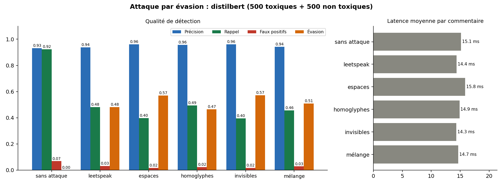
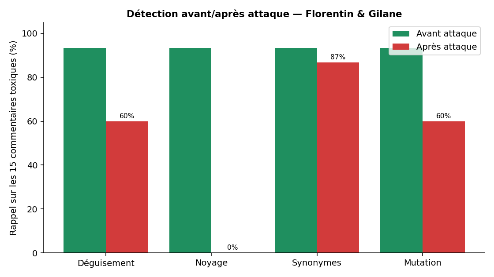
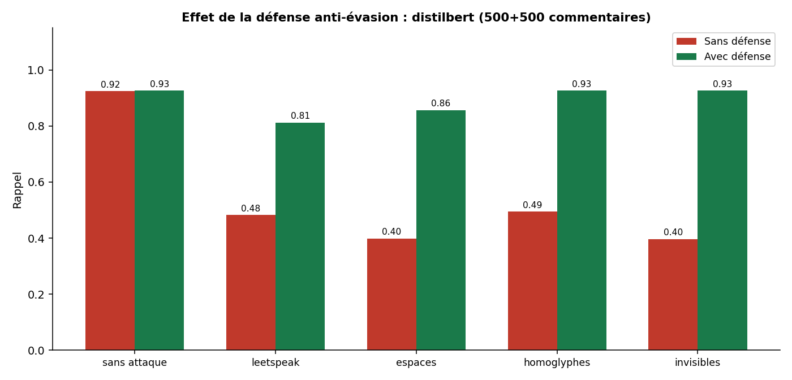
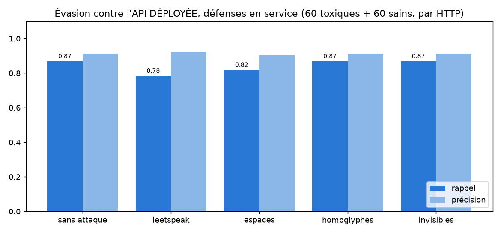
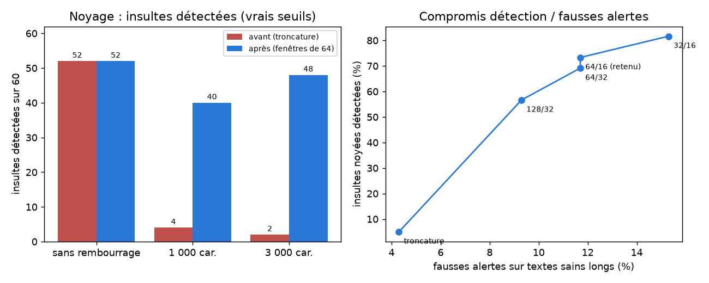
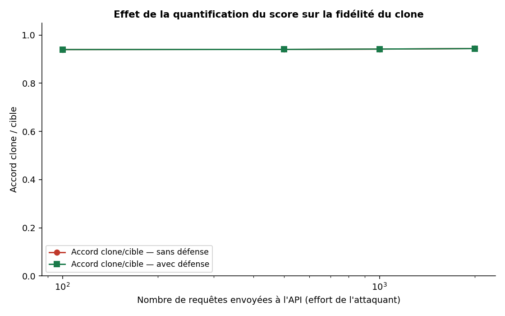
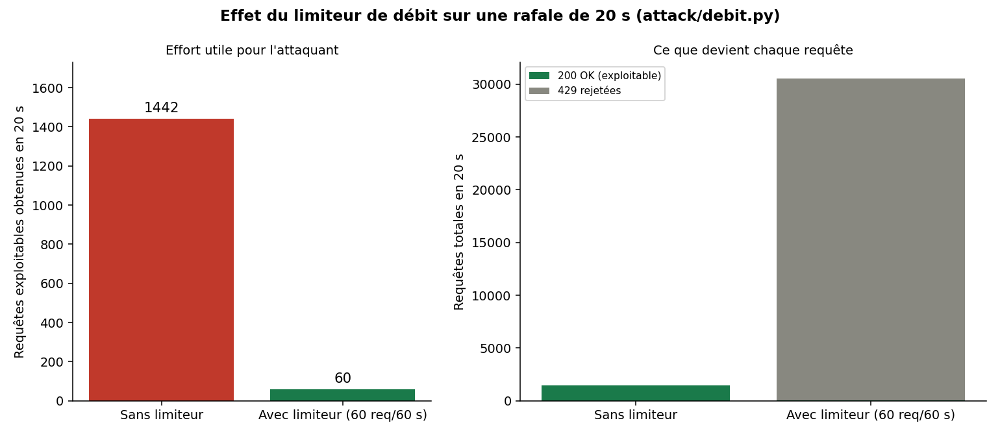
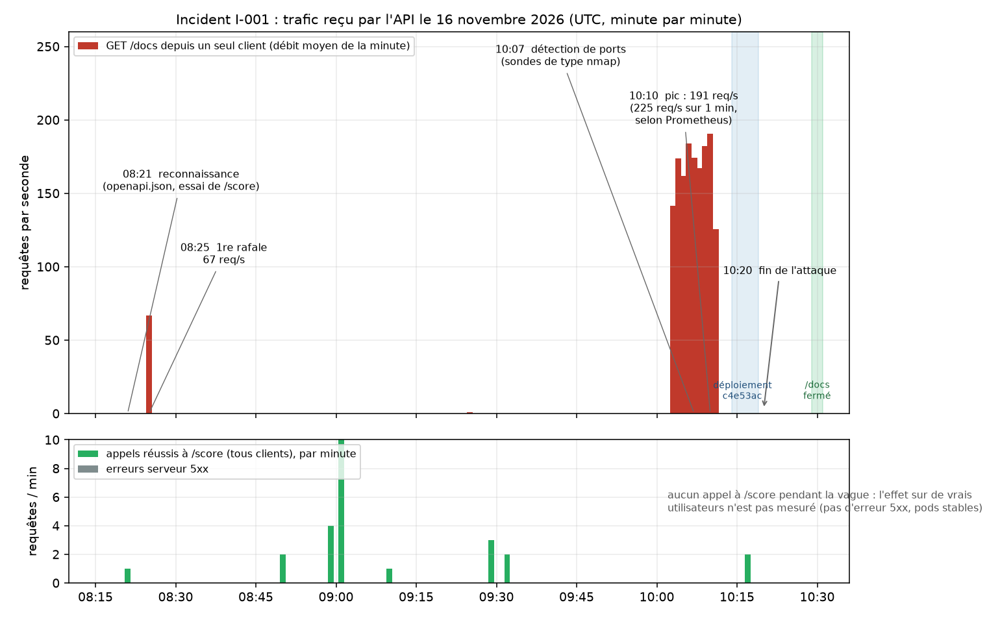
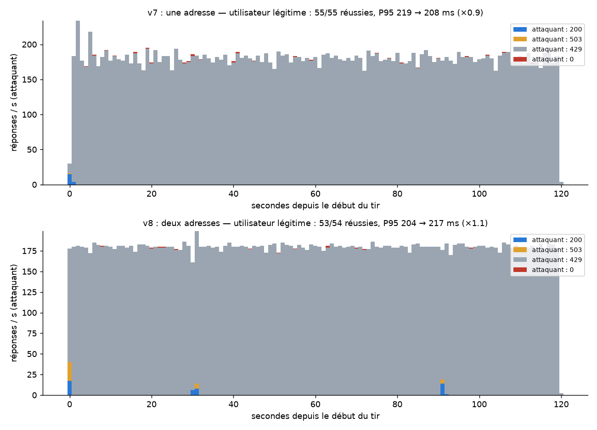
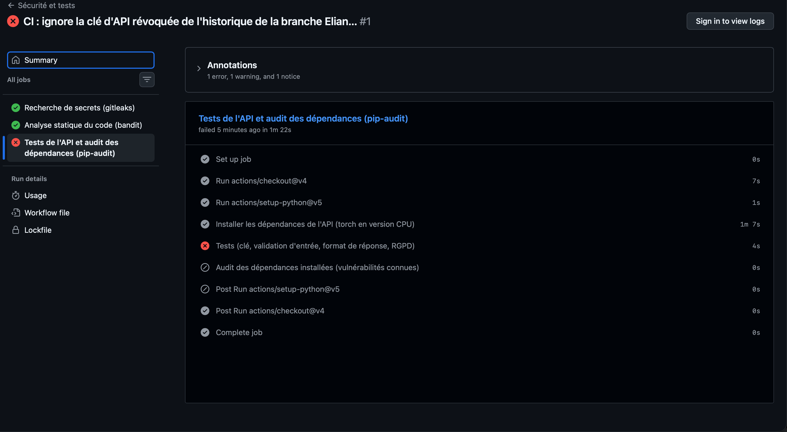

# Livrable TP2 : de la menace à la défense

**Membres** : CAKPOSSA Jean-Philippe, OUEDRAOGO Eliana, NOUDEGBE Situ ; TP2, Déploiement de solutions IA et cybersécurité, ESIGELEC, novembre 2026

Renforcer une IA déployée dans le cloud : l'API Digital Social Score du TP1 (DistilBERT sur GKE à Paris, `POST /score` protégé par clé). Le document suit les 5 étapes de l'énoncé (§ 2 à 6). Scripts d'attaque et résultats : dossier `attack/` ; fiche du modèle : `model_card.json` à la racine.

## Résumé

- **Attaque (étapes 1-2)** : évasion par texte déguisé (leetspeak, lettres espacées, homoglyphes, caractères invisibles). Sur 1 000 commentaires du test officiel, le rappel tombe de 0,92 à 0,40-0,49 : un toxique sur deux passe, sans aucun signal de performance (latence inchangée).
- **Défense (étape 3)** : normalisation du texte avant le modèle. Évasion ramenée à 0 % (homoglyphes, invisibles) et 6 à 10 % (leetspeak, espaces), mesuré par HTTP sur l'API déployée (8 à 12 % en local). Défenses complémentaires contre les attaques réellement subies : noyage (4 → 40 insultes détectées sur 60), vol de modèle (la quantification échoue, la limite de débit réussit), déni de service : sous un flot de 201 req/s sur `/score`, un utilisateur légitime garde 100 % de ses requêtes (§ 4.3).
- **IA Act (étape 4)** : risque limité, à condition que le score ne qualifie jamais une personne (sinon notation sociale interdite, art. 5). `model_card.json` contrôlée à chaque push ; biais déclaré non évalué plutôt qu'affirmé absent.
- **DevSecOps (étape 5)** : 7 jobs à chaque push (secrets, code, conformité IA Act, configuration, image Docker, tests, déploiement), identité fédérée sans clé, provenance des poids vérifiée, retour arrière automatique ; blocages réels prouvés par les numéros d'exécution.
- **Rejeu de l'attaque du professeur (§ 4.4)** : sous le même flot (≈ 180 req/s), l'utilisateur légitime passe de ×76 à ×0,8 à ×1,1 de latence ; 19 à 46 requêtes d'attaque acceptées sur plus de 21 000 contre 43 685 ; extraction freinée (7 à 15 réponses exploitables sur 400) ; réponse réduite ; alertes déclenchées. Deux exécutions, voir `attack/results/redteam/`.
- **Ce qui reste faible** : attaque depuis un réseau d'adresses plus large que nos deux adresses de test, limites par pod sans WAF (Cloud Armor refusé par quota), clé unique, biais non mesuré, noyage seulement réduit.

## Périmètre : TP1 et TP2

Le TP1 (`TP1_LIVRABLE.md`) décrit l'API, son déploiement, sa charge et sa supervision. Ce document ne reprend que ce qui relève de l'attaque, de la défense, de la conformité et de la chaîne de livraison. Les renvois « livrable du TP1, § x » pointent vers lui.

| Étape de l'énoncé   | Livrable demandé                                                  | Où  |
| ---------------------- | ------------------------------------------------------------------ | ---- |
| 1. Choix d'une attaque | Fiche d'analyse « Attaque IA »                                   | § 2 |
| 2. Mise en œuvre      | Script dans `attack/`, graphique, interprétation                | § 3 |
| 3. Défense            | Tableau et graphique avant/après                                  | § 4 |
| 4. IA Act              | Fiche de risque, `model_card.json`                               | § 5 |
| 5. DevSecOps           | Pipeline `.github/workflows/securite.yml`, journaux d'exécution | § 6 |

## 1. Introduction

**Démarche.** Nous avons suivi les 5 étapes de l'énoncé, puis confronté nos défenses aux attaques réelles du 16 novembre (le test du professeur) et à son rapport consolidé. Chaque défense est mesurée avant et après, sur l'API locale puis sur l'API déployée.

**Nos principes** (les sections y renvoient) :

| Principe                                        | Ce qu'il veut dire concrètement                                                                                            |
| ----------------------------------------------- | --------------------------------------------------------------------------------------------------------------------------- |
| D1 : Mesurer de bout en bout, sur l'API réelle | Une défense validée en local doit être rejouée par HTTP contre l'API en service, avec les vrais seuils                  |
| D2 : Une défense se juge aussi à son coût    | Efficacité, fausses alertes et calcul consommé : une défense qui ouvre un déni de service est une faille                |
| D3 : Ne rien affirmer sans preuve               | « Pas de biais » sans mesure est refusé par la pipeline ; un résultat négatif est publié comme tel                    |
| D4 : Refuser tôt et à bas coût               | Contrôles les moins chers (débit, taille, clé) avant le prétraitement et le modèle                                     |
| D5 : Défense en profondeur                     | Modèle (normalisation, fenêtres), application (limites), réponse (réduite), chaîne de livraison (pipeline, provenance) |

---

## 2. Choix et analyse d'une attaque (étape 1)

Cette étape choisit une seule attaque et la décrit dans une fiche d'analyse : type, cible, objectif, impacts techniques, éthiques et RGPD, risque IA Act.

| Rubrique                   | Contenu                                                                                                                                                                                                                                                  |
| -------------------------- | -------------------------------------------------------------------------------------------------------------------------------------------------------------------------------------------------------------------------------------------------------- |
| Type d'attaque             | Évasion par exemples adverses, en boîte noire : le texte toxique est déguisé pour que le modèle ne le reconnaisse plus, sans changer son sens pour un lecteur humain.                                                                               |
| Cible                      | Le modèle DistilBERT déployé. Point d'entrée : le champ `text` de `POST /score`, seule chose que l'attaquant contrôle ; il n'a besoin ni du code ni des poids, seulement d'une clé d'API.                                                      |
| Objectif de l'attaquant    | Publier insultes, menaces ou propos haineux sans être signalé : obtenir `toxique: false` pour un commentaire réellement toxique.                                                                                                                    |
| Techniques                 | Déguiser les seuls mots toxiques : leetspeak (`idiot` → `1d10t`), lettres espacées (`i d i o t`), homoglyphes (lettres cyrilliques identiques à l'œil, `іdіоt`), caractères invisibles (U+200B entre les lettres), mélange des quatre. |
| Impact attendu : technique | Le rappel s'effondre ; le service répond normalement (200, même latence) : aucune alerte.                                                                                                                                                              |
| Impact attendu : éthique  | Les personnes harcelées ne sont plus protégées ; les propos haineux (`identity_hate`) déguisés touchent des groupes déjà vulnérables ; la confiance dans la modération baisse.                                                                |
| Impact attendu : RGPD      | Les commentaires qui passent peuvent contenir des données sensibles (art. 9 : origine, religion, orientation sexuelle). Les homoglyphes et caractères invisibles peuvent aussi contourner les regex d'anonymisation (un e-mail déguisé non masqué). |
| Risque IA Act              | Atteinte à l'exigence de robustesse (art. 15) : résistance aux tentatives de tiers d'exploiter les vulnérabilités du système ; les exemples adverses sont cités explicitement (art. 15 § 5).                                                      |

**Pourquoi cette attaque plutôt qu'une autre.** Elle est réaliste (faisable à la main, sans outil) et mesurable sans coût sur le test officiel. Le vol de modèle coûte des milliers d'appels ; l'empoisonnement des données demande un réentraînement (64 min par essai) ; la saturation de l'API a été étudiée au TP1 et ne vise pas le modèle. Ces autres menaces ont été rencontrées ensuite pour de vrai : elles sont traitées à l'étape 3 (défenses complémentaires) et dans l'analyse critique.

---

## 3. Mise en œuvre de l'attaque (étape 2)

Cette étape met l'attaque en œuvre (dossier `attack/`, script `attack/evasion.py`) et mesure précision, taux de faux positifs et latence, avec graphique et interprétation.

**Protocole.**

- **Échantillon** : 500 commentaires toxiques et 500 non toxiques du test officiel (lignes à -1 exclues, graine 42). Les toxiques contiennent au moins un mot de la liste de mots toxiques du prétraitement (sinon il n'y aurait rien à déguiser).
- **Attaque** : seuls les mots toxiques sont déguisés, le reste est intact ; appliquée à tous les textes (un commentaire sain peut contenir un gros mot).
- **Chaîne** : la même que l'API (anonymisation, nettoyage, DistilBERT, seuils par label). Toxique prédit = au moins un label au-dessus de son seuil.
- **Machine** : Mac M3. Latence = prétraitement + modèle, sans le réseau.

**Exemple** (`You are a stupid idiot and a moron`), tel que le modèle le reçoit :

| Attaque           | Texte reçu par le modèle                                                                             |
| ----------------- | ------------------------------------------------------------------------------------------------------ |
| Leetspeak         | `you are a 7up1d 1d107 and a m0r0n`                                                                  |
| Lettres espacées | `you are a s t u p i d i d i o t and a m o r o n`                                                    |
| Homoglyphes       | `you are a stuріd іdіоt and a mоrоn`                                                          |
| Invisibles        | `you are a s t u p i d i d i o t and a m o r o n` (le nettoyage a changé les invisibles en espaces) |



| Variante               | Précision | Rappel | Taux de faux positifs | F1   | Évasion | Latence moyenne |
| ---------------------- | ---------- | ------ | --------------------- | ---- | -------- | --------------- |
| Sans attaque           | 0,93       | 0,92   | 0,068                 | 0,93 | —       | 15,1 ms         |
| Leetspeak              | 0,94       | 0,48   | 0,032                 | 0,64 | 48 %     | 14,4 ms         |
| Lettres espacées      | 0,96       | 0,40   | 0,016                 | 0,56 | 57 %     | 15,8 ms         |
| Homoglyphes            | 0,96       | 0,49   | 0,022                 | 0,65 | 47 %     | 14,9 ms         |
| Caractères invisibles | 0,96       | 0,40   | 0,016                 | 0,56 | 57 %     | 14,3 ms         |
| Mélange               | 0,94       | 0,46   | 0,028                 | 0,61 | 51 %     | 14,7 ms         |

*Évasion* : part des commentaires toxiques détectés sans attaque qui ne le sont plus avec l'attaque.

**Interprétation.**

- **L'attaque est efficace et bon marché** : le rappel passe de 0,92 à 0,40-0,49, un commentaire toxique sur deux n'est plus détecté, en changeant quelques caractères.
- **La précision ne baisse pas (0,93 → 0,94-0,96), et c'est trompeur** : le modèle ne se met pas à accuser des textes sains, il se tait. Les faux positifs baissent même (0,068 → 0,016), car les textes sains contenant un gros mot ne sont plus signalés non plus. Une supervision qui suivrait la précision ou le taux d'erreur ne verrait rien.
- **La latence est inchangée** (14 à 16 ms, dans le bruit de mesure) : l'attaque est invisible côté performance.
- **Lettres espacées et caractères invisibles sont les plus efficaces (57 %)** et donnent le même résultat : notre propre nettoyage transforme les invisibles en espaces. Le prétraitement, conçu pour réduire le vocabulaire, aide ici l'attaquant.
- **Le modèle résiste un peu** (la moitié des toxiques restent détectés), grâce au contexte de la phrase et aux sous-mots de DistilBERT.

**Limites.** Échantillon équilibré (50 % de toxiques contre ~10 % en réalité : la précision y est plus haute, le rappel et l'évasion n'en dépendent pas) ; seuls les mots de la liste sont déguisés (attaque plutôt prudente) ; une exécution, en local.

### 3.1 Attaques menées contre les autres binômes

Chaque binôme attaquait l'API d'autres binômes, avec leur accord et leur clé. Le 16 novembre, nous avons lancé 4 attaques contre deux API déployées, sur les mêmes 15 commentaires toxiques et 15 sains (`attack/inter_equipes/`) :
- **déguisement** : leetspeak, homoglyphes et caractères invisibles, 1 requête ;
- **noyage** : le commentaire placé après ≈ 4 000 caractères neutres, 1 requête ;
- **recherche de synonymes** : au plus 15 requêtes ;
- **mutation aléatoire** : au plus 15 requêtes.

| Cible | Détection sans attaque | Déguisement | Noyage | Synonymes | Mutation |
|---|---|---|---|---|---|
| Florentin & Gilane | 93 % | 60 % | **0 %** (14 évasions sur 15) | 87 % | 60 % |
| Exauce & Gilbert | 60 % | 7 % | **0 %** | **0 %** | 13 % |

*Détection* : part des 15 commentaires toxiques encore détectés.



Maëlle & Rémi ont aussi reçu de notre part une attaque par évasion (insultes déguisées), dont ils ont fait la cible de leur défense. L'API d'Aurel & Baunell n'a pas été testée : son certificat était refusé par nos outils, et nous n'avons pas voulu désactiver la vérification TLS.

**Ce que cela nous a appris sur notre propre API.** Le noyage, qui fait tomber la détection à 0 % chez les deux binômes, n'était pas dans notre analyse de l'étape 1. Nous l'avons rejoué sur notre API : la même faille y était (une insulte passe de 0,995 seule à 0,012 noyée). La défense est décrite au § 4.3. Chaque binôme a reçu son propre rapport avec les textes exacts ; le détail est dans `attack/RAPPORT.md`, § 4 et 5.

---

## 4. Conception d'une défense (étape 3)

Cette étape implémente une défense, rejoue l'attaque initiale avec et sans elle (§ 4.1 et 4.2), traite les attaques réellement subies (§ 4.3) et rejoue l'attaque du professeur (§ 4.4).

### 4.1 Défense contre l'évasion : normalisation du texte

**Défense implémentée** : une normalisation du texte avant le modèle, sans toucher au modèle : unification Unicode (NFKC), suppression des caractères invisibles, homoglyphes cyrilliques ramenés au latin, mots espacés lettre par lettre regroupés, dé-leet (seulement dans les mots qui contiennent déjà une vraie lettre, pour ne pas abîmer un numéro). Réexécution de l'attaque initiale : `attack/defense.py`, même protocole et même échantillon qu'à l'étape 2.



| Variante               | Précision sans → avec | Rappel sans → avec | Faux positifs sans → avec | Latence sans → avec | Évasion avec défense |
| ---------------------- | ----------------------- | ------------------- | -------------------------- | -------------------- | ---------------------- |
| Sans attaque           | 0,93 → 0,93            | 0,92 → 0,93        | 0,068 → 0,068             | 14,2 → 14,1 ms      | —                     |
| Leetspeak              | 0,94 → 0,93            | 0,48 → 0,81        | 0,032 → 0,060             | 14,2 → 14,1 ms      | 12 %                   |
| Lettres espacées      | 0,96 → 0,93            | 0,40 → 0,86        | 0,016 → 0,064             | 15,6 → 14,1 ms      | 8 %                    |
| Homoglyphes            | 0,96 → 0,93            | 0,49 → 0,93        | 0,022 → 0,068             | 15,0 → 15,0 ms      | 0 %                    |
| Caractères invisibles | 0,96 → 0,93            | 0,40 → 0,93        | 0,016 → 0,068             | 15,3 → 14,4 ms      | 0 %                    |

**Interprétation.**

- **La défense marche nettement** : homoglyphes et invisibles sont entièrement défaits (rappel revenu à 0,93, évasion 0 %) ; leetspeak et lettres espacées résistent un peu (évasion 8 à 12 %), car la règle de dé-leet est volontairement prudente.
- **Le texte normal n'est pas dégradé** (rappel 0,92 → 0,93, faux positifs identiques) : c'est le premier point à vérifier pour ce type de correction.
- **Les faux positifs remontent sur les variantes attaquées, mais exactement au niveau de base (0,068)** : un texte sain déguisé est traité comme un texte sain normal.
- **Coût nul** : latence inchangée.
- **Erreur trouvée en route** : dé-leeter *avant* l'anonymisation faisait traverser les numéros de téléphone et adresses IP collés à un mot (`me:0612345678`). Les tests de la pipeline (étape 5) l'ont détectée ; le dé-leet passe désormais après l'anonymisation. Cette défense est déployée dans l'API en service.

**Limites.** Mesure faite sur l'API locale, avec un échantillon équilibré. Elle est rejouée contre l'API déployée juste après (sous-section suivante). Les 4 variantes ont été testées séparément, pas le mélange.

### 4.2 Vérification sur l'API déployée (17 novembre)

Même protocole, mais par HTTP contre l'API en service, défenses actives, avec un nouveau script : `attack/mesure_api_deployee.py` (60 commentaires toxiques + 60 sains du test officiel, graine 42 ; requêtes espacées pour rester sous la limite de débit). C'est ce qu'obtiendrait un vrai attaquant, réseau, prétraitement et limites compris.



| Variante                                 | Précision | Rappel                | Faux positifs | Évasion | Latence médiane vue du client |
| ---------------------------------------- | ---------- | --------------------- | ------------- | -------- | ------------------------------ |
| Sans attaque                             | 0,91       | 0,87                  | 0,083         | —       | 941 ms                         |
| Leetspeak                                | 0,92       | 0,78                  | 0,067         | 9,6 %    | 944 ms                         |
| Lettres espacées                        | 0,91       | 0,82                  | 0,083         | 5,8 %    | 940 ms                         |
| Homoglyphes                              | 0,91       | 0,87                  | 0,083         | 0 %      | 961 ms                         |
| Caractères invisibles                   | 0,91       | 0,87                  | 0,083         | 0 %      | 946 ms                         |
| Noyage (1 000 caractères neutres avant) | —         | 47 sur 52 détectées | —            | 9,6 %    | 2,9 s                          |
| Noyage (3 000 caractères neutres avant) | —         | 47 sur 52 détectées | —            | 9,6 %    | 5,4 s                          |

**Lecture.**

- **Les résultats locaux se confirment en production** : homoglyphes et invisibles entièrement défaits ; leetspeak et lettres espacées à 6-10 % d'évasion (8-12 % en local). Sans défense, ces variantes passaient à 47-57 % (étape 2).
- **Le texte normal n'est pas dégradé** : mêmes précision et faux positifs avec ou sans déguisement (0,91 et 0,083).
- **La latence vue du client (≈ 0,94 s) n'est pas le temps de calcul** : le script ouvre une connexion chiffrée par requête depuis un poste en France. Le calcul lui-même prend ≈ 0,1 s dans le pod (journaux de l'API). Les textes noyés coûtent plus (lecture par fenêtres, voir plus bas).
- **Limites** : 60 + 60 commentaires seulement (requêtes espacées pour rester sous notre propre limite de débit), tirés différemment de l'échantillon de 1 000 de l'étape 2 (rappel de base 0,87 au lieu de 0,92) ; la série (13:47 à 14:07 UTC) a tourné sur la version déployée à 13:46 (fenêtres avec un chevauchement de 32 tokens) ; le correctif de coût, en service à 14:07, réduit ce chevauchement à 16, que la mesure locale montre au moins aussi efficace.

### 4.3 Défenses complémentaires : les attaques réellement reçues

| Sens | Binôme | Date | Attaque | Résultat clé |
|---|---|---|---|---|
| Reçue | Florentin & Gilane | 13 nov. | Reconnaissance, évasion, faux positifs, fuzzing, montée en charge, extraction | `/docs` ouvert ; réponse trop bavarde ; 45 à 70 % de toxiques encore détectés une fois déguisés ; aucune limite de débit (latence ×13) ; clone à 80 % avec 600 requêtes ; aucun crash sur 11 entrées absurdes |
| Reçue | Maëlle & Rémi | 13 nov. | Extraction de modèle | Clone à 94,7 % d'accord avec 2 000 requêtes ; latence ×2, quelques 502 |
| Reçue | Professeur | 16 nov. | Campagne complète (reconnaissance, déni de service, extraction) | Latence ×76, aucune limite, aucune alerte (voir plus bas et § 4.4) |
| Menée | Florentin & Gilane, Exauce & Gilbert | 16 nov. | Déguisement, noyage, synonymes, mutation | Noyage : détection à 0 % chez les deux (§ 3.1) |
| Menée | Maëlle & Rémi | — | Évasion (insultes déguisées) | Devenue la cible de leur défense |

**Noyage** (texte toxique précédé d'un long texte neutre), découvert en attaquant les autres binômes (§ 3.1). Le modèle ne lit que 128 tokens : au-delà, le texte est tronqué. `You are a stupid idiot…` passe de 0,995 seul à 0,012 noyé. Défense : en plus de la lecture normale, le texte long est relu par fenêtres de 64 tokens qui se chevauchent ; chaque label garde sa probabilité maximale (`api/scorer.py`). Un texte court n'est lu qu'une fois : rien ne change pour lui.

**Mesure** (vrai modèle, vrais seuils de décision, 60 vraies insultes du test officiel, rembourrage tiré de vrais commentaires sains ; 300 textes sains de 400 à 5 000 caractères pour les fausses alertes) :



| Variante                                              | Insultes détectées : sans rembourrage / 1 000 car. / 3 000 car. | Fausses alertes sur textes sains longs |
| ----------------------------------------------------- | ----------------------------------------------------------------- | -------------------------------------- |
| Avant (troncature)                                    | 52 / 4 / 2 sur 60                                                 | 4,3 %                                  |
| Fenêtres de 128                                      | 52 / 30 / 38                                                      | 9,3 %                                  |
| Fenêtres de 64, chevauchement 16 (retenu, déployé) | 52 / 40 / 48                                                      | 11,7 %                                 |
| Fenêtres de 32                                       | 52 / 47 / 51                                                      | 15,3 %                                 |

**Compromis** : des fenêtres plus courtes détectent mieux, mais un mot isolé de son contexte déclenche plus de fausses alertes. Nous retenons 64 tokens. Une première mesure annonçait « 0 % d'évasion » : elle comparait la probabilité à 0,5, alors que nos vrais seuils sont de 0,92 à 0,97 ; avec eux, la défense est réelle mais partielle.

**Une défense qui crée une faille, trouvée par la mesure.** Déployée le 17 novembre (en service à 13:46), la lecture par fenêtres a été mesurée dans le pod : un texte de 5 000 caractères demandait 5,3 à 6,8 s de calcul, contre ~0,1 s pour un texte court. Avec 3 calculs simultanés par pod, un seul client envoyant des textes longs à 1 requête/s pouvait occuper tout le service : nous avions transformé une défense contre l'évasion en porte ouverte au déni de service. Correctif en service le jour même à 14:07 (exécution 44097581208) :

- un texte long coûte plus de jetons au client (1 jeton + 1 par tranche de 500 octets ; un texte de 5 000 caractères vide son seau de 10 jetons) ;
- chevauchement des fenêtres réduit de 32 à 16 tokens : 21 fenêtres au lieu de 32 pour 5 000 caractères, avec une détection égale ou meilleure ;
- un seul fil de calcul PyTorch par pod (le pod n'a droit qu'à 1 CPU).

**Mesure après correctif** (texte de 4 990 caractères, temps de calcul relevé dans le pod) : 1,8 à 2,4 s au lieu de 5,3 à 6,8 s ; texte court : 0,07 s. Avec le coût en jetons, un même client ne peut plus envoyer qu'un texte long toutes les ≈ 10 s par pod.

**Vol de modèle** (subi deux fois le 13 novembre : Florentin & Gilane obtiennent un clone à 80 % d'accord avec 600 requêtes ; Maëlle & Rémi envoient jusqu'à 2 000 requêtes sans aucun refus et obtiennent un clone à 94,7 % ; notre latence double). Défense testée d'abord : arrondir le score renvoyé (`api/defense_extraction.py`). Test (`attack/extraction.py`) : un clone TF-IDF + Ridge entraîné sur 100 à 2 000 réponses, score exact puis verdict pur.



| Requêtes | Accord clone/cible sans défense | Avec défense (verdict 0/100) |
| --------- | -------------------------------- | ----------------------------- |
| 100       | 0,940                            | 0,940                         |
| 500       | 0,940                            | 0,940                         |
| 1 000     | 0,942                            | 0,942                         |
| 2 000     | 0,944                            | 0,944                         |

**Résultat négatif** : le vocabulaire toxique est si discriminant que le verdict seul suffit à l'attaquant. La vraie défense est le débit : avec une limite de 60 requêtes par minute (`attack/debit.py`, 20 s de rafale), l'attaquant obtient 60 réponses au lieu de 1 442 ; il lui faudrait ~33 minutes pour réunir 2 000 requêtes.



**Déni de service : l'attaque réelle du 16 novembre et le bilan du professeur.** Le 16 novembre, un client (le professeur, confirmé ensuite) a envoyé 94 000 requêtes en 2 heures : reconnaissance (`/openapi.json`), énumération (`.git`, `.env`, `phpinfo.php`), appels à `/score` avec la clé, détection de ports, puis inondation de `/docs` (pic de 191 à 225 req/s). Son rapport consolidé (9 équipes, 29 failles, déni de service réussi sur toutes les cibles) mesure chez nous 43 685 requêtes acceptées en 4 minutes (~180 req/s), P95 de 4 276 ms contre 56 ms (×76), 0 % d'erreurs, plus des en-têtes de sécurité manquants, aucune limitation de débit observable et pas de WAF. Analyse détaillée dans les journaux : `supervision/INCIDENTS.md` (incident I-001).



**Corrections déployées le 16 novembre**, à partir des failles relevées chez toutes les équipes :

| Constat chez d'autres équipes                                                                                                            | Notre situation avant                                                                              | Correction déployée le 16 nov.                                                                                                                                                                                                                                                   | Vérifié en réel                                                                                | Relevé chez nous par |
| ----------------------------------------------------------------------------------------------------------------------------------------- | -------------------------------------------------------------------------------------------------- | ---------------------------------------------------------------------------------------------------------------------------------------------------------------------------------------------------------------------------------------------------------------------------------- | ------------------------------------------------------------------------------------------------- | --- |
| Inférence sans authentification                                                                                                          | Clé obligatoire (déjà)                                                                          | Blocage temporaire d'une adresse après 10 clés fausses par minute (brute-force)                                                                                                                                                                                                  | 30 clés fausses : 16 × 401, puis 14 × 429                                                      | — (clé déjà exigée) |
| Scores par classe, seuil de détection et modèle exposés dans chaque réponse                                                           | Réponse complète : 6 probabilités, seuils, labels détectés, version (livrable du TP1, § 4.4) | Réponse réduite au score arrondi à la dizaine et au verdict ; pas d'en-tête `Server` ; en-têtes de sécurité                                                                                                                                                               | `{"score":100,"toxique":true}` seul                                                             | Florentin & Gilane |
| Modèle extractible : 2 005 requêtes/min sans aucun frein                                                                                | Aucune limite                                                                                      | Limite par adresse IP : 60 `/score` par minute et par pod ; remplacée le 17 nov. par un seau à jetons (rafale de 10 puis 1 par seconde, texte long = plus de jetons)                                                                                                           | 150 requêtes séquentielles : 106 × 200, 44 × 429 (limite du 16 nov.)                          | Florentin & Gilane (80 %), Maëlle & Rémi (94,7 %) |
| 43 685 requêtes acceptées en 4 min, latence × 76 ; latence × 108 ; service cassé à 168 requêtes simultanées ; hôte tombé 10 min | Tout était accepté, la latence montait                                                           | Au plus 3 calculs simultanés par pod ; une requête de plus attend 1 s au maximum (0,25 s depuis le 17 nov.), puis reçoit 503 : on refuse vite plutôt que de répondre en 30 s ; sanction progressive d'une adresse qui insiste (bloquée 30 s, puis 60, 120… jusqu'à 15 min) | 80 requêtes simultanées : 26 × 200, 54 × 503, `/health` toujours 200, aucun pod redémarré | Florentin & Gilane (×13), professeur (×76) |
| « L'attaque a réussi partout et personne ne l'a vue »                                                                                  | Aucune alerte                                                                                      | 7 règles Prometheus (`supervision/alertes.yaml`) : débit, refus, clés fausses, erreurs 5xx, P95 > 2 s, pods < 2, redémarrage ; métrique `dss_refus_total` par motif ; intervalles de latence élargis à 10 s (le P95 n'est plus bloqué à 1 s)                          | Règle chargée dans Prometheus                                                                   | Professeur |
| `/docs` fermé chez d'autres équipes : bonne pratique relevée                                                                         | `/docs` public (livrable du TP1, S6)                                                             | Fermé en production (`ENV=prod`)                                                                                                                                                                                                                                                | 404 sans clé                                                                                     | Florentin & Gilane, professeur |
| Redirection HTTPS ajoutée pendant l'exercice                                                                                             | Déjà en place (FrontendConfig)                                                                   | —                                                                                                                                                                                                                                                                                 | —                                                                                                | Florentin & Gilane, Maëlle & Rémi : redirection vérifiée |
| Corps de requête non limité                                                                                                             | 5 000 caractères, mais aucun plafond d'octets                                                     | Plafond de 40 Ko (413) ; délai du load balancer ramené à 15 s                                                                                                                                                                                                                   | Test automatique                                                                                  | Professeur |

**Choix et limites.**

- **Les limites sont par pod** (mémoire locale). Avec 2 à 5 pods, la limite réelle par adresse est 2 à 5 fois plus haute. Une limite globale demanderait Redis ou Cloud Armor.
- **Cloud Armor a été essayé et refusé** : le quota « politiques de sécurité » du projet étudiant est à 0 (`SECURITY_POLICIES`, limite 0). La limitation est donc faite dans l'API, après le load balancer : un flot de requêtes arrive toujours jusqu'au pod, qui le refuse en quelques millisecondes (429) au lieu de calculer.
- **Adresse du client** : avant-dernière valeur de `X-Forwarded-For`, celle que le load balancer Google ajoute. Les valeurs plus à gauche sont inventées par le client et ignorées. Derrière un réseau partagé (le wifi de l'école), plusieurs personnes partagent une adresse et donc un quota : la limite (1 requête par seconde en moyenne, rafales de 10) est volontairement large pour un usage normal.
- **RGPD** : une adresse IP est une donnée personnelle. Les journaux de refus n'en contiennent jamais : seulement une empreinte HMAC de 10 caractères (clé secrète du serveur), qui permet de reconnaître un client sans le nommer, et une seule ligne par minute et par client. Ni la clé ni le texte n'y figurent.
- **Pas d'Alertmanager** : une alerte « firing » se lit dans Prometheus ou Grafana, elle n'envoie aucun message.
- **Reste non fait** : une clé par client (toujours une clé unique, à changer après la notation), test dynamique de l'API dans la pipeline, limite globale.

**Mesure après correction** (16 novembre, 128 connexions, route inconnue, 107 req/s depuis un seul poste) : 600 réponses 404 puis 2 605 refus 429 ; la latence de `/health` passe de P95 115 à 209 ms (×1,8) au lieu de ×76, sans panne.

**Mesure finale, pire cas** (17 novembre, 14:30 UTC, toutes les défenses en service, y compris le throttling progressif) : un flot de 201 requêtes/s sur `/score` avec la clé valide pendant 60 s depuis un poste (plus que les ≈ 180 req/s du professeur, et sur la route qui coûte du calcul), pendant qu'un utilisateur légitime appelle `/score` toutes les 2 s. Cet utilisateur est un pod sonde dans le cluster, qui passe par l'adresse publique et sort par une autre adresse que l'attaquant.

| Utilisateur légitime | Requêtes | Réussies | Latence médiane | P95    |
| --------------------- | --------- | --------- | ---------------- | ------ |
| Avant le flot         | 21        | 21        | 99 ms            | 177 ms |
| Pendant le flot       | 29        | 29        | 110 ms           | 401 ms |
| Après le flot        | 21        | 21        | 104 ms           | 134 ms |

Côté attaquant : 12 083 requêtes, dont 12 000 refusées en 429, 19 en 503, 21 servies et 43 connexions coupées. Aucun pod redémarré.

**Lecture.** L'utilisateur légitime n'a perdu aucune requête ; sa latence médiane augmente de 11 % et son P95 est multiplié par 2,3 (177 → 401 ms), contre ×76 dans le rapport du professeur. Limites : un seul attaquant, donc une seule adresse (plusieurs adresses contourneraient les limites par IP, § 9, priorité 1) ; P95 calculé sur 29 requêtes.

### 4.4 Rejeu de l'attaque du professeur : avant / après

Le professeur a attaqué notre API le 16 novembre et conclu que le déni de service avait réussi et que plusieurs protections manquaient (§ 4.3). Nous avons corrigé, puis rejoué la même campagne contre notre propre API, défenses en service, deux fois le 17 novembre, pour vérifier que la défense est meilleure et pas seulement écrite. Les résultats bruts sont dans `attack/results/redteam/execution1/` (16:03 à 16:20 UTC) et `execution2/` (20:45 à 21:01 UTC), un fichier par vague plus `synthese.md`.

**Méthode.** Notre outil interne `RedTeamIA/` reproduit les sondes du professeur : reconnaissance, en-têtes et TLS, authentification, fuite d'information, extraction, évasion et noyage, déni de service. Chaque tir est plafonné (180 req/s, 128 requêtes simultanées, 120 s) et s'arrête seul au-delà de 20 % d'erreurs serveur ou d'un P95 de 10 s. Un utilisateur légitime est mesuré en continu pendant l'attaque, depuis une autre adresse que l'attaquant : c'est ce que le rapport du professeur ne mesurait pas. « Avant » = mesures du professeur du 16 novembre (`cours/RAPPORT-CONSOLIDE.md`) ; « après » = nos deux rejeux.

| Attaque                                                    | Avant (16 nov., professeur)                                           | Après, exécution 1                                                                                             | Après, exécution 2                                                                                                                                                                | Source                        |
| ---------------------------------------------------------- | --------------------------------------------------------------------- | ---------------------------------------------------------------------------------------------------------------- | ----------------------------------------------------------------------------------------------------------------------------------------------------------------------------------- | ----------------------------- |
| Déni de service sur `/score`, ≈ 180 req/s avec la clé | 43 685 requêtes acceptées en 4 min                                  | 21 600 tirées en 120 s : 22 acceptées, 21 558 en 429                                                           | 21 542 tirées : 19 acceptées, 21 490 en 429                                                                                                                                       | `v7_deni_service.json`      |
| Latence d'un utilisateur légitime pendant l'attaque       | P95 4 276 ms contre 56 ms au repos : ×76                             | P95 274 ms contre 351 ms : ×0,8 ; 53 sur 53 réussies                                                           | P95 208 ms contre 219 ms : ×0,9 ; 55 sur 55 réussies                                                                                                                              | `v7_deni_service.json`      |
| Attaque depuis deux adresses (poste et pod)                | non testée                                                           | 21 600 tirées, 37 acceptées ; légitime : 54 sur 54, P95 257 ms (×1,0)                                        | 21 600 tirées, 46 acceptées ; légitime : 53 sur 54 (un 503), P95 217 ms (×1,1)                                                                                                  | `v8_multi_adresses.json`    |
| Extraction du modèle, 400 requêtes rapides               | chez une autre équipe : 2 005/min, aucun refus                       | 7 réponses exploitables (155/min), 384 en 429                                                                   | 15 exploitables (65/min), 383 en 429                                                                                                                                                | `v5_extraction.json`        |
| Force brute sur la clé, 30 essais                         | non testée chez nous                                                 | blocage au 10ᵉ essai : 12 × 401, 18 × 429                                                                     | blocage au 9ᵉ essai : 8 × 401, 22 × 429 ; la même adresse repasse en 200 après 70 s                                                                                            | `v3_authentification.json`  |
| Fuite d'information                                        | chez une autre équipe : score, seuil et modèle dans chaque réponse | réponse réduite à `{"score":100,"toxique":true}` ; aucun indice de fuite sur 9 corps anormaux               | identique                                                                                                                                                                           | `v4_fuite_information.json` |
| Reconnaissance                                             | `/docs` public (TP1, S6)                                            | `/docs`, `/openapi.json`, `/metrics`, `.git`, `.env` en 404 ; ports 80 et 443 seuls ouverts ; conforme | mêmes routes inexistantes ; 5 routes sondées répondent 429 au lieu de 404 (la rafale de sondes déclenche la limite) : aucune route révélée, mais la sonde les note en écart | `v1_reconnaissance.json`    |
| En-têtes de sécurité                                    | manquants (HSTS, CSP, X-Frame-Options, X-Content-Type-Options)        | HSTS, CSP, `nosniff`, `referrer-policy` présents ; seul `X-Frame-Options` manque ; TLS 1.3                | identique                                                                                                                                                                           | `v2_sondes_web.json`        |
| Clé non ASCII (S2b)                                       | 500 au lieu de 401                                                    | 401 sur les 8 variantes de clé mal formée                                                                      | identique                                                                                                                                                                           | `v3_authentification.json`  |
| Détection                                                 | « personne ne l'a vue » : aucune alerte                             | `DssDebitAnormal` après ≈ 105 s, `DssRefusEnHausse` après ≈ 135 s ; aucun pod redémarré, 2 pods prêts | `DssDebitAnormal` après ≈ 75 s (une adresse) ou 105 s (deux), `DssRefusEnHausse` après ≈ 135 s ; aucun pod redémarré                                                      | `v7`, `v8`                |



**Évasion** (20 textes toxiques dont 18 détectés sans attaque, défenses en service ; mêmes résultats aux deux exécutions) : leetspeak 0/18, homoglyphes 0/18, caractères invisibles 0/18, lettres espacées 2/18 (11 %), noyage de 1 000 et 3 000 caractères 1/18 (6 %). Sans défense, ces variantes passaient à 47-57 % et le noyage à 4 puis 2 insultes détectées sur 60 (§ 3 et § 4.3). Les échantillons diffèrent (1 000 textes contre 18) : la comparaison est qualitative. Source : `v6_evasion_sondes_ia.json`.

**Ce que le rejeu montre :** sous la même attaque (≈ 180 req/s, même route, même clé), l'utilisateur légitime ne voit plus de dégradation (×76 → ×0,8 à ×1,1), l'API ne traite plus que 19 à 46 requêtes d'attaque sur plus de 21 000, et la supervision déclenche des alertes pendant l'attaque. Les deux exécutions donnent le même ordre de grandeur. La défense est donc améliorée.

**Ce qui reste ouvert, constaté par ce même rejeu :**

- **Déguisement par un point entre les lettres** : 6/18 (33 %) évasions. Cette variante ne figurait pas dans nos tests ; la normalisation ne la couvre pas.
- **Textes mal classés par le modèle** : un texte fait seulement d'emojis, une négation et une insulte citée sont mal classés.
- **JSON imbriqué sur 5 000 niveaux** : erreur 500.
- **Pas de WAF** (XSS et injection SQL transmises à l'API, risque accepté) ; `X-Frame-Options` manque.
- **Un client légitime partageant l'adresse d'un attaquant est bloqué** pendant la sanction.
- **Une requête légitime sur 54 refusée (503)** pendant l'attaque depuis deux adresses (exécution 2) : le plafond de 3 calculs simultanés par pod protège le CPU mais peut refuser un utilisateur honnête quand plusieurs adresses attaquent en même temps. C'est la première erreur visible côté légitime ; le taux de succès reste de 98 %.
- **Extraction un peu plus ouverte à la deuxième exécution** (15 réponses exploitables contre 7) : toujours 26 fois moins que les 400 d'une API sans limite, mais la limite n'est pas parfaitement déterministe.

**Limites de la mesure.** Ce n'est pas l'outil du professeur : nos sondes sont fixes et ne peuvent pas improviser, un rejeu officiel peut donner autre chose. Deux exécutions seulement. L'évasion ne porte que sur 18 textes. Le tir à deux adresses part du même réseau de test, ce n'est pas une attaque distribuée. Les tirs destructeurs du professeur (`impact.crash`, `impact.destroy`) n'ont pas été rejoués.

**Reproduire.** `RedTeamIA/orchestrer.py --impact` (ligne de commande) ou l'interface `RedTeamIA/interface/serveur.py` : tableau de bord en direct sur http://127.0.0.1:8060. L'adresse et la clé sont lues dans l'environnement et jamais écrites. Les vagues 7 et 8 font monter l'autoscaler jusqu'à 5 pods : prévenir l'équipe avant.

---

## 5. Conformité IA Act (étape 4)

Cette étape identifie la catégorie de risque (§ 5.1), établit la fiche du modèle (`model_card.json`, § 5.2) et documente données, performances, risques, transparence et gouvernance (§ 5.3 à 5.9).

### 5.1 Tableau de risque

| Niveau du règlement          | Notre système y entre-t-il ? | Justification                                                                                                                                                                                                                                                                                                                                            |
| ----------------------------- | ----------------------------- | -------------------------------------------------------------------------------------------------------------------------------------------------------------------------------------------------------------------------------------------------------------------------------------------------------------------------------------------------------- |
| Inacceptable (art. 5)         | Non, sous condition           | La notation sociale est interdite. Notre score qualifie un texte, jamais une personne : aucun score n'est associé à un auteur ni agrégé par utilisateur, aucun traitement défavorable d'une personne n'en découle. Cette condition est une règle de conception à ne pas lever : agréger les scores par utilisateur ferait basculer le système. |
| Haut risque (annexe III)      | Non                           | Aucun des domaines listés : emploi, crédit, éducation, accès aux services essentiels, forces de l'ordre, migration, justice.                                                                                                                                                                                                                         |
| Risque limité (transparence) | Oui                           | Modération automatisée de contenu : obligation d'informer les utilisateurs qu'un système automatique analyse leurs textes.                                                                                                                                                                                                                            |
| Risque minimal                | Non retenu                    | Le système influence ce qui est publié ou signalé : la transparence est due.                                                                                                                                                                                                                                                                          |

**Catégorie retenue : risque limité.** Mesures qui en découlent : information des utilisateurs, relecture humaine avant toute décision, limites déclarées (fiche ci-dessous).

### 5.2 Fiche du modèle

Le fichier `model_card.json` est à la racine du projet, comme le demande l'énoncé ; une copie identique est dans `LIVRABLES/`. Il est contrôlé à chaque push par la pipeline (`outils/verifier_model_card.py`, étape 5) : champs obligatoires présents, catégorie de risque parmi les 4 niveaux et justifiée, aucune affirmation sans preuve (par exemple « pas de biais » sans évaluation décrite est refusé).

| Champ                               | Valeur                                                                                                                                                                                                                                                              |
| ----------------------------------- | ------------------------------------------------------------------------------------------------------------------------------------------------------------------------------------------------------------------------------------------------------------------- |
| `model_name`                      | Digital Social Score v2                                                                                                                                                                                                                                             |
| `risk_level`                      | `limited`, avec justification                                                                                                                                                                                                                                     |
| `intended_use` / `out_of_scope` | Aide à la modération avec relecture humaine ; exclus : décision automatique, évaluation d'une personne, autre langue que l'anglais                                                                                                                              |
| `architecture`                    | DistilBERT affiné, multi-label, seuils par label réglés sur la validation                                                                                                                                                                                        |
| `data_source`                     | Jigsaw (pages de discussion Wikipédia, anglais), 30 000 lignes anonymisées ; test de 10 000 lignes jamais utilisées pour régler                                                                                                                                 |
| `privacy_measures`                | Anonymisation des données et de chaque texte reçu ; texte jamais stocké ni journalisé ; IP conservées 30 jours par le load balancer, jamais en clair dans les journaux de l'API ; HTTPS ; hébergement UE ; réponse réduite ; documentation de l'API fermée |
| `metrics_test`                    | ROC-AUC 0,9771, précision 0,4932, rappel 0,6927, F1 0,5577                                                                                                                                                                                                         |
| `bias_detected`                   | `null` (non évalué), avec la raison dans `bias_note` : le jeu Jigsaw associe à tort certains termes d'identité à la toxicité, un biais est plausible et doit être mesuré avant tout usage réel                                                         |
| `limitations`                     | Précision faible (0,49) ; contournable par texte déguisé ; anglais seulement                                                                                                                                                                                     |
| `version` / `last_update`       | `distilbert-2026-11-17` / 2026-11-17 (mêmes poids que la version du 16, empreintes SHA-256 identiques : seule la chaîne de traitement a changé)                                                                                                                |

**Rapport au modèle de l'énoncé.** Les 8 champs de l'exemple sont tous présents, avec les mêmes noms et les mêmes types (`model_name`, `description`, `risk_level`, `data_source`, `privacy_measures`, `bias_detected`, `version`, `last_update`) : un outil qui lit le format de l'énoncé lit notre fiche. Les champs ajoutés (`risk_justification`, `intended_use`, `out_of_scope`, `architecture`, `metrics_test`, `bias_note`, `limitations`, `version_note`) portent ce que l'IA Act demande de documenter et que l'exemple ne prévoit pas : justification de la catégorie de risque, usage prévu et usages exclus, performances, limites.

**Un seul écart : `bias_detected` vaut `null`, et non `false`.** Dans l'exemple, `false` signifie « aucun biais détecté ». Pour l'affirmer, il faudrait avoir cherché : comparer, par exemple, le taux de faux positifs sur des commentaires sains qui citent un groupe (religion, origine, orientation) à celui des autres commentaires. Nous ne l'avons pas fait. Écrire `false` laisserait croire à une vérification qui n'a pas eu lieu, alors que le jeu Jigsaw est connu pour ce biais. `null` est la valeur JSON de « non renseigné » : elle dit que la question reste ouverte, et `bias_note` explique pourquoi et ce qu'il faudrait mesurer. La pipeline applique la même règle : elle refuse `false` sans `bias_evaluation` décrivant la mesure.

### 5.3 Données d'entraînement

| Rubrique        | Détail                                                                                                                                                                                                       |
| --------------- | ------------------------------------------------------------------------------------------------------------------------------------------------------------------------------------------------------------- |
| Jeu             | *Toxic Comment Classification Dataset* (Jigsaw) : commentaires de pages de discussion Wikipédia en anglais, annotés par des humains (6 labels, multi-label)                                               |
| Licences        | Textes : CC-BY-SA 3.0 (Wikipédia) ; labels : CC0                                                                                                                                                             |
| Volume utilisé | 30 000 lignes d'entraînement tirées du jeu (stratifiées sur les 6 labels), validation sur 20 % du jeu d'entraînement, test sur 10 000 lignes du test officiel (sans les lignes non évaluées par Kaggle) |
| Anonymisation   | Appliquée aux données d'entraînement (regex + NER spaCy, livrable du TP1, étape 1) et à chaque texte reçu par l'API, avant le modèle                                                                   |
| Déséquilibre  | ≈ 10 % de positifs sur `toxic`, moins de 1 % sur `threat` et `identity_hate` ; compensé par une pondération des classes à l'entraînement                                                           |

### 5.4 Performances comparées

Test commun de 10 000 lignes, macro-moyenne sur les 6 labels, seuils par label réglés sur la validation (livrable du TP1, § 3.3) :

| Modèle                          | Précision     | Rappel         | F1             | ROC-AUC         |
| -------------------------------- | -------------- | -------------- | -------------- | --------------- |
| **DistilBERT (déployé)** | **0,49** | **0,69** | **0,56** | **0,977** |
| BiLSTM                           | 0,30           | 0,48           | 0,36           | 0,916           |
| LAYA (zéro-shot)                | 0,37           | 0,74           | 0,48           | 0,969           |

Seuils de décision (`models/seuils.json`) : `toxic` 0,92 ; `obscene` et `insult` 0,94 ; `identity_hate` 0,96 ; `severe_toxic` et `threat` 0,97. Ils sont élevés parce que la pondération des classes gonfle les probabilités : le score n'est pas une probabilité calibrée, c'est un indicateur arrondi à la dizaine. Les chiffres de 0,93 de précision cités aux étapes 2 et 3 viennent d'un échantillon équilibré (50 % de toxiques) et ne décrivent pas la production.

### 5.5 Risques du modèle et mesures

| Risque                                 | Niveau                 | Justification                                                                                                                                     | Mesure                                                                                                                    |
| -------------------------------------- | ---------------------- | ------------------------------------------------------------------------------------------------------------------------------------------------- | ------------------------------------------------------------------------------------------------------------------------- |
| Faux négatifs (toxique non détecté) | Élevé                | Rappel 0,69 : ≈ 31 % des commentaires toxiques passent en conditions réelles ; sous attaque par évasion, sans défense, un sur deux (étape 2) | Normalisation anti-évasion déployée (étape 3) ; usage limité à l'aide à la modération, jamais comme filtre unique |
| Faux positifs (texte sain signalé)    | Moyen                  | Précision 0,49 : environ une alerte sur deux porte sur un texte sain                                                                             | Relecture humaine obligatoire avant toute décision ; aucune sanction automatique                                         |
| Biais envers des groupes               | Non mesuré, plausible | Jigsaw est connu pour associer à tort certains termes d'identité à la toxicité : les textes qui les citent risquent d'être sur-signalés     | Déclaré non évalué (`bias_detected: null`) ; mesure à faire avant tout usage réel (analyse critique)              |
| Langue                                 | Élevé hors anglais   | Entraîné et évalué en anglais seulement : ailleurs, les performances ne sont ni mesurées ni garanties                                        | Hors périmètre déclaré dans `model_card.json`                                                                       |
| Robustesse (art. 15)                   | Moyen                  | Évasion, noyage, vol de modèle et déni de service démontrés (étapes 2 et 3)                                                                 | Défenses mesurées à l'étape 3, y compris sur l'API déployée ; noyage réduit mais pas éliminé                     |

### 5.6 Transparence (art. 13 et 50)

| Exigence                                               | Ce qui est fait                                                                                                                                                                     | Ce qui reste à la charge de l'intégrateur                                                     |
| ------------------------------------------------------ | ----------------------------------------------------------------------------------------------------------------------------------------------------------------------------------- | ----------------------------------------------------------------------------------------------- |
| Informer qu'un système automatique analyse les textes | La fiche et ce document décrivent le système, ses usages et ses limites pour la plateforme qui intègre l'API                                                                     | Afficher l'information aux utilisateurs finaux de la plateforme : l'API seule ne leur parle pas |
| Donner les limites du modèle                          | `model_card.json` (limites, hors périmètre, biais non évalué)                                                                                                                 | —                                                                                              |
| Ne pas exposer ce qui aide un attaquant                | Réponse réduite à `score` arrondi et `toxique` ; probabilités, seuils et version réservés (journaux internes, `/version` avec clé) ; documentation interactive fermée | —                                                                                              |

Le choix de ne pas renvoyer les probabilités et les seuils est un arbitrage entre transparence et robustesse : les exposer rendrait l'évasion triviale (seuil connu), c'est la faille relevée par le professeur chez une autre équipe.

### 5.7 Usages déconseillés, et quand la catégorie changerait

- **Pas comme outil de décision unique** : 31 % des toxiques manqués, une alerte sur deux à tort.
- **Pas sur une autre langue** sans réévaluation.
- **Jamais pour noter des personnes** : agréger les scores par auteur ferait du système une notation sociale (art. 5, interdite).
- **Pas dans un domaine de l'annexe III** (par exemple trier des candidats, évaluer des élèves ou des salariés à partir de leurs messages) : le système deviendrait à haut risque et les exigences des articles 9 à 15 s'appliqueraient (gestion des risques, gouvernance des données, documentation technique, contrôle humain, robustesse).

### 5.8 Gouvernance et cycle de vie

| Rubrique             | Contenu                                                                                                                                         |
| -------------------- | ----------------------------------------------------------------------------------------------------------------------------------------------- |
| Responsables         | L'équipe (NOUDEGBE Situ, OUEDRAOGO Eliana, CAKPOSSA Jean-Philippe), France                                                                     |
| Version en service   | `distilbert-2026-11-17`, lisible par `/version` (clé requise) et vérifiée après chaque déploiement                                     |
| Contrôle continu    | La fiche est vérifiée à chaque push par la pipeline (étape 5) ; une fiche incomplète ou une affirmation sans preuve bloque le déploiement |
| Révision des seuils | À recalibrer si les textes reçus changent (autre plateforme, dérive du vocabulaire)                                                          |
| Audit de sécurité  | Dernier : 16 novembre 2026 (attaque du professeur, étape 3) ; à refaire à chaque évolution du modèle ou de l'API                           |
| Retrait              | Sur décision de l'équipe ; modèle et données supprimés à la mise hors service                                                             |

### 5.9 Registre RGPD : de la version 1.1 à la version 1.2

La version 1.1 du registre (référence DSS-RGPD-2026-001, 13 novembre) décrit l'API telle qu'elle était avant le TP2. Les corrections du TP2 changent plusieurs de ses rubriques : le registre est passé à la version 1.2 (17 novembre), et ce tableau résume ce qui change. Le reste (responsable, personnes concernées, traitement A, durées, droits) reste valable.

| Rubrique du registre (§)               | Version 1.1 (13/11, avant TP2)                                                         | Version 1.2 (17/11, après TP2)                                                                                                                                                                                                                                                                                                                    |
| --------------------------------------- | -------------------------------------------------------------------------------------- | -------------------------------------------------------------------------------------------------------------------------------------------------------------------------------------------------------------------------------------------------------------------------------------------------------------------------------------------------- |
| Traitement B, finalité (§ 3)          | Restituer le score, les probabilités par label et un verdict                          | Restituer le score arrondi à la dizaine et le verdict seulement ; probabilités et seuils non communiqués (minimisation, et défense contre le vol de modèle)                                                                                                                                                                                   |
| Données, « Réponse » (§ 3.2)       | Score, 6 probabilités, seuils, verdict, texte anonymisé et nettoyé                  | `score` et `toxique` uniquement : plus aucun texte, même pseudonymisé, n'est renvoyé                                                                                                                                                                                                                                                        |
| Données traitées en mémoire (§ 3.2) | Texte soumis                                                                           | Texte soumis et adresse IP du client, lue en mémoire par le pod pour limiter le débit et sanctionner les abus ; jamais écrite en clair dans les journaux de l'API : seule une empreinte HMAC de 10 caractères y figure (journal des refus)                                                                                                     |
| Journaux (§ 3.2)                       | Une ligne par analyse                                                                  | Ligne par analyse inchangée. **Nouveau : journal des refus** (401, 429, 503, 413) : motif, route et empreinte HMAC de l'adresse IP (donnée pseudonymisée), au plus une ligne par minute, client et motif (`api/protection.py`). Les refus sont aussi comptés par motif dans Prometheus (`dss_refus_total`), sans donnée personnelle |
| Sous-traitants (§ 4)                   | GitHub : code et pipeline, « pas de donnée de production »                          | GitHub Actions déploie sur Google Cloud par identité fédérée (OIDC), sans clé stockée ; accès limité à ce dépôt et à la branche `ci`. Les poids du modèle sont dans un bucket Cloud Storage privé (lecture seule pour la pipeline) ; aucune donnée personnelle n'y figure                                                        |
| Mesures de sécurité (§ 6)            | Aucune limitation de débit ; `/docs` public ; clé non ASCII → 500 ; aucune alerte | Limitation de débit par adresse, blocage temporaire après clés fausses répétées, plafond de calculs simultanés ; `/docs` fermé ; bogue S2b corrigé ; 7 alertes Prometheus ; contrôle de provenance des poids ; pipeline de contrôles à chaque push                                                                                   |
| Décision automatisée (§ 3, art. 22)  | AIPD obligatoire si le score entre dans un processus décisionnel                      | Inchangé. Catégorie IA Act : risque limité, à condition que le score ne qualifie jamais une personne (§ 5.1)                                                                                                                                                                                                                                  |
| Risques résiduels (§ 8)               | Jeu brut dans le dépôt public ; clé unique ; accès trop larges                     | Le jeu brut (`data/train.csv`, `data/test.csv`) est toujours suivi par Git : non traité ; clé unique : non traité ; limites par pod et non globales (§ 9)                                                                                                                                                                                  |

**Mise à jour du registre.** Le registre (`LIVRABLES/REGISTRE_RGPD.md`, identique à l'annexe C du TP1) est en version 1.2 : il intègre déjà ces changements. Le corps du TP1 décrit l'état du 13 novembre (version 1.1).

---

## 6. Intégration DevSecOps (étape 5)

Cette étape ajoute des contrôles de sécurité à la pipeline (`.github/workflows/securite.yml`) ; les numéros d'exécution sont dans le journal ci-dessous.

Jusqu'au 16 novembre, rien n'était automatisé : le déploiement était un script lancé à la main (`deploy_gke.sh`) et aucun contrôle ne s'exécutait avant lui. Nous avons ajouté une pipeline GitHub Actions (`.github/workflows/securite.yml`) qui s'exécute à chaque push et pull request sur le dépôt public. Elle comprend sept jobs : six contrôles (secrets, code, conformité IA Act, configuration, image Docker, tests), puis le déploiement, qui ne démarre que si les six sont verts. La vérification de provenance du modèle est une étape de ce dernier job.

| Job                                                                                            | Outil                                                                                | Pourquoi ce choix                                                                                                                                                                                                                                                                 | Résultat                                                                                                                                                                                                               |
| ---------------------------------------------------------------------------------------------- | ------------------------------------------------------------------------------------ | --------------------------------------------------------------------------------------------------------------------------------------------------------------------------------------------------------------------------------------------------------------------------------- | ----------------------------------------------------------------------------------------------------------------------------------------------------------------------------------------------------------------------- |
| Secrets                                                                                        | `gitleaks`, sur tout l'historique git                                              | Une clé retirée d'un fichier reste lisible dans les anciens commits : c'est ce qui est arrivé (clé d'API dans `frontend/index.html`, branche Eliana). Un contrôle du seul état courant ne l'aurait pas vue.                                                               | Vert. Retrouve l'ancienne clé en local ; elle est révoquée depuis le 13 novembre et déclarée dans `.gitleaksignore` pour que seules les nouvelles fuites soient signalées.                                      |
| Code                                                                                           | `bandit`, échec dès la sévérité moyenne                                       | Détecte les motifs dangereux en Python sans exécuter le code.                                                                                                                                                                                                                   | Vert après correction (voir ci-dessous).                                                                                                                                                                               |
| Conformité IA Act                                                                             | `outils/verifier_model_card.py`                                                    | Le TP2 impose un `model_card.json` : on contrôle ses champs, que la catégorie de risque soit l'un des 4 niveaux du règlement et justifiée, et qu'aucune affirmation ne soit faite sans preuve (par exemple `bias_detected: false` sans évaluation décrite est refusé). | Vert. La fiche déclare `bias_detected: null` (non évalué) avec la raison.                                                                                                                                          |
| Configuration Docker et Kubernetes                                                             | `trivy`, échec dès la sévérité haute                                          | Le Dockerfile et les manifestes de `api/k8s/` décident des protections réelles du conteneur : on les contrôle comme du code.                                                                                                                                                 | Vert, sans aucune exception (voir ci-dessous).                                                                                                                                                                          |
| Image Docker (ajouté le 16 nov.)                                                              | `trivy image`, échec dès la sévérité haute, failles avec correctif disponible | La configuration saine ne dit rien des paquets que l'image contient : on construit l'image et on l'analyse.                                                                                                                                                                       | Rouge au premier essai (`zlib1g`, 2 failles hautes), vert après la mise à jour des paquets système dans le Dockerfile.                                                                                             |
| Tests et dépendances                                                                          | `pytest` ; `pip-audit` sur l'environnement installé                             | Rejoue la grille de sécurité (clé, validation d'entrée, anonymisation, CORS, réponse réduite) ; les versions sont libres (`fastapi>=0.115`), donc on audite ce que `pip` a réellement résolu.                                                                         | 41 tests : 37 avec le modèle factice dans ce job (clé, validation, protections, prétraitement), et 4 sur le vrai modèle (dont le noyage) rejoués avant chaque construction ; « No known vulnerabilities found ». |
| Provenance du modèle (ajouté le 17 nov. ; étape du job de déploiement, pas un job à part) | `sha256sum --check` dans le job de déploiement                                    | Les poids viennent d'un bucket, hors de Git : un fichier modifié ou ajouté (empoisonnement, porte dérobée) passerait sinon inaperçu. Les empreintes de référence sont dans `api/model_empreintes.sha256`, modifiable seulement par pull request sur `ci`.              | Vert à la première exécution (44093520661) : les 6 fichiers du bucket correspondent ; un octet modifié fait échouer le contrôle (testé en local).                                                                |
| Déploiement                                                                                   | Cloud Build, Kubernetes                                                              | Voir ci-dessous.                                                                                                                                                                                                                                                                  | Vert depuis le 16 novembre (premier déploiement automatique : exécution lancée à 10:07 UTC, en service à 10:14).                                                                                                   |

**Ce que la pipeline a trouvé.**

- `bandit` : (1) `torch.load` sans `weights_only=True` dans `api/scorer.py` et `api_locale/modeles.py` : un fichier de poids piégé pourrait exécuter du code au chargement. Corrigé. (2) et (3) `from_pretrained` « sans révision épinglée » : faux positifs justifiés (dossier local embarqué, rien n'est téléchargé), marqués `# nosec B615`.
- `trivy` : le conteneur n'avait pas `readOnlyRootFilesystem: true` (KSV-0014, sévérité haute) : un attaquant maître du conteneur pouvait y déposer un exécutable. D'abord accepté avec sa raison dans `.trivyignore` (non testable sans remplacer les pods), puis corrigé et déployé le 16 novembre avec deux volumes temporaires en mémoire. Le fichier d'exceptions est maintenant vide.
- **Les tests ont détecté une régression RGPD** au moment de réconcilier la branche `Enzo` (celle de Jean-Philippe) avec `ci` : la normalisation anti-évasion « corrigeait » le leetspeak (3 en e, 1 en i, 0 en o…) avant l'anonymisation. Un numéro de téléphone ou une adresse IP collés à un mot (`me:0612345678`) devenait du texte illisible et n'était plus reconnu : il traversait l'anonymisation. Correctif : le dé-leet passe après l'anonymisation, quand les données personnelles sont déjà des balises ; la défense contre l'évasion fonctionne toujours.
- `trivy image` : 2 failles de sévérité haute dans `zlib1g` (bibliothèque système de l'image de base Debian), avec correctif publié. La pipeline a refusé la pull request ; `apt-get upgrade` ajouté au Dockerfile, contrôle repassé au vert (exécutions 43858297183 puis 43858725549).
- Un échec de la première exécution, gardé volontairement : les tests importaient `pandas`, absent des dépendances de test. Cela montre que la pipeline détecte ce qui passe inaperçu sur une machine de développement.



**Le déploiement automatique, et pourquoi il est sûr.**

- **Déclenchement** : push sur la branche `ci` (la branche `Enzo`, celle de Jean-Philippe, en a été retirée le 16 novembre) quand `api/` a changé, ou à la demande ; jamais sur une pull request (le code peut venir d'un tiers). Un seul déploiement à la fois.
- **Aucune clé stockée.** GitHub prouve son identité à Google par un jeton OIDC (*Workload Identity Federation*). Le fournisseur d'identité est limité à ce dépôt et à deux branches, dont seule `ci` déclenche un déploiement ; le compte de service dédié n'a que les rôles nécessaires (construire, déployer, lire la clé d'API et les poids), aucun rôle d'administrateur du projet.
- **Poids du modèle dans un bucket privé** (accès public interdit, lecture seule pour la pipeline) : ils ne sont pas dans git, et c'est ce qui rend le déploiement reproductible depuis le seul dépôt.
- **Avant de construire** : test du vrai modèle (un modèle factice ne passe pas).
- **Après le déploiement**, un contrôle de 11 vérifications (`api/deploy/verifier_deploiement.py`) : `/health` répond sans rien révéler ; tous les pods annoncent la même version (le remplacement est progressif, anciens et nouveaux pods répondent tour à tour) ; le modèle n'est pas `dummy-…` (l'incident du 13 novembre) ; un texte toxique est jugé toxique et un texte neutre non ; la réponse ne contient que `score` et `toxique` ; 401 sans clé et avec une mauvaise clé ; `/version` exige la clé ; `/docs` répond 404.
- **Retour arrière automatique** si le déploiement échoue, seulement si un déploiement a réellement eu lieu (comparaison du numéro de révision). Sans cette condition, une première version de la pipeline a fait reculer la production d'une version alors que rien n'avait été déployé : défaut trouvé et corrigé le jour même.

**Les obstacles rencontrés** (le premier déploiement réussi a demandé une dizaine d'exécutions) :

| Exécutions | Échec                                                                     | Cause et correction                                                                                                                                                              |
| ----------- | -------------------------------------------------------------------------- | -------------------------------------------------------------------------------------------------------------------------------------------------------------------------------- |
| 1 à 5      | `gcloud builds submit` : « forbidden from accessing the bucket »       | Le compte limité n'a pas les droits que cette commande exige sur le bucket de sources. Droits ajoutés (lecture du bucket, puis administration de ce seul bucket) : sans effet. |
| 6           | Idem, avec une archive des sources déjà envoyée par le script           | La commande revérifie quand même le bucket. Contournement : `--no-source`, le build lit lui-même l'archive.                                                                 |
| 7 et 8      | Le build réussit mais la commande échoue : lecture des journaux refusée | Réservée aux *Viewer* du projet ; `--suppress-logs` ne suffit pas.                                                                                                         |
| 9           | Succès                                                                    | Soumission asynchrone puis lecture du statut du build (permis).                                                                                                                  |

**Choix et limites.**

- **`main` est protégé** : une fusion n'y est acceptée que si les contrôles sont verts. Les administrateurs peuvent contourner la règle en urgence ; les poussées forcées sont interdites.
- **Le déploiement part de la branche `ci`, pas de `main`** : `main` est la branche lue par les correcteurs et contient le même dossier `api/` ; `ci` est la seule branche autorisée à déployer, ce qui limite qui peut mettre du code en production. Cette branche est protégée depuis le 16 novembre : pull request obligatoire, les 6 contrôles verts obligatoires (branche à jour), pas de poussée forcée ni de suppression, règles valables aussi pour les administrateurs. Le déploiement n'est plus possible depuis aucune autre branche (la branche `Enzo` de Jean-Philippe en a été retirée).
- **Ajouté le 16 novembre** : analyse de l'image Docker, actions GitHub référencées par empreinte de commit, Dependabot (mises à jour des dépendances et des actions proposées en pull request), détection de secrets au push, droits du jeton GitHub réduits à la lecture.
- **Non couvert :** test dynamique de l'API en ligne dans la pipeline (le contrôle en 11 points après déploiement s'en approche mais ne cherche pas de failles) ; une seule clé d'API pour tous les clients.

**Journal d'exécution** (GitHub Actions, dépôt public `elSam22/depl_ai_cyber`, onglet Actions ; chaque numéro s'ouvre à `https://github.com/elSam22/depl_ai_cyber/actions/runs/<numéro>`, les journaux détaillés de chaque job y sont consultables) :

| Numéro                                          | Date    | Début (UTC) | Branche et événement                         | Résultat       | Ce qu'il montre                                                                                                                |
| ------------------------------------------------ | ------- | ------------ | ---------------------------------------------- | --------------- | ------------------------------------------------------------------------------------------------------------------------------ |
| 43845955880                                      | 16 nov. | 10:07        | `ci`, push                                   | Succès, 7 jobs | Premier déploiement entièrement automatique (contrôles verts, build, 11 vérifications) ; en service à 10:14               |
| 43848111995                                      | 16 nov. | 10:21        | `ci`, push                                   | Succès, 7 jobs | Déploiement de l'API réconciliée (réponse réduite, `/docs` fermé)                                                      |
| 43858285417 (push) et 43858297183 (pull request) | 16 nov. | 11:30        | `durcissement`                               | Échec, 6 jobs  | `trivy image` : 2 failles hautes dans `zlib1g` ; le déploiement n'a pas démarré (job ignoré)                           |
| 43858717055 (push) et 43858725549 (pull request) | 16 nov. | 11:32        | `durcissement`                               | Succès, 6 jobs | Après correction, 6 contrôles verts ; déploiement ignoré (pull request)                                                    |
| 43859230303                                      | 16 nov. | 11:36        | `ci`, push (fusion de la pull request)       | Succès, 7 jobs | 6 contrôles verts puis déploiement réel, vérifié en 11 points                                                             |
| 44093520661                                      | 17 nov. | 13:31        | `ci`, push (fusion de la pull request n° 2) | Succès, 7 jobs | Défense anti-noyage, throttling progressif et contrôle de provenance ; 11 vérifications vertes ; en service à 13:46        |
| 44097581208                                      | 17 nov. | 13:55        | `ci`, push (fusion de la pull request n° 3) | Succès, 7 jobs | Correctif du coût des textes longs (jetons selon la taille, fenêtres moins nombreuses, un fil PyTorch) ; en service à 14:07 |
| 44101077403                                      | 17 nov. | 14:15        | `ci`, push (fusion de la pull request n° 4) | Succès, 7 jobs | Bogue S2b corrigé : une clé non ASCII reçoit 401 au lieu de 500 (vérifié en production) ; en service à 14:28             |

- Chaque déploiement remplace les pods en service et consomme du crédit Google Cloud.

---

## 7. Analyse critique

### 7.1 Ce qui a marché

- **L'évasion est défaite sur l'API réelle** : 0 % pour les homoglyphes et les caractères invisibles, 6 à 10 % pour le leetspeak et les lettres espacées, contre 47 à 57 % sans défense, sans dégrader le texte normal.
- **Une confirmation extérieure de notre mesure** : Florentin & Gilane, avec leurs propres textes et techniques, trouvent 45 à 70 % de toxiques encore détectés une fois déguisés, du même ordre que notre rappel de 0,40 à 0,49 sous attaque (§ 3). Notre mesure n'était pas arrangée en notre faveur.
- **Les défenses contre le déni de service** ont été mesurées sur l'API réelle (§ 4.3 et 4.4).
- **Le rejeu de l'attaque du professeur confirme l'amélioration** (§ 4.4). Restent ouverts : déguisement par point entre les lettres (33 %), pas de WAF, JSON très imbriqué.
- **La pipeline a réellement bloqué** une image vulnérable et détecté une régression RGPD ; elle vérifie maintenant la provenance des poids.

### 7.2 Ce qui n'a pas marché, et ce qu'on en retient

- **La quantification du score ne protège pas du vol de modèle** (accord 0,94 identique). Nous gardons l'arrondi pour une autre raison : ne pas exposer probabilités et seuils, faille relevée chez une autre équipe.
- **Aucune erreur n'a été renvoyée pendant l'attaque, et la latence a pourtant été multipliée par 76.**
- **Des défenses écrites mais non déployées** : la limitation de débit et la fermeture de `/docs` étaient écrites avant l'attaque, aucune n'était en service.
- **Un coût de calcul inattendu** : la lecture par fenêtres contre le noyage a multiplié par 50 le coût d'un texte long, ouvrant un déni de service à un seul client (§ 4.3). La mesure dans le pod l'a révélé ; corrigé le jour même. Une défense se mesure aussi sur son coût.
- **Une mesure trop optimiste** : le « 0 % d'évasion » du noyage venait d'un seuil de 0,5 au lieu des vrais seuils (0,92 à 0,97). Mesurer avec la chaîne réelle de bout en bout évite ce piège.
- **Ce que les autres binômes ont vu et pas nous.** Un faux positif sur une phrase saine (« shoot me an email when you are free »). Et une réponse qui semble se contredire : `id1ot` reçoit un score de 91 et le verdict « non toxique ». Ce n'est pas un bogue : le score est la probabilité × 100, et le verdict compare chaque probabilité à son seuil (0,92 à 0,97). Vu de l'extérieur, c'est pourtant incohérent, et ça l'est toujours avec le score arrondi (90, non toxique). Piste : exprimer le score par rapport au seuil, pour qu'un score au-dessus de 50 veuille dire « toxique ».
- **Aucune alerte n'existait.** Elles existent maintenant, mais sans Alertmanager : elles se lisent à l'écran, rien n'est envoyé.

## 8. Ce que le projet apporte

1. **Une attaque réelle, pas seulement simulée.** Le test du professeur du 16 novembre a été reconstitué dans nos journaux (`supervision/INCIDENTS.md`, I-001), puis confronté à son rapport consolidé : chaque faille relevée chez les 9 équipes a été vérifiée chez nous.
2. **Un résultat négatif publié** (D3) : la quantification du score ne freine pas le vol de modèle (accord 0,94 identique).
3. **Des attaques menées contre d'autres équipes** (avec leur accord) : c'est ainsi que le noyage a été découvert, puis trouvé chez nous.
4. **Une chaîne de livraison qui vérifie la provenance du modèle** : empreintes SHA-256 des poids, contrôlées avant chaque construction ; et une fiche IA Act qui ne peut pas mentir (contrôle automatique).

## 9. Limites, risques résiduels et améliorations priorisées

| Priorité | Risque résiduel                                                                                                                        | Amélioration                                                                             | Effort  |
| --------- | --------------------------------------------------------------------------------------------------------------------------------------- | ----------------------------------------------------------------------------------------- | ------- |
| 1         | Attaque depuis plusieurs adresses : les limites par IP sont contournées, le plafond de 3 calculs par pod renvoie alors des 503 à tous | Limite globale partagée (Redis) ou Cloud Armor                                           | Moyen   |
| 2         | Pas de WAF ; limites par pod, pas globales                                                                                              | Demander la hausse du quota `SECURITY_POLICIES` (à 0 sur le projet étudiant)          | Faible  |
| 3         | Noyage réduit, pas éliminé (≈ 1 insulte noyée sur 5 passe) ; fausses alertes sur les textes longs 4 % → 12 %                      | Réentraîner sur des textes longs                                                        | Élevé |
| 4         | Décalage entraînement/production : la normalisation modifie ≈ 6 % des textes d'entraînement                                         | Réentraîner avec la normalisation                                                       | Élevé |
| 5         | Une seule clé d'API pour tous les clients                                                                                              | Une clé par client, stockée sous forme d'empreinte ; rotation après la notation        | Moyen   |
| 6         | Biais non mesuré                                                                                                                       | Taux de faux positifs selon les termes d'identité, avant tout usage réel                | Moyen   |
| 7         | Alertes sans notification                                                                                                               | Alertmanager vers un canal de l'équipe                                                   | Faible  |
| 8         | Provenance vérifiée pour les poids, pas pour les données d'entraînement (empoisonnement)                                            | Empreintes des jeux de données, fiche de données                                        | Faible  |
| 9         | Pas de test dynamique de l'API dans la pipeline                                                                                         | Rejouer `attack/mesure_api_deployee.py` (petit échantillon) après chaque déploiement | Faible  |

## 10. Conclusion

L'attaque choisie était simple et efficace : un toxique sur deux passait en changeant quelques caractères, sans aucun signal visible. La défense la ramène à 0-10 % sur l'API réelle, sans dégrader le texte normal. Les attaques réellement subies ont été plus instructives encore : une défense écrite mais non déployée ne protège pas, l'absence d'erreur n'exclut pas un impact sur la latence, et une défense mal mesurée peut ouvrir une nouvelle faille. La conformité IA Act tient à une règle de conception (le score qualifie un texte, jamais une personne) et la pipeline empêche désormais de déployer sans contrôles. Nous avons enfin rejoué l'attaque du professeur contre notre API corrigée (§ 4.4) : la dégradation de latence subie par l'utilisateur légitime disparaît. Les limites qui restent (plusieurs adresses, absence de WAF, biais non mesuré) sont classées au § 9.

## 11. Reproduire

```bash
# Depuis la racine, environnement du TP1 (.venv) ; les données Kaggle sont dans data/, les modèles dans lmodels/
.venv/bin/python -m attack.evasion          # étape 2 : attaque sur le modèle local -> attack/results/evasion_*
.venv/bin/python -m attack.defense          # étape 3 : même attaque, avec et sans défense -> attack/results/defense_*
.venv/bin/python -m attack.extraction       # vol de modèle : quantification du score
.venv/bin/python -m attack.debit            # vol de modèle : limite de débit (API locale lancée)
export API_KEY=<clé>                         # jamais dans un fichier
URL=https://<domaine>.sslip.io .venv/bin/python -m attack.mesure_api_deployee --n 60   # sur l'API déployée
python3 outils/verifier_model_card.py        # contrôle de la fiche IA Act (aussi fait par la pipeline)
cd api && pytest -v                          # tests de l'API, de la protection et du prétraitement
```
