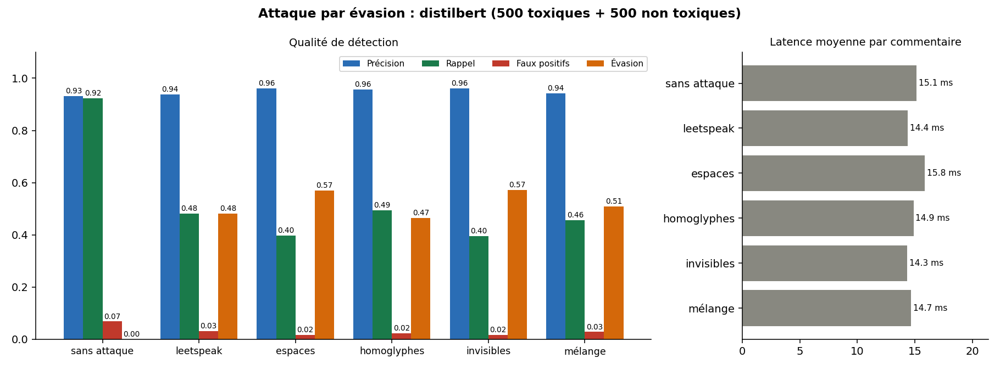
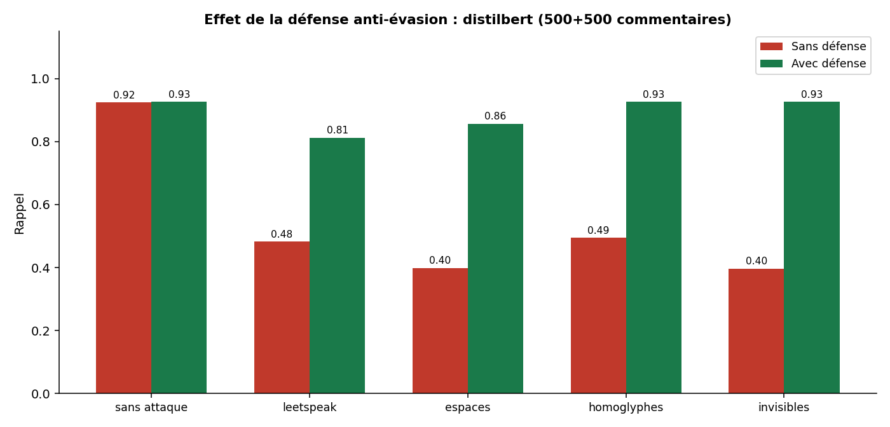
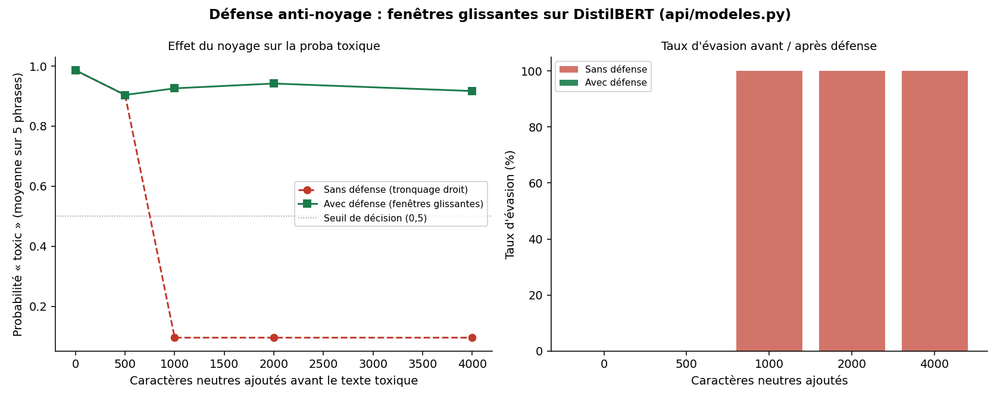
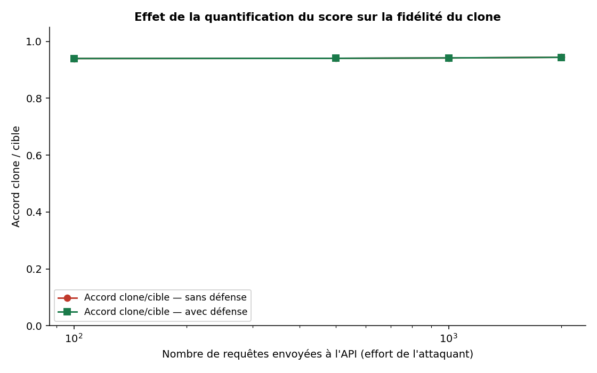
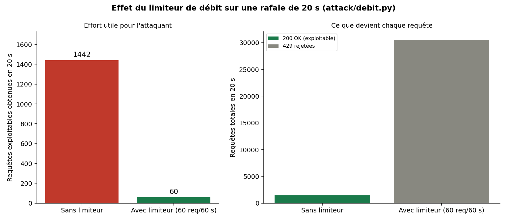
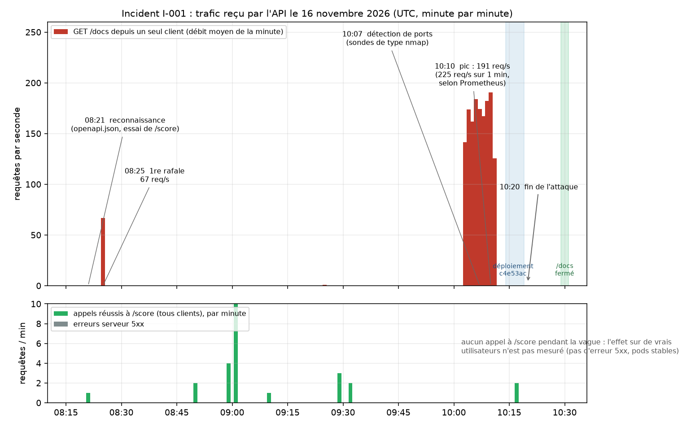
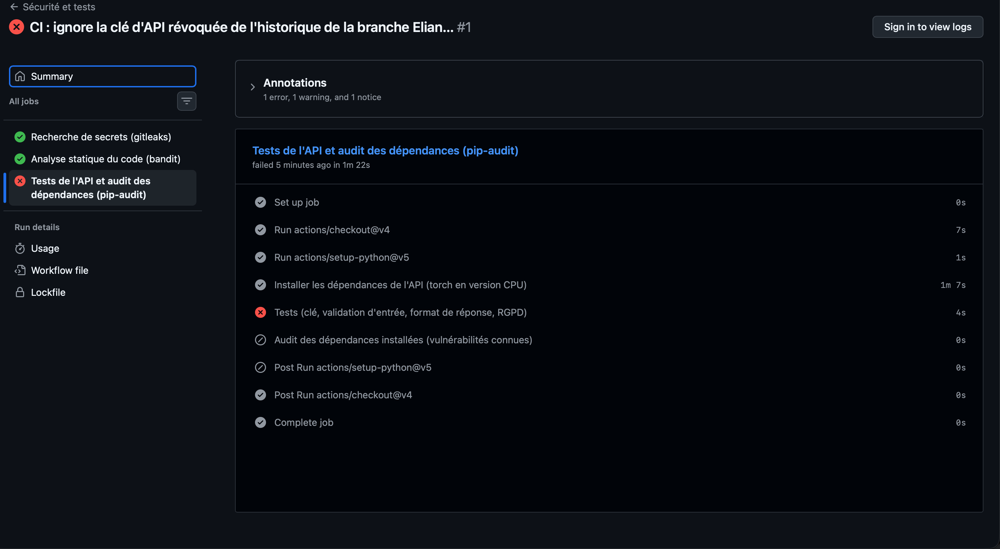

# TP2 : de la menace à la défense — livrable

**Membres** : NOUDEGBE Situ, OUEDRAOGO Eliana, CAKPOSSA Enzo

À partir de l'API Digital Social Score du TP1 (DistilBERT, déployée sur Google Kubernetes Engine à Paris, `POST /score` protégé par clé), ce document est **le livrable unique du TP2**. Il suit les **5 étapes de l'énoncé** et donne, pour chacune, les livrables demandés. La fin reprend les **livrables globaux**, l'**analyse critique** et les **critères d'évaluation**.

| Objectif de l'énoncé | Où |
|---|---|
| Simuler une attaque sur le modèle IA | Étapes 1 et 2 (évasion) |
| Concevoir et prouver l'efficacité d'une défense | Étape 3 |
| Démontrer la conformité au règlement IA Act | Étape 4 et `model_card.json` |
| Mettre en œuvre un pipeline DevSecOps sécurisé | Étape 5 |

---

## Étape 1 : Choix et analyse d'une attaque

**Livrable demandé : une fiche d'analyse « Attaque IA » d'une page au maximum.**

| Rubrique | Contenu |
|---|---|
| **Type d'attaque** | **Évasion** par exemples adverses, en boîte noire : le texte toxique est déguisé pour que le modèle ne le reconnaisse plus, sans changer son sens pour un lecteur humain. |
| **Cible** | Le modèle DistilBERT déployé. **Point d'entrée** : le champ `text` de `POST /score`, seule chose que l'attaquant contrôle ; il n'a besoin ni du code ni des poids, seulement d'une clé d'API. |
| **Objectif de l'attaquant** | Publier insultes, menaces ou propos haineux sans être signalé : obtenir `toxique: false` pour un commentaire réellement toxique. |
| **Techniques** | Déguiser les seuls mots toxiques : **leetspeak** (`idiot` → `1d10t`), **lettres espacées** (`i d i o t`), **homoglyphes** (lettres cyrilliques identiques à l'œil, `іdіоt`), **caractères invisibles** (U+200B entre les lettres), **mélange** des quatre. |
| **Impact attendu : technique** | Le rappel s'effondre ; le service répond normalement (200, même latence) : **aucune alerte**. |
| **Impact attendu : éthique** | Les personnes harcelées ne sont plus protégées ; les propos haineux (`identity_hate`) déguisés touchent des groupes déjà vulnérables ; la confiance dans la modération baisse. |
| **Impact attendu : RGPD** | Les commentaires qui passent peuvent contenir des données sensibles (art. 9 : origine, religion, orientation sexuelle). Les homoglyphes et caractères invisibles peuvent aussi contourner les regex d'anonymisation (un e-mail déguisé non masqué). |
| **Risque IA Act** | Atteinte à l'exigence de **robustesse** (art. 15) : résistance aux tentatives de tiers d'exploiter les vulnérabilités du système ; les exemples adverses sont cités explicitement (art. 15 § 5). |

**Pourquoi cette attaque plutôt qu'une autre.** Elle est **réaliste** (faisable à la main, sans outil) et **mesurable sans coût** sur le test officiel. Le vol de modèle coûte des milliers d'appels ; l'empoisonnement des données demande un réentraînement (64 min par essai) ; la saturation de l'API a été étudiée au TP1 et ne vise pas le modèle. Ces autres menaces ont été rencontrées ensuite pour de vrai : elles sont traitées à l'étape 3 (défenses complémentaires) et dans l'analyse critique.

---

## Étape 2 : Mise en œuvre de l'attaque

**Livrables demandés : graphique des métriques, interprétation des résultats.** Dossier **`attack/`** à la racine ; script **`attack/evasion.py`**.

**Protocole.**
- **Échantillon** : 500 commentaires toxiques et 500 non toxiques du test officiel (lignes à -1 exclues, graine 42). Les toxiques contiennent au moins un mot de la liste de mots toxiques du prétraitement (sinon il n'y aurait rien à déguiser).
- **Attaque** : seuls les mots toxiques sont déguisés, le reste est intact ; appliquée à tous les textes (un commentaire sain peut contenir un gros mot).
- **Chaîne** : la même que l'API (anonymisation, nettoyage, DistilBERT, seuils par label). Toxique prédit = au moins un label au-dessus de son seuil.
- **Machine** : Mac M3. Latence = prétraitement + modèle, sans le réseau.

**Exemple** (`You are a stupid idiot and a moron`), tel que le modèle le reçoit :

| Attaque | Texte reçu par le modèle |
|---|---|
| Leetspeak | `you are a 7up1d 1d107 and a m0r0n` |
| Lettres espacées | `you are a s t u p i d i d i o t and a m o r o n` |
| Homoglyphes | `you are a stuріd іdіоt and a mоrоn` |
| Invisibles | `you are a s t u p i d i d i o t and a m o r o n` (le nettoyage a changé les invisibles en espaces) |

| Variante | Précision | Rappel | Taux de faux positifs | F1 | Évasion | Latence moyenne |
|---|---|---|---|---|---|---|
| Sans attaque | 0,93 | **0,92** | 0,068 | 0,93 | — | 15,1 ms |
| Leetspeak | 0,94 | 0,48 | 0,032 | 0,64 | 48 % | 14,4 ms |
| Lettres espacées | 0,96 | **0,40** | 0,016 | 0,56 | **57 %** | 15,8 ms |
| Homoglyphes | 0,96 | 0,49 | 0,022 | 0,65 | 47 % | 14,9 ms |
| Caractères invisibles | 0,96 | **0,40** | 0,016 | 0,56 | **57 %** | 14,3 ms |
| Mélange | 0,94 | 0,46 | 0,028 | 0,61 | 51 % | 14,7 ms |

*Évasion* : part des commentaires toxiques détectés sans attaque qui ne le sont plus avec l'attaque.

**Interprétation.**
- **L'attaque est efficace et bon marché** : le rappel passe de 0,92 à 0,40-0,49, **un commentaire toxique sur deux n'est plus détecté**, en changeant quelques caractères.
- **La précision ne baisse pas (0,93 → 0,94-0,96), et c'est trompeur** : le modèle ne se met pas à accuser des textes sains, il se tait. Les **faux positifs baissent même** (0,068 → 0,016), car les textes sains contenant un gros mot ne sont plus signalés non plus. Une supervision qui suivrait la précision ou le taux d'erreur ne verrait rien.
- **La latence est inchangée** (14 à 16 ms, dans le bruit de mesure) : l'attaque est **invisible** côté performance.
- **Lettres espacées et caractères invisibles sont les plus efficaces (57 %)** et donnent le même résultat : notre propre nettoyage transforme les invisibles en espaces. Le prétraitement, conçu pour réduire le vocabulaire, aide ici l'attaquant.
- **Le modèle résiste un peu** (la moitié des toxiques restent détectés), grâce au contexte de la phrase et aux sous-mots de DistilBERT.

**Limites.** Échantillon équilibré (50 % de toxiques contre ~10 % en réalité : la précision y est plus haute, le rappel et l'évasion n'en dépendent pas) ; seuls les mots de la liste sont déguisés (attaque plutôt prudente) ; une exécution, en local.

---

## Étape 3 : Conception d'une défense

**Livrables demandés : tableau des métriques avant/après, graphique de comparaison.**

**Défense implémentée** : une **normalisation du texte avant le modèle**, sans toucher au modèle : unification Unicode (NFKC), suppression des caractères invisibles, homoglyphes cyrilliques ramenés au latin, mots espacés lettre par lettre regroupés, dé-leet (seulement dans les mots qui contiennent déjà une vraie lettre, pour ne pas abîmer un numéro). **Réexécution de l'attaque initiale** : `attack/defense.py`, même protocole et même échantillon qu'à l'étape 2.

| Variante | Précision sans → avec | Rappel sans → avec | Faux positifs sans → avec | Latence sans → avec | Évasion avec défense |
|---|---|---|---|---|---|
| Sans attaque | 0,93 → 0,93 | 0,92 → **0,93** | 0,068 → 0,068 | 14,2 → 14,1 ms | — |
| Leetspeak | 0,94 → 0,93 | 0,48 → **0,81** | 0,032 → 0,060 | 14,2 → 14,1 ms | 12 % |
| Lettres espacées | 0,96 → 0,93 | 0,40 → **0,86** | 0,016 → 0,064 | 15,6 → 14,1 ms | 8 % |
| Homoglyphes | 0,96 → 0,93 | 0,49 → **0,93** | 0,022 → 0,068 | 15,0 → 15,0 ms | **0 %** |
| Caractères invisibles | 0,96 → 0,93 | 0,40 → **0,93** | 0,016 → 0,068 | 15,3 → 14,4 ms | **0 %** |

**Interprétation.**
- **La défense marche nettement** : homoglyphes et invisibles sont entièrement défaits (rappel revenu à 0,93, évasion 0 %) ; leetspeak et lettres espacées résistent un peu (évasion 8 à 12 %), car la règle de dé-leet est volontairement prudente.
- **Le texte normal n'est pas dégradé** (rappel 0,92 → 0,93, faux positifs identiques) : c'est le premier point à vérifier pour ce type de correction.
- **Les faux positifs remontent sur les variantes attaquées, mais exactement au niveau de base (0,068)** : un texte sain déguisé est traité comme un texte sain normal.
- **Coût nul** : latence inchangée.
- **Erreur trouvée en route** : dé-leeter *avant* l'anonymisation faisait traverser les numéros de téléphone et adresses IP collés à un mot (`me:0612345678`). Les tests de la pipeline (étape 5) l'ont détectée ; le dé-leet passe désormais **après** l'anonymisation. Cette défense est **déployée** dans l'API en service.

**Limites.** Mesure faite sur l'API locale ; sur l'API déployée, l'efficacité n'a pas été remesurée avec le même échantillon. Les 4 variantes ont été testées séparément, pas le mélange.

### Défenses complémentaires : les attaques réellement reçues

**Noyage** (texte toxique précédé de ~4 000 caractères neutres). Notre modèle tronque à 128 tokens : `You are a stupid idiot…` passe de 0,995 seul à **0,012** noyé. Défense : analyse par **fenêtres glissantes** de 128 tokens, probabilité maximale retenue (`attack/defense_noyage.py`).

| Rembourrage neutre | Probabilité sans défense | Probabilité avec défense | Évasion sans → avec |
|---|---|---|---|
| 0 caractère | 0,986 | 0,986 | 0 % → 0 % |
| 500 | 0,904 | 0,904 | 0 % → 0 % |
| 1 000 | 0,096 | **0,926** | 100 % → **0 %** |
| 2 000 | 0,096 | **0,942** | 100 % → **0 %** |
| 4 000 | 0,096 | **0,917** | 100 % → **0 %** |

> **Limite importante** : cette défense est écrite et mesurée dans l'API **locale** ; l'API **déployée** tronque encore à 128 tokens. Voir l'analyse critique.

**Vol de modèle** (subi : une autre équipe a envoyé jusqu'à 2 000 requêtes sans aucun refus et obtenu un clone à 94,7 % d'accord ; notre latence a doublé). Défense testée d'abord : **arrondir le score renvoyé** (`api/defense_extraction.py`). Test (`attack/extraction.py`) : un clone TF-IDF + Ridge entraîné sur 100 à 2 000 réponses, score exact puis verdict pur.

| Requêtes | Accord clone/cible sans défense | Avec défense (verdict 0/100) |
|---|---|---|
| 100 | 0,940 | 0,940 |
| 500 | 0,940 | 0,940 |
| 1 000 | 0,942 | 0,942 |
| 2 000 | 0,944 | 0,944 |

**Résultat négatif** : le vocabulaire toxique est si discriminant que le verdict seul suffit à l'attaquant. **La vraie défense est le débit** : avec une limite de 60 requêtes par minute (`attack/debit.py`, 20 s de rafale), l'attaquant obtient **60 réponses au lieu de 1 442** ; il lui faudrait ~33 minutes pour réunir 2 000 requêtes.

**Déni de service : l'attaque réelle du 16 novembre et le bilan du professeur.** Le 16 novembre, un client (le professeur, confirmé ensuite) a envoyé **94 000 requêtes en 2 heures** : reconnaissance (`/openapi.json`), énumération (`.git`, `.env`, `phpinfo.php`), appels à `/score` avec la clé, détection de ports, puis inondation de `/docs` (pic de 191 à 225 req/s). Son rapport consolidé (9 équipes, 29 failles, déni de service réussi sur toutes les cibles) mesure chez nous **43 685 requêtes acceptées en 4 minutes (~180 req/s), P95 de 4 276 ms contre 56 ms (×76), 0 % d'erreurs**, plus des en-têtes de sécurité manquants, aucune limitation de débit observable et pas de WAF. Analyse détaillée dans les journaux : livrable du TP1, § 6.6.

**Corrections déployées le 16 novembre**, à partir des failles relevées chez toutes les équipes :

| Constat chez d'autres équipes | Notre situation avant | Correction déployée le 16 nov. | Vérifié en réel |
|---|---|---|---|
| Inférence sans authentification | Clé obligatoire (déjà) | Blocage temporaire d'une adresse après 10 clés fausses par minute (brute-force) | 30 clés fausses : 16 × 401, puis 14 × 429 |
| Scores par classe, seuil de détection et modèle exposés dans chaque réponse | Réponse déjà réduite (livrable du TP1, § 3.3) | Inchangé ; pas d'en-tête `Server` ; en-têtes de sécurité | `{"score":100,"toxique":true}` seul |
| Modèle extractible : 2 005 requêtes/min sans aucun frein | **Aucune limite** | Limite par adresse IP : 60 `/score` par minute et par pod (≈ 2 × plus avec 2 pods) | 150 requêtes séquentielles : 106 × 200, 44 × 429 |
| 43 685 requêtes acceptées en 4 min, latence × 76 ; latence × 108 ; service cassé à 168 requêtes simultanées ; hôte tombé 10 min | Tout était accepté, la latence montait | **Au plus 3 calculs simultanés par pod** ; une requête de plus attend 1 s au maximum, puis reçoit 503 : on refuse vite plutôt que de répondre en 30 s | 80 requêtes simultanées : 26 × 200, 54 × 503, `/health` toujours 200, aucun pod redémarré |
| « L'attaque a réussi partout et personne ne l'a vue » | Aucune alerte | 7 règles Prometheus (`supervision/alertes.yaml`) : débit, refus, clés fausses, erreurs 5xx, P95 > 2 s, pods < 2, redémarrage ; métrique `dss_refus_total` par motif ; intervalles de latence élargis à 10 s (le P95 n'est plus bloqué à 1 s) | Règle chargée dans Prometheus |
| Service cassé sous charge, pas de /docs public : bonne pratique | `/docs` déjà fermé | — | 404 |
| Redirection HTTPS ajoutée pendant l'exercice | Déjà en place (FrontendConfig) | — | — |
| Corps de requête non limité | 5 000 caractères, mais aucun plafond d'octets | Plafond de 40 Ko (413) ; délai du load balancer ramené à 15 s | Test automatique |

**Choix et limites, à dire sans détour.**
- **Les limites sont par pod** (mémoire locale). Avec 2 à 5 pods, la limite réelle par adresse est 2 à 5 fois plus haute. Une limite globale demanderait Redis ou Cloud Armor.
- **Cloud Armor a été essayé et refusé** : le quota « politiques de sécurité » du projet étudiant est à 0 (`SECURITY_POLICIES`, limite 0). La limitation est donc faite dans l'API, après le load balancer : un flot de requêtes arrive toujours jusqu'au pod, qui le refuse en quelques millisecondes (429) au lieu de calculer.
- **Adresse du client** : avant-dernière valeur de `X-Forwarded-For`, celle que le load balancer Google ajoute. Les valeurs plus à gauche sont inventées par le client et ignorées. Derrière un réseau partagé (le wifi de l'école), plusieurs personnes partagent une adresse et donc un quota : la limite de 60 par minute est volontairement large pour un usage normal (1 requête par seconde).
- **RGPD** : une adresse IP est une donnée personnelle. Les journaux de refus n'en contiennent jamais : seulement une empreinte HMAC de 10 caractères (clé secrète du serveur), qui permet de reconnaître un client sans le nommer, et une seule ligne par minute et par client. Ni la clé ni le texte n'y figurent.
- **Pas d'Alertmanager** : une alerte « firing » se lit dans Prometheus ou Grafana, elle n'envoie aucun message.
- **Reste non fait** : une clé par client (toujours une clé unique, à changer après la notation), test dynamique de l'API dans la pipeline, limite globale.

---

**Mesure après correction** (même jour, 128 connexions, route inconnue, 107 req/s depuis un seul poste) : 600 réponses 404 puis 2 605 refus 429 ; la latence de `/health` passe de P95 **115 à 209 ms (×1,8)** au lieu de ×76, sans panne.

---

## Étape 4 : Conformité IA Act

**Livrables demandés : une fiche IA Act (tableau de risque et justification) et un fichier `model_card.json` à la racine du projet.**

### Tableau de risque

| Niveau du règlement | Notre système y entre-t-il ? | Justification |
|---|---|---|
| **Inacceptable** (art. 5) | **Non, sous condition** | La notation sociale est interdite. Notre score qualifie **un texte**, jamais une personne : aucun score n'est associé à un auteur ni agrégé par utilisateur, aucun traitement défavorable d'une personne n'en découle. **Cette condition est une règle de conception à ne pas lever** : agréger les scores par utilisateur ferait basculer le système. |
| **Haut risque** (annexe III) | Non | Aucun des domaines listés : emploi, crédit, éducation, accès aux services essentiels, forces de l'ordre, migration, justice. |
| **Risque limité** (transparence) | **Oui** | Modération automatisée de contenu : obligation d'**informer les utilisateurs** qu'un système automatique analyse leurs textes. |
| **Risque minimal** | Non retenu | Le système influence ce qui est publié ou signalé : la transparence est due. |

**Catégorie retenue : risque limité.** Mesures qui en découlent : information des utilisateurs, relecture humaine avant toute décision, limites déclarées (fiche ci-dessous).

### Fiche du modèle

Le fichier **`model_card.json`** est à la racine du projet. Il est **contrôlé à chaque push** par la pipeline (`outils/verifier_model_card.py`, étape 5) : champs obligatoires présents, catégorie de risque parmi les 4 niveaux et justifiée, **aucune affirmation sans preuve** (par exemple « pas de biais » sans évaluation décrite est refusé).

| Champ | Valeur |
|---|---|
| `model_name` | Digital Social Score v2 |
| `risk_level` | `limited`, avec justification |
| `intended_use` / `out_of_scope` | Aide à la modération avec relecture humaine ; exclus : décision automatique, évaluation d'une personne, autre langue que l'anglais |
| `architecture` | DistilBERT affiné, multi-label, seuils par label réglés sur la validation |
| `data_source` | Jigsaw (pages de discussion Wikipédia, anglais), 30 000 lignes anonymisées ; test de 10 000 lignes jamais utilisées pour régler |
| `privacy_measures` | Anonymisation des données et de chaque texte reçu ; texte jamais stocké ni journalisé ; IP conservées 30 jours par le load balancer, jamais en clair dans les journaux de l'API ; HTTPS ; hébergement UE ; réponse réduite ; documentation de l'API fermée |
| `metrics_test` | ROC-AUC 0,9771, précision 0,4932, rappel 0,6927, F1 0,5577 |
| `bias_detected` | **`null`** (non évalué), avec la raison dans `bias_note` : le jeu Jigsaw associe à tort certains termes d'identité à la toxicité, un biais est plausible et doit être mesuré avant tout usage réel |
| `limitations` | Précision faible (0,49) ; contournable par texte déguisé ; anglais seulement |
| `version` / `last_update` | `distilbert-2026-11-16` / 2026-11-16 |

**Écart assumé avec le modèle de l'énoncé** : l'exemple donne `"bias_detected": false`. Nous n'avons pas mesuré le biais : écrire `false` serait une affirmation sans preuve. Nous écrivons `null` et l'expliquons.

### Données d'entraînement

| Rubrique | Détail |
|---|---|
| **Jeu** | *Toxic Comment Classification Dataset* (Jigsaw) : commentaires de pages de discussion Wikipédia en anglais, annotés par des humains (6 labels, multi-label) |
| **Licences** | Textes : CC-BY-SA 3.0 (Wikipédia) ; labels : CC0 |
| **Volume utilisé** | 30 000 lignes d'entraînement tirées du jeu (stratifiées sur les 6 labels), validation sur 20 % du jeu d'entraînement, test sur 10 000 lignes du test officiel (sans les lignes non évaluées par Kaggle) |
| **Anonymisation** | Appliquée **aux données d'entraînement** (regex + NER spaCy, livrable du TP1, étape 1) **et à chaque texte reçu** par l'API, avant le modèle |
| **Déséquilibre** | ≈ 10 % de positifs sur `toxic`, moins de 1 % sur `threat` et `identity_hate` ; compensé par une pondération des classes à l'entraînement |

### Performances comparées

Test commun de 10 000 lignes, macro-moyenne sur les 6 labels, seuils par label réglés sur la validation (livrable du TP1, § 2.3) :

| Modèle | Précision | Rappel | F1 | ROC-AUC |
|---|---|---|---|---|
| **DistilBERT (déployé)** | **0,49** | **0,69** | **0,56** | **0,977** |
| BiLSTM | 0,30 | 0,48 | 0,36 | 0,916 |
| LAYA (zéro-shot) | 0,37 | 0,74 | 0,48 | 0,969 |

Seuils de décision (`models/seuils.json`) : `toxic` 0,88 ; `obscene` et `insult` 0,94 ; `threat` et `identity_hate` 0,96 ; `severe_toxic` 0,97. Ils sont élevés parce que la pondération des classes gonfle les probabilités : **le score n'est pas une probabilité calibrée**, c'est un indicateur arrondi à la dizaine. Les chiffres de 0,93 de précision cités aux étapes 2 et 3 viennent d'un échantillon équilibré (50 % de toxiques) et ne décrivent pas la production.

### Risques du modèle et mesures

| Risque | Niveau | Justification | Mesure |
|---|---|---|---|
| **Faux négatifs** (toxique non détecté) | Élevé | Rappel 0,69 : ≈ 31 % des commentaires toxiques passent en conditions réelles ; sous attaque par évasion, sans défense, un sur deux (étape 2) | Normalisation anti-évasion déployée (étape 3) ; usage limité à l'aide à la modération, jamais comme filtre unique |
| **Faux positifs** (texte sain signalé) | Moyen | Précision 0,49 : environ une alerte sur deux porte sur un texte sain | Relecture humaine obligatoire avant toute décision ; aucune sanction automatique |
| **Biais envers des groupes** | Non mesuré, plausible | Jigsaw est connu pour associer à tort certains termes d'identité à la toxicité : les textes qui les citent risquent d'être sur-signalés | Déclaré non évalué (`bias_detected: null`) ; mesure à faire avant tout usage réel (analyse critique) |
| **Langue** | Élevé hors anglais | Entraîné et évalué en anglais seulement : ailleurs, les performances ne sont ni mesurées ni garanties | Hors périmètre déclaré dans `model_card.json` |
| **Robustesse** (art. 15) | Moyen | Évasion, noyage, vol de modèle et déni de service démontrés (étapes 2 et 3) | Défenses mesurées à l'étape 3 ; noyage encore ouvert sur l'API déployée |

### Transparence (art. 13 et 50)

| Exigence | Ce qui est fait | Ce qui reste à la charge de l'intégrateur |
|---|---|---|
| Informer qu'un système automatique analyse les textes | La fiche et ce document décrivent le système, ses usages et ses limites pour la plateforme qui intègre l'API | Afficher l'information aux utilisateurs finaux de la plateforme : l'API seule ne leur parle pas |
| Donner les limites du modèle | `model_card.json` (limites, hors périmètre, biais non évalué) | — |
| Ne pas exposer ce qui aide un attaquant | Réponse réduite à `score` arrondi et `toxique` ; probabilités, seuils et version réservés (journaux internes, `/version` avec clé) ; documentation interactive fermée | — |

Le choix de ne **pas** renvoyer les probabilités et les seuils est un arbitrage entre transparence et robustesse : les exposer rendrait l'évasion triviale (seuil connu), c'est la faille relevée par le professeur chez une autre équipe.

### Usages déconseillés, et quand la catégorie changerait

- **Pas comme outil de décision unique** : 31 % des toxiques manqués, une alerte sur deux à tort.
- **Pas sur une autre langue** sans réévaluation.
- **Jamais pour noter des personnes** : agréger les scores par auteur ferait du système une **notation sociale** (art. 5, interdite).
- **Pas dans un domaine de l'annexe III** (par exemple trier des candidats, évaluer des élèves ou des salariés à partir de leurs messages) : le système deviendrait **à haut risque** et les exigences des articles 9 à 15 s'appliqueraient (gestion des risques, gouvernance des données, documentation technique, contrôle humain, robustesse).

### Gouvernance et cycle de vie

| Rubrique | Contenu |
|---|---|
| **Responsables** | L'équipe (NOUDEGBE Situ, OUEDRAOGO Eliana, CAKPOSSA Enzo), France |
| **Version en service** | `distilbert-2026-11-16`, lisible par `/version` (clé requise) et vérifiée après chaque déploiement |
| **Contrôle continu** | La fiche est vérifiée à chaque push par la pipeline (étape 5) ; une fiche incomplète ou une affirmation sans preuve bloque le déploiement |
| **Révision des seuils** | À recalibrer si les textes reçus changent (autre plateforme, dérive du vocabulaire) |
| **Audit de sécurité** | Dernier : 16 novembre 2026 (attaque du professeur, étape 3) ; à refaire à chaque évolution du modèle ou de l'API |
| **Retrait** | Sur décision de l'équipe ; modèle et données supprimés à la mise hors service |

---

## Étape 5 : Intégration DevSecOps

**Livrables demandés : pipeline sécurisé + journaux d'exécution.**

Jusqu'au 16 novembre, **rien n'était automatisé** : le déploiement était un script lancé à la main (`deploy_gke.sh`) et aucun contrôle ne s'exécutait avant lui. Nous avons ajouté une pipeline GitHub Actions (`.github/workflows/securite.yml`) qui s'exécute **à chaque push et pull request** sur le dépôt public. Elle comprend **sept jobs** : six contrôles, puis le déploiement, qui ne démarre que si les six sont verts.

| Job | Outil | Pourquoi ce choix | Résultat |
|---|---|---|---|
| **Secrets** | `gitleaks`, sur **tout l'historique** git | Une clé retirée d'un fichier reste lisible dans les anciens commits : c'est ce qui est arrivé (clé d'API dans `frontend/index.html`, branche Eliana). Un contrôle du seul état courant ne l'aurait pas vue. | Vert. Retrouve l'ancienne clé en local ; elle est révoquée depuis le 13 novembre et déclarée dans `.gitleaksignore` pour que seules les **nouvelles** fuites soient signalées. |
| **Code** | `bandit`, échec dès la sévérité moyenne | Détecte les motifs dangereux en Python sans exécuter le code. | Vert après correction (voir ci-dessous). |
| **Conformité IA Act** | `outils/verifier_model_card.py` | Le TP2 impose un `model_card.json` : on contrôle ses champs, que la catégorie de risque soit l'un des 4 niveaux du règlement et justifiée, et **qu'aucune affirmation ne soit faite sans preuve** (par exemple `bias_detected: false` sans évaluation décrite est refusé). | Vert. La fiche déclare `bias_detected: null` (non évalué) avec la raison. |
| **Configuration Docker et Kubernetes** | `trivy`, échec dès la sévérité haute | Le Dockerfile et les manifestes de `api/k8s/` décident des protections réelles du conteneur : on les contrôle comme du code. | Vert, **sans aucune exception** (voir ci-dessous). |
| **Image Docker** (ajouté le 16 nov.) | `trivy image`, échec dès la sévérité haute, failles avec correctif disponible | La configuration saine ne dit rien des paquets que l'image contient : on construit l'image et on l'analyse. | Rouge au premier essai (`zlib1g`, 2 failles hautes), vert après la mise à jour des paquets système dans le Dockerfile. |
| **Tests et dépendances** | `pytest` ; `pip-audit` sur l'environnement installé | Rejoue la grille de sécurité (clé, validation d'entrée, anonymisation, CORS, réponse réduite) ; les versions sont libres (`fastapi>=0.115`), donc on audite ce que `pip` a réellement résolu. | 29 tests passent (modèle factice), dont ceux de la limitation de débit ; « No known vulnerabilities found ». |
| **Déploiement** | Cloud Build, Kubernetes | Voir ci-dessous. | Vert depuis le 16 novembre à 10:14 UTC. |

**Ce que la pipeline a trouvé.**
- `bandit` : (1) `torch.load` sans `weights_only=True` dans `api/scorer.py` et `api/modeles.py` : un fichier de poids piégé pourrait exécuter du code au chargement. **Corrigé.** (2) et (3) `from_pretrained` « sans révision épinglée » : **faux positifs** justifiés (dossier local embarqué, rien n'est téléchargé), marqués `# nosec B615`.
- `trivy` : le conteneur n'avait pas `readOnlyRootFilesystem: true` (KSV-0014, sévérité haute) : un attaquant maître du conteneur pouvait y déposer un exécutable. D'abord **accepté avec sa raison** dans `.trivyignore` (non testable sans remplacer les pods), puis **corrigé et déployé** le 16 novembre avec deux volumes temporaires en mémoire. Le fichier d'exceptions est maintenant vide.
- **Les tests ont détecté une régression RGPD** au moment de réconcilier le code d'Enzo : sa normalisation anti-évasion « corrigeait » le leetspeak (3 en e, 1 en i, 0 en o…) **avant** l'anonymisation. Un numéro de téléphone ou une adresse IP collés à un mot (`me:0612345678`) devenait du texte illisible et **n'était plus reconnu : il traversait l'anonymisation**. Correctif : le dé-leet passe **après** l'anonymisation, quand les données personnelles sont déjà des balises ; la défense contre l'évasion fonctionne toujours.
- `trivy image` : **2 failles de sévérité haute dans `zlib1g`** (bibliothèque système de l'image de base Debian), avec correctif publié. La pipeline a refusé la pull request ; `apt-get upgrade` ajouté au Dockerfile, contrôle repassé au vert (exécutions 43858297183 puis 43858725549).
- Un échec de la première exécution, gardé volontairement : les tests importaient `pandas`, absent des dépendances de test. Cela montre que la pipeline détecte ce qui passe inaperçu sur une machine de développement.

**Le déploiement automatique, et pourquoi il est sûr.**
- **Déclenchement** : push sur la branche `ci` (la branche `Enzo` en a été retirée le 16 novembre) quand `api/` a changé, ou à la demande ; **jamais sur une pull request** (le code peut venir d'un tiers). Un seul déploiement à la fois.
- **Aucune clé stockée.** GitHub prouve son identité à Google par un jeton OIDC (*Workload Identity Federation*). Le fournisseur d'identité est limité à **ce dépôt** et à deux branches, dont seule `ci` déclenche un déploiement ; le compte de service dédié n'a que les rôles nécessaires (construire, déployer, lire la clé d'API et les poids), aucun rôle d'administrateur du projet.
- **Poids du modèle dans un bucket privé** (accès public interdit, lecture seule pour la pipeline) : ils ne sont pas dans git, et c'est ce qui rend le déploiement reproductible depuis le seul dépôt.
- **Avant de construire** : test du **vrai** modèle (un modèle factice ne passe pas).
- **Après le déploiement**, un contrôle de 11 vérifications (`api/deploy/verifier_deploiement.py`) : `/health` répond sans rien révéler ; tous les pods annoncent la **même version** (le remplacement est progressif, anciens et nouveaux pods répondent tour à tour) ; le modèle n'est **pas** `dummy-…` (l'incident du 13 novembre) ; un texte toxique est jugé toxique et un texte neutre non ; la réponse ne contient que `score` et `toxique` ; 401 sans clé et avec une mauvaise clé ; `/version` exige la clé ; `/docs` répond 404.
- **Retour arrière automatique** si le déploiement échoue, **seulement si un déploiement a réellement eu lieu** (comparaison du numéro de révision). Sans cette condition, une première version de la pipeline a fait reculer la production d'une version alors que rien n'avait été déployé : défaut trouvé et corrigé le jour même.

**Les obstacles rencontrés** (le premier déploiement réussi a demandé une dizaine d'exécutions) :

| Exécutions | Échec | Cause et correction |
|---|---|---|
| 1 à 5 | `gcloud builds submit` : « forbidden from accessing the bucket » | Le compte limité n'a pas les droits que cette commande exige sur le bucket de sources. Droits ajoutés (lecture du bucket, puis administration de ce seul bucket) : sans effet. |
| 6 | Idem, avec une archive des sources déjà envoyée par le script | La commande revérifie quand même le bucket. **Contournement :** `--no-source`, le build lit lui-même l'archive. |
| 7 et 8 | Le build réussit mais la commande échoue : lecture des journaux refusée | Réservée aux *Viewer* du projet ; `--suppress-logs` ne suffit pas. |
| 9 | **Succès** | Soumission asynchrone puis lecture du **statut** du build (permis). |

**Choix assumés et limites.**
- **`main` est protégé** : une fusion n'y est acceptée que si **les contrôles sont verts**. Les administrateurs peuvent contourner la règle en urgence ; les poussées forcées sont interdites.
- **Le déploiement part de la branche `ci`, pas de `main`**, parce que `main` contient l'API locale de développement et non le code déployé. Cette branche est **protégée depuis le 16 novembre** : pull request obligatoire, les 6 contrôles verts obligatoires (branche à jour), pas de poussée forcée ni de suppression, règles valables aussi pour les administrateurs. Le déploiement n'est plus possible depuis aucune autre branche (la branche `Enzo` en a été retirée).
- **Ajouté le 16 novembre** : analyse de l'image Docker, actions GitHub référencées par empreinte de commit, Dependabot (mises à jour des dépendances et des actions proposées en pull request), détection de secrets au push, droits du jeton GitHub réduits à la lecture.
- **Non couvert :** test dynamique de l'API en ligne dans la pipeline (le contrôle en 11 points après déploiement s'en approche mais ne cherche pas de failles) ; une seule clé d'API pour tous les clients.

**Journal d'exécution** (GitHub Actions, dépôt public `elSam22/depl_ai_cyber`, onglet Actions ; chaque numéro s'ouvre à `https://github.com/elSam22/depl_ai_cyber/actions/runs/<numéro>`, les journaux détaillés de chaque job y sont consultables) :

| Numéro | Heure (UTC, 16 nov.) | Branche et événement | Résultat | Ce qu'il montre |
|---|---|---|---|---|
| 43845955880 | 10:07 | `ci`, push | Succès | Premier déploiement entièrement automatique (contrôles verts, build, 11 vérifications) |
| 43848111995 | 10:21 | `ci`, push | Succès | Déploiement de l'API réconciliée (réponse réduite, `/docs` fermé) |
| 43858285417 et 43858297183 | 11:30 | `durcissement`, push et pull request | **Échec** | `trivy image` : 2 failles hautes dans `zlib1g` ; **le déploiement n'a pas démarré** (job ignoré) |
| 43858717055 et 43858725549 | 11:32 | `durcissement`, push et pull request | Succès | Après correction, 6 contrôles verts, déploiement ignoré (pull request) |
| 43859230303 | 11:36 | `ci`, fusion de la pull request | **Succès, 7 jobs** | 6 contrôles verts puis déploiement réel, vérifié en 11 points |
- Chaque déploiement remplace les pods en service et consomme du crédit Google Cloud.

---

## Livrables globaux

| Livrable de l'énoncé | Où |
|---|---|
| Type d'attaque et démonstration | Étapes 1 et 2 ; scripts dans `attack/` |
| Défense et preuve d'efficacité | Étape 3 (tableaux et graphiques avant/après, défenses complémentaires mesurées en réel) |
| Classification IA Act + Model Card | Étape 4 ; `model_card.json` à la racine |
| Pipeline sécurisé + logs d'exécution | Étape 5 (jobs, blocages réels, numéros d'exécution) |
| Analyse critique et recommandations | Section suivante |

---

## Analyse critique et recommandations

### Ce qui a marché
- **L'évasion** est défaite à 0 % pour deux déguisements sur quatre et à 8-12 % pour les deux autres, sans dégrader le texte normal ni la latence.
- **Les défenses contre le déni de service** ont été mesurées sur l'API réelle : refus 429 en masse, aucun pod tombé, latence ×1,8 au lieu de ×76.
- **La pipeline a réellement bloqué** une image vulnérable et détecté une régression RGPD, preuves à l'appui.

### Ce qui n'a pas marché, et ce qu'on en retient
- **La quantification du score ne protège pas du vol de modèle** (accord 0,94 identique). Nous gardons l'arrondi pour une autre raison : ne pas exposer probabilités et seuils, faille relevée chez une autre équipe.
- **« Zéro erreur » ne veut pas dire « pas d'impact »** : pendant l'attaque, aucune erreur 5xx, et pourtant une latence ×76.
- **Une défense qui n'est pas déployée n'existe pas** : la limitation de débit et la fermeture de `/docs` étaient écrites avant l'attaque, aucune n'était en service.
- **Personne ne regardait** : aucune alerte n'existait. Elles existent maintenant, mais sans Alertmanager : elles se lisent à l'écran, rien n'est envoyé.

### Risques restants, par ordre de gravité
1. **Le noyage fonctionne sur l'API déployée** (troncature à 128 tokens) : la défense par fenêtres glissantes existe en local, il reste à la porter dans l'API en service et à la mesurer.
2. **Attaque depuis plusieurs adresses** : les limites par IP sont contournées ; seul le plafond de 3 calculs par pod protège la latence, au prix de refus 503 pour les vrais utilisateurs.
3. **Limites par pod**, pas de limite globale ; **pas de WAF** : Cloud Armor est refusé (quota du projet étudiant à 0).
4. **Une seule clé d'API** pour tous les clients.
5. **Biais non mesuré** ; efficacité de la normalisation non remesurée sur l'API déployée.
6. Attaques sur l'entraînement (empoisonnement, porte dérobée) non traitées ; pas de test dynamique de l'API dans la pipeline.

### Recommandations
- Porter les fenêtres glissantes dans l'API déployée, puis rejouer le noyage sur l'API réelle (avant/après chiffré).
- Ajouter `X-Frame-Options` (relevé par le professeur) ; demander une hausse du quota Cloud Armor ; installer Alertmanager.
- Mesurer le biais (taux de faux positifs selon les termes d'identité) avant tout usage réel.
- Une clé par client, journalisation des refus par clé, rotation de la clé après la notation.

---

## Critères d'évaluation

| Compétence | Indicateurs | Preuve |
|---|---|---|
| Réalisme de l'attaque | Pertinence, complexité technique | Étapes 1-2 : 5 variantes sur 1 000 textes ; attaques reçues en réel (vol de modèle, déni de service du professeur) ; noyage découvert en attaquant d'autres équipes |
| Efficacité de la défense | Mesure de l'impact | Étape 3 : précision, rappel, faux positifs et latence avant/après ; mesures sur l'API réelle |
| Conformité IA Act | Document complet et cohérent | Étape 4 : tableau de risque, fiche contrôlée automatiquement, biais déclaré non évalué plutôt qu'affirmé absent |
| Pipeline DevSecOps | Fonctionnel et automatisé | Étape 5 : 7 jobs à chaque push, déploiement automatique, blocages réels |
| Rigueur et clarté | Documentation et structure | Structure calquée sur l'énoncé, limites dites à chaque étape |
| Originalité et réflexion | Créativité, approche critique | Résultat négatif de la quantification assumé ; erreur de dé-leet trouvée par nos propres tests ; attaque du professeur analysée dans les journaux |
