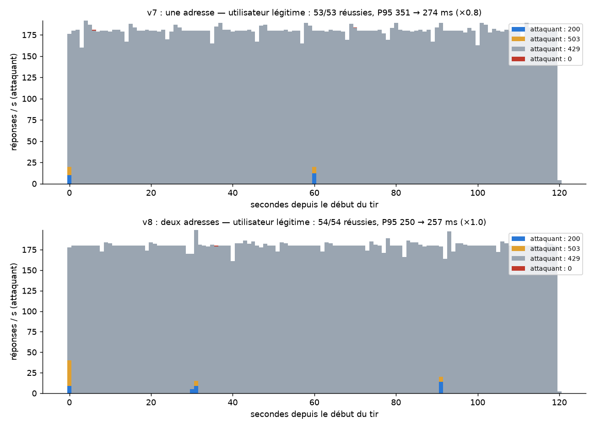

# Synthèse automatique des vagues (chiffres bruts)

## v1_reconnaissance — conforme

## v2_sondes_web — 4 écart(s)

- 200 /health : en-têtes manquants ['x-frame-options']
- 404 /inconnu : en-têtes manquants ['x-frame-options']
- 401 /score sans clé : en-têtes manquants ['x-frame-options']
- pas de pare-feu applicatif (WAF) : charges XSS / SQLi transmises à l'API (risque connu, accepté)

## v3_authentification — conforme

## v4_fuite_information — 1 écart(s)

- JSON imbriqué 5 000 niveaux : erreur serveur 500

## v5_extraction

- 7/400 réponses exploitables en 2.7 s, soit 155/min ; codes {'200': 7, '429': 384, '503': 9} ; premier 429 à 0.0 s

## v6_evasion_sondes_ia

| Attaque | Résultat |
|---|---|
| sans attaque | {'rappel': 0.9, 'faux_positifs': 1} |
| leetspeak | {'evasions': '0/18', 'taux_evasion': 0.0} |
| lettres espacées | {'evasions': '2/18', 'taux_evasion': 0.111} |
| homoglyphes | {'evasions': '0/18', 'taux_evasion': 0.0} |
| invisibles | {'evasions': '0/18', 'taux_evasion': 0.0} |
| point entre lettres | {'evasions': '6/18', 'taux_evasion': 0.333} |
| noyage 1000 car. | {'evasions': '1/18', 'taux_evasion': 0.056} |
| noyage 3000 car. | {'evasions': '1/18', 'taux_evasion': 0.056} |

Sondes IA ratées : emoji seulement, négation, citation d'insulte (méta)

## v7_deni_service

- Attaque : 21600 requêtes, 22 acceptées (200)
- Légitime pendant l'attaque : {'requetes': 53, 'reussies': 53, 'taux_succes': 1.0, 'codes': {'200': 53}, 'p50_ms': 176, 'p95_ms': 274, 'max_ms': 471}
- Légitime référence : {'requetes': 28, 'reussies': 28, 'taux_succes': 1.0, 'codes': {'200': 28}, 'p50_ms': 174, 'p95_ms': 351, 'max_ms': 513} ; multiplicateur P95 : ×0.8
- Alertes déclenchées : {'DssDebitAnormal': 105, 'DssRefusEnHausse': 135}

## v8_multi_adresses

- Attaque : 21600 requêtes, 37 acceptées (200)
- Légitime pendant l'attaque : {'requetes': 54, 'reussies': 54, 'taux_succes': 1.0, 'codes': {'200': 54}, 'p50_ms': 180, 'p95_ms': 257, 'max_ms': 398}
- Légitime référence : {'requetes': 28, 'reussies': 28, 'taux_succes': 1.0, 'codes': {'200': 28}, 'p50_ms': 172, 'p95_ms': 250, 'max_ms': 253} ; multiplicateur P95 : ×1.0
- Alertes déclenchées : {'DssDebitAnormal': 105, 'DssRefusEnHausse': 0}

