# Étape 5 : test de charge de l'API Digital Social Score

Cible : l'API déployée sur GKE (Kubernetes Autopilot, Paris), 2 pods au minimum, autoscaler de 2 à 5 pods à 70 % de CPU. Modèle : DistilBERT. Route testée : `POST /score` avec clé API.

## 1. Méthode et justification des choix

| Choix | Justification |
|---|---|
| **Locust** | Python comme le reste du projet, courbes en direct, export CSV pour le rapport. |
| **Cible : l'API sur GKE**, pas l'API locale | C'est ce qui sera réellement utilisé : on teste le load balancer, l'autoscaler et les pods, pas seulement le code. |
| **1 000 textes de `test_clean.csv`**, tirés au hasard (graine fixe), longueur médiane 147 caractères, maximum 4 728 | Textes variés et réalistes ; un texte différent à chaque requête évite qu'un cache fausse les mesures. |
| **Pause de 0,5 à 1 s** entre deux requêtes d'un utilisateur | Environ 1 requête par seconde et par utilisateur : 100 utilisateurs ≈ 100 requêtes/s demandées. |
| **Seuil de 2 s** pour le P95 | Choix de l'équipe, non imposé par le TP : au-delà, un appel d'API interactif est jugé trop lent. |
| **Paliers 1 → 10 → 50 → 100 utilisateurs** sur 5 min | Facteur 5 à 10 entre paliers pour voir où la latence décolle, sans durer assez longtemps pour coûter cher. |
| **Failover avec 5 utilisateurs** (≈ 5 requêtes/s) | Sous la capacité de 2 pods (≈ 8 requêtes/s) : le service est sain avant l'incident, donc l'effet de la perte d'un pod se voit. |
| **Mesures** : latence moyenne, médiane, P95, P99, taux d'erreur, requêtes/s | Demandées par le TP. Le P95 et le P99 disent ce que vivent presque tous les utilisateurs, ce que la moyenne cache. |
| **Percentiles calculés requête par requête** (journal `*_requetes.csv`) | Les percentiles du CSV de Locust sont cumulés depuis le début du test : inutilisables par palier. |

**Précaution :** Locust tourne sur un Mac et l'API sur Google Cloud. Les latences incluent donc le réseau et le chiffrement HTTPS. La clé d'API n'est jamais écrite dans un fichier (variable d'environnement), et le journal ne contient aucun texte.

## 2. Mesure de référence : 1 utilisateur

120 requêtes en 80 s, **0 erreur** : médiane 220 ms, moyenne 287 ms, P95 620 ms, P99 1 000 ms. C'est la latence de base à laquelle tout le reste est comparé.

Ce temps est bien supérieur aux ~12 ms mesurées en local (prétraitement 4 ms + modèle 8 ms) : on en déduit qu'un commentaire coûte environ 200 ms de calcul sur un pod, hypothèse cohérente avec le CPU à 99 % observé plus bas, mais non vérifiée (voir § 5).

## 3. Scénario 1 : montée progressive (1 → 10 → 50 → 100 utilisateurs, 5 min)

Deux exécutions. **Exécution 2** (percentiles exacts) :

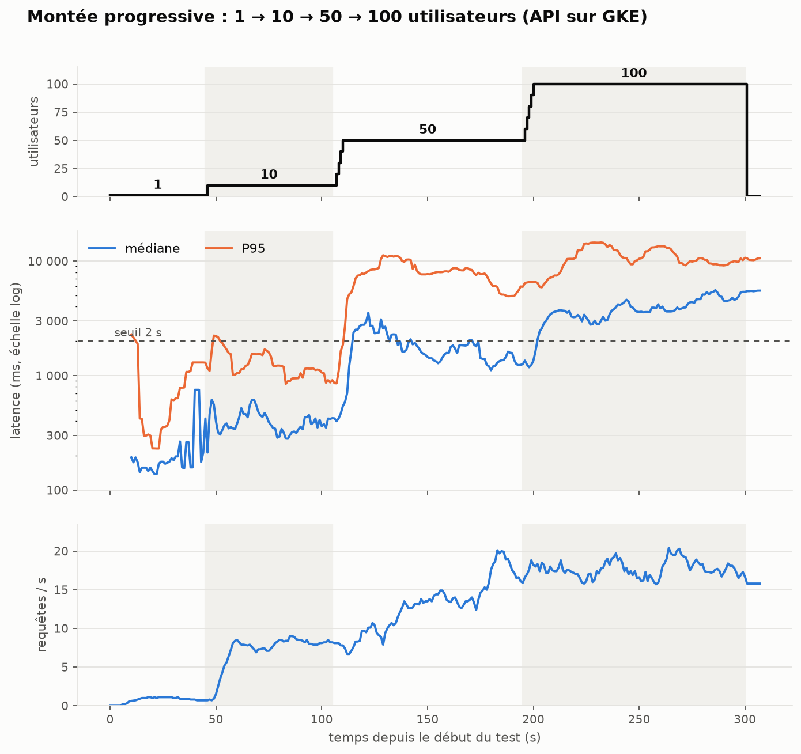

| Palier | Requêtes/s | Moyenne | Médiane | P95 | P99 | Erreurs |
|---|---|---|---|---|---|---|
| 1 utilisateur | 0,9 | 317 ms | 176 ms | 992 ms | 1,3 s | 0 |
| 10 | 8,0 | 482 ms | 384 ms | 1,2 s | 1,6 s | 0 |
| 50 | 14,2 | 2,8 s | 1,6 s | 8,2 s | 11,2 s | 1 |
| 100 | 17,6 | 4,9 s | 4,1 s | 11,8 s | 14,7 s | 2 |

3 616 requêtes en tout, 4 erreurs « 502 Bad Gateway » (≈ 0,1 %).

**Exécution 1** (moyennes seulement : le journal par requête n'existait pas encore) :

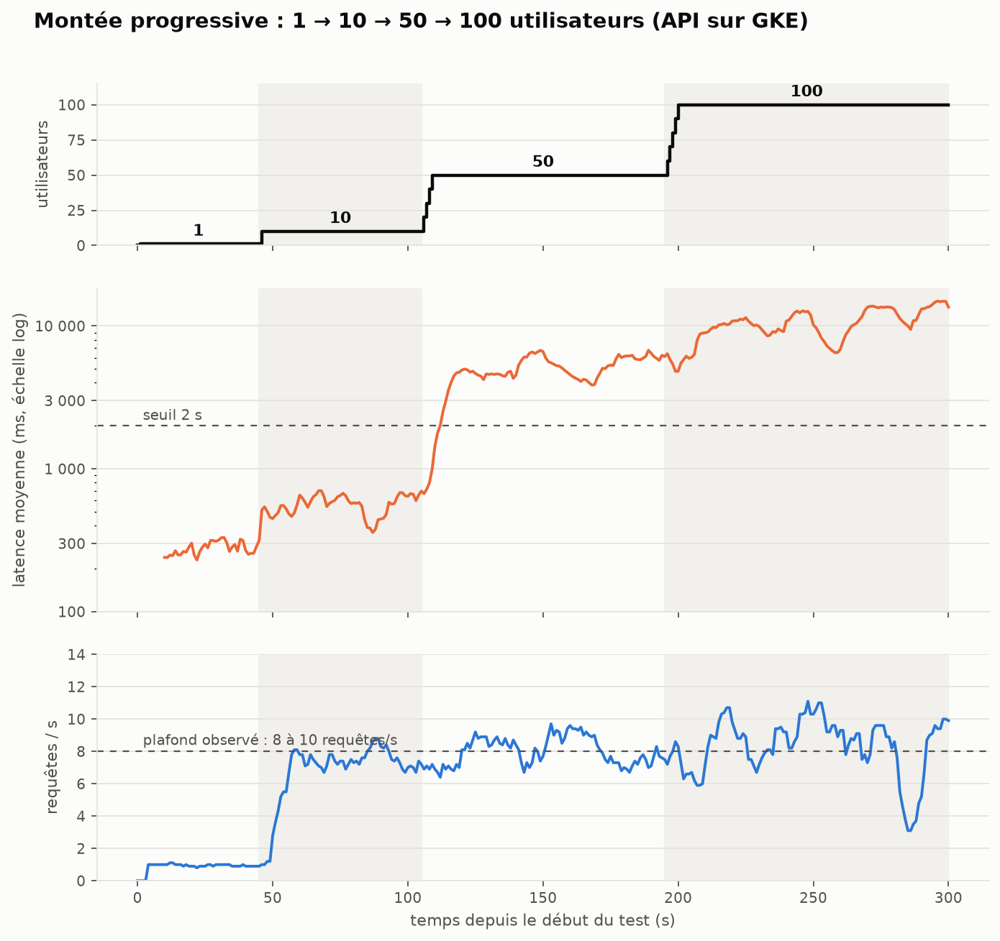

| Palier | Requêtes/s | Latence moyenne | Erreurs |
|---|---|---|---|
| 1 utilisateur | 1,0 | 280 ms | 0 |
| 10 | 7,5 | 569 ms | 0 |
| 50 | 8,1 | 5,1 s | 1 |
| 100 | 8,4 | 10,8 s | 1 |

**Lecture.**
- L'API ne s'effondre pas : moins de 0,2 % d'erreurs dans les deux exécutions. Elle **ralentit** : les requêtes attendent dans une file.
- **Point de rupture (latence)** : la latence moyenne dépasse 2 s entre 10 et 50 utilisateurs ; le stress test (§ 4) le situe à 20 utilisateurs (P95 > 2 s). Jusqu'à 10 utilisateurs, le P95 reste vers 1,2 s.
- **Exécution 1 : le débit plafonne vers 8 requêtes/s** dès 10 utilisateurs, avec 2 pods. **Exécution 2 : il monte à 17-20 requêtes/s** après le palier à 10. La capacité a plus que doublé d'une exécution à l'autre : les captures du § 5 montrent que l'autoscaler a cette fois atteint ses 5 pods.

## 4. Scénario 2 : stress

Profil `stress.py` : **+10 utilisateurs toutes les 20 s**. Arrêt automatique dès que le P95 (fenêtre de 10 s) reste au-dessus de **2 s pendant 10 s**, ou que 5 erreurs arrivent en 10 s, ou à 200 utilisateurs. Le point de rupture est enregistré dans `results/stress_rupture.json`.

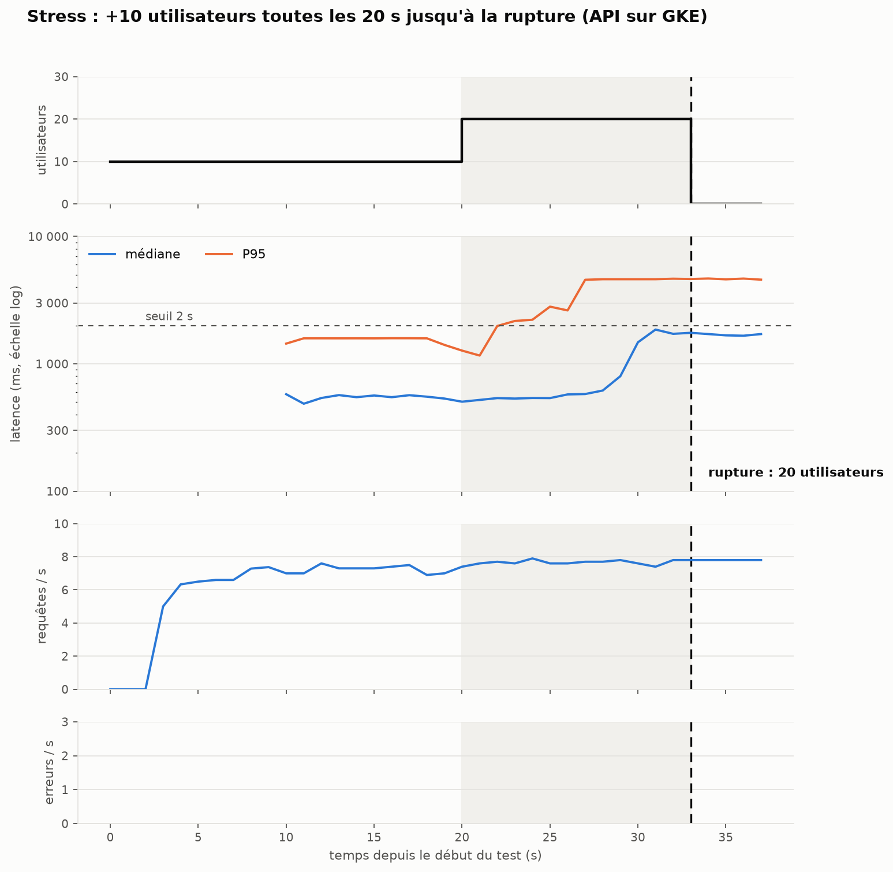

| Palier | Requêtes/s | Moyenne | Médiane | P95 | P99 | Erreurs |
|---|---|---|---|---|---|---|
| 10 utilisateurs | 7,7 | 574 ms | 504 ms | 1,3 s | 1,6 s | 0 |
| 20 utilisateurs (interrompu après 13 s) | 8,0 | 1,8 s | 1,6 s | 4,4 s | 4,7 s | 0 |

**Résultat : rupture au sens du critère à 20 utilisateurs**, 33 s après le début, avec un P95 de 4,8 s. Le débit est déjà de ≈ 8 requêtes/s à 10 utilisateurs et n'augmente plus : la capacité est atteinte, les requêtes font la queue. La capture ci-dessous montre **2 pods** au départ (l'autoscaler à 2 réplicas, CPU à 49 % pendant le test) : cela fait ≈ 4 requêtes/s par pod.

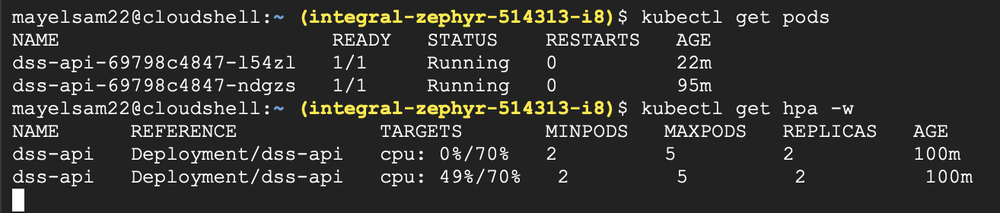

**Limites.**
- Le critère (P95 > 2 s) est strict : c'est une **dégradation**, pas une panne (0 erreur). La montée à 100 utilisateurs (§ 3) a tenu avec 0,1 % d'erreurs : on n'a donc pas trouvé de rupture « dure ».
- Le test dure 37 s : l'autoscaler n'a pas eu le temps de réagir (un pod neuf met plus de 5 min à être prêt, § 5). Le point de rupture mesuré est celui de la configuration de départ.
- Le palier à 20 utilisateurs est très court : ses valeurs sont indicatives.

## 5. Autoscaling

**Exécution 1** :

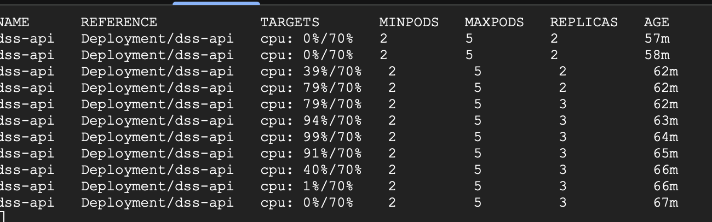

Le CPU passe de 0 % à 79 %, l'autoscaler ajoute **un seul pod** (2 → 3), puis le CPU reste à 91-99 % avec 3 pods, sans que l'autoscaler monte plus haut pendant le test. Le goulot est donc le **CPU**, pas le réseau.

**Exécution 2** : liste des pods relevée avec `kubectl get pods -w` pendant et après le test.

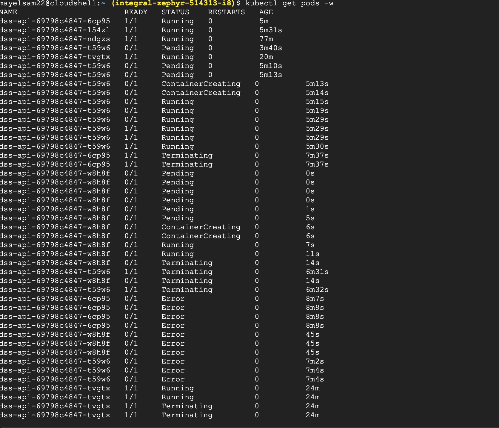

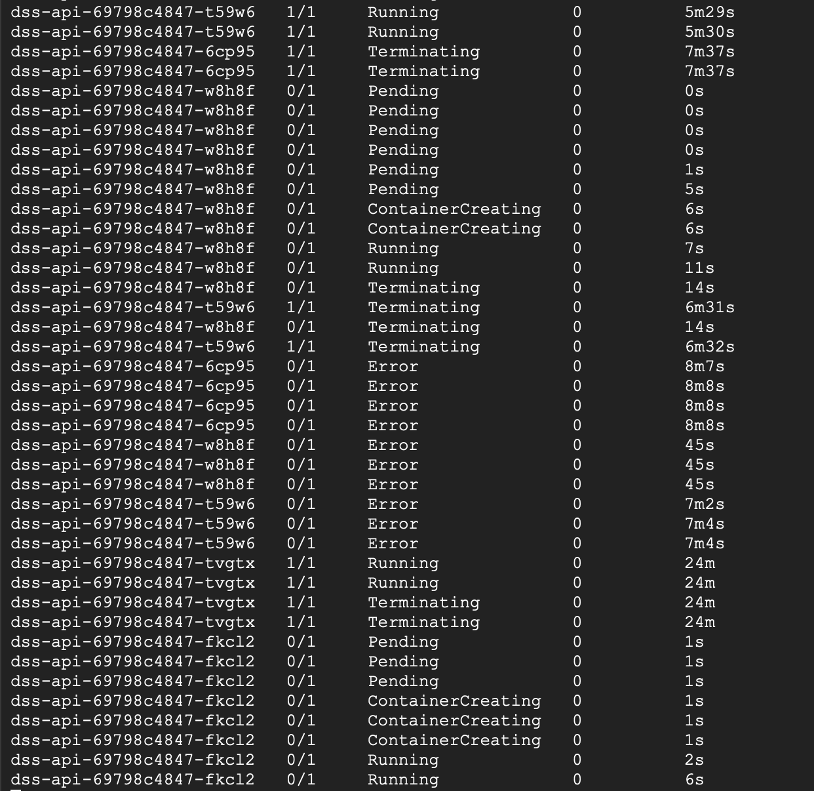

- On compte **5 pods distincts** : l'autoscaler a atteint son **maximum**. Trois d'entre eux (âgés de 3 à 5 min au début de la capture) ont été créés pendant la montée. Cela explique le débit de 17 à 20 requêtes/s : environ 4 à 5 requêtes/s par pod si 4 à 5 pods servaient, cohérent avec les ≈ 4 requêtes/s par pod de l'exécution 1.
- **Un pod neuf met plusieurs minutes à servir.** Le pod `t59w6` reste **5 min 10 s en `Pending`** (Autopilot doit d'abord préparer une machine), démarre en ≈ 15 s, et n'est prêt (`1/1`) qu'à **5 min 29 s**. Un pod ajouté pendant une montée de 5 minutes arrive donc quand elle est déjà finie.
- Les pods arrêtés passent par le statut `Error` : non diagnostiqué ici, à faire examiner (code de sortie du conteneur).

## 6. Scénario 3 : failover

Charge constante de 5 utilisateurs (≈ 5 requêtes/s, sous la capacité), 4 minutes. À **t = 183 s** (11:34:43 UTC), un pod est supprimé avec `kubectl delete` :

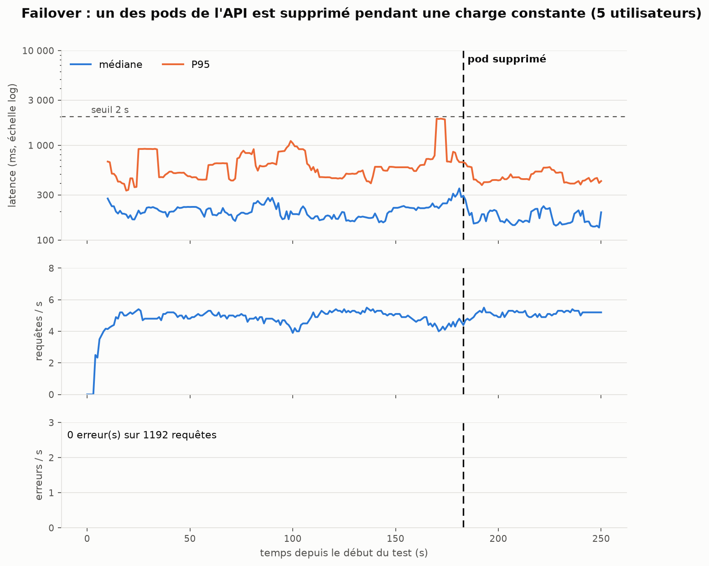

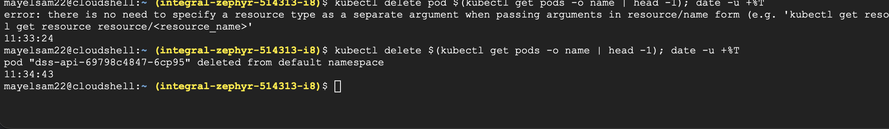

Interface de Locust pendant les deux tests (montée progressive, puis failover à 5 utilisateurs) et tableau final du failover :

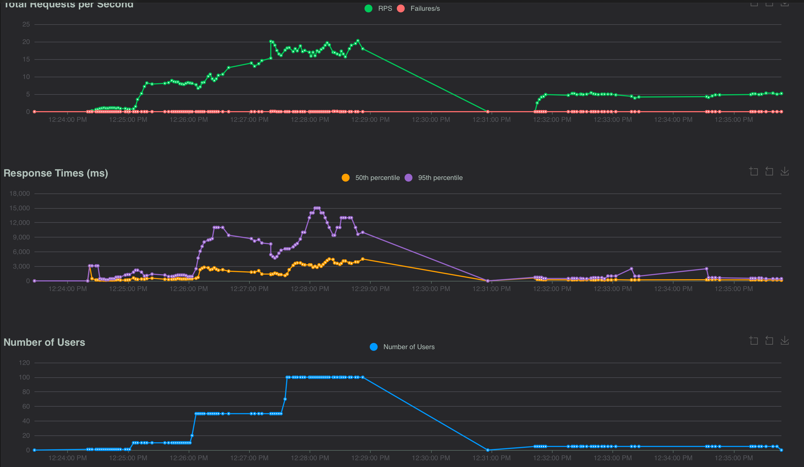

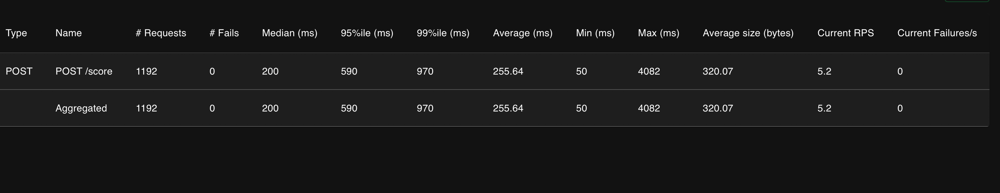

| Période | Requêtes/s | Médiane | P95 | Erreurs |
|---|---|---|---|---|
| Avant l'incident | 4,9 | 209 ms | 628 ms | 0 |
| 0 à 20 s après | 5,2 | 161 ms | 413 ms | 0 |
| 20 à 60 s après | 5,1 | 170 ms | 465 ms | 0 |

**Résultat : 0 erreur sur 1 192 requêtes** ; la latence ne se dégrade pas.

**Pods autour de l'incident** (captures du § 5) : avant l'incident, **5 pods étaient prêts** (`t59w6` l'est devenu environ 50 s avant). Le pod supprimé `6cp95` passe en `Terminating` ; Kubernetes crée **immédiatement** un remplacement (`w8h8f` : `Pending` 0 s, `Running` à 7 s). Ce remplacement est lui-même arrêté 14 s plus tard, avec d'autres pods : probablement la réduction de l'autoscaler, le CPU étant redevenu bas (non confirmé).

**Limites, à ne pas passer sous silence :**
- Le test s'arrête **59 s après** l'incident : on n'observe ni le retour à un état stable, ni le temps de démarrage d'un pod de remplacement (celui créé a été arrêté après 14 s).
- `kubectl delete pod` est un arrêt **propre** (le pod est retiré du load balancer avant de s'arrêter). Une panne brutale (nœud perdu, processus tué) n'a pas été testée.
- La charge de 5 requêtes/s est inférieure à la capacité des pods restants : le résultat ne dit rien sur une panne pendant un pic.
- L'incident a eu lieu avec **5 pods prêts** (4 après la suppression), pas avec le minimum de 2 : le résultat montre la redondance d'un cluster déjà monté en charge, pas celle de la configuration minimale.

## 7. Améliorations (cache, load balancer, redondance)

Le TP demande de **proposer** des améliorations. Voici ce qui existe déjà, ce qui a été testé, et ce qui reste une proposition, **sans l'avoir mis en œuvre ni mesuré** :

| Amélioration | État | Justification (liée aux mesures) |
|---|---|---|
| **Load balancer** | **En place** (Ingress Google, déployé par Enzo) ; testé indirectement par tous les tests | Répartit les requêtes entre les pods ; sans lui, le failover (§ 6) n'aurait pas été transparent. |
| **Redondance** : 2 pods minimum + autoscaler jusqu'à 5 | **En place et testée** (failover : 0 erreur ; autoscaler : 5 pods atteints à la 2e montée) | Le service continue quand un pod disparaît. |
| **Au moins 3 pods en permanence** | Proposée | Avec 2 pods, la perte d'un pod divise la capacité par 2 (≈ 4 requêtes/s restantes) ; le failover a été testé avec 5 pods, pas avec 2. |
| **Pods prêts plus vite** (minimum relevé avant un pic prévu, cible de CPU plus basse) | Proposée | Un pod neuf a mis **5 min 29 s** à être prêt (5 min 10 s de `Pending`) : trop lent pour une montée de 5 minutes. |
| **Plus de CPU par pod, ou réglage des threads de torch** | Proposée | Pods à 91-99 % de CPU pour ≈ 4 requêtes/s chacun : le calcul du modèle est le goulot. |
| **Traitement par lots** (plusieurs commentaires par appel du modèle) | Proposée | Le modèle est plus efficace par lots ; à 100 requêtes/s, un appel par commentaire pèse. |
| **Limite de débit par clé API** | Proposée, non faite | Au-delà de ≈ 8 requêtes/s l'API fait la queue : mieux vaut refuser tôt (429) que laisser la latence monter à 10 s. |
| **File d'attente pour les pics** | Proposée | Absorbe un pic sans faire attendre l'appelant en direct. |
| **Cache des textes déjà vus** | Proposée, **non mesurée** | Utile seulement si des textes se répètent : nos tests envoient un texte différent à chaque requête, donc rien n'a été mesuré. |
| **Modèle plus léger** (BiLSTM : 0,13 ms par commentaire) | Proposée | Capacité bien plus grande, mais F1 de 0,36 contre 0,56 pour DistilBERT : un compromis à assumer. |

## 8. Limites de l'étude

- Locust et l'API ne sont pas sur le même réseau : les latences incluent le trajet.
- Une seule exécution par scénario sauf la montée (deux exécutions, aux résultats différents) : pas d'intervalle de confiance.
- Percentiles exacts uniquement pour l'exécution 2 de la montée et pour le failover.
- Compte gratuit : le quota n'a pas empêché l'autoscaler d'atteindre 5 pods (exécution 2).
- Les textes envoyés sont ceux de `test_clean.csv`, déjà nettoyés (l'API les anonymise quand même).

## 9. Relancer les tests

```bash
# Depuis la racine du projet ; la clé reste dans la variable d'environnement, jamais dans un fichier
export API_KEY=<clé>
# Montée progressive (interface sur http://localhost:8089, cliquer sur Start)
LOG_REQUETES=loadtest/results/montee_requetes.csv .venv/bin/locust -f loadtest/locustfile.py,loadtest/montee.py \
    --host https://<domaine>.sslip.io --web-host 127.0.0.1 --csv loadtest/results/montee
.venv/bin/python loadtest/report.py montee
# Failover : lancer failover.py à la place de montee.py, puis supprimer un pod et noter l'heure UTC
#   kubectl delete $(kubectl get pods -o name | head -1); date -u +%T
.venv/bin/python loadtest/report.py failover <HH:MM:SS>
```
