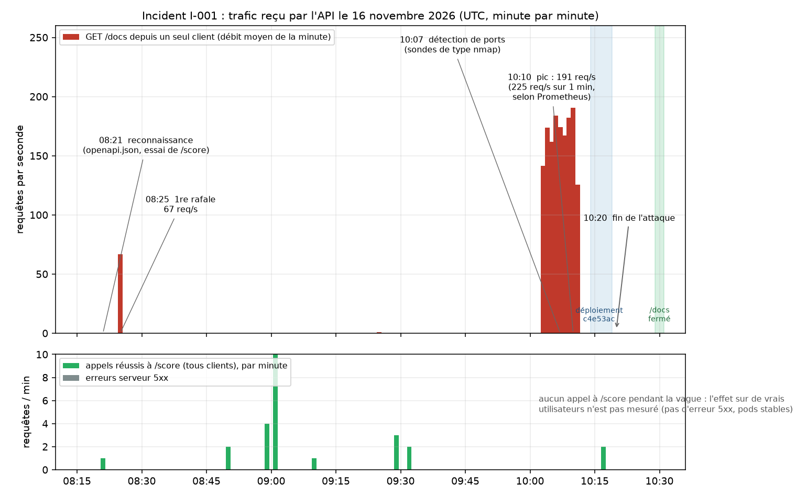

# Registre des incidents et attaques observés

Un incident = une activité anormale repérée dans **Grafana** (quand, quelle route, quel code) et **Cloud Logging** (quel client, quel outil, quels chemins), décrite, évaluée et suivie d'une correction proposée. Les adresses IP sont des données personnelles : elles sont remplacées ici par un identifiant (C1, C2…), jamais écrites en clair dans ce dépôt public.

## Méthode (5 étapes, dans cet ordre)

1. **Grafana**, tableau de bord `grafana_dashboard.json`, section « Détection d'attaque » : un pic de débit sur une route, une part de 4xx qui monte, des pages inconnues (route `none`), des erreurs 5xx, des pods qui tombent. Noter l'**heure** (le graphique est en heure du navigateur, les journaux en UTC : Paris = UTC + 1 en hiver).
2. **Journaux** : `python supervision/analyser_journaux.py --projet <projet> --heures 6`. Il sépare les codes que Prometheus regroupe (401, 404, 422) et donne le client, son outil (user-agent) et ses chemins.
3. **Écarter notre propre trafic** : nos tests de charge (Locust), le contrôle après déploiement (`Python-urllib`, qui provoque volontairement des 401), nos `curl`, les scripts d'attaque d'Enzo (`attack/`).
4. **Caractériser** : type d'attaque, cible, volume, durée, **impact mesuré** (latence de `/score`, erreurs 5xx, pods prêts), et ce qui n'est **pas** prouvé (qui est derrière).
5. **Corriger** : proposition, justification, preuve avant/après, statut.

## Synthèse

| N° | Date (UTC) | Type | Impact | Statut |
|---|---|---|---|---|
| I-001 | 16 nov. 08:21 à 10:20 | Reconnaissance, usage de la clé, détection de ports, puis **rafale de 94 000 requêtes sur `/docs`** (pic 225 req/s) | Aucune erreur 5xx, CPU à 0,22 cœur sur 2 ; **effet sur `/score` non mesuré** (aucun appel pendant la vague) | Surface fermée le 16 nov. à 10:31 ; **limitation de débit non faite** |
| I-002 | 15 nov. 21:39 à 16 nov. 07:45 | Scans automatiques d'Internet (502 faute de pod) | Aucun (API en pause) | Accepté |

## I-001 — Attaque du 16 novembre : reconnaissance, usage de la clé, détection de ports, rafale sur `/docs`

### Résumé

Un **seul client** (C1, une seule adresse) a envoyé **94 161 des 94 306 requêtes** reçues sur la période analysée (environ 07:25 à 10:25, soit 99,85 %), entre 08:21 et 10:20:35. Sa conduite se lit comme une attaque **par étapes**, dans l'ordre classique : *reconnaissance*, *énumération*, *usage de la clé*, *détection de ports*, puis *inondation*. Elle n'a causé **aucune erreur 5xx** et a laissé l'API disponible, mais elle a révélé qu'**aucune de nos défenses ne l'aurait arrêtée**.

### Chronologie (UTC ; Paris = UTC + 1)

| Heure | Ce qui s'est passé | Source |
|---|---|---|
| 08:21:35 | `curl` : téléchargement de `/openapi.json` (**200**, le plan complet de l'API est livré), `GET /score` (405), **`POST /score` avec la clé valide (200)**, puis `POST /score` sans clé (401), en une seconde | Journaux du load balancer |
| 08:23 | Client `python-httpx` : recherche d'autres emplacements du schéma (`/docs/openapi.json`, `/docs/swagger.json`, `/docs/v1/openapi.json`) : 404 | idem |
| 08:25 | Énumération de fichiers sensibles sous `/docs`, `/redoc` et `/openapi.json` : `.git/config`, `.env`, `server-status`, `phpinfo.php`, `xmlrpc.php`, `/stats` (tous 404). **Première rafale : 4 029 requêtes en une minute (67 req/s)** sur `/docs` | idem ; Grafana |
| 09:10 et 09:29 | `curl` : 4 appels `POST /score` réussis avec la clé | idem |
| 09:23 | Seconde série de sondes de fichiers sensibles | idem |
| 09:59 | `POST /predict` (404) : le client devine le nom de la route d'analyse | idem |
| 10:03 à 10:11 | **Vague principale : 90 022 requêtes sur `/docs`** (18 905 entre 10:00 et 10:04, 52 148 entre 10:05 et 10:09, 18 969 entre 10:10 et 10:14). **Pic : 11 437 requêtes dans la minute de 10:10 (191 req/s) ; 225 req/s au plus fort selon Prometheus** | Journaux ; Prometheus |
| 10:07:40 à 10:07:58 | **Requêtes mal formées sans identification** : `/nice ports,/Trinity.txt.bak`, `HELP`, `0?`, `OPTIONS` : ce sont les sondes de la **détection de services de `nmap`** (réponses 400 et 404) | Journaux |
| 10:14 à 10:19 | *Notre* déploiement automatique remplace les pods **dans la queue de l'attaque** (moins de 8 req/s après 10:11) : aucune erreur 5xx | Cluster ; Grafana |
| 10:20:35 | Dernière requête de C1 | Journaux |
| 10:29 à 10:31 | Déploiement final : `/docs`, `/redoc` et `/openapi.json` répondent **404** ; la réponse de `/score` est réduite | Cluster ; vérifié par `curl` |

### Impact mesuré

| Mesure | Résultat |
|---|---|
| Erreurs serveur (5xx) | **0** (Prometheus et journaux) |
| Pods prêts | **2 sur 2** pendant toute la vague |
| CPU total des pods | **0,22 cœur au plus**, sur 2 cœurs alloués |
| Latence d'une requête `/docs` | médiane **4,4 ms**, maximum 292 ms |
| Taille d'une requête | 326 octets (aucun envoi massif) |
| `/score` pendant la vague (10:00 à 10:15) | **0 appel** : l'effet sur de vrais utilisateurs **n'a pas pu être mesuré** |

La vague n'a rien coûté parce que `/docs` est une page statique très légère (225 req/s pour 0,22 cœur). **Ce n'est pas une preuve de robustesse :** un calcul de score coûte environ 100 ms de CPU, et notre limite mesurée est d'**environ 8 requêtes/s** avec 2 pods. Le même débit envoyé à `/score` aurait saturé l'API.

### Ce qui est établi, et ce qui ne l'est pas

- **Établi :** un seul client, des outils variés (`curl`, `python-httpx`, `nmap`), des étapes enchaînées, et **l'usage de la clé d'API valide** (5 appels `/score` réussis et 1 refusé sans clé).
- **Très probable, non prouvé :** qu'il s'agisse de l'agent de test du professeur. Les indices concordent : l'attaque commence peu après la remise de l'adresse et de la clé, elle suit exactement la progression annoncée (reconnaissance, essais variés, charge), et son auteur **détient la clé**. Aucun élément technique ne le prouve : seule une confirmation du professeur le ferait.
- **Conséquence pratique :** **ne pas bloquer cette adresse.** Si c'est le test du professeur, la bloquer reviendrait à neutraliser l'évaluation.

### Détection : ce qui a fonctionné et ce qui a manqué

- **Vu par :** Grafana (le graphique « Requêtes par seconde » à 250 req/s), puis les journaux du load balancer. **Aucune alerte automatique** n'a prévenu l'équipe : il faut regarder pour voir.
- **Prometheus** localise la route et l'heure, mais regroupe les erreurs par famille (401, 404, 422 sont tous « 4xx »).
- **Les journaux de l'application ne voient rien** : les accès sont désactivés (choix RGPD) et seules les analyses réussies sont écrites. L'adresse, l'outil et les chemins ne se trouvent que dans les journaux du **load balancer**, qui conservent l'adresse IP (30 jours, voir le registre RGPD).

### Évaluation des risques

| Étape de l'attaque | Constat | Risque |
|---|---|---|
| Reconnaissance : `/openapi.json` | Le schéma complet (routes, champs, codes d'erreur) était public. **Il a déjà été téléchargé** : le fermer n'efface pas ce qu'il sait. | Moyen |
| Énumération de fichiers sensibles | Tout est 404 : rien n'est exposé | Faible |
| Usage de la clé | La clé est **partagée et unique** : impossible de distinguer un client d'un autre, ou de la couper pour un seul | Moyen |
| Détection de ports (`nmap`) | Le load balancer n'expose que 80 et 443 ; les pods ne sont pas joignables directement | Faible |
| **Inondation** | Aucune limitation de débit à aucun niveau. **Une inondation de `/score` avec la clé serait la suite logique.** | **Élevé** |

### Corrections

| # | Correction | Effet | État |
|---|---|---|---|
| 1 | Fermer `/docs`, `/redoc` et `/openapi.json` en production (`ENV=prod`) | Supprime la cible de la rafale et le plan livré aux inconnus | **Fait**, déployé le 16 nov. à 10:31, vérifié (404) |
| 2 | Réponse réduite : score arrondi à la dizaine et verdict seulement | Ne donne plus de signal fin pour régler une évasion ou cloner le modèle | **Fait**, déployé |
| 3 | Normalisation anti-évasion avant le modèle | Défait le leetspeak, les homoglyphes et les lettres espacées (`y0u are a 1d10t` donne 100) | **Fait**, déployé (dé-leet corrigé pour ne plus casser l'anonymisation) |
| 4 | **Limitation de débit** sur `/score` | Freine un client qui envoie trop de requêtes, même avec la clé | **Non faite en production.** Le module existe (`api/limiteur_debit.py`, Eliana : 60 requêtes par 60 s) mais n'est **pas branché** sur la route ; sa mémoire est locale à chaque pod |
| 5 | Limitation de débit **au niveau du load balancer** (Cloud Armor, règle `rate_based_ban`) | Bloque l'inondation avant les pods, sur toutes les routes, y compris celles qui n'existent pas | **Non faite** : coût mensuel à valider |
| 6 | Alerte Prometheus (débit élevé sur une route, part de 4xx) | Prévenir l'équipe sans regarder le tableau de bord | **Non faite** (pas d'Alertmanager) |
| 7 | Journaliser les refus (401, 422) dans l'application, sans la clé ni le texte | Rend visibles les attaques sur l'authentification | **Non faite** |
| 8 | Clés distinctes par client | Couper ou attribuer un seul client | **Non faite** ; changer la clé après la notation |
| 9 | Tableau de bord Grafana « Détection d'attaque » et script `analyser_journaux.py` | Voir et décrire la prochaine attaque en quelques minutes | **Fait** (à importer dans Grafana) |

### Leçons

1. **Une défense qui n'a pas été éprouvée n'existe pas** : nous avions écrit le limiteur et la fermeture de la documentation, mais aucun n'était en service quand l'attaque est arrivée.
2. **Sans alerte, on n'est pas supervisé** : nous n'avons vu l'attaque que parce que quelqu'un regardait Grafana.
3. **Les deux sources se complètent** : Prometheus dit *quand et où*, les journaux du load balancer disent *qui et comment*, et l'application ne dit rien.
4. **Ne pas confondre débit et danger** : 225 req/s sur une page légère ne coûtent presque rien ; 10 req/s sur `/score` suffisent à saturer l'API.

## I-002 — Scans automatiques d'Internet pendant la pause

Entre le 15 novembre 21:39 et le 16 novembre 07:45, **181 requêtes** ont reçu une erreur **502** : l'API était à 0 pod (pause pour économiser le crédit) et le load balancer n'avait personne à qui transmettre. Les chemins visés (`/wsman`, `/sonicui/7/sslvpn-portal/…`, `/favicon.ico`, `/`) sont ceux de scanners qui parcourent toutes les adresses IP publiques à la recherche de services connus : **bruit de fond d'Internet**, sans rapport avec notre API.

**Impact :** aucun. **Décision : accepté.** Toute adresse IP publique reçoit ce trafic. Atténuation : ne pas exposer d'autre route que `/score` et `/health`, et renvoyer des réponses génériques (404) aux chemins inconnus.

## Trafic qui n'est pas une attaque (à ne pas confondre)

- `Python-urllib/3.14` : le contrôle après déploiement (`verifier_deploiement.py`), qui envoie volontairement une requête sans clé et une avec une mauvaise clé (401 attendus).
- `python-requests/2.33.1` : 72 requêtes `POST /score` toutes en 200, une seule minute : probablement un script de l'équipe (attaque d'évasion d'Enzo) ; **à confirmer avec lui**.
- Les `curl` et les tests de charge Locust de l'équipe.
